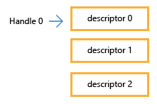
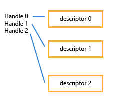

<a id="output-merger"></a>

# Output merger

The output merger determines depth/stencil visibility and updates the bound depth/stencil and color attachments. This chapter defines the output tests and updates, blending and logic operations, component/sample masks, dynamic output state, attachment binding and render passes.

This is a source-preserving draft. Explicit draft qualifications below identify unresolved source conflicts; source-only requirements are not claims of independent universal hardware verification.

[Pipeline state](pipeline-state.md#blend-state) owns blend/output descriptions, [depth/stencil descriptions](pipeline-state.md#depth-stencil) and PSO creation/validation. [Command-list state](command-list-state.md#output-bindings) owns defaults, reset and bundle inheritance. [Rasterization](rasterization.md#rasterization) owns geometric coverage, face determination, viewport transforms and sample patterns. The [pixel-shader stage](pixel-shaders.md#execution-control) owns shader execution, discard/helpers, the early/late testing interface, conservative depth, stencil export, ROV ordering and VRS execution.

[Formats and views](formats.md#view-descriptions), [resource flags](resources.md#resource-flags), [binding](binding.md#pipeline-compatibility), [lifetime](execution.md#lifetime) and [synchronization](synchronization.md#barrier-access) retain their respective contracts. Ordinary transfer/clear/resolve API entries are separate from render-pass access operations; their attachment interactions are specified [below](#clear-copy-resolve-interactions).

<a id="configuration"></a>

## Configuration and availability

Blend enable/factors/operations, logic enable/operation, color write masks, alpha-to-coverage, sample mask, depth/stencil functions/operations/write masks and depth-bounds enable are selected by the graphics PSO. `OMSetBlendFactor`, `OMSetStencilRef`, `OMSetFrontAndBackStencilRef` and `OMSetDepthBounds` set the dynamic values described here. There is no D3D11-style separately bound blend-state or depth/stencil-state object.

| Contribution | Required capability / supported path |
|---|---|
| Logic operations | `D3D12_FEATURE_DATA_D3D12_OPTIONS::OutputMergerLogicOp` |
| Shader stencil reference | `D3D12_FEATURE_DATA_D3D12_OPTIONS::PSSpecifiedStencilRefSupported`; [shader interface](pixel-shaders.md#stencil-reference) |
| Depth-bounds test | `D3D12_FEATURE_DATA_D3D12_OPTIONS2::DepthBoundsTestSupported`; `D3D12_DEPTH_STENCIL_DESC1` or `DESC2` |
| Scalar alpha blend factors | `D3D12_FEATURE_DATA_D3D12_OPTIONS13::AlphaBlendFactorSupported` |
| Independent front/back stencil references and masks | `D3D12_FEATURE_DATA_D3D12_OPTIONS14::IndependentFrontAndBackStencilRefMaskSupported`; `ID3D12GraphicsCommandList8::OMSetFrontAndBackStencilRef` and `D3D12_DEPTH_STENCIL_DESC2` |
| Render passes | `D3D12_FEATURE_DATA_D3D12_OPTIONS18::RenderPassesValid`; [tiers and driver handling](#render-pass-support) |
| Mismatching attachment dimensions | `D3D12_FEATURE_DATA_D3D12_OPTIONS19::MismatchingOutputDimensionsSupported` |
| Multisampling with no attachments | `D3D12_FEATURE_DATA_D3D12_OPTIONS19::SupportedSampleCountsWithNoOutputs`; [canonical PSO/rasterization contract](pipeline-state.md#no-output-samples) |
| Output formats and multisampling | Per-format `D3D12_FEATURE_FORMAT_SUPPORT` and `D3D12_FEATURE_MULTISAMPLE_QUALITY_LEVELS`; [format capabilities](formats.md#support) |

Optional capability fields are not interchangeable with interface availability, feature level, shader model or render-pass acceleration tier.

<a id="depth-stencil"></a>

## Depth and stencil tests and updates

The [depth/stencil PSO descriptions](pipeline-state.md#depth-stencil) define `DepthEnable`, `DepthWriteMask`, `DepthFunc`, `StencilEnable`, front/back stencil operations and masks, and `DepthBoundsTestEnable` in the extended descriptions. `D3D12_DEPTH_STENCIL_DESC` and `DESC1` use shared front/back read and write masks; `DESC2` places `StencilReadMask` and `StencilWriteMask` in each `D3D12_DEPTH_STENCILOP_DESC1`. Face selection follows [rasterization orientation](rasterization.md#front-face).

<a id="depth-stencil-enable"></a>

### Enable controls

DepthEnable and StencilEnable are overall enable/disable controls for the depth and stencil processing
portions of the output merger.  When DepthEnable is false, depth test and depth buffer write are not performed, regardless
of any other settings.  When StencilEnable is false, the stencil test and stencil buffer write are not performed,
regardless of any other settings.  When DepthEnable is false but StencilEnable is true, the depth test always
passes when incorporated into the stencil operation.

Note that DepthEnable is limited in scope to the output merger area - in particular it does not affect functionality
such as clipping, depth bias, or clamping that occurs to depth prior to input to the pixel shader.

<a id="depth-clamp"></a>

### Depth clamp

Depth values that reach the Output Merger, whether coming from interpolation or from Pixel Shader output (replacing the interpolated z),
are always clamped: `z = min(max(Viewport.MinDepth,Viewport.MaxDepth), max(min(Viewport.MinDepth,Viewport.MaxDepth),z))` following the [Floating Point Rules](../archive/D3D11_3_FunctionalSpec.htm#FloatingPointRules) for
min/max.  The MinDepth and MaxDepth values are defined by the [Viewport](rasterization.md#viewport-transform).

<a id="depth-comparison"></a>

### Depth comparison

When the DepthEnable state is true and a Depth Buffer is bound at the Output Merger, the [clamped](#depth-clamp) z value
gets converted to the format/precision of the Depth Buffer (nop if the Depth Buffer format is float32), and is then compared using
DepthFunc against the corresponding Depth Buffer value.  The conversion of z to Depth Buffer precision uses round to nearest (+0.5 and truncate).
If no Depth Buffer is bound, the depth test always passes.

For depth, the source operand of `DepthFunc` is the incoming converted depth and the destination operand is the stored depth. For stencil, the source and destination operands are the masked reference and masked stored stencil respectively. Passing both enabled tests permits the applicable depth/color updates; stencil fail/depth-fail/pass operations have the separate update selection below. A disabled depth test does not disable stencil.

| Constant | Value | Behavior |
|---|---|---|
| `D3D12_COMPARISON_FUNC_NEVER` | 1 | Never pass the comparison. |
| `D3D12_COMPARISON_FUNC_LESS` | 2 | If the source data is less than the destination data, the comparison passes. |
| `D3D12_COMPARISON_FUNC_EQUAL` | 3 | If the source data is equal to the destination data, the comparison passes. |
| `D3D12_COMPARISON_FUNC_LESS_EQUAL` | 4 | If the source data is less than or equal to the destination data, the comparison passes. |
| `D3D12_COMPARISON_FUNC_GREATER` | 5 | If the source data is greater than the destination data, the comparison passes. |
| `D3D12_COMPARISON_FUNC_NOT_EQUAL` | 6 | If the source data is not equal to the destination data, the comparison passes. |
| `D3D12_COMPARISON_FUNC_GREATER_EQUAL` | 7 | If the source data is greater than or equal to the destination data, the comparison passes. |
| `D3D12_COMPARISON_FUNC_ALWAYS` | 8 | Always pass the comparison. |

<a id="stencil"></a>

### Stencil

When the StencilEnable state is true and a Depth Buffer having Stencil bits is bound at the Output Merger, a long list
of states is used to drive stencil testing (the ones with 'Stencil' in the name in the depth/stencil PSO description).  If there is no stencil component in the
Depth Buffer format, or no Depth Buffer bound, then the stencil test always passes.

Stencil storage is eight bits in the supported depth/stencil formats. The applicable front/back description supplies `StencilFunc`, `StencilFailOp`, `StencilDepthFailOp`, `StencilPassOp` and the read/write masks. The selected reference is the face's dynamic reference, except where the [pixel-shader stencil-reference interface](pixel-shaders.md#stencil-reference) replaces it. The shader replacement affects both testing and `REPLACE`, not a separate unmasked store. [Forced-early tests](pixel-shaders.md#early-depth-stencil) use the early interface instead of late depth/stencil exports.

For each covered sample, the output merger performs a test using the corresponding value in the stencil buffer, a stencil reference value, and a stencil mask value. If the test passes, Direct3D performs an action. The test is performed using the following steps.

1. Perform a bitwise AND operation of the stencil reference value with the stencil mask.
2. Perform a bitwise AND operation of the stencil buffer value for the current pixel with the stencil mask.
3. Compare the result of step 1 to the result of step 2, using the comparison function.

These steps are shown in the following code example.

```
(StencilRef & StencilMask) CompFunc (StencilBufferValue & StencilMask)
```

In this algorithm, `StencilMask` means the applicable `StencilReadMask`, `StencilBufferValue` is the stored eight-bit stencil value, and `CompFunc` is `StencilFunc`. The reference participates in the test through its stencil bits; increment/decrement/invert operate on the stored value, not the read-masked value.

`StencilFailOp`

A [D3D12_STENCIL_OP](https://learn.microsoft.com/en-us/windows/desktop/api/d3d12/ne-d3d12-d3d12_stencil_op)-typed value that identifies the stencil operation to perform when stencil testing fails.

`StencilDepthFailOp`

A [D3D12_STENCIL_OP](https://learn.microsoft.com/en-us/windows/desktop/api/d3d12/ne-d3d12-d3d12_stencil_op)-typed value that identifies the stencil operation to perform when stencil testing passes and depth testing fails.

`StencilPassOp`

A [D3D12_STENCIL_OP](https://learn.microsoft.com/en-us/windows/desktop/api/d3d12/ne-d3d12-d3d12_stencil_op)-typed value that identifies the stencil operation to perform when stencil testing and depth testing both pass.

| Constant | Value | Behavior |
|---|---|---|
| `D3D12_STENCIL_OP_KEEP` | 1 | Keep the existing stencil data. |
| `D3D12_STENCIL_OP_ZERO` | 2 | Set the stencil data to 0. |
| `D3D12_STENCIL_OP_REPLACE` | 3 | Set the stencil data to the reference value set by calling [ID3D12GraphicsCommandList::OMSetStencilRef](#omsetstencilref). |
| `D3D12_STENCIL_OP_INCR_SAT` | 4 | Increment the stencil value by 1, and clamp the result. |
| `D3D12_STENCIL_OP_DECR_SAT` | 5 | Decrement the stencil value by 1, and clamp the result. |
| `D3D12_STENCIL_OP_INVERT` | 6 | Invert the stencil data. |
| `D3D12_STENCIL_OP_INCR` | 7 | Increment the stencil value by 1, and wrap the result if necessary. |
| `D3D12_STENCIL_OP_DECR` | 8 | Decrement the stencil value by 1, and wrap the result if necessary. |

```
NewStencilBufferValue = (StencilBufferValue & ~StencilWriteMask) |
                        (StencilWriteMask & StencilOp(StencilBufferValue))
```

`StencilOp` in the write equation is the selected fail/depth-fail/pass operation. The result is merged with the previous stored value using `StencilWriteMask`; bits disabled by this mask retain their previous values. Saturating increment/decrement clamp at 255/0, and wrapping increment/decrement wrap modulo 256. Stencil read-only view flags suppress the write independently of the selected operation and write mask.

<a id="independent-stencil"></a>

### Independent front/back references and masks

D3D12 supports assigning reference and mask values independently for front-face and back-face stencil operations. `D3D12_DEPTH_STENCIL_DESC2` provides per-face read and write masks, and `ID3D12GraphicsCommandList8::OMSetFrontAndBackStencilRef` sets the two reference values.

Independent references and independent masks require `IndependentFrontAndBackStencilRefMaskSupported`. `OMSetStencilRef` continues to set a common reference for both faces. The read/write masks remain PSO fields; they are not changed by either reference setter. [Initial/reset values and bundle persistence](command-list-state.md#stencil-references) are defined by command-list state.

<a id="depth-bounds"></a>

### Depth-bounds testing

This feature allows a programmer to discard pixels (or samples) based
on a minimum and maximum depth value: if the current depth value in
the depth buffer is inclusively within the specified range, then the
pixel (or sample) has passed the Depth Bounds Test and is rendered,
otherwise the pixel (or sample) has failed the Depth Bounds Test and
is discarded. It is important to note that this feature is independent
of the depth output by a given pixel shader invocation: only the
currently stored depth value and the programmer-specified Depth Bounds
values are relevant.

`DepthBoundsTestEnable` is selected by the PSO; `OMSetDepthBounds` sets the minimum and maximum floating-point depth bounds. The runtime will not clamp or validate the input, but
implementations may clamp to the range \[0,1\] if necessary. NaNs must
be treated as 0, but the runtime will convert NaNs to 0 on behalf of
the implementation. If the range is inverted (i.e. min > max), then
implementations must treat the Depth Bounds Test as always failing.

Any Pixel Shader invocation that fails the Depth Bounds Test (i.e.
whose stored depth buffer value falls exclusively outside the Depth
Bounds range) cannot affect the render target, depth, or stencil
buffer. However, UAV writes by a pixel shader invocation that fails
the Depth Bounds Test are determined by the ForceEarlyDepthStencil
flag. When the ForceEarlyDepthStencil flag is present an
implementation must perform the Depth/Stencil tests, the Depth Bounds
Test, and Depth/Stencil writes before executing the Pixel Shader,
which prohibits any external effects (e.g. UAV writes) from the Pixel
Shader invocation. In the absence of the ForceEarlyDepthStencil flag
an implementation may perform optimizations, but must appear to have
executed the Depth/Stencil Tests and Depth Bounds Test after the Pixel
Shader invocation and must reflect any memory updates (e.g. oDepth and
UAV writes) performed by the invocation. Note that while a Pixel
Shader invocation's oDepth is honored in the absence of the
ForceEarlyDepthStencil flag, the Depth Bounds Test for a given Pixel
Shader invocation does not use the depth written by that invocation:
it uses the current depth buffer value prior to its own writes.

When a depth buffer is not bound (e.g. with [target-independent rasterization](rasterization.md#target-independent)), the Depth
Bounds Test must always pass. This is consistent with the behavior of
the Depth Test in this configuration.

Depth-bounds range initialization, reset and bundle inheritance are defined in [command-list state](command-list-state.md#depth-bounds). The [occlusion](counters-queries-and-predication.md#occlusion) and [pipeline-statistics](counters-queries-and-predication.md#pipeline-statistics) definitions govern query counting, including their depth-bounds/early-test interactions; depth-bounds rejection is not a blanket rule that a shader invocation or its UAV side effects never occurred.

<a id="read-only-depth-stencil"></a>

### Read-only depth/stencil views

<a id="read-only-view-controls"></a>

#### Read-only write controls

Applications can indicate to the system that a depth and/or stencil buffer bound at the Output Merger (OM) is read-only, via flags in the DepthStencilView (DSV).

Having a read-only DSV bound at the OM enables ShaderResourceViews (SRVs) of the same depth/stencil buffer memory to be bound as shader input simultaneously,
without risk of a read/write hazard on the memory.   Further, this mechanism can be made to cooperate with existing mechanisms for controlling OM depth buffer read/write behavior,
while enabling the system to efficiently notice there is no read/write hazard to worry about in the face of high frequency state changes encountered in Draw*() scenarios.


To determine whether depth writing is enabled, D3D12 hardware must AND together the following two pieces of information
(where a result of 0 means writes to depth must be forced off):

(1) The PSO depth/stencil description has depth write enabled.

(2) The D3D12_DSV_FLAG_READ_ONLY_DEPTH flag must NOT be set in the currently bound DSV.

Similarly, to determine if stencil writing is enabled, D3D12 hardware must AND together the following two pieces of information
(where a result of 0 means writes to stencil must be forced off):

(1)    The PSO depth/stencil description has stencil writes enabled via the selected stencil operation and write mask.

(2)    The D3D12_DSV_FLAG_READ_ONLY_STENCIL flag must NOT be set in the currently bound DSV.

The descriptor flags are `D3D12_DSV_FLAG_READ_ONLY_DEPTH = 0x1` and `D3D12_DSV_FLAG_READ_ONLY_STENCIL = 0x2`. They control the corresponding aspect independently. A zero PSO write mask alone does not replace a read-only view flag for simultaneous shader-resource/depth-stencil binding. The [DSV definition](formats.md#dsv-types), [depth/stencil view compatibility](formats.md#depth-stencil-views), [legacy depth read/write states](synchronization.md#legacy-resource-states) and [enhanced access/layout rules](synchronization.md#barrier-access) apply; D3D12 does not insert D3D11-style automatic hazard unbinding. Render-pass read-only binding adds the [pass flags and access conditions](#read-only-depth-stencil-pass).

<a id="blending"></a>

## Color blending and logic operations

[Blend/output PSO descriptions](pipeline-state.md#blend-state) declare `D3D12_BLEND_DESC`, `D3D12_RENDER_TARGET_BLEND_DESC`, `D3D12_BLEND`, `D3D12_BLEND_OP` and the output-format array. When `IndependentBlendEnable` is false, `RenderTarget[0]` applies to all active color attachments; when true, each attachment uses its own blend description. `BlendEnable` and `LogicOpEnable` must not both be true. Color and alpha use separate source factors, destination factors and operations.

<a id="blend-factors"></a>

### Blend factors

| Constant | Value | Behavior |
|---|---|---|
| `D3D12_BLEND_ZERO` | 1 | The blend factor is (0, 0, 0, 0). No pre-blend operation. |
| `D3D12_BLEND_ONE` | 2 | The blend factor is (1, 1, 1, 1). No pre-blend operation. |
| `D3D12_BLEND_SRC_COLOR` | 3 | The blend factor is (Rₛ, Gₛ, Bₛ, Aₛ), that is color data (RGB) from a pixel shader. No pre-blend operation. |
| `D3D12_BLEND_INV_SRC_COLOR` | 4 | The blend factor is (1 - Rₛ, 1 - Gₛ, 1 - Bₛ, 1 - Aₛ), that is color data (RGB) from a pixel shader. The pre-blend operation inverts the data, generating 1 - RGB. |
| `D3D12_BLEND_SRC_ALPHA` | 5 | The blend factor is (Aₛ, Aₛ, Aₛ, Aₛ), that is alpha data (A) from a pixel shader. No pre-blend operation. |
| `D3D12_BLEND_INV_SRC_ALPHA` | 6 | The blend factor is ( 1 - Aₛ, 1 - Aₛ, 1 - Aₛ, 1 - Aₛ), that is alpha data (A) from a pixel shader. The pre-blend operation inverts the data, generating 1 - A. |
| `D3D12_BLEND_DEST_ALPHA` | 7 | The blend factor is (Ad Ad Ad Ad), that is alpha data from a render target. No pre-blend operation. |
| `D3D12_BLEND_INV_DEST_ALPHA` | 8 | The blend factor is (1 - Ad 1 - Ad 1 - Ad 1 - Ad), that is alpha data from a render target. The pre-blend operation inverts the data, generating 1 - A. |
| `D3D12_BLEND_DEST_COLOR` | 9 | The blend factor is (Rd, Gd, Bd, Ad), that is color data from a render target. No pre-blend operation. |
| `D3D12_BLEND_INV_DEST_COLOR` | 10 | The blend factor is (1 - Rd, 1 - Gd, 1 - Bd, 1 - Ad), that is color data from a render target. The pre-blend operation inverts the data, generating 1 - RGB. |
| `D3D12_BLEND_SRC_ALPHA_SAT` | 11 | The blend factor is (f, f, f, 1); where f = min(Aₛ, 1 - Ad). The pre-blend operation clamps the data to 1 or less. |
| `D3D12_BLEND_BLEND_FACTOR` | 14 | The blend factor is the blend factor set with [ID3D12GraphicsCommandList::OMSetBlendFactor](#omsetblendfactor). No pre-blend operation. |
| `D3D12_BLEND_INV_BLEND_FACTOR` | 15 | The blend factor is the blend factor set with [ID3D12GraphicsCommandList::OMSetBlendFactor](#omsetblendfactor). The pre-blend operation inverts the blend factor, generating 1 - blend\_factor. |
| `D3D12_BLEND_SRC1_COLOR` | 16 | The blend factor is color data from pixel-shader output o1. There is no pre-blend operation. This blend factor supports dual-source color blending. |
| `D3D12_BLEND_INV_SRC1_COLOR` | 17 | The blend factor is color data from pixel-shader output o1. The pre-blend operation inverts the data, generating 1 - RGB. This blend factor supports dual-source color blending. |
| `D3D12_BLEND_SRC1_ALPHA` | 18 | The blend factor is alpha data from pixel-shader output o1. There is no pre-blend operation. This blend factor supports dual-source color blending. |
| `D3D12_BLEND_INV_SRC1_ALPHA` | 19 | The blend factor is alpha data from pixel-shader output o1. The pre-blend operation inverts the data, generating 1 - A. This blend factor supports dual-source color blending. |
| `D3D12_BLEND_ALPHA_FACTOR` | 20 | The blend factor is (A, A, A, A), where the constant, A, is taken from the blend factor set with [OMSetBlendFactor](#omsetblendfactor). To successfully use this constant on a target machine, the [D3D12_FEATURE_DATA_D3D12_OPTIONS13](https://learn.microsoft.com/en-us/windows/win32/api/d3d12/ns-d3d12-d3d12_feature_data_d3d12_options13) returned from [capability querying](https://learn.microsoft.com/en-us/windows/win32/direct3d12/capability-querying) must have its *AlphaBlendFactorSupported* set to `TRUE`. |
| `D3D12_BLEND_INV_ALPHA_FACTOR` | 21 | The blend factor is (1 – A, 1 – A, 1 – A, 1 – A), where the constant, A, is taken from the blend factor set with [OMSetBlendFactor](#omsetblendfactor). To successfully use this constant on a target machine, the [D3D12_FEATURE_DATA_D3D12_OPTIONS13](https://learn.microsoft.com/en-us/windows/win32/api/d3d12/ns-d3d12-d3d12_feature_data_d3d12_options13) returned from [capability querying](https://learn.microsoft.com/en-us/windows/win32/direct3d12/capability-querying) must have its *AlphaBlendFactorSupported* set to `TRUE`. |

For each color component, `S` denotes the pixel-shader output and `D` the existing render-target value. `SrcBlend` and `DestBlend` select the factors for RGB; `SrcBlendAlpha` and `DestBlendAlpha` select the factors for alpha. `ADD` computes `S*SrcFactor + D*DestFactor`, `SUBTRACT` computes `S*SrcFactor - D*DestFactor`, and `REV_SUBTRACT` computes `D*DestFactor - S*SrcFactor`. `MIN` and `MAX` operate directly on `S` and `D`, ignoring the four factor selections; precision and exceptional-value behavior follow the [blending-specific requirements](#blending-precision). These equations do not override the blender's NaN and signed-zero requirements, including the stated zero-weight cases.

<a id="alpha-factors"></a>

### Alpha-factor restrictions

```cpp

    D3D12_BLEND_ZERO
    D3D12_BLEND_ONE
    D3D12_BLEND_SRC_ALPHA
    D3D12_BLEND_INV_SRC_ALPHA
    D3D12_BLEND_DEST_ALPHA
    D3D12_BLEND_INV_DEST_ALPHA
    D3D12_BLEND_SRC_ALPHA_SAT
    D3D12_BLEND_BLEND_FACTOR
    D3D12_BLEND_INV_BLEND_FACTOR
    D3D12_BLEND_SRC1_ALPHA
    D3D12_BLEND_INV_SRC1_ALPHA

```

The alpha blend factors above exclude the `_COLOR` factor selections. `D3D12_BLEND_ALPHA_FACTOR` and `D3D12_BLEND_INV_ALPHA_FACTOR` also select a scalar alpha factor, with the capability requirement in [configuration](#configuration). Their command-list constant is the alpha component set by `OMSetBlendFactor`.

Support for the alpha blend factor is implied by, and must be supported on, drivers that report their DDI version to be `e_DDI_12_8_0092` or greater.

<a id="independent-blending"></a>

### Multiple render targets

Fixed-function blend can be enabled and configured independently for each RenderTarget.

<a id="srgb-blending"></a>

### sRGB blending

The blender must be able to write in accordance with sRGB rules for formats which include _SRGB in the name,
for example: R8G8B8A8_UNORM_SRGB.

The [format conversion rules](formats.md#modifiers) define sRGB decoding and encoding: color blending uses linear values, with conversion back to the sRGB render-target representation on output. Alpha is not sRGB encoded.

<a id="blending-precision"></a>

### Blending precision

All Output Merger math/blending operations with floating point RenderTarget(s) (regardless of format size)
must honor the [Floating Point Rules](../archive/D3D11_3_FunctionalSpec.htm#FloatingPointRules), although
operations are considered to be "fused", and reordering is permitted, outside of application control.

NaNs and signed zeros must be propagated by blending hardware for all cases (including 0.0 blend weights).

Values entering Blending Hardware, including the BlendFactor value, are always clamped to the range of the
RenderTarget before being used in the Blend.
Components not present in the format must be clamped to the minimum range of all the components that are present.
e.g. with the format R8G8_UNORM, the components B,A entering the blending hardware get clamped to the same range as R,G, which would be [0..1].

Note that this clamping must be done on a per-rendertarget basis,
so if one render target is a float type and another is UNORM type, the shader values and blend factor must be
float range for the float render target Blend, and clamped to 0..1 for the UNORM render target Blend.

An exception is float16, float11, float10 or R9G9B9E5 RenderTargets, where it is permitted
for implementations to not clamp data going into the blend.  So it is required that blend operations on these formats be
done with at least equal precision/range as the output format but an implementation can choose to perform blending with
precision/range (up to float32).

When a RenderTarget has a fixed point format, as stated above, implementations are required to clamp data going into
Blending to the RenderTarget format range, however blending operations may be performed at equal or more (e.g up to float32) precision/range than
the output format.  For SNORM data, intermediate operations such as (1-x) are performed without clamping [-1..1], though input to and output from blending are still clamped.

For fixed point formats with components having fewer than 8 bits (e.g. DXGI_FORMAT_B5G6R5_UNORM), the allowance above that blending operations may be performed
at equal or more precision than the output format applies even if blending is disabled.  That is, the hardware may or may not upconvert to some intermediate precision level,
say 8 bit, even if blending is off, before converting down to the final output format precision (say 5 bit).

For all formats, there is a clamp to the RenderTarget range after blend, before writing values out to memory.

<a id="dual-source-blending"></a>

### Dual-source blending

This feature enables Output Merger to use both the Pixel Shader
outputs o0 and o1 simultaneously as input sources to a blending operation
with the single RenderTarget at slot 0.

Additional options are available for the SrcBlend, DestBlend, SrcBlendAlpha or DestBlendAlpha
terms in the Blend equation.  The presence of any of the following choices in the Blend equation
means that Dual Source Color Blending is enabled:

```cpp

        D3D12_BLEND_SRC1_COLOR
        D3D12_BLEND_INV_SRC1_COLOR
        D3D12_BLEND_SRC1_ALPHA
        D3D12_BLEND_INV_SRC1_ALPHA

```

When Dual Source Color Blending is enabled, the Pixel Shader must have only
a single RenderTarget bound, at slot 0, and must output both o0 and o1.  Writing
to other outputs (o2, o3 etc.) produces undefined results for the corresponding RenderTargets, if bound
illegally. Writing oDepth is valid when performing Dual Source Color Blending.

The only valid blend ops with Dual Source Color Blending are: add, subtract and revsubtract.  Others are undefined.

The configured blend equation and the
[Output Write Mask](#write-masks) at slot 0 imply exactly which
components from Pixel Shader outputs o0 and o1 must be present. If expected output components are not present,
results are undefined. If extra components in o0 or o1 are output, they are ignored.

Examples:

There are times when a Shader computes 2 results that are useful on a single pass,
    but needs to combine one into the destination with a multiply and the other in
    with an add.  This would look like:

```cpp

        SrcFactor = D3D12_BLEND_ONE;
        DestFactor = D3D12_BLEND_SRC1_COLOR;

```

Next is a Blend mode setup that takes PS output color o0 as src color,
     and uses PS output color o1 to blend with the destination color.
     i.e. o1 is used as per-color component blend factor.

```cpp

        SrcFactor = D3D12_BLEND_SRC1_COLOR;
        DestFactor = D3D12_BLEND_INV_SRC1_COLOR;

```

Example illustrating expected outputs from the Pixel Shader:

```cpp

    SrcFactor = D3D12_BLEND_SRC1_ALPHA;
    DestFactor = D3D12_BLEND_SRC_COLOR;
    OutputWriteMask[0] = .ra; // pseudocode for setting the mask at
                              // RenderTarget slot 0 to .ra

```

Together, these imply that the Pixel Shader is required to output at least o0.ra and o1.a.
Extra output components would be ignored, and fewer components would produce undefined results.

<a id="logic-operations"></a>

### Logic operations

Logic operations combine pixel-shader output and render-target bits rather than performing floating-point blending. `OutputMergerLogicOp` is the device capability. A logic-enabled description requires `IndependentBlendEnable = FALSE` and `BlendEnable = FALSE`; `RenderTarget[0].LogicOp` then applies to the active render targets. All active render targets used for logic operations must use renderable UINT formats.

```cpp
typedef enum D3D12_LOGIC_OP
{
                                   // Operation: (s == PS output, d = RTV contents)
    D3D12_LOGIC_OP_CLEAR = 0,      // 0
    D3D12_LOGIC_OP_SET,            // 1
    D3D12_LOGIC_OP_COPY,           // s
    D3D12_LOGIC_OP_COPY_INVERTED,  // ~s
    D3D12_LOGIC_OP_NOOP,           // d
    D3D12_LOGIC_OP_INVERT,         // ~d
    D3D12_LOGIC_OP_AND,            // s & d
    D3D12_LOGIC_OP_NAND,           // ~(s & d)
    D3D12_LOGIC_OP_OR,             // s | d
    D3D12_LOGIC_OP_NOR,            // ~(s | d)
    D3D12_LOGIC_OP_XOR,            // s ^ d
    D3D12_LOGIC_OP_EQUIV,          // ~(s ^ d)
    D3D12_LOGIC_OP_AND_REVERSE,    // s & ~d
    D3D12_LOGIC_OP_AND_INVERTED,   // ~s & d
    D3D12_LOGIC_OP_OR_REVERSE,     // s | ~d
    D3D12_LOGIC_OP_OR_INVERTED,    // ~s | d
};
```

Logic ops are supported only on renderable UINT formats.  Implementations that expose Logic Ops support must support them for all renderable UINT formats.

Ideally, the number of bits per component in the output format indicates how many bits from the corresponding Pixel Shader
output component are used, starting from the LSB of the PS output (e.g. 8 bits per component from LSB used for R8G8B8A8).

For now, it is allowed for hardware to clamp the shader output as a UINT to the number of bits in the format, e.g. for an 8-bit output format
component, the value 0x100 coming out of the shader turns into 0xff going into the Logic Op.  Ideal hardware would just take the
bottom 8 bits, 0x00.

So applications using Logic Op must zero out bits above the number of bits in the output format to guarantee consistent behavior
across all hardware.

**Draft qualification — logic input narrowing:** the retained low-bit-versus-clamp allowance describes the inherited hardware contract. It has not been independently established for every currently supported device. No stronger truncation-only guarantee is inferred from the API enum declaration.

<a id="attachments"></a>

## Attachments and output masks

<a id="multiple-render-targets"></a>

### Attachment compatibility

It is required that the Pixel Shader be able to simultaneously render to at least
8 separate RenderTargets.  Without `MismatchingOutputDimensionsSupported`, the bound output views must have compatible resource dimensions and equal effective width, height and array/depth extents. The capability-dependent rules below replace these dimensional restrictions where supported.
If Multisample Antialiasing is being used, all bound RenderTargets and Depth Buffer must be
the same form of Multisample Resources (i.e.  the sample counts must be the same).
Each RenderTarget may have a different data format; there are no requirements that the
formats have identical bit-per-Element counts.

Any combination of the 8 slots for
RenderTargets can have a RenderTarget set or not set.

The same resource view cannot be bound to multiple simultaneous RenderTarget slots
simultaneously.  Note that setting multiple non-overlapping resource views of a single
resource as simultaneous multiple rendertargets is supported.

<a id="mismatching-output-dimensions"></a>

### Mismatching output dimensions

The complete [mixed-output dimension contract](rasterization.md#output-dimensions) defines the buffer restriction, effective 2D interpretation of 1D/3D views, equal-dimension implicit scissor intersection, mismatched-dimension smallest-output bounds and possible undefined results including GPU faults, and differing array-size out-of-range behavior. Those rules apply to the attachments bound by the APIs here.

The linked dimensional relaxations require `MismatchingOutputDimensionsSupported`. The public driver contract requires this feature for DDI version 0102 or greater. `SupportedSampleCountsWithNoOutputs` separately controls [sample-frequency rendering without attachments](rasterization.md#no-output-samples); it does not waive the matching sample-count requirement when attachments are bound. PSO formats/sample configuration must be compatible with the views actually bound for rasterization.

<a id="write-masks"></a>

### Output write masks

The [declared-output rule](pixel-shaders.md#output-writes) applies before the write masks: if an o# register has no components declared for output, the corresponding render target is not modified, regardless of write masks or blend modes.

The Output Write Masks control on a per-RenderTarget, per-component level what data gets written
to the RenderTarget(s) (assuming all other conditions passed, such as depth/stencil, and the pixel
wasn't discarded).  For a register with declared output components, failure to provide sufficient data to the Output Merger for all of the
RenderTarget(s)/component(s) enabled with the write masks results in undefined values being
written out.  See the discussion of [Output Writes](pixel-shaders.md#output-writes) for
further detail on the interaction between Pixel Shader outputs and the Output Write masks.

Note that the Output Write Masks do not affect what data may get read from the RenderTarget(s)
in the process of performing Blend operations specified in the Output Merger, depending on the operation
specified.  The masks simply limit writes.

<a id="depth-with-mrt"></a>

### Depth/stencil with multiple outputs

There can only be one Depth/Stencil buffer active, regardless of how many
RenderTargets are active.  Of course if Depth/Stencil is not being used, a Depth/Stencil buffer need not be bound.

`RenderTargetWriteMask` is the bitwise OR of the applicable `D3D12_COLOR_WRITE_ENABLE` values. These bits gate stores, not blend reads. Depth writes additionally require depth testing enabled, passing applicable tests, `D3D12_DEPTH_WRITE_MASK_ALL` and a non-read-only depth aspect. Stencil updates use the selected operation and its mask as described [above](#stencil). `DXGI_FORMAT_R9G9B9E5_SHAREDEXP` has the [shared-exponent format's all-or-none color write-mask requirement](formats.md#shared-exponent-support); its render-target/blend availability is separately format-gated.

| Constant | Value | Behavior |
|---|---|---|
| `D3D12_COLOR_WRITE_ENABLE_RED` | 1 | Allow data to be stored in the red component. |
| `D3D12_COLOR_WRITE_ENABLE_GREEN` | 2 | Allow data to be stored in the green component. |
| `D3D12_COLOR_WRITE_ENABLE_BLUE` | 4 | Allow data to be stored in the blue component. |
| `D3D12_COLOR_WRITE_ENABLE_ALPHA` | 8 | Allow data to be stored in the alpha component. |
| `D3D12_COLOR_WRITE_ENABLE_ALL` | 15 | Allow data to be stored in all components. |

<a id="sample-mask"></a>

### Sample mask

SampleMask is a 32-bit coverage mask applied to the Multisample coverage
for a primitive to determine which samples get updated in all the active Rendertargets.  There is only one
coverage shared for all RenderTargets in Multisampling.  SampleMask is always applied, regardless of whether
Multisample rendertargets are bound or not.  For n-sample rendering, the
first n bits of SampleMask from the LSB are used to mask the coverage.  n can be from 1 to 32,
depending on the multisample mode used (out of the selection of modes offered by the individual hardware implementation).

`SampleMask` is PSO state, not a dynamic `OMSetBlendState` parameter. The [rasterization sample-index/pattern contract](rasterization.md#sample-patterns) defines the spatial interpretation, including standard/center and [programmable patterns](rasterization.md#programmable-samples). Pixel-shader [input/output coverage](pixel-shaders.md#output-coverage) and [early/late testing](pixel-shaders.md#execution-control) determine when a candidate survives; final color updates require the corresponding coverage, mask and tests. Forced-early depth/stencil updates have the separately defined pre-shader timing and are not undone by later shader discard/coverage.

<a id="alpha-to-coverage"></a>

### Alpha-to-coverage

The [Blend State](#blending) bool AlphaToCoverageEnable toggles whether the .a component of output register o0 from the Pixel Shader
is converted to an n-step coverage mask (given an n-sample RenderTarget).  This mask is ANDed with the
usual sample coverage for the pixel in the primitive (in addition to SampleMask) to determine which samples get updated in all the active
RenderTarget(s).

If the Pixel Shader outputs [oMask (output coverage)](../archive/D3D11_3_FunctionalSpec.htm#oMask), Alpha-to-Coverage is disabled.

Note that there is only one coverage shared for all RenderTargets in Multisampling.  The fact that .a
from output o0 is read and converted to coverage when AlphaToCoverageEnable is true does not change the .a value going to
the Blender at RenderTarget 0 (if a RenderTarget happens to be set there).  In general, enabling Alpha-to-Coverage is completely orthogonal
to how all color outputs from Pixel Shaders interact with RenderTarget(s) through Output Merger Stage, EXCEPT the addition
that the coverage mask is ANDed with the Alpha-to-Coverage mask.  Alpha-to-coverage works orthogonally to whether
the RenderTarget is blendable or not (or whether blending is being used on it).

There is no precise specification of exactly how Pixel Shader o0.a (alpha) gets converted to a coverage mask by the hardware, except that alpha
of 0 (or less) must map to no coverage and alpha of 1 (or greater) must map to full coverage (before ANDing with actual primitive coverage).
As alpha goes from 0 to 1, the resulting coverages should generally increase monotonically, however hardware may or
may not perform area dithering to provide some better quantization of alpha values at the cost of spatial resolution and
noise. An alpha value of NaN results in a no coverage (zero) mask.

Alpha-to-coverage is traditionally used for screen-door transparency or defining detailed silhouettes
for otherwise opaque sprites.

<a id="output-ordering"></a>

### Output ordering

Output-merger tests, blending/logic operations and attachment updates preserve the ordering of overlapping primitives established by [primitive retirement](vertex-processing.md#geometry-view-ordering) and [mesh rasterization order](amplification-and-mesh-shaders.md#rasterization-order). This is not a requirement that pixel shaders execute in primitive order. Ordinary UAV side effects do not obtain framebuffer ordering merely because they are issued by a pixel shader; [ROV overlap ordering](pixel-shaders.md#rov-ordering) has its own precise shader contract. Barriers and inter-command-list/queue dependencies retain their [synchronization](synchronization.md#foundations) requirements.

<a id="clear-copy-resolve-interactions"></a>

### Clear, copy and resolve interactions

The complete ordinary [clear](resource-operations.md#clear-commands), [copy](resource-operations.md#copy-commands), [resolve](resource-operations.md#resolve-commands) and [discard](resource-operations.md#discard-commands) API entries define their independent destinations and recording/format requirements. Render-pass access operations and the read-only-view interaction here remain separately defined.

`ClearRenderTargetView` and `ClearDepthStencilView` are descriptor-addressed clear operations, not draws. They are not controlled by the currently bound PSO color/depth/stencil write masks, blend state or sample mask. Depth/stencil clear aspect selection comes from the clear flags. Scissor state does not replace the clear rectangles. This does not legalize a clear during an active render pass: [pass recording restrictions](#render-pass-recording) apply, and pass `CLEAR` accesses are specified [below](#d3d12_render_pass_beginning_access_clear).

Copies/resolves address their own resources/subresources, not the currently bound RTV/DSV set. A read-only output view is not a resource-wide prohibition on a later write through another valid operation/view; the operation still requires the appropriate resource access/layout/state, lifetime and view/format compatibility.

The canonical programmed-pattern interactions are [render-target clear](rasterization.md#sample-clear-rendertarget), [depth/stencil clear](rasterization.md#sample-clear-depthstencil), [render-target draw](rasterization.md#sample-draw-using-rendertarget), [depth/stencil draw](rasterization.md#sample-draw-using-depthstencil), [color resolve](rasterization.md#sample-resolve-rendertarget), [depth/stencil resolve](rasterization.md#sample-resolve-depthstencil), [color copy](rasterization.md#sample-copy-rendertarget), [full depth/stencil copy](rasterization.md#sample-copy-depthstencil-full-subresource), [partial depth/stencil copy](rasterization.md#sample-copy-depthstencil-partial-subresource), and [depth-state transitions](rasterization.md#sample-transitioning-out-of-depth_read-or-depth_write-state). In particular, color operations work on stored samples while depth operations retain their stated sample-position consistency requirements; stencil-only operations have the stated exceptions. Ordinary transfer API declarations remain separate; the resolve-mode meanings needed for pass ending accesses are included in [resolve parameters](#render-pass-resolve-modes).

`ClearDepthStencilView` must not clear an aspect marked read-only in the descriptor passed to that call. In particular, `D3D12_CLEAR_FLAG_DEPTH` is invalid when that DSV has `D3D12_DSV_FLAG_READ_ONLY_DEPTH`, and `D3D12_CLEAR_FLAG_STENCIL` is invalid when it has `D3D12_DSV_FLAG_READ_ONLY_STENCIL`. This is invalid usage, not a request to silently suppress the clear.

The runtime cannot enforce this restriction. The debug layer must report an error for a violating clear; a missing diagnostic is a validation defect, not permission to clear through the read-only view.

<a id="output-apis"></a>

## Attachment binding and dynamic output APIs

The binding and dynamic setter entries below use their declaring interfaces; inherited availability does not create additional methods on derived interfaces. `OMSetRenderTargets` is supported on direct command lists, not bundles. The dynamic blend-factor, stencil-reference and depth-bounds setters are supported on direct command lists and bundles, subject to the exact [state inheritance/reset rules](command-list-state.md#recording-boundaries). Render-pass begin/end are direct-list recording operations, not bundle setters. State setters and render-pass wrapper/work effects retain the [predication operation matrix](counters-queries-and-predication.md#predication-operation-matrix).

These methods have no per-call HRESULT. The canonical [recording error/Close contract](execution.md#close) applies to invalid command recording; the pass-specific runtime removals are specified [below](#render-pass-validation). Debug-layer diagnostics are separate from retail validation, and the absence of a diagnostic does not establish legal use.

<a id="omsetrendertargets"></a>

### ID3D12GraphicsCommandList::OMSetRenderTargets

#### Declaration

```cpp
void OMSetRenderTargets(
    UINT NumRenderTargetDescriptors,
    const D3D12_CPU_DESCRIPTOR_HANDLE* pRenderTargetDescriptors,
    BOOL RTsSingleHandleToDescriptorRange,
    const D3D12_CPU_DESCRIPTOR_HANDLE* pDepthStencilDescriptor
    );
```

#### Behavior

Sets CPU descriptor handles for the render targets and depth stencil.

Descriptors are consumed when the call is recorded; the CPU descriptor memory can subsequently be reused under the [CPU-descriptor lifetime contract](binding.md#descriptor-population). The bound resources themselves retain the [execution lifetime](execution.md#lifetime) requirements. The [attachment compatibility rules](#attachments) apply at rendering, including PSO/output format and multisample compatibility. The method cannot be called inside an active render pass.

#### Parameters

`NumRenderTargetDescriptors`

Type: **UINT**

The number of render-target descriptors to bind (ranges between 0 and **D3D12\_SIMULTANEOUS\_RENDER\_TARGET\_COUNT**). If this parameter is nonzero and RTsSingleHandleToDescriptorRange is FALSE, the number of entries in the array to which pRenderTargetDescriptors points must equal the number in this parameter. If RTsSingleHandleToDescriptorRange is TRUE, pRenderTargetDescriptors points to one handle identifying a contiguous range of this many descriptors.

`pRenderTargetDescriptors`

Type: **const [D3D12_CPU_DESCRIPTOR_HANDLE](https://learn.microsoft.com/en-us/windows/desktop/api/d3d12/ns-d3d12-d3d12_cpu_descriptor_handle)\***

Specifies an array of [D3D12_CPU_DESCRIPTOR_HANDLE](https://learn.microsoft.com/en-us/windows/desktop/api/d3d12/ns-d3d12-d3d12_cpu_descriptor_handle) structures that describe the CPU descriptor handles for the render target descriptors to bind. If this parameter is NULL and NumRenderTargetDescriptors is 0, no render targets are bound.

`RTsSingleHandleToDescriptorRange`

Type: **BOOL**

**True** means the handle passed in is the pointer to a contiguous range of *NumRenderTargetDescriptors* descriptors. This case is useful if the set of descriptors to bind already happens to be contiguous in memory (so all that’s needed is a handle to the first one). For example, if *NumRenderTargetDescriptors* is 3 then the memory layout is taken as follows:


In this case the driver dereferences the handle and then increments the memory being pointed to.

**False** means that the handle is the first of an array of *NumRenderTargetDescriptors* handles. The false case allows an application to bind a set of descriptors from different locations at once. Again assuming that *NumRenderTargetDescriptors* is 3, the memory layout is taken as follows:


In this case the driver dereferences three handles that are expected to be adjacent to each other in memory.

`pDepthStencilDescriptor`

Type: **const [D3D12_CPU_DESCRIPTOR_HANDLE](https://learn.microsoft.com/en-us/windows/desktop/api/d3d12/ns-d3d12-d3d12_cpu_descriptor_handle)\***

A pointer to a [D3D12_CPU_DESCRIPTOR_HANDLE](https://learn.microsoft.com/en-us/windows/desktop/api/d3d12/ns-d3d12-d3d12_cpu_descriptor_handle) structure that describes the CPU descriptor handle of the depth stencil descriptor. If this parameter is NULL, no depth stencil descriptor is bound.

#### Return values

None.

<a id="omsetblendfactor"></a>

### ID3D12GraphicsCommandList::OMSetBlendFactor

#### Declaration

```cpp
void OMSetBlendFactor(
    const FLOAT BlendFactor[ 4 ]
    );
```

#### Behavior

Sets the blend factor that modulates values for a pixel shader, render target, or both.

If the PSO selects [D3D12_BLEND_BLEND_FACTOR](https://learn.microsoft.com/en-us/windows/win32/api/d3d12/ne-d3d12-d3d12_blend) or **D3D12\_BLEND\_INV\_BLEND\_FACTOR**, then the blending stage uses the non-NULL array of blend factors. Otherwise, the blending stage doesn't use the non-NULL array of blend factors; the runtime stores the blend factors.

If you pass NULL, then the runtime uses or stores a blend factor equal to `{ 1, 1, 1, 1 }`.

The scalar `ALPHA_FACTOR` / `INV_ALPHA_FACTOR` modes also consume this constant's alpha component, subject to `AlphaBlendFactorSupported`. All targets share the constant but perform their own format-range clamping as defined in [blending precision](#blending-precision). [Default/reset/bundle behavior](command-list-state.md#base-graphics) is defined by command-list state.

#### Parameters

`BlendFactor`

Type: **const FLOAT[4]**

Array of blend factors, one for each RGBA component.

#### Return values

None.

<a id="omsetstencilref"></a>

### ID3D12GraphicsCommandList::OMSetStencilRef

#### Declaration

```cpp
void OMSetStencilRef(
    UINT StencilRef
    );
```

#### Behavior

Sets the reference value for depth stencil tests.

This sets the reference for both front-facing and back-facing stencil operations. Testing, `REPLACE`, masks and shader override follow the [stencil algorithm](#stencil). [Initialization and bundle persistence](command-list-state.md#stencil-references) are defined by command-list state.

#### Parameters

`StencilRef`

Type: **UINT**

Reference value to perform against when doing a depth-stencil test.

#### Return values

None.

<a id="omsetfrontandbackstencilref"></a>

### ID3D12GraphicsCommandList8::OMSetFrontAndBackStencilRef

#### Declaration

```cpp
void OMSetFrontAndBackStencilRef(
    UINT FrontStencilRef,
    UINT BackStencilRef
);
```

#### Behavior

Sets the front-facing and back-facing stencil references independently. `IndependentFrontAndBackStencilRefMaskSupported` must be supported. Only the stencil bits participate in the [test/update algorithm](#stencil). This does not set the PSO's read/write masks. `OMSetStencilRef` remains the common-reference setter. [Initialization and bundle persistence](command-list-state.md#stencil-references) are defined by command-list state.

#### Parameters

`FrontStencilRef`

Type: **UINT**

The reference value for front-facing stencil operations.

`BackStencilRef`

Type: **UINT**

The reference value for back-facing stencil operations.

#### Return values

None.

<a id="omsetdepthbounds"></a>

### ID3D12GraphicsCommandList1::OMSetDepthBounds

#### Declaration

```cpp
void OMSetDepthBounds(
    FLOAT Min,
    FLOAT Max
    );
```

#### Behavior

Changes the depth bounds dynamically.

Sets the dynamic range used when the PSO enables depth-bounds testing. `DepthBoundsTestSupported` must be supported. The complete [depth-bounds algorithm](#depth-bounds), including runtime NaN conversion, implementation clamping permission, inverted range, unbound-depth behavior and early/late side effects, applies. [Initialization/reset and bundles](command-list-state.md#depth-bounds) are defined by command-list state.

#### Parameters

`Min`

Type: **FLOAT**

Specifies the minimum depth bounds. NaN values silently convert to 0.

`Max`

Type: **FLOAT**

Specifies the maximum depth bounds. NaN values silently convert to 0.

#### Return values

None.

#### Debug layer

The API validation in the SDK layers includes a min-max inversion
check: `Min > Max` generates a warning message when SDK layers are
present.

<a id="render-passes"></a>

## Render passes

A render pass fixes its attachment bindings and beginning/ending access declarations for a sequence of graphics commands. The application declares dependencies; the runtime/driver may use them to reduce attachment memory traffic. Render passes do not replace explicit synchronization or permit a shader to consume arbitrary writes made earlier in the same pass.

<a id="render-pass-support"></a>

### Availability, tiers and driver responsibilities

Render passes require `CheckFeatureSupport` to report `RenderPassesValid` in `D3D12_FEATURE_DATA_D3D12_OPTIONS18`.

On older D3D12 runtimes with the non-functioning RenderPass support,
the `RenderPassesValid` query isn't recognized so the query will fail.
That is an indication that use of RenderPasses at all is invalid, and can
result in undefined behavior. On runtimes reporting `RenderPassesValid = TRUE`, the render-pass APIs can be used.

`D3D12_FEATURE_DATA_D3D12_OPTIONS5::RenderPassesTier` separately describes driver acceleration versus runtime emulation.

There are three tiers of support:

- `D3D12_RENDER_PASS_TIER_0` -- Driver has not implemented DDI
    Table, supported via SW emulation

- `D3D12_RENDER_PASS_TIER_1` -- Render Passes implemented by
    the user-mode driver (UMD), render-target/depth-buffer writes may be accelerated. UAV writes *not* efficiently
    supported within the Render Pass.

- `D3D12_RENDER_PASS_TIER_2` -- Tier 1, plus that UAV writes
    (pursuant to the read-after-write prohibition) are likely to be
    efficiently supported (more efficient than issuing the same work
    without a Render Pass).

The driver reports back these tiers to the runtime. The runtime will
validate that drivers which fill out the DDI table at least report back
TIER_1, and at the same time will validate that drivers which do not fill
out the DDI table do not claim anything other than TIER_0 support (the
runtime will fail device creation in this case).

This requirement applies only for drivers supporting the minimum
DDI version described in [Minimum Driver DDI version](#minimum-driver-ddi-version).

---

#### Minimum driver DDI version

Even if drivers report support for `TIER_1+`, if the device doesn't support DDI revision `D3D12DDI_SUPPORTED_0101` or greater, the runtime maps all uses of RenderPasses to non-renderpass DDIs (and reports `TIER_0` at the API).  This is the DDI revision where the `*PRESERVE_LOCAL*` flags were introduced, and it is deemed simpler to only support these features going forward, all or none.

<a id="render-pass-recording"></a>

### Binding and recording

Render Target and Depth Buffer bindings are declared at the start of a
Render Pass, directly in the ID3D12GraphicsCommandList4::BeginRenderPass
call.

The BeginRenderPass call accepts the lists of RTVs/DSV -- either are
optional, though at least one must be specified. All bindings are via
CPU descriptors, and like OMSetRenderTargets they are 'snapped' at
BeginRenderPass time from their respective (CPU) descriptor heaps.

For more detail, see [surfaces bound for rasterization](#surfaces-that-beginrenderpass-binds-for-raster).

---

#### Workloads

A Render Pass is a subset of commands within a Command List, a Command
List may contain multiple Render Passes. The boundaries of a Render Pass
are declared explicitly on the Command List via the
BeginRenderPass/EndRenderPass Command List APIs.

Render Passes may not be nested, and they must be ended within the
current Command List (they cannot straddle Command Lists, see [suspend/resume](#suspend-and-resume) for
optimizations designed to enable efficient multi-threaded Render Pass
generation).

Writes from within a Render Pass are not 'valid' to be read until the
end of the Render Pass. This precludes some types of barriers from
within the Render Pass (e.g. barriering from `RENDER_TARGET` to
`SHADER_RESOURCE` on the currently-bound render target), but some other
barriers may be allowed. See [render-pass barrier dependencies](synchronization.md#render-pass-barriers).

The sole exception to the 'no reads on writes that occurred within the
render pass' are the implicit reads that occur as part of depth-testing
and render target blending.

Thus, the list of disallowed APIs within a Render Pass is:

- AtomicCopyBuffer*

- BeginRenderPass

- ClearState

- ClearRenderTargetView

- ClearDepthStencilView

- ClearUnorderedAccessViewUint

- ClearUnorderedAccessViewFloat

- CopyBufferRegion

- CopyTextureRegion

- CopyResource

- CopyTiles

- DiscardResource

- Dispatch (the current operation-specific recording table below distinguishes mesh, ray and work-graph dispatches)

- OMSetRenderTargets

- ResolveQueryData

- ResolveSubresource(Region)

- SetProtectedResourceSession

The core runtime will remove the Command List if any of the above APIs
are called during Command List recording (the UMD can assume those DDIs
will never be called during a render pass).

<a id="render-pass-operation-surface"></a>

#### Current recording surface

The following table explicitly accounts for the selected 77 graphics recording methods and the two fence-barrier methods. It describes an **open direct-list pass**. “Recording-admitted” means that the command is not rejected merely because the pass is open; all normal state, resource, capability, lifetime and workload conditions still apply. “Conditional” identifies an additional workload/dependency condition, not unrestricted permission. Forbidden calls remove the command list under the recording validation contract.

This is separate from predication policy, feature availability and proof of universal hardware behavior. No method is treated as allowed merely because the older source's disallowed list did not name it.

| Recording context | Methods (declaring-interface identities) | Conditions |
|---|---|---|
| Forbidden | `ID3D12GraphicsCommandList::CopyBufferRegion`, `ID3D12GraphicsCommandList::CopyTextureRegion`, `ID3D12GraphicsCommandList::CopyResource`, `ID3D12GraphicsCommandList::CopyTiles`, `ID3D12GraphicsCommandList1::AtomicCopyBufferUINT`, `ID3D12GraphicsCommandList1::AtomicCopyBufferUINT64`, `ID3D12GraphicsCommandList::ClearRenderTargetView`, `ID3D12GraphicsCommandList::ClearDepthStencilView`, `ID3D12GraphicsCommandList::ClearUnorderedAccessViewUint`, `ID3D12GraphicsCommandList::ClearUnorderedAccessViewFloat`, `ID3D12GraphicsCommandList::DiscardResource`, `ID3D12GraphicsCommandList::ResolveSubresource`, `ID3D12GraphicsCommandList1::ResolveSubresourceRegion`, `ID3D12GraphicsCommandList::ResolveQueryData` | These separately addressed copy/clear/discard/resolve operations cannot be recorded inside the open pass. Beginning/ending access operations are the separately specified pass mechanisms. |
| Forbidden | `ID3D12GraphicsCommandList::Dispatch`, `ID3D12GraphicsCommandList4::DispatchRays` | Compute `Dispatch` and ray `DispatchRays` are prohibited in the open pass; the name prefix `Dispatch` is not a classification of all later operations. Raytracing capability and a raytracing pipeline do not waive the pass restriction. |
| Forbidden | [`ID3D12GraphicsCommandList4::BuildRaytracingAccelerationStructure`](acceleration-structures.md#buildraytracingaccelerationstructure), [`ID3D12GraphicsCommandList4::CopyRaytracingAccelerationStructure`](acceleration-structures.md#copyraytracingaccelerationstructure), [`ID3D12GraphicsCommandList4::EmitRaytracingAccelerationStructurePostbuildInfo`](acceleration-structures.md#emitraytracingaccelerationstructurepostbuildinfo) | All three acceleration-structure work operations are prohibited in the open pass, independently of their ordinary raytracing/resource requirements. |
| Forbidden | `ID3D12GraphicsCommandList4::InitializeMetaCommand`, `ID3D12GraphicsCommandList4::ExecuteMetaCommand` | Neither meta-command initialization nor execution is permitted in the open pass. Command-specific resource/barrier, initialization and dirty-state contracts do not create a pass exception. |
| Forbidden | `ID3D12GraphicsCommandList::ClearState`, `ID3D12GraphicsCommandList::OMSetRenderTargets`, `ID3D12GraphicsCommandList3::SetProtectedResourceSession`, [`ID3D12GraphicsCommandList4::SetPipelineState1`](state-objects.md#setpipelinestate1) | These state/control calls are prohibited in the open pass. In particular, `SetPipelineState1` is not interchangeable with the admitted `SetPipelineState` or `SetProgram` calls. |
| Conditional | `ID3D12GraphicsCommandList::DrawInstanced`, `ID3D12GraphicsCommandList::DrawIndexedInstanced`, `ID3D12GraphicsCommandList6::DispatchMesh` | Raster workloads may target the pass bindings with compatible pipeline/output state. Mesh dispatch retains its mesh capability and pipeline requirements; shader/pass access and UAV-write promises still apply. |
| Conditional; typed work | [`ID3D12GraphicsCommandList::ExecuteIndirect`](indirect-execution.md#recording-contexts) | Admission of the wrapper is not a grant for arbitrary work. DRAW, DRAW_INDEXED and DISPATCH_MESH forms retain their raster/pipeline/capability contracts. Argument/count buffers must already satisfy indirect-argument access, bounds/alignment and root-signature requirements; they must not consume writes from this pass. The non-raster typed-work qualification below applies. |
| Conditional; contents | `ID3D12GraphicsCommandList::ExecuteBundle` | Bundle type/inheritance and command legality remain required. Executed contents must be pass-conformant; the wrapper does not grant forbidden operations or relax pass resource dependencies. Work-graph program selection/dispatch is not supported in bundles. |
| Conditional; qualified below | `ID3D12GraphicsCommandList10::DispatchGraph`, [`ID3D12GraphicsCommandList10::SetProgram`](state-objects.md#setprogram) | The current recording gate admits both calls. The work-graph dispatch path requires `WorkGraphsTier` and valid program/backing-memory/input state; `SetProgram` requirements depend on the selected program kind. Both retain pass access promises, and neither is a blanket GPU-ordering barrier. The work-graph qualification below remains explicit. |
| Conditional | `ID3D12GraphicsCommandList2::WriteBufferImmediate` | Immediate writes are admitted while the pass is open, subject to `D3D12_FEATURE_DATA_D3D12_OPTIONS3::WriteBufferImmediateSupportFlags`, 4-byte-aligned destination addresses, `COPY_DEST` buffer access and the [mode/ordering contract](../D3D12WriteBufferImmediate.md#2-hardware-requirements). They do not permit consuming same-pass writes or constitute a general cache-visibility guarantee. |
| Conditional; dependency scope | `ID3D12GraphicsCommandList::ResourceBarrier`, `ID3D12GraphicsCommandList7::Barrier` | Only the conformant [render-pass barrier/dependency cases](synchronization.md#render-pass-barriers) are permitted. Admission is not permission for an aliasing/UAV barrier or a transition that consumes current-pass attachment writes. |
| Conditional; shared fence contract | `ID3D12CommandListFenceBarriers::SignalBarrier`, `ID3D12CommandListFenceBarriers::WaitBarrier` | The [signal](fence-barriers.md#signal-barrier) and [wait](fence-barriers.md#wait-barrier) requirements and pass dependency promises apply. Recording admission does not create an exception for consuming writes from the current pass. |
| Conditional | `ID3D12GraphicsCommandList::BeginQuery`, `ID3D12GraphicsCommandList::EndQuery`, `ID3D12GraphicsCommandList::SetPredication` | The [query/predication owner](counters-queries-and-predication.md#predication-operation-matrix) defines applicable types, scopes, buffers and effects. Query resolves remain prohibited; this table changes no predicate policy. |
| Recording-admitted | `ID3D12GraphicsCommandList::SetPipelineState` | Pipeline selection can change; subsequent work still needs a compatible pipeline and fixed pass attachments. This is not permission for a separately prohibited work operation. |
| Recording-admitted | `ID3D12GraphicsCommandList::SetDescriptorHeaps`, `ID3D12GraphicsCommandList::SetComputeRootSignature`, `ID3D12GraphicsCommandList::SetGraphicsRootSignature`, `ID3D12GraphicsCommandList::SetComputeRootDescriptorTable`, `ID3D12GraphicsCommandList::SetGraphicsRootDescriptorTable`, `ID3D12GraphicsCommandList::SetComputeRoot32BitConstant`, `ID3D12GraphicsCommandList::SetGraphicsRoot32BitConstant`, `ID3D12GraphicsCommandList::SetComputeRoot32BitConstants`, `ID3D12GraphicsCommandList::SetGraphicsRoot32BitConstants`, `ID3D12GraphicsCommandList::SetComputeRootConstantBufferView`, `ID3D12GraphicsCommandList::SetGraphicsRootConstantBufferView`, `ID3D12GraphicsCommandList::SetComputeRootShaderResourceView`, `ID3D12GraphicsCommandList::SetGraphicsRootShaderResourceView`, `ID3D12GraphicsCommandList::SetComputeRootUnorderedAccessView`, `ID3D12GraphicsCommandList::SetGraphicsRootUnorderedAccessView` | Descriptor/root state changes retain their [binding contracts](binding.md#binding-apis), static-data promises and pass resource-access restrictions. |
| Recording-admitted | `ID3D12GraphicsCommandList::IASetPrimitiveTopology`, `ID3D12GraphicsCommandList::IASetIndexBuffer`, `ID3D12GraphicsCommandList::IASetVertexBuffers`, `ID3D12GraphicsCommandList9::IASetIndexBufferStripCutValue`, `ID3D12GraphicsCommandList::RSSetViewports`, `ID3D12GraphicsCommandList::RSSetScissorRects`, `ID3D12GraphicsCommandList9::RSSetDepthBias`, `ID3D12GraphicsCommandList::SOSetTargets` | Input/raster/stream-output bindings and dynamic controls can change under their own legality, capability and content-consistency requirements; fixed RTV/DSV bindings do not change. |
| Recording-admitted | `ID3D12GraphicsCommandList::OMSetBlendFactor`, `ID3D12GraphicsCommandList::OMSetStencilRef`, `ID3D12GraphicsCommandList8::OMSetFrontAndBackStencilRef`, `ID3D12GraphicsCommandList1::OMSetDepthBounds`, `ID3D12GraphicsCommandList1::SetSamplePositions`, `ID3D12GraphicsCommandList1::SetViewInstanceMask`, `ID3D12GraphicsCommandList5::RSSetShadingRate`, `ID3D12GraphicsCommandList5::RSSetShadingRateImage` | These dynamic/sample/view/rate controls retain their capabilities and canonical state/PS/rasterization contracts. Recording admission does not make an incompatible depth sample pattern or resource access valid. |
| Recording-admitted | `ID3D12GraphicsCommandList::BeginEvent`, `ID3D12GraphicsCommandList::EndEvent`, `ID3D12GraphicsCommandList::SetMarker` | Annotations retain their matching/context requirements; they do not authorize GPU work or access that would otherwise violate the pass. |
| Control-specific | `ID3D12GraphicsCommandList4::BeginRenderPass`, `ID3D12GraphicsCommandList4::EndRenderPass`, `ID3D12GraphicsCommandList::Close`, `ID3D12GraphicsCommandList::Reset` | Begin cannot nest; End requires an open pass. Close requires the pass already ended. Reset retains the [closed-list lifecycle requirement](execution.md#list-reset), not an in-pass state-reset operation. |

**Typed indirect-work restriction:** signatures ending in `DISPATCH` or `DISPATCH_RAYS` must not be executed inside an open render pass, just as their direct forms are forbidden. Admission of the `ExecuteIndirect` wrapper does not grant an exception. `DispatchGraph` is not an indirect command-signature operation. The ordinary signature, pipeline/root compatibility, count/argument-buffer and state-leakage contracts still apply to permitted raster forms.

**Work-graph qualification:** current recording admission permits `DispatchGraph` and `SetProgram`, unlike the older source's broad `Dispatch*` shorthand. The [work-graph operation and backing-memory contract](../WorkGraphs.md#dispatchgraph), [program selection](command-list-state.md#pipeline-selection), `ALLOW_UAV_WRITES`/local-access flags and pass dependency promises remain required. The selected sources do not independently establish every interaction of graph-internal UAV communication/program initialization with pass-local preservation. Recording admission is not a blanket exception to either the graph's memory semantics or the pass's access promises.

The surface table concerns an open pass. Between a suspending pass and its resuming pass, the separate **no intervening GPU work** rule still applies, including graph dispatch, immediate writes and indirect/bundle work. Program selection that initializes GPU backing memory is work, not a harmless state-only exception; state and annotation admission is not a grant to violate the suspension rule.

The [synchronization owner](synchronization.md#render-pass-barriers) defines the complete pass barrier/dependency contract, conformant/nonconformant examples and driver barrier-coalescing permission. The [state owner](command-list-state.md#render-pass) defines attachment inheritance and undefined post-pass bindings. The [predication owner](counters-queries-and-predication.md#predication-operation-matrix) distinguishes pass boundaries/bindings from implicit translated clear/resolve workloads.

<a id="render-pass-access"></a>

### Access declarations

`D3D12_RENDER_PASS_RENDER_TARGET_DESC` pairs a CPU RTV descriptor with `BeginningAccess` and `EndingAccess`. `D3D12_RENDER_PASS_DEPTH_STENCIL_DESC` uses one DSV descriptor and independent depth/stencil beginning/ending access declarations. Both declarations are supplied to `BeginRenderPass`, not to `EndRenderPass`. `NO_ACCESS` leaves the corresponding aspect unbound for rasterization; the other aspect can remain active.

The `Type` member selects the access operation. `Clear.ClearValue` is used for beginning `CLEAR`; `Resolve` supplies the ending `RESOLVE` parameters. `PreserveLocal.AdditionalWidth` and `AdditionalHeight` describe the local-access border for the corresponding `PRESERVE_LOCAL_*` type, with zero border required for local render access. [Clear-value representation](resources.md#optimized-clear-value) is shared with resources, but an actual pass clear is an operation, not the resource-creation optimization hint. Access names in the prose may abbreviate the `D3D12_RENDER_PASS_BEGINNING_ACCESS_TYPE_` or `D3D12_RENDER_PASS_ENDING_ACCESS_TYPE_` prefix. All local-access modes use the [shared preserve-local descriptor identity](#preserve-local-descriptors), with the [read-only depth/stencil exception](#read-only-depth-stencil-pass).

#### D3D12_RENDER_PASS_BEGINNING_ACCESS_TYPE

```cpp
typedef enum D3D12_RENDER_PASS_BEGINNING_ACCESS_TYPE
{
    D3D12_RENDER_PASS_BEGINNING_ACCESS_TYPE_DISCARD,
    D3D12_RENDER_PASS_BEGINNING_ACCESS_TYPE_PRESERVE,
    D3D12_RENDER_PASS_BEGINNING_ACCESS_TYPE_CLEAR,
    D3D12_RENDER_PASS_BEGINNING_ACCESS_TYPE_NO_ACCESS,
    D3D12_RENDER_PASS_BEGINNING_ACCESS_TYPE_PRESERVE_LOCAL_RENDER,
    D3D12_RENDER_PASS_BEGINNING_ACCESS_TYPE_PRESERVE_LOCAL_SRV,
    D3D12_RENDER_PASS_BEGINNING_ACCESS_TYPE_PRESERVE_LOCAL_UAV
} D3D12_RENDER_PASS_BEGINNING_ACCESS_TYPE;
```

#### D3D12_RENDER_PASS_BEGINNING_ACCESS_CLEAR_PARAMETERS

```cpp
typedef struct D3D12_RENDER_PASS_BEGINNING_ACCESS_CLEAR_PARAMETERS
{
    D3D12_CLEAR_VALUE ClearValue;
} D3D12_RENDER_PASS_BEGINNING_ACCESS_CLEAR_PARAMETERS;
```

#### D3D12_RENDER_PASS_BEGINNING_ACCESS_PRESERVE_LOCAL_PARAMETERS

```cpp
typedef struct D3D12_RENDER_PASS_BEGINNING_ACCESS_PRESERVE_LOCAL_PARAMETERS
{
    UINT AdditionalWidth;
    UINT AdditionalHeight;
} D3D12_RENDER_PASS_BEGINNING_ACCESS_PRESERVE_LOCAL_PARAMETERS;
```

#### D3D12_RENDER_PASS_BEGINNING_ACCESS

```cpp
typedef struct D3D12_RENDER_PASS_BEGINNING_ACCESS
{
    D3D12_RENDER_PASS_BEGINNING_ACCESS_TYPE Type;

    union
    {
        D3D12_RENDER_PASS_BEGINNING_ACCESS_CLEAR_PARAMETERS Clear;
        D3D12_RENDER_PASS_BEGINNING_ACCESS_PRESERVE_LOCAL_PARAMETERS PreserveLocal;
    };
} D3D12_RENDER_PASS_BEGINNING_ACCESS;
```

#### D3D12_RENDER_PASS_ENDING_ACCESS_TYPE

```cpp
typedef enum D3D12_RENDER_PASS_ENDING_ACCESS_TYPE
{
    D3D12_RENDER_PASS_ENDING_ACCESS_TYPE_DISCARD,
    D3D12_RENDER_PASS_ENDING_ACCESS_TYPE_PRESERVE,
    D3D12_RENDER_PASS_ENDING_ACCESS_TYPE_RESOLVE,
    D3D12_RENDER_PASS_ENDING_ACCESS_TYPE_NO_ACCESS,
    D3D12_RENDER_PASS_ENDING_ACCESS_TYPE_PRESERVE_LOCAL_RENDER,
    D3D12_RENDER_PASS_ENDING_ACCESS_TYPE_PRESERVE_LOCAL_SRV,
    D3D12_RENDER_PASS_ENDING_ACCESS_TYPE_PRESERVE_LOCAL_UAV
} D3D12_RENDER_PASS_ENDING_ACCESS_TYPE;
```

#### D3D12_RENDER_PASS_ENDING_ACCESS_PRESERVE_LOCAL_PARAMETERS

```cpp
typedef struct D3D12_RENDER_PASS_ENDING_ACCESS_PRESERVE_LOCAL_PARAMETERS
{
    UINT AdditionalWidth;
    UINT AdditionalHeight;
} D3D12_RENDER_PASS_ENDING_ACCESS_PRESERVE_LOCAL_PARAMETERS;
```

#### D3D12_RENDER_PASS_ENDING_ACCESS

```cpp
typedef struct D3D12_RENDER_PASS_ENDING_ACCESS
{
    D3D12_RENDER_PASS_ENDING_ACCESS_TYPE Type;

    union
    {
        D3D12_RENDER_PASS_ENDING_ACCESS_RESOLVE_PARAMETERS Resolve;
        D3D12_RENDER_PASS_ENDING_ACCESS_PRESERVE_LOCAL_PARAMETERS PreserveLocal;
    };
} D3D12_RENDER_PASS_ENDING_ACCESS;
```

#### D3D12_RENDER_PASS_RENDER_TARGET_DESC

```cpp
typedef struct D3D12_RENDER_PASS_RENDER_TARGET_DESC
{
    D3D12_CPU_DESCRIPTOR_HANDLE cpuDescriptor;

    D3D12_RENDER_PASS_BEGINNING_ACCESS BeginningAccess;
    D3D12_RENDER_PASS_ENDING_ACCESS EndingAccess;

} D3D12_RENDER_PASS_RENDER_TARGET_DESC;
```

#### D3D12_RENDER_PASS_DEPTH_STENCIL_DESC

```cpp
typedef struct D3D12_RENDER_PASS_DEPTH_STENCIL_DESC
{
    D3D12_CPU_DESCRIPTOR_HANDLE cpuDescriptor;

    D3D12_RENDER_PASS_BEGINNING_ACCESS DepthBeginningAccess;
    D3D12_RENDER_PASS_BEGINNING_ACCESS StencilBeginningAccess;

    D3D12_RENDER_PASS_ENDING_ACCESS DepthEndingAccess;
    D3D12_RENDER_PASS_ENDING_ACCESS StencilEndingAccess;

} D3D12_RENDER_PASS_DEPTH_STENCIL_DESC;
```

<a id="preserve-local-descriptors"></a>

#### Preserve-local descriptor identity

The pass's surface definition is the same rendertarget or depthstencil descriptor used in neighboring passes (even though the application might actually access the surface some other way in the current pass).  This lets implementations match up neighboring passes.  If none of the passes are actually using a rendertarget/depth surface (e.g. UAV/SRV only rendering), the application still must create a dummy rendertarget or depthstencil descriptor to use in the pass description, for simplicity of the API.  The view used in the descriptor heap to actually access the surface can use compatible format casting, so the format doesn't have to exactly match the pass's descriptor as long as the memory identified is the same.

<a id="d3d12_render_pass_beginning_access_discard"></a>

#### D3D12_RENDER_PASS_BEGINNING_ACCESS_TYPE_DISCARD

`BEGINNING_DISCARD` signifies that the application does not have any
dependency on the prior contents of the resource. A given implementation
may return the previously-written contents, or it may return
uninitialized data. However, reading from the resource must not produce
a GPU hang, the read may 'at worst' only return undefined data.

A read is defined as a traditional UAV/SRV/CBV/VBV/IBV/IndirectArg
binding/read, or as a blend/depth-testing-induced read.

BeginRenderPass with this state means the surface will be bound at the rasterizer/depth (whichever applies) for the pass. See [Surfaces that BeginRenderPass binds for raster](#surfaces-that-beginrenderpass-binds-for-raster).

<a id="d3d12_render_pass_beginning_access_preserve"></a>

#### D3D12_RENDER_PASS_BEGINNING_ACCESS_TYPE_PRESERVE

`BEGINNING_PRESERVE` signifies the application has a dependency on the prior
contents of the resource, and the contents must be loaded from main
memory.

BeginRenderPass with this state means the surface will be bound at the rasterizer/depth (whichever applies) for the pass. See [Surfaces that BeginRenderPass binds for raster](#surfaces-that-beginrenderpass-binds-for-raster).

<a id="d3d12_render_pass_beginning_access_clear"></a>

#### D3D12_RENDER_PASS_BEGINNING_ACCESS_TYPE_CLEAR

`BEGINNING_CLEAR` signifies the application has a dependency on the resource
being cleared to a specific (app-provided) color. *This clear occurs
whether or not the resource is interacted with any further in the Render
Pass*.

The API allows the application to specify the clear values at
BeginRenderPass time, via a `D3D12_CLEAR_VALUE` struct.

BeginRenderPass with this state means the surface will be bound at the rasterizer/depth (whichever applies) for the pass. See [Surfaces that BeginRenderPass binds for raster](#surfaces-that-beginrenderpass-binds-for-raster).

<a id="d3d12_render_pass_beginning_access_no_access"></a>

#### D3D12_RENDER_PASS_BEGINNING_ACCESS_TYPE_NO_ACCESS

`NO_ACCESS` signifies the resource will not be read from or written to
during the Render Pass. It is most expected to be used to denote whether
the depth/stencil plane for a DSV is not accessed.

For each surface or depth/stencil aspect, beginning `NO_ACCESS` and ending `NO_ACCESS` must be paired. Neither can be combined with a different access type at the other end of the same pass. An ending write needs a beginning declaration specifying initialization; a beginning read cannot be followed by a declaration that there was no access.

BeginRenderPass with this state means the surface will not be bound at the rasterizer/depth (whichever applies) for the pass, unless it is on only one of depth or stencil and the other has a state that is renderable, in which case the DSV is bound with only one part being accessible. See [Surfaces that BeginRenderPass binds for raster](#surfaces-that-beginrenderpass-binds-for-raster).

See [Surface Flow Between Passes](#surface-flow-between-passes) for a discussion on lining up states across passes, and [State At End Of Command List](#state-at-end-of-command-list) describing restrictions on ending a command list with a surface in `NO_ACCESS` state.

<a id="d3d12_render_pass_beginning_access_preserve_local_render"></a>

#### D3D12_RENDER_PASS_BEGINNING_ACCESS_TYPE_PRESERVE_LOCAL_RENDER

`PRESERVE_LOCAL_RENDER` signifies:

- The resource was read or written in the preceding pass, and data from that resource that may be in tile memory can stay there for the current pass.
- The current pass will render to the resource in such a way that processing for a given
pixel coordinate will access the same location in the resource that
the previous pass accessed.

AdditionalWidth and AdditionalHeight parameters must be 0 since they don't make sense in the context of rendering.

The end of the previous pass must specify `ENDING_ACCESS_TYPE_PRESERVE_LOCAL_RENDER` and the same AdditionalWidth/AdditionalHeight parameters.

See [Surface Flow Between Passes](#surface-flow-between-passes) for a discussion on lining up states across passes, and [State At End Of Command List](#state-at-end-of-command-list) describing that command lists can't finish with a surface in `PRESERVE_LOCAL_*` state.

BeginRenderPass with this state means the surface will be bound at the rasterizer/depth (whichever applies) for the pass. See [Surfaces that BeginRenderPass binds for raster](#surfaces-that-beginrenderpass-binds-for-raster).

<a id="d3d12_render_pass_beginning_access_preserve_local_srv"></a>

#### D3D12_RENDER_PASS_BEGINNING_ACCESS_TYPE_PRESERVE_LOCAL_SRV

- The resource was read or written in the preceding pass, and data from that resource that may be in tile memory can stay there for the current pass.
- The current pass will read from the resource via SRV binding(s) in the descriptor heap in such a way that processing for a given pixel coordinate will access the same location in the resource that the previous pass accessed.

If AdditionalWidth/AdditionalHeight parameters for the pass are nonzero, they define a border of additional pixel locations around the current one that can also be read.  For instance AdditionalWidth of 1 and AdditionalHeight of 2 means a region 3 pixels wide and 5 pixels tall around the current pixel can be read by the current pixel.

The end of the previous pass must specify `ENDING_ACCESS_PRESERVE_LOCAL_SRV` and the same
AdditionalWidth/AdditionalHeight parameters.

See [Surface Flow Between Passes](#surface-flow-between-passes) for a discussion on lining up states across passes, and [State At End Of Command List](#state-at-end-of-command-list) describing that command lists can't finish with a surface in `PRESERVE_LOCAL_*` state.

BeginRenderPass with this state means the surface will not be bound at the rasterizer/depth (whichever applies) for the pass.  The exception is read only DSVs. See [Surfaces that BeginRenderPass binds for raster](#surfaces-that-beginrenderpass-binds-for-raster) and [Read only depth stencil](#read-only-depth-stencil-pass).

<a id="d3d12_render_pass_beginning_access_preserve_local_uav"></a>

#### D3D12_RENDER_PASS_BEGINNING_ACCESS_TYPE_PRESERVE_LOCAL_UAV

- The resource was read or written in the preceding pass, and data from that resource that may be in tile memory can stay there for the current pass.
- The current pass will read/write the resource via UAV binding(s) in the descriptor heap in such a way that processing for a given pixel coordinate will access the same location in the resource that the previous pass accessed.

If AdditionalWidth/AdditionalHeight parameters for the pass are nonzero, they define a border of additional pixel locations around the current one that can also be read/written.  For instance AdditionalWidth of 1 and AdditionalHeight of 2 means a region 3 pixels wide and 5 pixels tall around the current pixel can be read/written by the current pixel.

The end of the previous pass must specify `ENDING_ACCESS_PRESERVE_LOCAL_UAV` and the same
AdditionalWidth/AdditionalHeight parameters.

See [Surface Flow Between Passes](#surface-flow-between-passes) for a discussion on lining up states across passes, and [State At End Of Command List](#state-at-end-of-command-list) describing that command lists can't finish with a surface in `PRESERVE_LOCAL_*` state.

BeginRenderPass with this state means the surface will not be bound at the rasterizer/depth (whichever applies) for the pass.  See [Surfaces that BeginRenderPass binds for raster](#surfaces-that-beginrenderpass-binds-for-raster).

<a id="d3d12_render_pass_ending_access_discard"></a>

#### D3D12_RENDER_PASS_ENDING_ACCESS_TYPE_DISCARD

`ENDING_ACCESS_DISCARD` signifies the application will have no future
dependency on the data written to the resource during this Render Pass
(may be appropriate for a depth buffer where the depth buffer will never
be textured from prior to future writes).

See [Surface Flow Between Passes](#surface-flow-between-passes) for a discussion on lining up states across passes.

<a id="d3d12_render_pass_ending_access_preserve"></a>

#### D3D12_RENDER_PASS_ENDING_ACCESS_TYPE_PRESERVE

`ENDING_ACCESS_PRESERVE` signifies the application will have a
dependency on the written contents of this resource in the future (and
they must be preserved).

See [Surface Flow Between Passes](#surface-flow-between-passes) for a discussion on lining up states across passes.

<a id="d3d12_render_pass_ending_access_preserve_local_render"></a>

#### D3D12_RENDER_PASS_ENDING_ACCESS_TYPE_PRESERVE_LOCAL_RENDER

`ENDING_ACCESS_PRESERVE_LOCAL_RENDER` signifies surface contents must be preserved
for rendering with a local access pattern in the next pass.

See [Surface Flow Between Passes](#surface-flow-between-passes) for a discussion on lining up states across passes, and [State At End Of Command List](#state-at-end-of-command-list) describing that command lists can't finish with a surface in `PRESERVE_LOCAL_*` state.

<a id="d3d12_render_pass_ending_access_preserve_local_srv"></a>

#### D3D12_RENDER_PASS_ENDING_ACCESS_TYPE_PRESERVE_LOCAL_SRV

`ENDING_ACCESS_PRESERVE_LOCAL_SRV` signifies surface contents must be preserved
for use as an SRV with a local access pattern in the next pass.

See [Surface Flow Between Passes](#surface-flow-between-passes) for a discussion on lining up states across passes, and [State At End Of Command List](#state-at-end-of-command-list) describing that command lists can't finish with a surface in `PRESERVE_LOCAL_*` state.

<a id="d3d12_render_pass_ending_access_preserve_local_uav"></a>

#### D3D12_RENDER_PASS_ENDING_ACCESS_TYPE_PRESERVE_LOCAL_UAV

`ENDING_ACCESS_PRESERVE_LOCAL_UAV` signifies surface contents must be preserved
for use as a UAV with a local access pattern in the next pass.

See [Surface Flow Between Passes](#surface-flow-between-passes) for a discussion on lining up states across passes, and [State At End Of Command List](#state-at-end-of-command-list) describing that command lists can't finish with a surface in `PRESERVE_LOCAL_*` state.

<a id="d3d12_render_pass_ending_access_resolve"></a>

#### D3D12_RENDER_PASS_ENDING_ACCESS_TYPE_RESOLVE

`ENDING_ACCESS_RESOLVE` allows the application to directly resolve a
MSAA surface to a separate resource at the conclusion of the Render Pass
(ideally while the MSAA contents are currently in the tile cache, for
TBDRs).

The resolve dest is expected to be in the `RESOLVE_DEST` resource state
at the time the Render Pass ends.

The resolve source will be left in its initial resource state at the time the Render Pass
ends. Resolve operations submitted by a render pass will not implicitly change the state of any resources.

See [Surface Flow Between Passes](#surface-flow-between-passes) for a discussion on lining up states across passes.

<a id="d3d12_render_pass_ending_access_no_access"></a>

#### D3D12_RENDER_PASS_ENDING_ACCESS_TYPE_NO_ACCESS

`ENDING_ACCESS_NO_ACCESS` signifies the resource will not be read from
or written to during the Render Pass. It is most expected to be used to
denote whether the depth/stencil plane for a DSV is not accessed.

See [Surface Flow Between Passes](#surface-flow-between-passes) for a discussion on lining up states across passes, and [State At End Of Command List](#state-at-end-of-command-list) describing that command lists can't finish with a surface in `NO_ACCESS` state.

<a id="render-pass-resolve"></a>

### Resolve parameters

#### D3D12_RENDER_PASS_ENDING_ACCESS_RESOLVE_SUBRESOURCE_PARAMETERS

```cpp
typedef struct D3D12_RENDER_PASS_ENDING_ACCESS_RESOLVE_SUBRESOURCE_PARAMETERS
{
    UINT SrcSubresource;
    UINT DstSubresource;

    UINT DstX;
    UINT DstY;
    D3D12_RECT SrcRect; // (0, 0, 0, 0) == resolve entire resource.

} D3D12_RENDER_PASS_ENDING_ACCESS_RESOLVE_SUBRESOURCE_PARAMETERS;
```

`SrcSubresource`

A **UINT**. The source subresource.

`DstSubresource`

A **UINT**. The destination subresource.

`DstX`

A **UINT**. The x coordinate within the destination subresource.

`DstY`

A **UINT**. The y coordinate within the destination subresource.

`SrcRect`

A [D3D12_RECT](https://learn.microsoft.com/en-us/windows/desktop/direct3d12/d3d12-rect). The rectangle within the source subresource.

#### D3D12_RENDER_PASS_ENDING_ACCESS_RESOLVE_PARAMETERS

```cpp
typedef struct D3D12_RENDER_PASS_ENDING_ACCESS_RESOLVE_PARAMETERS
{
    ID3D12Resource* pSrcResource;
    ID3D12Resource* pDstResource;

    // Can be a subset of RT's array slices, but can't target subresources that weren't part of RTV/DSV.
    UINT SubresourceCount;
    const D3D12_RENDER_PASS_ENDING_ACCESS_RESOLVE_SUBRESOURCE_PARAMETERS *pSubresourceParameters;

    DXGI_FORMAT Format;
    D3D12_RESOLVE_MODE ResolveMode;

    BOOL PreserveResolveSource;

} D3D12_RENDER_PASS_ENDING_ACCESS_RESOLVE_PARAMETERS;
```

`pSrcResource`

A pointer to an [ID3D12Resource](https://learn.microsoft.com/en-us/windows/desktop/api/d3d12/nn-d3d12-id3d12resource). The source resource.

`pDstResource`

A pointer to an [ID3D12Resource](https://learn.microsoft.com/en-us/windows/desktop/api/d3d12/nn-d3d12-id3d12resource). The destination resource.

`SubresourceCount`

A **UINT**. The number of subresources.

`pSubresourceParameters`

A pointer to a constant array of [D3D12_RENDER_PASS_ENDING_ACCESS_RESOLVE_SUBRESOURCE_PARAMETERS](https://learn.microsoft.com/en-us/windows/desktop/api/d3d12/ns-d3d12-d3d12_render_pass_ending_access_resolve_subresource_parameters). These subresources can be a subset of the render target's array slices, but you can't target subresources that aren't part of the render target view (RTV) or the depth/stencil view (DSV).

Note

This pointer is directly referenced by the command list, and the memory for this array must remain alive and intact until [EndRenderPass](https://learn.microsoft.com/en-us/windows/win32/api/d3d12/nf-d3d12-id3d12graphicscommandlist4-endrenderpass) is called.

`Format`

A [DXGI_FORMAT](https://learn.microsoft.com/en-us/windows/desktop/api/dxgiformat/ne-dxgiformat-dxgi_format). The data format of the resources.

`ResolveMode`

A [D3D12_RESOLVE_MODE](https://learn.microsoft.com/en-us/windows/desktop/api/d3d12/ne-d3d12-d3d12_resolve_mode). The resolve operation.

`PreserveResolveSource`

A **BOOL**. **TRUE** to preserve the resolve source, otherwise **FALSE**.

The source resource/subresources identify the corresponding RTV/DSV attachment being resolved; a subset of its view's array slices may be selected, not unrelated subresources. Each entry supplies the source/destination subresource, destination X/Y offset and source rectangle. `Format` and `ResolveMode` select the compatible format and resolve operation; [format capabilities](formats.md#support) and [sample-pattern resolve rules](rasterization.md#sample-resolve-depthstencil) apply. `PreserveResolveSource = TRUE` preserves source contents; `FALSE` does not promise their later preservation. The source returns to its initial resource state and the destination must have resolve-destination access as specified in the ending access contract. This is not an implicit application-visible resource-state transition.

<a id="render-pass-resolve-modes"></a>

#### Resolve modes and regional constraints

The ending resolve targets a separate resource, and its destination has resolve-destination access. The following resolve-operation meanings supply its color/depth/stencil prerequisites; they do not relax those pass-specific requirements:

The resolve operation can be specified -- MIN, MAX, AVERAGE (all
following D3D arithmetic precision rules):

- MIN or MAX can be used with any RenderTarget or DepthStencil
    format (depth or stencil plane)

- AVERAGE can be used with any non-integer format -- UNORM, FLOAT,
    SNORM etc, including depth (not stencil)


MIN, MAX and AVERAGE require the destination to have a sample count of 1.

`ResolveSubresourceRegion` is supported at programmable-sample-position Tier 1 or greater. The [sample-position capability and operation contract](rasterization.md#programmable-samples) still applies to depth access. In runtime translation, full-resource color `AVERAGE` may use the base resolve path; regional, depth/stencil and other resolve-mode requirements must not be inferred from `RenderPassesValid` or render-pass tier alone. The zero `SrcRect` sentinel in the final parameter declaration selects the entire source subresource; it is not the source design's obsolete nullable rectangle pointer.

The separate-resource and destination-state requirements of ending `RESOLVE` remain in force. The general regional-resolve in-place exception is not a grant to relax those requirements.

<a id="render-pass-flags"></a>

### Pass flags

```cpp
typedef enum D3D12_RENDER_PASS_FLAGS
{
    D3D12_RENDER_PASS_FLAG_NONE                   = 0x0,
    D3D12_RENDER_PASS_FLAG_ALLOW_UAV_WRITES       = 0x1,
    D3D12_RENDER_PASS_FLAG_SUSPENDING_PASS        = 0x2,
    D3D12_RENDER_PASS_FLAG_RESUMING_PASS          = 0x4,
    D3D12_RENDER_PASS_FLAG_BIND_READ_ONLY_DEPTH   = 0x8,
    D3D12_RENDER_PASS_FLAG_BIND_READ_ONLY_STENCIL = 0x10
} D3D12_RENDER_PASS_FLAGS;
```

<a id="uav-writes-within-a-render-pass"></a>

#### UAV writes within a Render Pass

UAV writes are permitted within a Render Pass, but the user must
specifically indicate that they will be issuing UAV writes within the
Render Pass with the `ALLOW_UAV_WRITES` flag, to let UMDs opt out of
tiling if necessary.

UAV accesses must follow the rule that writes are not valid to read until
the end of the Render Pass. Relatedly, UAV barriers are not permitted
within a Render Pass.

UAV root-binding inheritance and pass-exit effects follow [command-list state](command-list-state.md#render-pass).

This flag is not necessary/ignored for passes with `BEGINNING_ACCESS_TYPE`/`ENDING_ACCESS_TYPE` `_PRESERVE_LOCAL_*` flags.  In these passes, if the application wants to do UAV accesses it must ensure that the memory access pattern is such that if an implementation breaks up passes into tiles, the UAV accesses will behave identically as if the implementation didn't do so and executed each GPU command fully before moving to the next. `ALLOW_UAV_WRITES` refers to UAVs other than the pass surface, so is independent of the `_PRESERVE_LOCAL_UAV` flag, which is specifically calling out the pass surface for UAV access with a local access pattern.

<a id="suspend-and-resume"></a>

#### Suspend and Resume

Applications can suspend/resume a logical render pass across command lists. This means suspending at the end of
the last render pass in one command list and resuming with the first render pass in another command list.

These command lists can be recorded in parallel or any order, but when executed, they have to be placed in
the intended order in an execute command lists call.

A render pass can be both resuming and suspending if it is the only thing in a command list, connecting a prior command list that suspends
and a subsequent command list that resumes.

Suspended/resumed segments are subject to the provisional identical-declaration rule for this section, rather than an inferred permission to vary declarations using the ordinary inter-pass flow table.

There cannot be intervening GPU ops (draws,
dispatches, discards, clears, copies, updatetilemappings,
writebufferimmediates, queries, query resolves, ..) between the
suspending/resuming render passes.

**Draft rule - suspend/resume, confirmation pending:** treat the segments as one logical pass with identical attachment and beginning/ending access declarations. The appropriate `SUSPENDING_PASS` and `RESUMING_PASS` flags distinguish the segments. Under this interpretation, beginning effects apply at the outer beginning and ending effects at the final end: resuming does not repeat beginning clears, and suspending does not perform the deferred ending resolves/discards.

This is the working interpretation, not a final resolution of the conflicting surface-flow wording. Its precise interaction with local-preservation accesses remains subject to confirmation.

<a id="read-only-depth-stencil-pass"></a>

#### Read Only Depth Stencil

If an application wishes to bind a DSV where one or both of depth/stencil is read only to the rasterizer for a given pass, it can provide the appropriate read-only DSV descriptor to the pass.  It is fine for neighboring passes to use the same surface in read/write mode via read-write DSV descriptor.  This is the one case with render passes where it is valid for adjacent passes to refer to the same surface via different cpu descriptors.

When a read only DSV is specified, the application must include one or both of `D3D12_RENDER_PASS_FLAG_BIND_READ_ONLY_DEPTH` and `D3D12_RENDER_PASS_FLAG_BIND_READ_ONLY_STENCIL` (whichever apply) in render pass flags.  They indicate to the system to bind the read only DSV at the rasterizer.

These flags can only be specified when the depth/stencil surfaces have been initialized before the current pass (by a previous pass or some other way).

Here is a table of behaviors when combining `D3D12_RENDER_PASS_FLAG_BIND_READ_ONLY_DEPTH/STENCIL` flags with various `D3D12_RENDER_PASS_BEGINNING_ACCESS_*` options for the depth and/or stencil surface:

|`D3D12_RENDER_PASS_BEGINNING_ACCESS_TYPE_*` |Behavior with `D3D12_RENDER_PASS_FLAG_BIND_READ_ONLY_DEPTH/STENCIL`|
|--------------------------------------|---------------------------------------------------------------------------------|
|`PRESERVE`|The surface will be bound at the rasterizer for read only access.  The application can still bind an SRV for this surface, and is not promising any pixel local access, which is the `PRESERVE_LOCAL_SRV` option below.|
|`PRESERVE_LOCAL_SRV`|The surface will be bound at the rasterizer for read only access while shaders can also access it via SRV in a local fashion.|
|`PRESERVE_LOCAL_RENDER`|The surface will be bound at the rasterizer for read only access with no access from shaders. This can be done for read/write DSVs as well (no `D3D12_RENDER_PASS_FLAG_BIND_READ_ONLY_DEPTH/STENCIL` flags in that case).|

If an application wants to do pixel local access to a depth buffer via SRV while no depth buffer is bound at the rasterizer, it must specify a normal DSV cpu descriptor (not a read only one) in BeginRenderPass, and use `BEGINNING_ACCESS_TYPE_PRESERVE_LOCAL_SRV`. In this case the `D3D12_RENDER_PASS_FLAG_BIND_READ_ONLY_DEPTH/STENCIL` are not specified, and the DSV will not be bound at the rasterizer.

If an application wants to do random access to a depth buffer via SRV that is different from the depth buffer bound at the rasterizer (if any), the pass description doesn't need to mention anything about the surface accessed via SRV binding.  This is just like any other non-pass surface.   It could have been a depth buffer rendered in a previous pass (for example a shadow map) in which that pass ended with `ENDING_ACCESS_TYPE_PRESERVE`.

<a id="surfaces-that-beginrenderpass-binds-for-raster"></a>

### Surfaces bound for rasterization

This is a description of which surfaces specified in BeginRenderPass get bound for rasterization/depth/stencil and how they match up with surfaces listed in PSO definitions used in the pass.

Surfaces listed in BeginRenderPass in the following access modes will be bound for raster/depth/stencil, as if OMSetRenderTargets() was called at BeginRenderPass():

|`D3D12_RENDER_PASS_BEGINNING_ACCESS_TYPE_*`|`R` == bound for raster,<br>`NR` == not bound for raster|
|-----------|-----------------------------------------------------|
|`DISCARD`|`R`|
|`PRESERVE`|`R`|
|`CLEAR`|`R`|
|`PRESERVE_LOCAL_RENDER`|`R`|
|`PRESERVE_LOCAL_SRV` with `D3D12_RENDER_PASS_FLAG_BIND_READ_ONLY_DEPTH/STENCIL`<br> flag(s) and matching read-only DSV cpuDescriptor. See [Read Only Depth Stencil](#read-only-depth-stencil-pass).|`R`|
|`PRESERVE_LOCAL_SRV` in all other cases|`NR`|
|`PRESERVE_LOCAL_UAV`|`NR`|
|`NO_ACCESS`|`NR`|

Indeed for drivers that don't support render passes, the runtime uses these rules to convert BeginRenderPass() into the equivalent OMSetRenderTargets() call.

Suppose a given BeginRenderPass() call lists a set of RTVs (and DSV) with the following distribution of `R` (bound for raster) and `NR` (not bound for raster) surfaces based on the above:

RTV list:

`[0] PRESERVE_LOCAL_SRV (NR)`<br>
`[1] NO_ACCESS (NR)`<br>
`[2] PRESERVE_LOCAL_RENDER (R)`<br>
`[3] PRESERVE_LOCAL_UAV (NR)`<br>
`[4] PRESERVE (R)`

DSV: `CLEAR (R)`

In this case, the pass binds 2 RTVs (`[2]` and `[4]` in the array) to raster, plus the DSV - all the `R` surfaces.  As if OMSetRenderTargets() is called with these 2 RTVs and DSV.

Therefore, any PSOs used in the pass must specify descriptions of at least 2 RTV formats and a DSV format.  If Blend desc is applicable, there would be at least 2 entries in the PSO desc there as well.  Any additional RTVs specified beyond 2 in the PSO get unused.  As might be expected, in a PSO definition's list of RTVs, entries `[0]` and `[1]` map to BeginRenderPass surfaces `[2]` and `[4]` respectively - the order the raster bound surfaces appear in the render pass RTV list without any gaps.

<a id="surface-flow-between-passes"></a>

### Surface flow between passes

The [same-pass NO_ACCESS pairing rule](#d3d12_render_pass_beginning_access_no_access) applies in addition to the ordinary requirements of each declared access. The inter-pass flow below does not waive that pairing.

Conversely, when a pass ends with a surface in a given ending access type, here is a summary of options for the next pass beginning access type:

|Previous pass `D3D12_RENDER_PASS_ENDING_ACCESS_TYPE_*`|Next pass `D3D12_RENDER_PASS_BEGINNING_ACCESS_TYPE_*` options|
|-|-|
|`DISCARD`/`PRESERVE`/`RESOLVE`/`NO_ACCESS` or no previous reference to surface|Any of `DISCARD`/`PRESERVE`/`CLEAR`/`NO_ACCESS` for the next pass that references the surface.  It is also fine for new passes to not use the surface again or until a later pass.  The begin state can differ from the previous end state to allow for non-pass operations on the surface between the passes, such as copying or running a compute shader. |
|`PRESERVE_LOCAL_RENDER`|`PRESERVE_LOCAL_RENDER`. Between the passes, the only valid operations are setting up rendering state for the next pass.  This includes necessary resource transitions.  Also valid are binding shaders/root parameters, though these can be done within the pass as well.|
|`PRESERVE_LOCAL_SRV`|`PRESERVE_LOCAL_SRV`. Between the passes, the only valid operations are setting up rendering state for the next pass.  This includes necessary resource transitions.  Also valid are binding shaders/root parameters, though these can be done within the pass as well.|
|`PRESERVE_LOCAL_UAV`|`PRESERVE_LOCAL_UAV`. Between the passes, the only valid operations are setting up rendering state for the next pass.  This includes necessary resource transitions.  Also valid are binding shaders/root parameters, though these can be done within the pass as well.|

The order that RTV descriptors appear in the list in BeginRenderPass does not have to match the order they are listed in neighboring passes.

These rules describe flow between distinct passes. They do not grant permission to change declarations between suspended/resumed segments of a single logical pass; the [provisional suspend/resume interpretation](#suspend-and-resume) applies there.

---

#### State at end of command list

A command list cannot end with any surface in `PRESERVE_LOCAL_RENDER / PRESERVE_LOCAL_SRV / PRESERVE_LOCAL_UAV` states.  It is also invalid to end a command list with a surface in `NO_ACCESS` if it was in any other state earlier in the sequence of passes. For a previously accessed surface, `NO_ACCESS` is an intermediate-pass declaration within the larger flow, not a terminal declaration; drop that surface from the final pass rather than leave it declared `NO_ACCESS`. Dropping the surface here means omitting its pass declaration, not releasing its resource before execution completes.

The exception is if the last pass in a command list uses flag `D3D12_RENDER_PASS_FLAG_SUSPENDING_PASS`, indicating a subsequent command list in the same ExecuteCommandLists call will have a pass starting with `D3D12_RENDER_PASS_FLAG_RESUMING_PASS`. See [Suspend/Resume](#suspend-and-resume)

<a id="render-pass-validation"></a>

### Recording validation

The runtime does the following validation:

- *Render Passes may not be started within
    non-DIRECT command lists*

- *Render Passes must be ended before calling
    ID3D12GraphicsCommandList::Close*

- *Render Passes may not be nested (two begins
    in a row)*

- *A Render Pass may not be ended twice in a
    row*

- *Disallowed APIs may not be called during a
    Render Pass (command list will be removed)*

The debug layer does the following validation:

- Translate `DISCARD` (`BEGINNING_ACCESS` or
    `ENDING_ACCESS`) to "clear-to-a-random-value", since that shouldn't
    impact app at all.

Runtime validation includes the pass begin/end ordering and disallowed-command recording rules above. The debug layer separately diagnoses attachment access/state, read-only DSV/pass-flag agreement, pixel-local parameter/flow restrictions and invalid command-list terminal access. These diagnostics are not a guarantee that every invalid resource/shader dependency is detected, nor a retail or universal hardware behavior guarantee. The pass resolve member descriptions retain the conservative public caller-memory lifetime requirement even where an inspected implementation snapshots the array.

<a id="beginrenderpass"></a>

### ID3D12GraphicsCommandList4::BeginRenderPass

#### Declaration

```cpp
void BeginRenderPass(
    UINT NumRenderTargets,
    const D3D12_RENDER_PASS_RENDER_TARGET_DESC* pRenderTargets,
    const D3D12_RENDER_PASS_DEPTH_STENCIL_DESC* pDepthStencil,
    D3D12_RENDER_PASS_FLAGS                          Flags
    );
```

#### Behavior

Marks the beginning of a render pass by binding a set of output resources for the duration of the render pass. These bindings are to one or more render target views (RTVs), and/or to a depth stencil view (DSV).

The [recording](#render-pass-recording), [access](#render-pass-access), [raster binding](#surfaces-that-beginrenderpass-binds-for-raster), [surface flow](#surface-flow-between-passes), [flags](#render-pass-flags), [support](#render-pass-support) and [validation](#render-pass-validation) contracts above apply. `NumRenderTargets` is limited to `D3D12_SIMULTANEOUS_RENDER_TARGET_COUNT` (8). The CPU descriptor contents are snapped at the call; resources retain their execution lifetime, and the resolve-subresource array retains the caller-memory requirement stated in its type contract.

#### Parameters

`NumRenderTargets`

A **UINT**. The number of render targets being bound.

`pRenderTargets`

A pointer to an array of NumRenderTargets constant [D3D12_RENDER_PASS_RENDER_TARGET_DESC](https://learn.microsoft.com/en-us/windows/win32/api/d3d12/ns-d3d12-d3d12_render_pass_render_target_desc), which describes bindings (fixed for the duration of the render pass) to one or more render target views (RTVs), as well as their beginning and ending access characteristics. This pointer may be NULL when NumRenderTargets is 0.

`pDepthStencil`

A pointer to a constant [D3D12_RENDER_PASS_DEPTH_STENCIL_DESC](https://learn.microsoft.com/en-us/windows/win32/api/d3d12/ns-d3d12-d3d12_render_pass_depth_stencil_desc), which describes a binding (fixed for the duration of the render pass) to a depth stencil view (DSV), as well as its beginning and ending access characteristics. This pointer may be NULL when no depth/stencil attachment is declared.

`Flags`

A [D3D12_RENDER_PASS_FLAGS](https://learn.microsoft.com/en-us/windows/win32/api/d3d12/ne-d3d12-d3d12_render_pass_flags). The nature/requirements of the render pass; for example, whether it is a suspending or a resuming render pass, or whether it wants to write to unordered access view(s).

#### Return values

None.

<a id="endrenderpass"></a>

### ID3D12GraphicsCommandList4::EndRenderPass

#### Declaration

```cpp
void EndRenderPass();
```

#### Behavior

Marks the ending of a render pass.

Ends the currently open render pass and applies its declared ending accesses, subject to the [suspend/resume qualification](#suspend-and-resume). Calling it without a corresponding open pass is invalid. The [flow/end-of-command-list restrictions](#surface-flow-between-passes) and [recording validation](#render-pass-validation) apply. Attachment bindings after the pass have the [canonical undefined state](command-list-state.md#render-pass), rather than restoring earlier bindings.

#### Return values

None.

<a id="driver-contract"></a>

## Driver interface and hardware responsibilities

The runtime passes PSO blend/depth/stencil descriptions and dynamic output state to the driver; hardware implements the tests, masks, comparisons, blending/logic operations, precision and ordered attachment updates defined above. Driver-private state-object sizes/handles are not application API objects.

The public command-list driver table identifies `PFND3D12DDI_OM_SETBLENDFACTOR`, `PFND3D12DDI_OM_SETSTENCILREF`, `PFND3D12DDI_OM_SET_RENDER_TARGETS_0003`, `PFND3D12DDI_OM_SETDEPTHBOUNDS_0025` and `PFND3D12DDI_OM_SETFRONTANDBACKSTENCILREF_0095`. A table field's presence is not an independently documented full ABI/behavior contract for every callback. No missing public callback ABI is reconstructed from private implementation.

Render-pass acceleration and fallback use the [tier/minimum-DDI contract](#render-pass-support). The driver may move conformant barriers to the pass beginning only under the exact [synchronization conditions](synchronization.md#render-pass-barriers). Emulation does not change the public application's access promises. Checked-layer diagnostics do not establish retail validation behavior.

Support for independent front-face and back-face references and masks is implied by, and must be supported on, drivers that report their DDI version to be `e_DDI_12_8_0095` or greater.

The public independent-stencil contribution describes the `D3D12DDI_DEPTH_STENCIL_DESC_0095` mask extension and size/create callbacks, while the final application layout is the separately declared `D3D12_DEPTH_STENCIL_DESC2`. These are different contracts, not interchangeable struct layouts. The owning [PSO driver contract](pipeline-state.md#driver) retains state-object creation/lifetime responsibilities.

The public render-pass DDI retains the `_0053` table, callback and access-aggregate identities while incorporating `_0101` local-preservation fields, access values and read-only flags. The minimum `D3D12DDI_SUPPORTED_0101` gate does not imply that the callbacks are renamed `_0101`. The exact public layouts below are available; no unavailable private layout is reconstructed.

```cpp
typedef VOID ( APIENTRY* PFND3D12DDI_OM_SETFRONTANDBACKSTENCILREF_0095 )(
      D3D12DDI_HCOMMANDLIST, /*FrontStencilRef*/ UINT, /*BackStencilRef*/ UINT );
```

The depth-bounds design's `_0011` callback/state-description fragments are historical, not current declarations to rename. The public current table identifies the `_0025` depth-bounds callback; the PSO carries the enable bit, the dynamic call supplies Min/Max, and the runtime converts NaNs before driver forwarding. Its numerical clamp permission, inverted-range handling and no-depth-buffer behavior remain the [hardware test contract](#depth-bounds).

<a id="render-pass-driver-declarations"></a>

### Render-pass driver declarations

- The [**D3D12DDI\_RENDER\_PASS\_FUNCS\_0053**](https://learn.microsoft.com/en-us/windows-hardware/drivers/ddi/d3d12umddi/ns-d3d12umddi-d3d12ddi_render_pass_funcs_0053) structure contains the render-pass callbacks. The runtime queries this version of the interface by calling [**pfnFillDditTable**](https://learn.microsoft.com/en-us/windows-hardware/drivers/ddi/d3d12umddi/nc-d3d12umddi-pfnd3d12ddi_fillddittable) with the [**D3D12DDI\_TABLE\_TYPE\_0043\_RENDER\_PASS**](https://learn.microsoft.com/en-us/windows-hardware/drivers/ddi/d3d12umddi/ne-d3d12umddi-d3d12ddi_table_type) table type. The structure contains pointers to the following driver-implemented DDIs.

    - [**pfnBeginRenderPass**](https://learn.microsoft.com/en-us/windows-hardware/drivers/ddi/d3d12umddi/nc-d3d12umddi-pfnd3d12ddi_begin_render_pass_0053)
    - [**pfnEndRenderPass**](https://learn.microsoft.com/en-us/windows-hardware/drivers/ddi/d3d12umddi/nc-d3d12umddi-pfnd3d12ddi_end_render_pass_0053)

#### D3D12DDI_RENDER_PASS_BEGINNING_ACCESS_TYPE_0053

```cpp
typedef enum D3D12DDI_RENDER_PASS_BEGINNING_ACCESS_TYPE_0053 {
  D3D12DDI_RENDER_PASS_BEGINNING_ACCESS_TYPE_0053_DISCARD,
  D3D12DDI_RENDER_PASS_BEGINNING_ACCESS_TYPE_0053_PRESERVE,
  D3D12DDI_RENDER_PASS_BEGINNING_ACCESS_TYPE_0053_CLEAR,
  D3D12DDI_RENDER_PASS_BEGINNING_ACCESS_TYPE_0053_NO_ACCESS,
  D3D12DDI_RENDER_PASS_BEGINNING_ACCESS_TYPE_0101_PRESERVE_LOCAL_RENDER,
  D3D12DDI_RENDER_PASS_BEGINNING_ACCESS_TYPE_0101_PRESERVE_LOCAL_SRV,
  D3D12DDI_RENDER_PASS_BEGINNING_ACCESS_TYPE_0101_PRESERVE_LOCAL_UAV
} ;
```

#### D3D12DDI_RENDER_PASS_ENDING_ACCESS_TYPE_0053

```cpp
typedef enum D3D12DDI_RENDER_PASS_ENDING_ACCESS_TYPE_0053 {
  D3D12DDI_RENDER_PASS_ENDING_ACCESS_TYPE_0053_DISCARD,
  D3D12DDI_RENDER_PASS_ENDING_ACCESS_TYPE_0053_PRESERVE,
  D3D12DDI_RENDER_PASS_ENDING_ACCESS_TYPE_0053_RESOLVE,
  D3D12DDI_RENDER_PASS_ENDING_ACCESS_TYPE_0053_NO_ACCESS,
  D3D12DDI_RENDER_PASS_ENDING_ACCESS_TYPE_0101_PRESERVE_LOCAL_RENDER,
  D3D12DDI_RENDER_PASS_ENDING_ACCESS_TYPE_0101_PRESERVE_LOCAL_SRV,
  D3D12DDI_RENDER_PASS_ENDING_ACCESS_TYPE_0101_PRESERVE_LOCAL_UAV
} ;
```

#### D3D12DDIARG_RENDER_PASS_FLAGS_0053

```cpp
typedef enum D3D12DDIARG_RENDER_PASS_FLAGS_0053 {
  D3D12DDI_RENDER_PASS_FLAG_0053_NONE = 0x0,
  D3D12DDI_RENDER_PASS_FLAG_0053_ALLOW_UAV_WRITES = 0x1,
  D3D12DDI_RENDER_PASS_FLAG_0053_SUSPENDING_PASS = 0x2,
  D3D12DDI_RENDER_PASS_FLAG_0053_RESUMING_PASS = 0x4,
  D3D12DDI_RENDER_PASS_FLAG_0101_BIND_READ_ONLY_DEPTH = 0x8,
  D3D12DDI_RENDER_PASS_FLAG_0101_BIND_READ_ONLY_STENCIL = 0x10
} ;
```

#### D3D12DDI_RENDER_PASS_BEGINNING_ACCESS_CLEAR_PARAMETERS_0053

```cpp
typedef struct D3D12DDI_RENDER_PASS_BEGINNING_ACCESS_CLEAR_PARAMETERS_0053 {
  D3D12DDI_CLEAR_VALUES ClearValue;
} D3D12DDI_RENDER_PASS_BEGINNING_ACCESS_CLEAR_PARAMETERS_0053;
```

#### D3D12DDI_RENDER_PASS_BEGINNING_ACCESS_PRESERVE_LOCAL_PARAMETERS_0101

```cpp
typedef struct D3D12DDI_RENDER_PASS_BEGINNING_ACCESS_PRESERVE_LOCAL_PARAMETERS_0101 {
  UINT AdditionalWidth;
  UINT AdditionalHeight;
} D3D12DDI_RENDER_PASS_BEGINNING_ACCESS_PRESERVE_LOCAL_PARAMETERS_0101;
```

#### D3D12DDI_RENDER_PASS_ENDING_ACCESS_PRESERVE_LOCAL_PARAMETERS_0101

```cpp
typedef struct D3D12DDI_RENDER_PASS_ENDING_ACCESS_PRESERVE_LOCAL_PARAMETERS_0101 {
  UINT AdditionalWidth;
  UINT AdditionalHeight;
} D3D12DDI_RENDER_PASS_ENDING_ACCESS_PRESERVE_LOCAL_PARAMETERS_0101;
```

#### D3D12DDI_RENDER_PASS_ENDING_ACCESS_RESOLVE_SUBRESOURCE_PARAMETERS_0053

```cpp
typedef struct D3D12DDI_RENDER_PASS_ENDING_ACCESS_RESOLVE_SUBRESOURCE_PARAMETERS_0053 {
  UINT          SrcSubresource;
  UINT          DstSubresource;
  UINT          DstX;
  UINT          DstY;
  D3D12DDI_RECT SrcRect;
} D3D12DDI_RENDER_PASS_ENDING_ACCESS_RESOLVE_SUBRESOURCE_PARAMETERS_0053;
```

#### D3D12DDI_RENDER_PASS_ENDING_ACCESS_RESOLVE_PARAMETERS_0053

```cpp
typedef struct D3D12DDI_RENDER_PASS_ENDING_ACCESS_RESOLVE_PARAMETERS_0053 {
  D3D12DDI_HRESOURCE                                                           hSrcResource;
  D3D12DDI_HRESOURCE                                                           hDstResource;
  UINT                                                                         SubresourceCount;
  const D3D12DDI_RENDER_PASS_ENDING_ACCESS_RESOLVE_SUBRESOURCE_PARAMETERS_0053 *pSubresourceParameters;
  DXGI_FORMAT                                                                  Format;
  D3D12DDI_RESOLVE_MODE                                                        ResolveMode;
  BOOL                                                                         PreserveResolveSource;
} D3D12DDI_RENDER_PASS_ENDING_ACCESS_RESOLVE_PARAMETERS_0053;
```

#### D3D12DDI_RENDER_PASS_BEGINNING_ACCESS_0053

```cpp
typedef struct D3D12DDI_RENDER_PASS_BEGINNING_ACCESS_0053 {
  D3D12DDI_RENDER_PASS_BEGINNING_ACCESS_TYPE_0053 Type;
  union {
    D3D12DDI_RENDER_PASS_BEGINNING_ACCESS_CLEAR_PARAMETERS_0053          Clear;
    D3D12DDI_RENDER_PASS_BEGINNING_ACCESS_PRESERVE_LOCAL_PARAMETERS_0101 PreserveLocal;
  };
} D3D12DDI_RENDER_PASS_BEGINNING_ACCESS_0053;
```

#### D3D12DDI_RENDER_PASS_ENDING_ACCESS_0053

```cpp
typedef struct D3D12DDI_RENDER_PASS_ENDING_ACCESS_0053 {
  D3D12DDI_RENDER_PASS_ENDING_ACCESS_TYPE_0053 Type;
  union {
    D3D12DDI_RENDER_PASS_ENDING_ACCESS_RESOLVE_PARAMETERS_0053        Resolve;
    D3D12DDI_RENDER_PASS_ENDING_ACCESS_PRESERVE_LOCAL_PARAMETERS_0101 PreserveLocal;
  };
} D3D12DDI_RENDER_PASS_ENDING_ACCESS_0053;
```

#### D3D12DDIARG_RENDER_PASS_RENDER_TARGET_DESC_0053

```cpp
typedef struct D3D12DDIARG_RENDER_PASS_RENDER_TARGET_DESC_0053 {
  D3D12DDI_CPU_DESCRIPTOR_HANDLE             cpuDescriptor;
  D3D12DDI_RENDER_PASS_BEGINNING_ACCESS_0053 BeginningAccess;
  D3D12DDI_RENDER_PASS_ENDING_ACCESS_0053    EndingAccess;
} D3D12DDIARG_RENDER_PASS_RENDER_TARGET_DESC_0053;
```

#### D3D12DDIARG_RENDER_PASS_DEPTH_STENCIL_DESC_0053

```cpp
typedef struct D3D12DDIARG_RENDER_PASS_DEPTH_STENCIL_DESC_0053 {
  D3D12DDI_CPU_DESCRIPTOR_HANDLE             cpuDescriptor;
  D3D12DDI_RENDER_PASS_BEGINNING_ACCESS_0053 DepthBeginningAccess;
  D3D12DDI_RENDER_PASS_BEGINNING_ACCESS_0053 StencilBeginningAccess;
  D3D12DDI_RENDER_PASS_ENDING_ACCESS_0053    DepthEndingAccess;
  D3D12DDI_RENDER_PASS_ENDING_ACCESS_0053    StencilEndingAccess;
} D3D12DDIARG_RENDER_PASS_DEPTH_STENCIL_DESC_0053;
```

#### D3D12DDI_RENDER_PASS_FUNCS_0053

```cpp
typedef struct D3D12DDI_RENDER_PASS_FUNCS_0053 {
  PFND3D12DDI_BEGIN_RENDER_PASS_0053 pfnBeginRenderPass;
  PFND3D12DDI_END_RENDER_PASS_0053   pfnEndRenderPass;
} D3D12DDI_RENDER_PASS_FUNCS_0053;
```

The driver attachment descriptions use driver CPU descriptor handles and independent beginning/ending accesses for depth and stencil. The access `Type` selects the union member. Clear parameters carry `D3D12DDI_CLEAR_VALUES`; local parameters carry `UINT` borders; resolve parameters carry source/destination **resource** handles, a count/array of subresource parameters, format, resolve mode and the source-preservation flag. `SrcSubresource` and `DstSubresource` are indices, not command-list handles. Destination X/Y and the source rectangle identify the region; the destination region has the source rectangle's width/height. These driver fields implement the [attachment access](#render-pass-access), [local descriptor/flow](#preserve-local-descriptors), [resolve](#render-pass-resolve) and [read-only binding](#read-only-depth-stencil-pass) contracts above, not separate application objects or implicit state transitions.

### PFND3D12DDI_BEGIN_RENDER_PASS_0053

#### Declaration

```cpp
VOID Pfnd3d12ddiBeginRenderPass0053(
  D3D12DDI_HCOMMANDLIST unnamedParam1,
  UINT NumRenderTargets,
  const D3D12DDIARG_RENDER_PASS_RENDER_TARGET_DESC_0053 *pRenderTargets,
  const D3D12DDIARG_RENDER_PASS_DEPTH_STENCIL_DESC_0053 *pDepthStencil,
  D3D12DDIARG_RENDER_PASS_FLAGS_0053 Flags
);
```

#### Behavior

This version of the user-mode display driver's (UMD) **pfnBeginRenderPass** callback function marks the beginning of an [extended render pass](https://learn.microsoft.com/en-us/windows-hardware/drivers/display/d3d12-render-passes).

#### Parameters

`unnamedParam1`

[in] A D3D12DDI\_HCOMMANDLIST handle through which to reference the command list.

`NumRenderTargets`

[in/optional] The number of rendering targets that **pRenderTargets** points to.

`pRenderTargets`

[in/optional] Pointer to a [**D3D12DDIARG\_RENDER\_PASS\_RENDER\_TARGET\_DESC\_0053**](https://learn.microsoft.com/en-us/windows-hardware/drivers/ddi/d3d12umddi/ns-d3d12umddi-d3d12ddiarg_render_pass_render_target_desc_0053) structure that describes the render target.

`pDepthStencil`

[in/optional] Pointer to a [**D3D12DDIARG\_RENDER\_PASS\_DEPTH\_STENCIL\_DESC\_0053**](https://learn.microsoft.com/en-us/windows-hardware/drivers/ddi/d3d12umddi/ns-d3d12umddi-d3d12ddiarg_render_pass_depth_stencil_desc_0053) structure that describes the Render Pass depth stencil.

`Flags`

[in] A [**D3D12DDIARG\_RENDER\_PASS\_FLAGS\_0053**](https://learn.microsoft.com/en-us/windows-hardware/drivers/ddi/d3d12umddi/ne-d3d12umddi-d3d12ddiarg_render_pass_flags_0053) enumeration that specifies the state of the Render Pass.

#### Return values

None

#### Driver responsibilities

The caller of **pfnBeginRenderPass** must provide all Resources that the user declared. These resources can be one or both of the following:

- Serving as RTVs (Render Target View) or DSVs (Depth Stencil Views) within that Render Pass.
- Resuming from a previous Render Pass, via a [SUSPEND/RESUME](https://learn.microsoft.com/en-us/windows-hardware/drivers/ddi/d3d12umddi/ne-d3d12umddi-d3d12ddiarg_render_pass_flags_0053) pair.

The [**D3D12DDI\_RENDER\_PASS\_BEGINNING\_ACCESS\_TYPE\_0053**](https://learn.microsoft.com/en-us/windows-hardware/drivers/ddi/d3d12umddi/ne-d3d12umddi-d3d12ddi_render_pass_beginning_access_type_0053) and [**D3D12DDI\_RENDER\_PASS\_ENDING\_ACCESS\_TYPE\_0053**](https://learn.microsoft.com/en-us/windows-hardware/drivers/ddi/d3d12umddi/ne-d3d12umddi-d3d12ddi_render_pass_ending_access_type_0053) enumerations must both be provided for all resources when calling this callback.

For more information, see [D3D12 Render Passes](https://learn.microsoft.com/en-us/windows-hardware/drivers/display/d3d12-render-passes).

### PFND3D12DDI_END_RENDER_PASS_0053

#### Declaration

```cpp
VOID Pfnd3d12ddiEndRenderPass0053(
  D3D12DDI_HCOMMANDLIST unnamedParam1
);
```

#### Behavior

The user-mode display driver's (UMD) **pfnEndRenderPass** callback function marks the end of an [extended render pass](https://learn.microsoft.com/en-us/windows-hardware/drivers/display/d3d12-render-passes).

#### Parameters

`unnamedParam1`

A D3D12DDI\_HCOMMANDLIST (command list) that contains the Render Pass.

For more information, see [Direct3D 12 Render Passes](https://learn.microsoft.com/en-us/windows-hardware/drivers/display/d3d12-render-passes).

#### Return values

None
