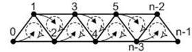

<a id="pixel-shaders"></a>

# Pixel shaders

A pixel shader consumes rasterizer-produced/interpolated primitive data, computes color/depth/coverage/stencil-reference outputs and may access shader resources and UAVs. [Rasterization](rasterization.md#rasterization) defines geometric coverage and sample patterns; [pipeline state](pipeline-state.md#graphics-description) selects the program and output configuration. Shader/root/resource binding, lifetime and synchronization retain their [binding](binding.md#pipeline-compatibility), [execution](execution.md#lifetime) and [resource access](synchronization.md#barrier-access) contracts.

Shared [lane/wave terminology](common-shader-internals.md#execution-terminology) and [wave capabilities](common-shader-internals.md#waves) apply. Pixel-specific quads, helper invocations, discard, ROV ordering and VRS execution are defined here. The stage supports applicable DXBC SM5.0/5.1 and DXIL SM6.x programs; this does not expose every historical profile or every instruction on every device.

<a id="representations"></a>

## Capabilities and representations

| Contribution | Availability |
|---|---|
| Shader stencil reference | `OPTIONS.PSSpecifiedStencilRefSupported` |
| Rasterizer-ordered views | `OPTIONS.ROVsSupported` |
| Barycentric inputs and vertex-attribute access | SM6.1 and `OPTIONS3.BarycentricsSupported` |
| Shading-rate semantic | SM6.4; PS input requires VRS Tier 2 |
| Helper query | SM6.6 native operation; earlier supported DXIL profiles use compiler fallback |
| Helper participation attribute / quad votes | SM6.7; wave/quad operation instructions retain `WaveOps` requirements |
| Variable-rate shading | `OPTIONS6.VariableShadingRateTier`; additional/viewport-indexed rates have separate bits |
| SUM combiner / mesh rate output | `OPTIONS10.VariableRateShadingSumCombinerSupported` / `MeshShaderPerPrimitiveShadingRateSupported` |

Common wave/native-type and later-profile requirements do not imply that all optional targets or PS features are available. PSO shader-feature validation is distinct from diagnostic coverage and from a universal guarantee about invalid program execution.

A final DXIL PS is identified by the `ps` shader-model declaration and `dx.entryPoints`. Input/output signature metadata describes user attributes and signature-carried system values; private computations use typed SSA values rather than a fixed bank of DXBC temporary registers. `LoadInput` and `StoreOutput` access the declared signature elements. IsFrontFace requires a scalar 32-bit integer signature element despite HLSL `bool` spelling.

`SampleIndex`, `Coverage`, `InnerCoverage` and `ViewID` are obtained by their operations, not ordinary packed input-signature elements. Barycentric inputs are declared in the signature but do not reserve ordinary interpolator storage. Depth and stencil-reference output semantics and the early-depth/stencil shader property are part of the program contract, not mutable D3D11 shader-object state.

Relevant operation families include interpolation evaluation, derivatives and sampling, discard/helper queries, resource and counter accesses, wave/quad operations and feature-qualified ray queries. The [inline-ray-query owner](../Raytracing.md#inline-raytracing) supplies that optional operation model. Full instruction/intrinsic behavior and encodings remain the shader appendices, not a substitute for these stage rules.

<a id="dxbc-storage"></a>

### DXBC logical storage

The following registers are available in the ps_5_0 model:

| Register Type | Count | r/w | Dimension | Indexable by r# | Defaults | Requires DCL |
| --- | --- | --- | --- | --- | --- | --- |
| 32-bit Temp (r#) | 4096 (r# + x#[n]) | r/w | 4 | n | none | y |
| 32-bit Indexable Temp Array (x#[n]) | 4096 (r# + x#[n]) | r/w | 4 | y | none | y |
| 32-bit Input Attribute (v#) | 32 | r | 4 | y | none | y |
| Element in an input resource (t#) | 128 | r | 1 | n | none | y |
| Sampler (s#) | 16 | r | 1 | n | none | y |
| ConstantBuffer reference (cb#[index]) | 15 | r | 4 | y(contents) | none | y |
| Immediate ConstantBuffer reference (icb[index]) | 1 | r | 4 | y(contents) | none | y |
| **Output Registers:** | | | | | | |
| NULL (discard result, useful for ops with multiple results) | n/a | w | n/a | n/a | n/a | n |
| 32-bit output Element (o#) | 8 | w | 4 | n/a | n/a | y |
| Unordered Access View (u#) | Profile/register ranges and binding tiers | r/w | Resource-defined | n | n | y |
| 32-bit float output depth (oDepth) | 1 | w | 1 | n/a | n/a | y |
| 32-bit UINT output sample mask (oMask) | 1 | w | 1 | n/a | n/a | y |
| 32-bit UINT stencil-reference output | 1 | w | 1 | n/a | n/a | y |

The table is the archival DXBC logical interface, not a DXIL private-register limit or a D3D12 binding-slot allocation. SM5.1 register spaces/ranges and [binding tiers](binding.md#binding-capabilities) govern descriptors. D3D12 does not subtract the number of RTVs from a shared API UAV-slot count. Ordinary declared shader inputs remain subject to [graphics interface capacities](vertex-processing.md#geometry-interface-capacities); native/minimum-precision types do not by themselves double those slot budgets.

<a id="invocation"></a>

## Invocation frequencies

For each primitive entering the rasterizer, the Pixel Shader is invoked once for each pixel
covered by the primitive (pixel-frequency), or once per sample (sample-frequency). Sample-frequency execution is chosen
if the Pixel Shader declares any input as needing sample-frequency evaluation (described in more detail later).

In either pixel- or sample-frequency execution, note the minimum atom size for shader execution is actually 2x2 blocks of shaders,
to support derivative calculations via x/y deltas between shader invocations. This means there may be dummy invocations off the
edge of a primitive to fill out the minimum 2x2 size.

In pixel-frequency operation, even though the Pixel Shader is invoked once per covered pixel, the depth/stencil tests
occur for each covered sample, and samples that pass the tests are each blended to RenderTargets with the replicated Pixel Shader
output color(s). In contrast, for sample-frequency execution, since the Pixel Shader is run once for
each covered sample, there is a unique set of Pixel Shader outputs to go with the unique depth/stencil operation for each sample - this
is pure "supersampling".

In either execution frequency, early depth/stencil culling may be performed by hardware,
preventing the need to run the Pixel Shader in cases where the outputs would be guaranteed to be
discarded anyway.

<a id="pixel-quads"></a>

### Pixel quads and coarse execution

The baseline pixel/sample-frequency descriptions use fine 1x1 pixels. [VRS](#vrs) can shade several fine pixels as one coarse invocation while retaining fine-pixel/sample coverage and depth/stencil storage. A derivative quad consists of a 2x2 set of pixel-shader invocations at the applicable shading frequency, not necessarily an entire wave. Sample-frequency execution forms quads for the relevant sample index; helper invocations fill required neighboring positions.

Reading `SV_SampleIndex` or requesting sample-frequency input evaluation selects sample-frequency execution. Safe early culling, forced early testing and side-effect rules below qualify whether covered candidates execute as visible invocations. [Pipeline statistics](counters-queries-and-predication.md#pipeline-statistics) count actual stage invocations under their canonical definitions, not simply every geometric candidate.

<a id="sample-frequency"></a>

### Sample-frequency primitive behavior

Note that [points](../archive/D3D11_3_FunctionalSpec.htm#Points) and [quadrilateral lines](../archive/D3D11_3_FunctionalSpec.htm#QuadrilateralLines) are functionally equivalent to drawing
their area with triangles. So Sample-Frequency execution is easily defined for all of these primitives. For points, the samples
covered by the point area (and in the RasterizerState's SampleMask) each get Pixel Shader invocations with attributes replicated from its single vertex (except one parameter
is available that is varying - an ID identifying each sample from the total set of samples in the pixel). For quadrilateral lines,
the two end vertices define how attributes interpolate along the length, staying constant across the perpendicular. Again, the samples covered by
the area of the primitive (and in the SampleMask) each get a Pixel Shader invocations in Sample-Frequency execution mode, with unique input attributes per sample, including
an ID identifying which sample it is.

[Alpha-Antialiased Lines](../archive/D3D11_3_FunctionalSpec.htm#AALines) and [Aliased Lines](../archive/D3D11_3_FunctionalSpec.htm#AliasedLines) are algorithms that inherently do not
deal with discrete sample locations within a pixel's area, and thus it is illegal/undefined to request Sample-Frequency
execution for these primitives, unless the sample count is 1, which is identical to Pixel-Frequency execution.

<a id="sample-invariance"></a>

### Pixel-frequency input invariance

Consider a Pixel Shader that operates only on pixel-frequency inputs (e.g. all attributes have one of the following [interpolation
modes](#interpolation): constant, linear, linear_centroid, linear_noperspective or linear_noperspective_centroid).
Implementations need only execute the shader once per pixel and replicate the results to all samples in the pixel.
Now suppose code is added to the shader that generates new outputs based on reading sample-frequency inputs. The existing
pixel-frequency part of the shader behaves identically to before. Even though the shader will now execute at sample-frequency
(so the new outputs can vary per-sample), each invocation produces the same result for the original outputs.

Though this example happens to separate out the different interpolation frequencies to highlight their invariance,
of course it is perfectly valid in general for shader code to mix together inputs with any different interpolation modes.

<a id="inputs"></a>

## Inputs

The Pixel Shader inputs 32 32-bit*4-component vectors (v# registers),
each of which is interpolated from the vertex attributes of the primitive being rasterized, based on the [interpolation mode](#interpolation)
declared in the Pixel Shader (subject to some restrictions on the mode described in the next paragraph).
If the primitive gets clipped before rasterization, the interpolation mode is honored during the clipping process as well.

A per-primitive value that can be [declared](../archive/D3D11_3_FunctionalSpec.htm#inst_vDCL_SV) for hardware to initialize in an input register component is the [IsFrontFace](rasterization.md#front-face) value, generated by the Rasterizer.

A per-sample value that can be [declared](../archive/D3D11_3_FunctionalSpec.htm#inst_vDCL_SV) for hardware to initialize in an input register component is the [sampleIndex](../archive/D3D11_3_FunctionalSpec.htm#generatedvalue_SAMPLEINDEX), generated by the Rasterizer. Requesting
this input is one of the ways to force the Pixel Shader into sample-frequency execution.

A per-pixel value that can be [declared](../archive/D3D11_3_FunctionalSpec.htm#inst_vDCL_SV) for hardware to initialize in an input register component is [Input Coverage](#input-coverage), which indicates which samples
in the pixel are covered by the primitive.

One of the input v# registers to the Pixel Shader can be declared with the name [position](../archive/D3D11_3_FunctionalSpec.htm#interpretedvalue_POSITION),
which means it will be initialized with the pixel's float32 xyzw position. Note that w is the reciprocal of the linearly interpolated
1/w value. The position location can be chosen by appropriate choice of [interpolation mode](#interpolation):
LINEAR_NOPERSPECTIVE yields the pixel center, in which the xy components will have a fraction of 0.5f.
LINEAR_NOPERSPECTIVE_CENTROID yields the pixel [centroid](#centroid) location. LINEAR_NOPERSPECTIVE_SAMPLE yields the
sample location (and forces sample-frequency execution). Note: Separately the [sampleopos](../archive/D3D11_3_FunctionalSpec.htm#inst_SAMPLEPOS) instruction can also be used to query the location
of any given sample (including the current) within the pixel in terms of a delta from the pixel center, where the absolute location can
be obtained by adding the delta to the pixel center position.

The v-register input/declaration wording above is DXBC notation; DXIL representation follows the [signature/operation model](#representations). Fine-pixel `SV_Position` locations follow the declared center/centroid/sample mode. Under coarse shading, [VRS interpolation](#vrs-center) supplies the applicable location. Programmable-position restrictions on sample-position queries and attribute-by-sample evaluation remain those of [sample-pattern operations](rasterization.md#sample-shader-samplepos).

`SV_PrimitiveID` follows its [producer/reset/leading-vertex contract](vertex-processing.md#primitive-id). View/layer/viewport values follow [rasterizer selection](rasterization.md#viewport-selection), not a new native-support gate. `SV_ViewID` uses the existing [view execution model](vertex-processing.md#geometry-view-instancing). `SV_InnerCoverage` generation and uncertainty are [conservative rasterization](rasterization.md#conservative-innercoverage), with the [coarse packed-mask extension](rasterization.md#conservative-vrs).

<a id="input-depth"></a>

### Position depth and precision

For all the interpolation modes listed above that are valid for position input, the z and w values of position input are interpolated at the corresponding
xy coordinates.

Pixel Shader Input Z is not snapped to the precision of any depth buffer -> z and w input to the Pixel Shader are just interpolated floating point values.
In other words, the contents of the input position register are properties of the current pixel in the primitive being rendered, and have nothing to
do with what is in RenderTarget(s)/depth/stencil buffers.

Pixel Shader Input Z is required to NOT be clamped to the interval between the viewport depth endpoints (also mentioned [here](rasterization.md#viewport-transform)), and required to not reflect any quantization to depth
format that is done before depth testing. Otherwise, Pixel Shader Input Z must exactly match the way fixed function Z interpolation is performed.

Here is an example of the implications of this requirement: Suppose we have single sample RenderTarget(s), or multi sample RenderTargets under
sample-frequency Pixel Shader execution. In this case, if a Pixel Shader inputs Z and writes it out unmodified, the resulting per-sample depth test
and any update to the depth buffer must be identical to what would have happened if the shader did not input and output Z.

This does **not** mean that if a Pixel Shader reads a depth buffer generated with an identical rendering in a previous pass as an input Shader Resource View (SRV),
the PS input Z will match the value read from the SRV given the same primitive and location. The reason is that the values in the depth SRV reflect quantization/clamping which
has not been performed on the PS input Z. However, if the SRV format is float32, then it will exactly match the PS input Z except for clamping to the interval between the viewport depth endpoints.

<a id="input-coverage"></a>

### Input coverage

The Pixel Shader has an input 32-bit scalar integer System Generated Value available:
[InputCoverage](../archive/D3D11_3_FunctionalSpec.htm#generatedvalue_INPUTCOVERAGE). This is a bitfield, where bit i from the LSB indicates (with 1) if the current primitive covers sample
i in the current pixel on the RenderTarget.

Regardless of whether the Pixel Shader is configured to be invoked at pixel frequency or sample frequency, the first n bits in InputCoverage from the LSB
are used to indicate primitive coverage, given an n sample per pixel RenderTarget and/or Depth/Stencil buffer is bound at the Output Merger. The rest of the bits are 0.

DXBC declares InputCoverage as one input-register component with constant interpolation. DXIL obtains it through the `Coverage` operation (`NotInSig`).

The InputCoverage bitfield is not affected by depth/stencil tests, but it is ANDed with the SampleMask Rasterizer state.

If no samples are covered, such as on helper pixels executed off the bounds of a primitive to fill out 2x2 pixel stamps, InputCoverage is 0.

The ordinary fine-pixel input is geometric coverage AND the applicable PSO SampleMask; four covered samples with mask `0x5` give input `0x5`, not `0xf`. [Forced-count rasterization](rasterization.md#forced-pattern-behavior), [conservative coverage](rasterization.md#conservative-inputcoverage-interaction) and [VRS packing](#vrs-sv_coverage) supply their named extensions; they do not turn an ordinary input mask into an unmasked geometric mask.

<a id="interpolation"></a>

## Interpolation modes

These modes are selected via Pixel Shader input register [declaration](../archive/D3D11_3_FunctionalSpec.htm#inst_vDCL), on a per-Element basis.
Should multiple declarations be present in the Pixel Shader for the different components of a given
input register (perhaps for identifying [System Interpreted Values](../archive/D3D11_3_FunctionalSpec.htm#SystemInterpretedValues) or [System Generated Values](../archive/D3D11_3_FunctionalSpec.htm#SystemGeneratedValues)
for some of the components, the interpolation modes for all components of the given register are required to be the same.

Note that when an interpolation mode with no perspective correction is used, the clipper must account for this appropriately (different
than how attributes that are to be interpolated with perspective correction would be handled). Also, attributes set with interpolation mode
constant must pass through clipping and interpolation in the rasterizer completely unchanged from the value in the leading vertex (e.g.
the bits in the attribute are untouched, with no type interpretation).

Interpolation modes with sample in the name cause sample-frequency execution of the Pixel Shader.

| Logical mode | Value | HLSL modifier |
|---|---|---|
| Constant | 1 | `nointerpolation` |
| Linear | 2 | `linear` (default) |
| Linear centroid | 3 | `centroid` |
| Linear no-perspective | 4 | `noperspective` |
| Linear no-perspective centroid | 5 | `noperspective centroid` |
| Linear sample | 6 | `sample` |
| Linear no-perspective sample | 7 | `noperspective sample` |

- Constant : data from the [leading vertex](vertex-processing.md#leading-vertex) is provided to all pixels in the primitive.

- Linear : linear interpolation with perspective correction.

- LinearCentroid : same as linear, but [centroid](#centroid) clamped.

- LinearNoPerspective: linear interpolation without perspective correction.

- LinearNoPerspectiveCentroid: same as LinearNoPerspective, but [centroid](#centroid) clamped when multisampling.

- LinearSample: same as linear, but evaluated at each covered sample.

- LinearNoPerspectiveSample: same as LinearNoPerspective, but evaluated at each covered sample.

<a id="centroid"></a>

### Centroid evaluation

When a sample-frequency [interpolation mode](#interpolation) is not needed on an attribute, pixel-frequency
interpolation-modes such as linear evaluate at the pixel center. However with sample count > 1 on the RenderTarget, attributes could be interpolated
at the pixel center even though the center of the pixel may not be covered by the primitive, in which case interpolation becomes "extrapolation".
This "extrapolation" can be undesirable in some cases, so short of going to sample-frequency interpolation, a compromise is the
centroid interpolation mode.

Centroid behaves exactly as follows:

- (1) If all samples in the pixel are covered after the applicable SampleMask, the attribute is evaluated at the pixel center (even if the sample pattern does not happen to have a sample location there).

- (2) Else the attribute is evaluated at the first covered sample, in increasing order of sample index, where sample coverage is after ANDing the coverage with the SampleMask Rasterizer State.

- (3) If no samples are covered, such as on helper pixels executed off the bounds of a primitive to fill out 2x2 pixel stamps, the attribute is evaluated as follows: If the SampleMask Rasterizer state is a subset of the samples in the pixel, then the first sample covered by the SampleMask Rasterizer State is the evaluation point. Otherwise (full SampleMask), the pixel center is the evaluation point.

The full-coverage pixel-center exception is retained when sample positions are programmed. In fine-pixel centroid evaluation, test the applicable SampleMask-filtered coverage against the entire sample set, not merely whether all enabled samples are covered. If all sample bits are covered, use the pixel center; otherwise choose the first covered sample in the programmed order, or use the no-covered-sample fallback above. Thus four geometric samples covered with SampleMask `0x5` do not satisfy the all-samples-covered shortcut.

The [coarse centroid rule](#vrs-centroid), [conservative center rule](rasterization.md#conservative-attribute-interpolation-interaction) and [TIR SampleMask distinction](rasterization.md#forced-pattern-behavior) remain separate cases.

<a id="pull-model"></a>

## Pull-model evaluation

The following signatures are generic intrinsic notation (`numeric` is the input type; `attrib` identifies an interpolated input), not complete HLSL declarations.

Attributes evaluated without use of the intrinsics defined below will be evaluated according to the specification in the previous section.

Pull model attribute evaluation enables programmable interpolation of inputs in pixel shaders. This functionality allows the programmer to choose how an
input is interpolated at runtime, to use multiple interpolation modes on the same input, and to change where the input is evaluated.

The programmer declares input attributes along with their interpolation mode (similar to earlier shader models). What is unique to pull model is that in the shader body,
the programmer can call intrinsics to evaluate an input attribute at programmable locations.

When using programmable locations for evaluation, the only aspect of the interpolation mode declaration that is honored is choice of constant/linear/linearNoPerspective.
On the other hand, location based modifiers on the attribute declaration, centroid or sample, are ignored during pull-model evaluation. Such modifiers have to do with
where evaluation happens spatially, and in pull-model, spatial positioning comes from the instruction.

If attributes are referenced directly from a shader, all properties of the attribute declaration are honored – the type (constant/linear/linearNoPerspective)
and any location modifiers – centroid or sample. This is the same as previous shader models.

Due to a limitation in some hardware, position is the one attribute that cannot be "pulled".

The following intrinsics are available:

```text
EvaluateAttributeSnapped(attrib numeric value, int2 pixeloffset)
-    Evaluate at (fractional) pixel offset from pixel center, given a 16x16 offset grid within the pixel.  See later description of how integer
    (fixed point) offsets are interpreted.
-    Interpolation mode from attribute declaration: linear or linear_no_perspective.  Presence of centroid or sample on attrib declaration is
    ignored and the default interpolation mode is used.
-    Attributes with constant interpolation also allowed, in which case pixeloffset has no effect on the result.
-   Bytecode intrinsic: eval_snapped

EvaluateAttributeAtSample(attrib numeric value, uint sampleindex)
-    Evaluate at sample location by index within pixel. If sampleindex is out of bounds, results are undefined.
-    Interpolation mode from attribute declaration: linear or linear_no_perspective.  Presence of centroid or sample on attrib declaration ignored.
-    Attributes with constant interpolation also allowed, in which case sampleIndex has no effect on the result.
-   Bytecode intrinsic: eval_sample_index

EvaluateAttributeAtCentroid(attrib numeric value)
-    Evaluate at centroid location within pixel
-    Interpolation mode from attribute declaration: linear or linear_no_perspective.  Presence of centroid (moot) or sample on attrib declaration ignored.
-    Attributes with constant interpolation also allowed, in which case the fact that centroid is being requested has no effect on the result.
-   Bytecode intrinsic: eval_centroid
```

<a id="pull-indexing"></a>

### Indexing declared inputs

The index range declaration ([dcl_indexRange](../archive/D3D11_3_FunctionalSpec.htm#inst_indexRange)) that allows input registers to be indexed when referenced within shader code also applies to references to
input registers by pull-model eval* operations.

All restrictions on the dcl_indexRange declaration are unaffected by pull model usage. One restriction in particular is that the interpolation mode on all
elements in the range being declared is identical.

<a id="pull-bounds"></a>

### Sample-index bounds

For index based addressing, if the sample index is out of the range of the number of samples per pixel in the RenderTarget,
results for the pull model evaluation are undefined.

For offset based addressing, by definition no out of bounds index can be produced.

<a id="pull-offsets"></a>

### Fine-pixel fixed-point offsets

Consider the mode where the address comes in as an offset. This mode allows full access to the grid (256 available sample locations),
as opposed to the sample index mode, which only chooses from among the renderTarget sample locations.

In the offset mode, the offset is an integer tuple (U,V). This maps to grid coordinates in each axis span the integer range [-8–7],
where 0 is the center. The left and top edges of a pixel are included, but the bottom and right edges are not.

The least significant 4 bits of each int pixelOffset coordinate are interpreted as fixed point numbers. The conversion from 4 bit fixed point
to float is as follows (MSB–LSB), where the MSB is both a part of the fraction and determines the sign:

```text
    1000 = -0.5f    (-8 / 16)
    1001 = -0.4375f (-7 / 16)
    1010 = -0.375f  (-6 / 16)
    1011 = -0.3125f (-5 / 16)
    1100 = -0.25f   (-4 / 16)
    1101 = -0.1875f (-3 / 16)
    1110 = -0.125f  (-2 / 16)
    1111 = -0.0625f (-1 / 16)
    0000 =  0.0f    ( 0 / 16)
    0001 =  0.0625f ( 1 / 16)
    0010 =  0.125f  ( 2 / 16)
    0011 =  0.1875f ( 3 / 16)
    0100 =  0.25f   ( 4 / 16)
    0101 =  0.3125f ( 5 / 16)
    0110 =  0.375f  ( 6 / 16)
    0111 =  0.4375f ( 7 / 16)
```

All other bits in the 32-bit integer U and V offset values are ignored.

As an example, an implementation can take this shader provided offset and obtain a full 32-bit fixed point value (28.4)
spanning the valid range by performing:

```text
iU = (iU<<28)>>28  // keep lowest 4 bits and sign extend, yielding [-8..7]
```

If an implementation needed to map this to a floating point offset, that would simply be:

```text
fU = ((float)iU)/16
```

In practice, implementers will find shortcuts to the desired effect for their situation.

<a id="barycentrics"></a>

## Barycentric and per-vertex inputs

SM6.1 barycentric inputs and `GetAttributeAtVertex` require `OPTIONS3.BarycentricsSupported`. Their ordering follows original primitives and the mesh-stage exception rather than post-clip triangle replacement. Code fragments below illustrate declarations and modifiers; ellipses stand for omitted shader bodies, not executable HLSL.

<a id="bary-system-generated-barycentric-coordinates"></a>

### System Generated Barycentric Coordinates

Pixel shaders can access barycentric weights in their input attribute declaration via the SV_Barycentrics semantic system value, following the standard attribute declaration syntax:

    float4 PSMain(float3 baryWeights : SV_Barycentrics) : SV_Target {
       ...
    }

Attributes declared with the SV_Barycentrics system-generated value must be a vector of three 32-bit floating point numbers, representing the barycentric weights of the current pixel relative to the vertices of the original API primitive prior to clipping (see later re. interactions with clipping).

The 3 values are NOT guaranteed to add up to floating-point 1.0 exactly. If it is desired for the pixel shader to ensure that the weights have this property, it can reconstruct the third coordinate per fragment by subtracting the sum of the other two from 1.0.

Also note, that individual barycentric weights may take on arbitrarily large or arbitrarily small values, and are not constrained to be within [0...1] range necessarily – this may happen for screen-space (non-perspective-correct) barycentric interpolants, extrapolated locations.
For triangle primitives, all 3 weights will typically contain non-zero values, but for line primitives the third barycentric weight (e.g. myBaryWeights.z) is guaranteed to be exactly 0.0. With this definition, pixel shaders can remain agnostic to the primitive type being rasterized (i.e. they can evaluate barycentric sums using all 3 barycentric weights for both triangles and lines).

Implementers note: attributes declared as barycentrics will not have space reserved in the pixel shader signature storage.

<a id="bary-barycentric-coordinate-interpolation-types"></a>

#### Barycentric Coordinate Interpolation Types

For the most part, barycentric coordinates behave just like any other regular attribute, in the sense of allowing either affine (screen-space) or perspective-correct interpolation, and optional centroid adjustment. Interpolation type is specified using existing syntax, e.g.:

    // perspective-correct barycentrics: (default)
    linear float3 BaryLinear : SV_Barycentrics;

    // centroid-adjusted affine (screen-space) barycentrics:
    centroid noperspective float3 BaryAffine : SV_Barycentrics;

    // force shader to run at supersampling rate (one invocation per MSAA sample)
    sample noperspective float3 BaryAffineSample : SV_Barycentrics;

The nointerpolation interpolation modifier is disallowed for barycentric attributes.
As an exception to the current attribute specification rules, it is allowed for the pixel shader to declare **at most two** input attributes with the SV_Barycentrics system semantics, provided that one declaration uses **perspective-correct** interpolation type, and the other uses **noperspective**(affine, screen-space) interpolation type. These two system semantics should have different indices with value either 0 or 1.  For example, the following is a valid attribute syntax:

    float4 PSMain(float3 PerspectiveBaryWeights : SV_Barycentrics,
       noperspective float3 NoPerspectiveBaryWeights : SV_Barycentrics1) : SV_Target

This allows the pixel shader to get access to both perspective-correct and affine versions of barycentric coordinates.

<a id="bary-barycentric-coordinate-ordering"></a>

#### Barycentric Coordinate Ordering

Barycentric coordinates ordering from the perspective of the pixel shader matches vertex ordering of the primitive being rasterized in the original API stream. For example, if a triangle ABC is specified using the following order of its vertices: A, B, C, then the pixel shader will see the barycentric weight associated with the vertex A in the x component of the SV_Barycentrics vector, and barycentric weights associated with vertices B and C will be found in y and z components of the vector, correspondingly. Note that this definition also implies that the barycentric weight, associated with the provoking vertex of the current primitive can always be found in the x component of the SV_Barycentrics vector.
One important exception to the above rule is triangle strips: due to the way triangle strips are specified, the order of barycentric weights will have to be flipped for every other triangle. This is necessary to ensure that the pixel shader always sees consistent winding of vertices for all triangles in the strip. More specifically, given the following triangle strip:

 

The first two triangles will specify their barycentric weights in the following order (corresponding to x,y,z components of the SV_Barycentrics vector):

Triangle 0: [x:0, y:1, z:2], 0 is the provoking vertex

Triangle 1: [x:1, y:3, z:2], 1 is the provoking vertex

Note how barycentric weights corresponding to vertices 2 and 3 of the second triangle have been flipped relative to their API specification order.

<a id="bary-per-vertex-attributes"></a>

### Per-Vertex Attributes

For pixel shaders to perform attribute interpolation using the system-generated barycentric weights, the attributes values at the vertices must be provided.
These can be accessed by declaring the attribute as nointerpolation, and using intrinsics to read the values at the 3 vertices.
Attributes declared as nointerpolation do not participate in the clipping and interpolation setup stages, but rather their per-vertex values are provided as is to the pixel shader. Implementations are required to preserve all bits in the binary representation of such attributes through the VS/DS/GS-to-PS interface – so that applications can treat them essentially as sets of 32-bit bitfields with application-specific interpretation.
To use the above barycentric weights to interpolate attributes, the values of the attributes at the vertices are provided by the following routine:

    <attributeType> GetAttributeAtVertex( nointerpolation <attributeType> attribute,
                                                                      uint VertexID );

Where **VertexID** is in the range 0..2, and **attributeType** is an attribute declared with **nointerpolation**.

This routine can be used in the following way:

    // enum available in HLSL 2017
    enum VertexID {
        FIRST = 0,
        SECOND = 1,
        THIRD = 2
    };

    // Linear perspective-correct interpolation of the COLOR attribute
    float3 main( float3 vBaryWeights : SV_Barycentrics,
         nointerpolation float3 Color : COLOR ) : SV_Target
    {
        float3 vColor;

        float3 vColor0 = GetAttributeAtVertex( Color, VertexID::FIRST );  // color at provoking vertex
        float3 vColor1 = GetAttributeAtVertex( Color, VertexID::SECOND ); // color at 2nd vertex
        float3 vColor2 = GetAttributeAtVertex( Color, VertexID::THIRD );  // color at last vertex

        vColor = vBaryWeights.x*vColor0 + vBaryWeights.y*vColor1 + vBaryWeights.z*vColor2;

        return vColor;
    }

The triangle indices specified follow the order of the original triangle vertices as specified in the API stream, (taking the behavior of strips into account). This also means that the order of barycentric weights and the order of per-vertex attributes always match, so that the pixel shader can always assume that the per-vertex attribute at VertexID= 0 corresponds to the barycentric weight placed in the x component of the SV_Barycentrics vector, etc. This also means that the value of a per vertex attribute at VertexID 0 always corresponds to its value at the “provoking vertex”.

As a consequence, it should be possible for pixel shaders to read attributes directly from a vertex buffer and interpolate them in a manner consistent with the fixed-function interpolator.

As always, it is illegal to combine nointerpolation mode with centroid or sample specifiers on the same parameter.

<a id="bary-interactions-with-clipping"></a>

### Interactions with Clipping

Per-vertex attributes are never clipped, and always passed along unmodified, so that the pixel shader gets access to their values as they are output by the last shader in the geometry pipeline (DS, VS or GS). This is also true for vertices which happen to be outside the frustum, or even behind the W=0 plane in clip-space, regardless of what kind of clipping situation occurs for the current primitive.

<a id="bary-wireframe-mode"></a>

### Wireframe mode

When drawing primitives with wireframe rasterizer mode (i.e., D3D12_FILL_MODE_WIREFRAME), barycentric co-ordinates follow the same order as the input vertices. This means that when drawing triangle primitives for example, where a barycentric co-ordinate in a wireframe tends to have a zero component and two non-zero ones, the 3rd component isn't necessary the zero.

For mesh output, the [mesh primitive-vertex order](amplification-and-mesh-shaders.md#primitive-attributes) controls barycentric components and vertex-attribute lookup. This is a stage-specific ordering contribution, not arbitrary vertex sorting by the pixel shader.

<a id="derivative-flow"></a>

## Derivatives and control flow

The Pixel Shader instruction set includes several instructions that produce or use derivatives
of quantities wrt screen space x and y. The most common use for derivatives is
to compute LOD calculations for texture sampling, and in the case of
anisotropic filtering, selecting samples along the axis of anisotropy.
Implementations run the Pixel Shader on multiple pixels
(in particular at least a 2x2 grid) simultaneously, so that derivatives of quantities
computed in the Shader can be reasonably approximated as deltas of the values
at the same point of execution in adjacent pixels.

When flow control is present in a Shader and it is possible for different Shader
invocations to take different paths, the result of a derivative calculation on
registers inside a branch is ambiguous if these registers are updated in any
of the branches.

The following restriction is in place to help applications avoid producing such ambiguous cases in shader code.
Actually, the restriction is even tighter than minimally necessary to stop the scenario described above.
The restriction is conservatively defined to permit some implementation flexibility for hardware.

The high level shading language compiler will attempt to emit warnings (but will not fail) when these restrictions are violated.
Not all cases can be caught depending on how programs get compiled.

The primitive-varying register/control-flow formulation below preserves the legacy DXBC diagnostic model. For DXIL computed values, the operative participating-lane requirement is [quad-uniform control flow](#quad-uniformity), which can still diverge across a primitive or wave. This does not permit reading an uninitialized/inactive neighboring temporary value.

<a id="derivative-terms"></a>

### Legacy register/control-flow terminology

**Varying Quantity**

A varying quantity in a Pixel Shader is a register which could have different
values across different Pixel Shader invocations on a single primitive, at a
common point in execution of the Pixel Shader.

Specifically, varying quantities are input registers which are interpolated (not defined as
constant), or temporary registers (non-indexable r# or indexable x#[] arrays)
whose contents are dependent directly or indirectly on interpolated input
registers. Any instruction inside varying flow control (defined below) also produces a varying result.

In contrast, NON-varying quantity is an input register defined as
constant, a literal/immediate value in the shader, or any quantity derived directly
or indirectly from only other non-varying quantities in the shader. In general,
any instruction not inside varying flow control, whose inputs are entirely non-varying produces a
non-varying result. Examples: The results of constant/texture fetches with non-varying
address are considered non-varying. If all writes to an x#[] (indexable
temp register array) were non-varying, the x#[] (indexable temp array) is
considered non-varying. If the index into a fetch from a non-varying x#[] is non-varying,
the result is non-varying.

**Varying Flow Control**

If a varying quantity is present as any condition(s) for a
flow control construct, the entire contents of the flow control construct are
considered to be within varying flow control.

If a varying flow control construct is nested inside another
flow control construct, the fact that the nested construct is varying has no
effect on whether or not the outer flow control construct is considered
varying. The exception would be if the nested construct contains an instruction that could jump across
scopes, as described next.

The presence of a [retc](../archive/D3D11_3_FunctionalSpec.htm#inst_RET_CONDITION) using a varying quantity as the condition
or [ret](../archive/D3D11_3_FunctionalSpec.htm#inst_RET) inside a varying flow control construct means the
rest of the code from the retc/ret to the end of the current scope (current subroutine or main program)
is deemed to be within varying flow control.

The presence of a [break](../archive/D3D11_3_FunctionalSpec.htm#inst_BREAK), [breakc](../archive/D3D11_3_FunctionalSpec.htm#inst_BREAK_CONDITION),
[ret](../archive/D3D11_3_FunctionalSpec.htm#inst_RET), [retc](../archive/D3D11_3_FunctionalSpec.htm#inst_RET_CONDITION), [continue](../archive/D3D11_3_FunctionalSpec.htm#inst_CONTINUE), or
[continuec](../archive/D3D11_3_FunctionalSpec.htm#inst_CONTINUE_CONDITION) instruction inside a [loop](../archive/D3D11_3_FunctionalSpec.htm#inst_LOOP) means
the entire contents of loop is deemed to be within varying flow control.

In contrast, the presence of a [discard](../archive/D3D11_3_FunctionalSpec.htm#inst_DISCARD) instruction anywhere in a program
has NO effect on whether code following it is considered varying or not.

**Shader-Computed Temporary**

A shader-computed temporary is any value that has been written to a register in a shader invocation
that can be read again in the same invocation (i.e. r# or x#[] registers). Shader input or output
registers are not included.

<a id="derivative-restrictions"></a>

### Derivative source restrictions

(a) The following uses of sample or derivative instructions are not permitted inside varying flow control (though the HLSL compiler only attempts to warn about it):

- [sample](../archive/D3D11_3_FunctionalSpec.htm#inst_SAMPLE), [sample_b](../archive/D3D11_3_FunctionalSpec.htm#inst_SAMPLE_B), or [sample_c](../archive/D3D11_3_FunctionalSpec.htm#inst_SAMPLE_C), or [lod](../archive/D3D11_3_FunctionalSpec.htm#inst_LOD) when the texture address is
a shader-computed temporary.

- [deriv_rtx_coarse](../archive/D3D11_3_FunctionalSpec.htm#inst_DERIV_RTX_COARSE), [deriv_rty_coarse](../archive/D3D11_3_FunctionalSpec.htm#inst_DERIV_RTY_COARSE), [deriv_rtx_fine](../archive/D3D11_3_FunctionalSpec.htm#inst_DERIV_RTX_FINE), [deriv_rty_fine](../archive/D3D11_3_FunctionalSpec.htm#inst_DERIV_RTY_FINE), when the input is
a shader-computed temporary.

(b) Other uses of sample or derivative instructions have no restrictions with flow control. Examples are:

- [sample](../archive/D3D11_3_FunctionalSpec.htm#inst_SAMPLE), [sample_b](../archive/D3D11_3_FunctionalSpec.htm#inst_SAMPLE_B), or [sample_c](../archive/D3D11_3_FunctionalSpec.htm#inst_SAMPLE_C), when the texture address is a shader input (regardless of interpolation mode) or statically indexed constant.

- [deriv_rtx_fine](../archive/D3D11_3_FunctionalSpec.htm#inst_DERIV_RTX_FINE), [deriv_rty_fine](../archive/D3D11_3_FunctionalSpec.htm#inst_DERIV_RTY_FINE), [deriv_rtx_coarse](../archive/D3D11_3_FunctionalSpec.htm#inst_DERIV_RTX_COARSE) and [deriv_rty_coarse](../archive/D3D11_3_FunctionalSpec.htm#inst_DERIV_RTY_COARSE) when the input operand is a shader input (regardless of interpolation mode) or statically indexed constant, though the latter is not useful.

- [sample_l](../archive/D3D11_3_FunctionalSpec.htm#inst_SAMPLE_L): here the application provides LOD as an operand, so no derivative calculation
is required, and there is no issue with flow control.

- [sample_d](../archive/D3D11_3_FunctionalSpec.htm#inst_SAMPLE_D): here the application provides derivatives as input operands, so there is no
issue with flow control.

- [sample_c_lz](../archive/D3D11_3_FunctionalSpec.htm#inst_SAMPLE_C_LZ), [gather4](../archive/D3D11_3_FunctionalSpec.htm#inst_GATHER4), [gather4_c](../archive/D3D11_3_FunctionalSpec.htm#inst_GATHER4_C), [gather4_po](../archive/D3D11_3_FunctionalSpec.htm#inst_GATHER4_PO), [gather4_po_c](../archive/D3D11_3_FunctionalSpec.htm#inst_GATHER4_PO_C): here the LOD is fixed, so no derivative calculation is required,
and there is no issue with flow control.

Regardless of the restriction above, shader authors still must ensure that before
computing any derivative (or performing a texture sample that implicitly
computes a derivative) where permitted, the register containing the source data must have been
initialized for all execution paths beforehand. Initialization of temporary
registers is not validated or enforced in general.

<a id="derivatives"></a>

### Pixel/sample derivative quads

These stage-specific derivatives feed the shared [LOD/anisotropy calculation](common-shader-internals.md#lod-and-anisotropy) and [sampling/addressing precision rules](common-shader-internals.md#sampling-precision). The common texture algorithm does not change this stage's quad formation or participating-lane requirements.

Pixel Shaders always run in minimum 2x2 quanta to be able to support derivative calculations,
regardless of the RenderTarget sample count. These Pixel Shader derivative calculations, used in texture filtering operations,
but also available directly in shaders, are calculated by taking deltas of data in adjacent pixels. For fine shading this uses corresponding locations one pixel apart horizontally or vertically; coarse shading uses the [VRS spacing](#vrs-grid).

RenderTarget sample counts > 1 do not affect derivative calculation methods. If derivatives are requested on an attribute that
has been Centroid sampled, the hardware calculation is not adjusted, and therefore incorrect derivatives will
often result. What the Shader expects to be a derivative wrt a unit distance in the x or y direction in RenderTarget space will actually
be the rate of change with respect to some other direction vector, which also probably isn't unit length.

The point here is that it is the application's responsibility to exhibit caution when requesting derivative from
Centroid sampled attributes, ideally never requesting them at all. Centroid sampling can be useful for situations
where it is critical that a primitive's interpolated attributes are not "extrapolated", but this comes with some tradeoffs:
First, centroid sampled attributes may appear to jump around as a primitive edge moves over a pixel, rather than
changing continuously. Secondly, derivative calculations on the attributes become unreliable or difficult to use correctly
(which also hurts texture sampling operations that derive LOD from derivatives).

Under sample-frequency execution, a 2x2 quad of Pixel Shaders executes for each sample index where that sample is covered in at least
one of the pixels participating in the 2x2 quad. For matching sample locations in adjacent fine pixels, corresponding samples are one unit apart horizontally or vertically. A [four-pixel programmed pattern](rasterization.md#setsamplepositions) can instead place the same sample index at different relative locations in neighboring pixels. Derivatives still use the specified invocation-pair deltas; no compensating rescaling for those different locations is required.

It is left to the application's shader author to decide how to adjust for the fact that derivatives calculated from spacings of one unit may need to be scaled in some way to reflect higher frequency shader execution,
depending on the sample pattern/count.

Further important discussion of Pixel Shader derivatives is under [Interaction of Varying Flow Control With Screen Derivatives](#derivative-flow).

<a id="additional-dxil"></a>

### Additional DXIL and shader interface details

#### DerivCoarseX

dst = DerivCoarseX(src);

Computes the rate of change per stamp in x direction. Only a single x derivative pair is computed for each 2x2 stamp of pixels.
The data in the current Pixel Shader invocation may or may not participate in the calculation of the requested derivative, given the derivative will be calculated only once per 2x2 quad:
As an example, the x derivative could be a delta from the top row of pixels.
The exact calculation is up to the hardware vendor. There is also no specification dictating how the 2x2 quads will be aligned/tiled over a primitive.

#### DerivCoarseY

dst = DerivCoarseY(src);

Computes the rate of change per stamp in y direction. Only a single y derivative pair is computed for each 2x2 stamp of pixels.
The data in the current Pixel Shader invocation may or may not participate in the calculation of the requested derivative, given the derivative will be calculated only once per 2x2 quad:
As an example, the y derivative could be a delta from the left column of pixels.
The exact calculation is up to the hardware vendor. There is also no specification dictating how the 2x2 quads will be aligned/tiled over a primitive.

#### DerivFineX

dst = DerivFineX(src);

Computes the rate of change per pixel in x direction. Each pixel in the 2x2 stamp gets a unique pair of x derivative calculations
The data in the current Pixel Shader invocation always participates in the calculation of the requested derivative.
There is no specification dictating how the 2x2 quads will be aligned/tiled over a primitive.

#### DerivFineY

dst = DerivFineY(src);

Computes the rate of change per pixel in y direction. Each pixel in the 2x2 stamp gets a unique pair of y derivative calculations
The data in the current Pixel Shader invocation always participates in the calculation of the requested derivative.
There is no specification dictating how the 2x2 quads will be aligned/tiled over a primitive.

<a id="quad-votes"></a>

### Quad vote interfaces

#### QuadAny

```C++
bool QuadAny(bool expr)
```

Returns true if &lt;expr&gt; is `true` in any lane of the current quad.

#### QuadAll

```C++
bool QuadAll(bool expr)
```

Returns true if &lt;expr&gt; is `true` in all lanes of the current quad.

<a id="quad-uniformity"></a>

### Quad-uniform evaluation

Intrinsics that calculate gradient values read texture coordinates
from all four threads in a quad to calculate the gradients.

In *divergent control flow*, inactive lanes may use the same temporary registers to store different values on other code paths.
Therefore, it is not well-defined to read a value from an inactive lane
corresponding to a temporary value in an active lane.

For well-defined gradient calculations on temporary values,
all lanes in the quad must be active.
This is a weaker requirement than *uniform control flow* called *quad-uniform control flow*.
Quad-uniform control flow may still be *divergent* across a wave,
but it satisfies the requirements for well-defined gradient calculations on each active quad,
since each gradient operation will only read from other lanes in the same quad.
`QuadAny` makes it convenient to write code that preserves quad-uniform control flow.

SM6.7 `QuadAny` and `QuadAll` compare all four lanes, including helper lanes. Calls require quad-uniform flow and `WaveOps`; they are not the default helper-excluding wave-wide votes. Existing quad-read operations can support older-profile lowering, but a particular compiler's fallback is not a new DXBC instruction.

Implicit-gradient sampling instructions retain the quad-uniform source restrictions. SM6.7 `SampleCmpLevel` supplies explicit LOD; SM6.8 `SampleCmpGrad` supplies explicit gradients, whereas `SampleCmpBias` still uses implicit gradients. These additions do not make implicit-gradient evaluation in arbitrary divergent flow defined.

<a id="outputs"></a>

## Outputs

The [output merger](output-merger.md#depth-stencil) defines attachment testing and updates, [color write masks](output-merger.md#write-masks), [dual-source blending](output-merger.md#dual-source-blending) and [alpha-to-coverage](output-merger.md#alpha-to-coverage). The shader output-declaration, early/late, discard/helper and ROV execution contracts remain PS-owned.

The Pixel Shader is capable of outputting up to 8 32-bit*4-component elements of data, in addition
to an optional 32-bit float scalar depth value for the depth test.

Color output component types follow HLSL/profile and render-target compatibility; the baseline four-component register interface is not a float-only requirement. Coverage and stencil reference are scalar integer outputs, and depth is scalar float. `earlydepthstencil` lowers to the PS early-depth/stencil property for DXIL, with the same pre-shader tests/updates and ignored depth/stencil-export semantics in [execution control](#execution-control).

<a id="output-writes"></a>

### Declared output writes

The component(s) of any output o# registers that a Shader intends to write must be [declared](../archive/D3D11_3_FunctionalSpec.htm#inst_oDCL)
(statically) in each Pixel Shader, down to the component level. A distinct mask for each o# is permitted.

If a given o# register has no components declared for output then the RenderTarget at that output slot is not modified
regardless of any other settings (such as write masks or blend modes).

If a given o# register IS declared for output, then all the declared components are assumed to be output from the Shader,
however separate write-enable [masks](../archive/D3D11_3_FunctionalSpec.htm#OutputWriteMasks), per-RenderTarget, per-component, can be set outside the Shader
at the Output Merger which ultimately decides which components get written to the RenderTarget (through the Output
Merger blend if applicable). Therefore, hardware never needs to track during Shader execution which
output registers/components are written, and can assume all declared ones are written, while relying on the masks
defined outside the Shader to determine which portions of the RenderTarget(s) get updated.

Partial writes to a given o# output register (writing a nonempty proper subset of the declared components)
will produce undefined results in the unwritten component(s) that were declared for output.
i.e. Declaring o0.rga but only writing o0.r means the RenderTarget location for o0.ga will be written with
undefined values. However the application can take advantage of the write-enable masks to prevent undefined
values from being written out and thus vary outputs with flow control in a Shader, as long as the condition
doesn't vary within a given Draw*() (since the write-enable masks can only be updated between Draw*() calls).

Note that o# registers may be written multiple times in a Shader; the defined output of the Shader is the
contents of the declared o# register components at the end of Shader
execution, only for o# registers that were actually written at all. Of course, if the Shader was ["discard"](../archive/D3D11_3_FunctionalSpec.htm#inst_DISCARD)ed,
that would mean there are no outputs.

It is permissible for a pixel shader to have no declared outputs - this case is **not** treated as a NULL pixel
shader, especially because of the interaction with 'discard'.
A no-output shader still participates in the canonical PS invocation statistics.
If the pixel shader is NULL and DepthEnable and StencilEnable are both FALSE, rasterization is disabled and
rasterizer-related counters, CInvocations and CPrimitives, will not update.

<a id="depth-output"></a>

### Depth output

If a Shader intends to write to oDepth, it must be [declared](../archive/D3D11_3_FunctionalSpec.htm#inst_oDepthDCL) statically in the Shader, just as o# registers.
The Shader is then assumed to always write oDepth (replacing the interpolated depth value), and the oDepth value is always used
in the depth comparison (if depth compare is enabled). Failure to write oDepth when declared results in undefined behavior
(which may or may not include discard of the pixel/sample). This is consistent with the undefined behavior when not writing to
declared o#. In pixel-frequency execution, the single oDepth output is replicated to all samples for their unique depth tests. In
sample-frequency execution, each sample gets a Pixel Shader invocation, so oDepth can provide unique values per-sample.

If a developer wants to control whether depth gets written to the depth buffer, the Output Merger has a depth write enable state,
which at Draw*() granularity can control the write, which is consistent with the handling of o# register writes as well.
If a developer wishes to obtain the behavior where not writing to oDepth results in discard of the pixel, the application can always
use the [discard](../archive/D3D11_3_FunctionalSpec.htm#inst_DISCARD) instruction explicitly.

Note that this undefined behavior for not writing oDepth when declared means it is not possible for an 'uber-Shader' to
dynamically select between fixed-function depth or Shader depth.

<a id="depth-range"></a>

#### Depth value range

Any float32 value including +/-INF and NaN can be written to oDepth.

<a id="conservative-depth"></a>

### Conservative depth output

Conservative oDepth provides knowledge of the correspondence between oDepth and the rasterizer generated depth in a pixel shader.
This enables early depth culling and depth modification to be used together.

Enabling oDepth in a pixel shader disables early z culling. Early depth culling dramatically improves performance when there is medium to significant overdraw.
Rather than having the pixel shader arbitrarily change the depth value, the shader can make a promise that the output depth value is always less than
or greater than the rasterizer depth value. This allows the depth value to be affected by the
shader and allows early depth culling when the declared conservative depth mode and depth comparison mode are compatible.

If a Shader intends to use conservative depth writes, it must be [declared](../archive/D3D11_3_FunctionalSpec.htm#inst_ConservativeoDepthDCL) statically in the Shader with parameters
[SV_DepthGreaterEqual](../archive/D3D11_3_FunctionalSpec.htm#interpretedvalue_DEPTH_GREATER_EQUAL) or [SV_DepthLessEqual](../archive/D3D11_3_FunctionalSpec.htm#interpretedvalue_DEPTH_LESS_EQUAL).
If the shader chooses SV_DepthGreaterEqual or SV_DepthLessEqual, then the shader promises that it never writes smaller or larger values (respectively) than the
rasterizer depth value. Breaking this promise results in undefined behavior.

The valid range is identical to that for standard oDepth.

<a id="conservative-depth-modes"></a>

#### Compatible comparison modes

[SV_DepthGreaterEqual:](../archive/D3D11_3_FunctionalSpec.htm#interpretedvalue_DEPTH_GREATER_EQUAL)

If the shader declares the depth output as SV_DepthGreaterEqual, the system assumes it can enable early depth cull when the depth
comparison mode is "less" or "less or equal".

[SV_DepthLessEqual:](../archive/D3D11_3_FunctionalSpec.htm#interpretedvalue_DEPTH_LESS_EQUAL)

If the shader declares the depth output as SV_DepthLessEqual, the system assumes it can enable early depth cull when the depth
comparison mode is "greater" or "greater or equal".

Using SV_DepthGreaterEqual and SV_DepthLessEqual is valid with any depth mode, but the early depth cull will be disabled if the knowledge of is
GreaterEqual/LessEqual is not compatible with the early depth cull optimization.

<a id="conservative-depth-clamp"></a>

#### Promise violations and compiler declarations

Implementations may choose to pick a particular behavior when the app breaks the promises described above by clamping to the
rasterizer depth. The rasterizer depth value that would be used to clamp against is the centroid depth value if the shader is executing at pixel-frequency
or sample depth at sample-frequency.
To help enable this, it is enforced by the HLSL compiler that if the shader inputs depth and outputs one of the above depth values,
the input depth must be interpolated as linear_noperspective_centroid or linear_noperspective_sample (if position is input at all).

**History (2025).** This clamping was originally intended to be performed by either the HLSL compiler or by the driver (spec was ambiguous), avoiding undefined behavior.
But it appears tests weren't authored to verify clamping, so it turns out the compiler and many implementations haven't performed clamping for years (and it isn't worth starting to clamp now that this was noticed in 2025).

The compiler enforcement of interpolation mode described here was always present on the assumption that clamping is happening, and it isn't being removed.

The purpose for requiring centroid in pixel-frequency execution is that it guarantees the clamp is done against a safe depth value
within the gamut of the covered samples, thus not violating any traditional depth optimizations. More ideal would have been to
pick the min or max covered sample, depending on which conservative depth mode is chosen, but that would have been too costly
to require hardware to compute for the benefit. It was deemed adequate to use an existing interpolation mode – centroid.

The shader can also ask for position to be interpolated with linear_noperspective_sample, but that makes the shader run at sample-frequency,
so the situation is simpler given there is a depth per sample and thus a clamp per sample. Similarly, if the shader is running at sample
frequency for some other reason (such as inputting sample index), input depth can be interpolated in any valid way, unaffected by
whether or not the shader is outputting conservative depth.

<a id="output-coverage"></a>

### Output coverage

The Pixel Shader output register oMask receives from the shader an output coverage mask, behaves like the SampleMask Rasterizer state. The final coverage values
are the result of ANDing the sample mask with the coverage mask, followed by the output coverage mask if one is written.
Alpha to Coverage is disabled if this register is written in a shader.

When the Pixel Shader runs at sample-frequency, the coverage mask is also ANDed with a mask that selects the sample currently being
processed. As a result, sample N is always masked by bit N of oMask. This allows a shader to run at either sample-frequency or
pixel-frequency with identical oMask behavior. The same rule applies to Alpha To Coverage when the shader runs at sample-frequency.

If a Shader intends to write to oMask, it must be [declared](../archive/D3D11_3_FunctionalSpec.htm#inst_oMaskDCL) statically in the Shader, just as o# registers.
The Shader is then assumed to always write oMask. Failure to write oMask means its contents are undefined as with any other output register
(which may or may not cause random samples to disappear).

It is valid for a Pixel Shader to not have any outputs other than oMask, such as for a z-prepass. This is similar to outputting
nothing but using [discard](../archive/D3D11_3_FunctionalSpec.htm#inst_DISCARD), except with per-sample control.

<a id="stencil-reference"></a>

### Shader stencil reference

The Stencil Reference Value is normally specified by the [**ID3D12GraphicsCommandList::OMSetStencilRef**](https://learn.microsoft.com/en-us/windows/desktop/api/d3d12/nf-d3d12-id3d12graphicscommandlist-omsetstencilref) method. This method sets the stencil reference value on a per-draw granularity. However, this value can be overwritten by the pixel shader.

This D3D12 (and D3D11.3) feature enables developers to read and use the Stencil Reference Value (*SV\_StencilRef*) that is output from a pixel shader, enabling a per-pixel or per-sample granularity.

The shader specified value replaces the API-specified reference value for that invocation, which means the change affects both the stencil test, and when the stencil operation D3D12\_STENCIL\_OP\_REPLACE (one member of [**D3D12\_STENCIL\_OP**](https://learn.microsoft.com/en-us/windows/desktop/api/d3d12/ne-d3d12-d3d12_stencil_op)) is used to write the reference value to the stencil buffer.

This feature is optional in both D3D12 and D3D11.3. To test for its support, check the *PSSpecifiedStencilRefSupported* boolean field of [**D3D12\_FEATURE\_DATA\_D3D12\_OPTIONS**](https://learn.microsoft.com/en-us/windows/desktop/api/d3d12/ns-d3d12-d3d12_feature_data_d3d12_options) using [**CheckFeatureSupport**](https://learn.microsoft.com/en-us/windows/desktop/api/d3d12/nf-d3d12-id3d12device-checkfeaturesupport).

`SV_StencilRef` is a scalar `uint` output. At pixel frequency its reference is used for the covered samples of that invocation; sample-frequency execution can provide separate values. It replaces the API reference used by stencil testing/REPLACE, not a direct unmasked write to stencil storage. Forced-early behavior follows the execution-control rules below.

<a id="unordered-access"></a>

## Unordered access

Pixel shaders can perform applicable loads, stores, counter accesses and atomics through UAVs. This does not expose compute thread-group shared memory or a group execution rendezvous to a pixel shader. [Binding](binding.md#descriptor-tables) and [typed-UAV format support](formats.md#typed-uav-loads) remain canonical; [general memory/atomic semantics](memory-model.md#memory-consistency) are separate from PS execution masking.

PS has no visible HLSL thread group, group-shared allocation or group execution rendezvous. Stage eligibility is:

| Form | Pixel-shader eligibility |
|---|---|
| DXBC `sync_uglobal` | Device-memory fence; no thread-group execution synchronization |
| Legacy DXIL/HLSL `DeviceMemoryBarrier()` | Supported UAV/device-memory-only form |
| Legacy DXIL/HLSL `AllMemoryBarrier()` / `GroupMemoryBarrier()` | Not PS forms: these request TGSM fencing |
| Legacy `*WithGroupSync()` forms | Not PS forms: they request group execution synchronization |
| SM6.8 `Barrier(uint MemoryTypeFlags, uint SemanticFlags)` | `UAV_MEMORY` or zero; `ALL_MEMORY` is specially masked to the stage's applicable memory kinds |
| SM6.8 `Barrier(UAVResource object, uint SemanticFlags)` | Supported for a UAV object without group semantic flags; restricts the affected memory to that resource |
| Node-record overload | Not a PS form |

For both SM6.8 PS forms, `GROUP_SCOPE` and `GROUP_SYNC` are not permitted. `DEVICE_SCOPE` requires UAV memory or a UAV object; semantic flags zero provide only the specified per-invocation ordering, not inter-invocation visibility. Explicit group-shared/node memory-kind bits are not valid PS kinds; their removal from the special `ALL_MEMORY` mask does not legalize arbitrary kind masks. Flags must be statically resolvable. SM6.8 `Barrier(ALL_MEMORY, DEVICE_SCOPE)` must not be confused with the legacy `AllMemoryBarrier()` lowering, which includes TGSM fencing.

The [shared fence/coherence semantics](memory-model.md#shader-barriers) remain separate. These eligibility rules do not supply a group rendezvous, cross-invocation progress guarantee or command-list resource barrier.

<a id="uav-only"></a>

### UAV-only rendering

If no DSV or RTVs are bound, only UAVs, the rasterizer needs a way of knowing what width/height and sample pattern
to execute at. The size cannot come from the dimensions of the UAV, since in general, UAVs of different sizes and types
(Buffer vs Texture2D) can be simultaneously bound.

The [rasterization owner](rasterization.md#uav-only) defines viewport/scissor bounds and the legacy forced-count path; the [newer no-output PSO sample-count path](rasterization.md#no-output-samples) can support sample-frequency shading. Single-sample-only and disable-scissor wording in older descriptions does not define D3D12.

<a id="execution-control"></a>

## Early and late depth/stencil execution

To improve the ability to achieve deterministic output for shaders performing write operations to [Unordered Access Views](formats.md#buffer-uav) (UAVs),
it is important for an application to be able to have predictable control over how many Pixel Shader invocations are invoked which are permitted to write to UAVs.

When depth/stencil testing is being used, some hardware is able to pull the depth/stencil test before PS invocation when it knows the Pixel Shader
is not going to affect the result of the depth/stencil test. This saves executing the depth/stencil test unnecessarily, without affecting functional behavior.

If a Pixel Shader has any UAVs declared for access, the decision about whether to run the PS or not based on depth/stencil must be under the control of the application.

As such, there are 2 modes the Pixel Shader can be declared to run in. One of the modes is selectable by passing a flag to the [dcl_globalFlags](../archive/D3D11_3_FunctionalSpec.htm#inst_globalFlagsDCL) declaration in the shader bytecode.
The other mode is implied by the absence of the flag. The following two sections describe each mode. Note that selection between these modes is available to Pixel Shaders independent of
the use of UAVs by the shader.

<a id="early-depth-stencil"></a>

### Forced early tests and updates

Specifying the FORCE_EARLY_DEPTH_STENCIL flag in the dcl_globalFlags declaration for a Pixel Shader indicates that the implementation must perform Depth/Stencil tests and
depth/stencil writes before executing the Pixel Shader.

If the tests do not pass, the Pixel Shader is not invoked unless it is a helper (see further below). If the Pixel Shader is in Sample-Frequency mode, the same applies based
on per-sample Depth/Stencil tests.

If the tests pass, the Pixel Shader is invoked, and it may perform operations with external effects such as accessing UAVs (Unordered Access Views), outputting to RenderTargets,
output Coverage etc. Attempts to write Depth and/or Stencil  from the PS are simply ignored with no effect, since Depth/Stencil processing has already happened.

The D3D [Occlusion Query](counters-queries-and-predication.md#occlusion) counts the number of MultiSamples which passed Depth and Stencil. In the FORCE_EARLY_DEPTH_STENCIL mode, a sample is counted for the query if
it passes the Depth/Stencil tests that happen before the Pixel Shader invocation, and nothing downstream further impacts the count.

<a id="default-depth-stencil"></a>

### Default final-value testing

The absence of the FORCE_EARLY_DEPTH_STENCIL flag indicates Depth/Stencil testing must occur based on the final state of the Depth/Stencil values, appearing as if the tests
occur after the Pixel Shader runs.

Implementations may perform optimizations that maintain this behavior but which do not execute "unnecessary" Pixel Shader invocations. However, if, for instance, a Pixel Shader declares
that it might output arbitrary Depth (subject to the [conservative-depth exception](#conservative-depth)), or it might access a [UAV](formats.md#buffer-uav) (Unordered Access View), any optimizations the hardware may be capable of which seek to cull the Pixel Early by performing an early
Depth/Stencil test must be disabled. This enables applications to rely on a deterministic set of Pixel Shader invocations which can perform actions that have external side effects,
such as manipulating UAV memory.

As in the previous section, helper pixels/samples, which only exist to fill out 2x2 quanta for derivatives, have their access to UAVs ignored, and immediate atomics that return a value return an undefined value.

The D3D [Occlusion Query](counters-queries-and-predication.md#occlusion) counts the number of MultiSamples which passed Depth and Stencil and also were not masked in any other ways such as SampleMask,
Pixel Shader Output Coverage, or discarding of the Pixel.

<a id="helper-lanes"></a>

## Discard and helper invocations

The Pixel Shader can [discard](../archive/D3D11_3_FunctionalSpec.htm#inst_DISCARD) itself, which means RenderTarget updates will not happen, however any access to [UAVs](formats.md#buffer-uav) from the shader before the discard is issued
are "in the past" and proceed to completion. After the discard is issued, further operations on UAVs do not change the UAV memory, and if they return a value to the shader, the value returned is undefined.

Regardless of whether executing in Sample-Frequency mode or not, sometimes helper Pixel Shader invocations need to exist to support derivatives in 2x2 stamps.
If a Pixel Shader invocation only exists as a helper, and not because it passed Depth/Stencil, then any output from that shader invocation such as writes to RenderTargets,
output Coverage Mask, atomic memory updates etc. are valid but ignored. Atomic operations on a UAV (Unordered Access View) that return a result to a helper shader invocation
("immediate" atomics) return an undefined value without changing the UAV memory. This matches the execution behavior after a Pixel has been discarded, described above.

Memory fence operations need not be honored in helper and discarded pixels. Fences are further discussed in the definition of the [sync](memory-model.md#shader-barriers) instruction,
along with the more general discussion of the [shader memory consistency model](memory-model.md#memory-consistency). A discard instruction itself, however, acts implicitly as a memory
fence that prevents operations from being reordered before or after the discard.

It is invalid for any result dependent on an access to UAV memory to contribute to a derivative calculation in a Pixel Shader.
This will be enforced to the extent possible by the HLSL compiler. This is a conservative restriction,
but it is a safe and simple way to mitigate pollution of active pixel shader invocations through derivatives with undefined results returned
when helper or discarded pixels access UAVs.

<a id="is-helper-lane"></a>

### Helper query

<a id="helper-query"></a>

#### IsHelperLane

IsHelperLane() is an intrinsic introduced in Shader Model 6.6 that returns true if a given lane in a pixel shader is
a helper lane.  Helper lanes are nonvisible pixels that are executing due to gradient operations or discarded pixels.
IsHelperLane() returns false for all visible pixels in a pixel shader and it returns false for all other shader stages.

On supported earlier DXIL profiles, the compiler supplies a software fallback for IsHelperLane().

When using the default helper-excluding wave intrinsics in pixel shaders, you can end up with undefined results for certain
values in helper lanes.  This can lead to problems, like undefined screen-space derivatives or unintentional infinite loops (hangs),
when depending on results from wave intrinsics.  In the past, we attempted to guard against this problem by disallowing potentially
problematic operations from being dependent on the result of wave intrinsics.  However, this could be too strict, or even miss some dependencies.
This guard has been changed into a warning but leaves the shader author without an explicit way to write safe code in that area of interaction.
IsHelperLane provides a way for the shader to explicitly vary behavior on helper lanes to guard against potential problems, for instance by
explicitly excluding helper lanes from entering a loop which depends on a wave intrinsic for its exit condition.

```cpp
bool IsHelperLane()
```

<a id="wave-helper-participation"></a>

### Wave helper participation

Shader Model 6.7 introduces an option that allows the shader author
to specify whether helper lanes participate in wave intrinsics.

Helper lane is a lane in pixel shader quad that is not covered by a primitive
(where at least one lane in the quad is covered by the primitive),  or a lane
 that has been demoted with `discard`.
In other words, a pixel shader lane is considered a helper lane
if it is part of a scheduled quad, but masked from writes.

Helper lanes exist only in pixel shaders and are present only if the shader contains
a quad or derivative operation (gradient/Sample) that requires all four lanes of a quad.
After the last quad or derivative operation in the shader code the helper lanes are not
 guaranteed to exist. Consequently, there might actually be no helper lanes at all if
 the shader does not have any quad or derivative operations.

For shaders using the `WaveOpsIncludeHelperLanes` option, the helper lanes will be
 guaranteed to exist until the last wave operation in the shader code, in addition to
  quad and derivative ops. The attribute will never activate any helper lanes.

The [`IsHelperLane`](#is-helper-lane) intrinsics can be used to
 determine if a lane is a helper lane.

More information about wave intrinsics and helper lanes can be found [here](https://github.com/microsoft/DirectXShaderCompiler/wiki/Wave-Intrinsics).

<a id="helper-attribute"></a>

#### Attribute scope and libraries

The function attribute `WaveOpsIncludeHelperLanes` is introduced in HLSL for shader model 6.7 as a
non-optional feature. The attribute  indicates that the shader code requires helper lanes to
participate in wave intrinsics. By default and when this attribute is not present only non-helper
lanes participate in wave operations.

##### Non-library shaders

The attribute can be specified on the shader entry point function. It applies to the whole shader module.

```C++
[WaveOpsIncludeHelperLanes]
void PSMain() { /* shader body */ }
```

This attribute is valid only in pixel shaders. The compiler will issue a warning if it is present
in any other type of shader.

##### Library shaders

For shader model 6.7 the use of `WaveOpsIncludeHelperLanes` attribute in libraries is not supported.

<a id="helper-feature"></a>

### Helper attribute representation

#### DXIL

For non-library shaders the attribute will be captured in the compiled shader object as a shader feature flag,
set in the blob part DFCC_FeatureInfo (FourCC SFI0).

```
#define D3D_SHADER_FEATURE_WAVE_OPS_INCLUDE_HELPER_LANES  0x20000000
```

#### Device behavior

The device must include helper lanes in all wave operations in pixel shaders that have `WaveOpsIncludeHelperLanes` attribute specified.

By default wave operations exclude helpers. `[WaveOpsIncludeHelperLanes]` extends participation/lifetime of existing helpers as specified above; it does not make their resource writes or discarded outputs visible and does not activate new helpers. Quad-vote/read operations retain their separate all-quad-lane requirements.

<a id="rovs"></a>

## Rasterizer-ordered views

<a id="rov-ordering"></a>

### Ordered overlapping invocations

Rasterizer Ordered Views (ROVs) allow Pixel Shader code to mark UAV
bindings with a declaration that alters ordinary unordered-access ordering, guaranteeing order of UAV
accesses for any pair of overlapping Pixel Shader invocations.
"Overlapping" means that the invocations are generated by the same
Draw\* API call and share the same pixel coordinate when in
pixel-frequency execution mode, and same pixel and sample coordinate in
sample-frequency mode. The order in which overlapping Pixel Shader
invocations' ROV accesses are executed must be the order in which the
geometry was submitted (see [fixed primitive order](vertex-processing.md#primitive-assembly)). This means that, for overlapping Pixel Shader invocations, ROV
writes performed by a Pixel Shader invocation must be available to read
by a subsequent invocation and must not affect reads by a previous
invocation, and ROV reads performed by a Pixel Shader invocation must
reflect writes by a previous invocation and must not reflect writes by a
subsequent invocation. This is important for UAVs because they are
not generally ordered by the fixed-order pipeline output guarantees.

<a id="rov-declarations"></a>

### Shader declarations

The Raster Ordered Views are declared with the following HLSL
Objects, and are only allowed in the Pixel Shader:

- `RasterizerOrderedBuffer`
- `RasterizerOrderedByteAddressBuffer`
- `RasterizerOrderedStructuredBuffer`
- `RasterizerOrderedTexture1D`
- `RasterizerOrderedTexture1DArray`
- `RasterizerOrderedTexture2D`
- `RasterizerOrderedTexture2DArray`
- `RasterizerOrderedTexture3D`

ROVs require `OPTIONS.ROVsSupported`; PSO creation validates the shader's requirement. They use ordinary UAV resources/descriptors with shader-declared rasterizer ordering, not a separate D3D12 CreatePixelShader or ROV state object. DXBC marks ordered UAV declarations; DXIL resource properties carry the ordered requirement. Accesses through ordered declarations must honor the same overlap contract.

The guarantee is scoped to overlapping PS invocations of the same draw; it is not a general inter-draw resource barrier or an ordering guarantee for arbitrary nonoverlapping coordinates/ordinary UAV accesses. Under [VRS](#vrs-raster-order-views), interlock granularity remains fine-pixel/sample based. Helpers/discarded invocations still obey PS side-effect suppression.

<a id="vrs"></a>

## Variable-rate shading

<a id="vrs-types"></a>

### VRS capability and combiner types

```cpp
typedef enum D3D12_VARIABLE_SHADING_RATE_TIER
{
    D3D12_VARIABLE_SHADING_RATE_TIER_NOT_SUPPORTED = 0,
    D3D12_VARIABLE_SHADING_RATE_TIER_1 = 1,
    D3D12_VARIABLE_SHADING_RATE_TIER_2 = 2,
} D3D12_VARIABLE_SHADING_RATE_TIER;
```

```cpp
typedef struct D3D12_FEATURE_DATA_D3D12_OPTIONS6
{
    BOOL AdditionalShadingRatesSupported;
    BOOL PerPrimitiveShadingRateSupportedWithViewportIndexing;
    D3D12_VARIABLE_SHADING_RATE_TIER VariableShadingRateTier;
    UINT ShadingRateImageTileSize;
    BOOL BackgroundProcessingSupported;
} D3D12_FEATURE_DATA_D3D12_OPTIONS6;
```

```cpp
typedef struct D3D12_FEATURE_DATA_D3D12_OPTIONS10
{
    BOOL VariableRateShadingSumCombinerSupported;
    BOOL MeshShaderPerPrimitiveShadingRateSupported;
} D3D12_FEATURE_DATA_D3D12_OPTIONS10;
```

```cpp
typedef enum D3D12_SHADING_RATE_COMBINER
{
    D3D12_SHADING_RATE_COMBINER_PASSTHROUGH = 0,
    D3D12_SHADING_RATE_COMBINER_OVERRIDE = 1,
    D3D12_SHADING_RATE_COMBINER_MIN = 2,
    D3D12_SHADING_RATE_COMBINER_MAX = 3,
    D3D12_SHADING_RATE_COMBINER_SUM = 4,
} D3D12_SHADING_RATE_COMBINER;
```

<a id="vrs-support"></a>

### Coarse size and MSAA support

Coarse shading extends supersampling-with-MSAA into the opposite, “coarse pixel”, direction, by adding a new concept of coarse shading. This is where shading can be performed at a frequency coarser than a pixel. That is to say, a group of pixels can be shaded as a single unit and the result is then broadcast to all samples in the group.

A coarse shading API allows apps to specify the number of pixels that belong to a shaded group. The coarse pixel size can be varied after the render target is allocated. So, different portions of the screen or different draw passes can have different subsampling rates.

Following is a table describing which MSAA level is supported with which coarse pixel size; some are not supported on any platform, while others are conditionally enabled based on a cap
(AdditionalShadingRatesSupported).


There exists a 2x4 cap and not 4x2 for 2x MSAA due to the supported MSAA/coarse-size combinations.

For what is exposed by Tiers 1 and 2, and in the tiered feature, there is no coarse-pixel-size-and-sample-count combination where hardware must track more than 16 samples per pixel shader invocation. For illustration purposes those are halftone-shaded above.

| MSAA samples | Basic coarse rates | Additional-cap coarse rates |
|---|---|---|
| 1 | 1x2, 2x1, 2x2 | 2x4, 4x2, 4x4 |
| 2 | 1x2, 2x1, 2x2 | 2x4 |
| 4 | 1x2, 2x1, 2x2 | none |
| 8 or 16 | none | none |

Fine 1x1 execution is separate from coarse-rate support. The sixteen-samples-per-coarse-invocation ceiling is necessary, not sufficient: for example, 4x2 at 2x MSAA is not supported although its product is sixteen. Tier/feature fallbacks and forced-fine cases still apply.

<a id="vrs-tiering"></a>

### Tiers and capabilities

Two variable-rate shading tiers are exposed, with separate capability flags.

Features for each tier are described in greater detail below the table.

| **Feature** | **Tier 1** | **Tier 2** |
| --- | --- | --- |
| Per draw rate selection | Y | Y |
| Supports request for 1x1, 1x2, 2x1 and 2x2 coarse pixel size | Y | Y |
| Shading rate 1x2 is guaranteed available if requested | N | Y |
| Coarse shading is guaranteed available when programmable sample positions are used | N | Y |
| Coarse shading is guaranteed available when conservative rasterization is used | N | Y |
| Additional coarse pixel sizes (see above) | CAP (AdditionalShadingRatesSupported) | CAP (AdditionalShadingRatesSupported) |
| Per provoking vertex rate selection when one viewport is used | N | Y |
| Per provoking vertex rate selection when multiple viewports are used | N | CAP (PerPrimitiveShadingRateSupportedWithViewportIndexing) |
| Screenspace image-based rate selection | N | Y |
| SV_ShadingRate PS input | N | Y |
| Shader can get or set SV_Coverage when coarse pixel shading is used | N | Y |
| SampleMask may be something other than full mask when coarse pixel shading is used | N | Y |
| Pull model can be used when coarse pixel shading is used | N | Y |

#### Tier 1
* Shading rate can only be specified on a per-draw-basis; nothing more granular than that
* Shading rate applies uniformly to what is drawn independently of where it lies within the rendertarget
* Use of 1x2, programmable sample positions, or conservative rasterization may cause fall-back into fine shading

#### Tier 2
* Shading rate can be specified on a per-draw-basis, as in Tier 1. It can also be specified by a combination of per-draw-basis, and of:
  * Semantic from the per-provoking-vertex, and
  * a screenspace image
* Shading rates from the three sources are combined using a set of combiners
* Screen space image tile size is 8x8, 16x16 or 32x32
* Shading rate requested by the app is guaranteed to be delivered exactly (for precision of temporal and other reconstruction filters)
* SV_ShadingRate PS input is supported
* The per-provoking vertex rate, also referred to here as a per-primitive rate, is valid when one viewport is used and SV_ViewportArrayIndex is not written to.
* The per-provoking vertex rate, also referred to as a per-primitive rate, can be used with more than one viewport if the PerPrimitiveShadingRateSupportedWithViewportIndexing cap is marked *true*. Additionally, in that case, it can be used when SV_ViewportArrayIndex is written to.

#### List of Caps
* AdditionalShadingRatesSupported
  * Boolean type
  * Indicates whether 2X4, 4X2, and 4X4 coarse pixel sizes are supported for single sampled rendering, and whether coarse pixel size 2X4 is supported for 2xMSAA.
* PerPrimitiveShadingRateSupportedWithViewportIndexing
  * Boolean type
  * Indicates that an application can both
     * use more than one viewport, and
     * use the per-vertex (also referred to as ‘per-primitive’) shading rate
  * at the same time. If this cap is FALSE, and per-vertex shading rates are used, then only one viewport can be used at a time. The cap does *not* pertain to the idea of using different shading rates for different viewports. Variable rate shading does not expose a way to use different shading rates for different viewports.
* VariableRateShadingSumCombinerSupported
  * Boolean type
  * Indicates whether the SUM combiner can be used. This cap is pertaining to variable rate shading Tier 2.
* MeshShaderPerPrimitiveShadingRateSupported
  * Boolean type
  * Indicates that the SV_ShadingRate can be set from a mesh shader. This cap is pertaining to variable rate shading Tier 2. Note that SV_ShadingRate can always be set vertex and geometry shaders irrespective of any cap on variable rate shading Tier 2 platforms.

<a id="vrs-command"></a>

### Command-level contribution

This is the simplest mechanism for setting the shading rate, available on Tier 1 and above.

The app can specify a subsampling level in the command buffer. The rate is one enum argument; two optional combiners control the other contributions. The API provides an overall control of the level of quality for rendering— an ability to set the shading rate on a per-draw basis.

Values for this state are expressed through the enumeration D3D12_SHADING_RATE.

##### Coarse pixel size support
The shading rates 1x1, 1x2, 2x1 and 2x2 can be requested on all tiers.

There is a cap, AdditionalShadingRatesSupported, to indicate whether 2x4, 4x2, and 4x4 are available on the device.

<a id="vrs-image"></a>

### Screen-space image

On Tier 2 and higher, pixel shading rate can be specified by a screen-space image.

The screen-space image allows the app to create an “LOD mask” image indicating regions of varying quality, such as areas which will be covered by motion blur, depth-of-field blur, transparent objects, or HUD UI elements. The resolution of the image is in macroblocks, not the resolution of the render target. In other words, the subsampling data is specified at a granularity of 8x8, 16x16 or 32x32 pixel tiles as indicated by the VRS tile size.

##### Tile size
The app can query an API to know the supported VRS tile size for its device.

Tiles are square, and the size refers to the tile’s width or height in texels.

If the hardware does not support Tier 2 variable rate shading, the capability query for the tile size will yield 0.

If the hardware does support Tier 2 variable rate shading, the tile size is one of
* 8
* 16
* 32

##### Screen space image size
For a render target of size {rtWidth, rtHeight}, using a given tile size called VRSTileSize, the screen space image that will cover it is of dimensions

```
 {ceil((float)rtWidth / VRSTileSize), ceil((float)rtHeight / VRSTileSize)}.
```

The screenspace image’s top left (0, 0) is locked to the render-target’s top left (0, 0).

To look up the (x,y) co-ordinate of a tile that corresponds to a particular location in the render target, divide the window-space co-ordinates of (x, y) by the tile size, ignoring fractional bits.

If the screen space image is larger than it needs to be for a given render target, the extra portions at the right and/or bottom are not used.

If the screen space image is too small for a given render target, any attempted read from the image beyond its actual extents yields a default shading rate of 1x1. Since the screenspace image’s top left (0, 0) is locked to the render-target’s top left (0, 0) and “reading beyond the render-target extents” means reading too-great of values for x and y.

##### Format, layout, resource properties
The format of this surface is a single-channel 8-bit surface (DXGI_FORMAT_R8_UINT).

The resource is dimension TEXTURE2D.

It cannot be arrayed or mipped. It must explicitly have one mip level.

It has sample count 1 and sample quality 0.

It has texture layout UNKNOWN. It implicitly cannot be row-major layout because cross-adapter is not allowed.

The expected way in which the screen-space image data is populated is to either
1.	Write the data using a compute shader; the screen-space image is bound as a UAV
2.	Copy the data to the screen-space image

When creating the screen-space image, the following flags are permitted:
* NONE
* ALLOW_UNORDERED_ACCESS
* DENY_SHADER_RESOURCE

The following flags are not permitted:
* ALLOW_RENDER_TARGET
* ALLOW_DEPTH_STENCIL
* ALLOW_CROSS_ADAPTER
* ALLOW_SIMULTANEOUS_ACCESS
* VIDEO_DECODE_REFERENCE_ONLY

The resource’s heap type cannot be UPLOAD or READBACK.

The resource cannot be SIMULTANEOUS_ACCESS. The resource is not allowed to be cross-adapter.

##### Data
Each byte of the screen space image corresponds to a value of the D3D12_SHADING_RATE enum.

##### Resource state
A resource needs to be transitioned into a read-only state when used as a screen-space image. A read-only state, D3D12_RESOURCE_STATE_SHADING_RATE_SOURCE, is defined for this purpose.

Validation of shading rate image resource state occurs at Draw time. In other words, resources need to be in SHADING_RATE_SOURCE state when a Draw is executed that has the shading rate image set.

When a resource is passed as an argument to RSSetShadingRateImage, it can be in SHADING_RATE_SOURCE state or some other state. The resource doesn't have to be in SHADING_RATE_SOURCE state until some Draw is executed that has the resource set as a shading rate image.

An image resource is transitioned out of SHADING_RATE_SOURCE to become writable again.

##### Setting the image
The screen-space image for specifying shader rate is set on the command list.

A resource used by a draw as its shading-rate source cannot simultaneously be read or written from any shader stage. Merely recording the setter does not prohibit preparing the resource earlier.

A *null* screen-space image can be set for specifying shader rate. This has the effect of 1x1 being consistently used as contribution from the screen-space image. The screen-space image can initially be considered set to *null*.

##### Promotion and Decay
A screen-space image resource does not have any special implications with respect to promotion or decay.

For enhanced barriers, use `D3D12_BARRIER_LAYOUT_SHADING_RATE_SOURCE` with `D3D12_BARRIER_ACCESS_SHADING_RATE_SOURCE` and the applicable `D3D12_BARRIER_SYNC_PIXEL_SHADING` synchronization. The [layout/access/creation restrictions](synchronization.md#layout-transitions) and [draw access timing](synchronization.md#barrier-access) apply. Changing the binding is not a barrier and the required source layout/access applies when a draw uses the image.

<a id="vrs-primitive"></a>

### Primitive contribution

A system value provides the ability to specify a shading rate term as either a per-primitive or per-provoking-vertex attribute. This settable semantic is SV_ShadingRate. SV_ShadingRate exists as part of shader model 6_4.

The SV_ShadingRate attribute is flat-shaded— that is, propagated to all pixels in the current triangle or line primitive. Use of SV_ShadingRate can enable finer-grained control of image quality compared to the other shading rate specifiers.

Setting SV_ShadingRate is permitted from VS, GS or MS stages. It is not permitted from other stages, for example DS.

Applications are only permitted to set SV_ShadingRate from the MS (mesh shader) stage if the MeshShaderPerPrimitiveShadingRateSupported cap is TRUE. If an application tries to set SV_ShadingRate from a mesh shader and the MeshShaderPerPrimitiveShadingRateSupported cap is FALSE, the rendering behavior is undefined.

> #### Remark
> The MeshShaderPerPrimitiveShadingRateSupported cap was added in a Windows release after the initial release of variable rate shading went out. With this in mind, the runtime does not strictly validate setting of MS per-primitive shading rates against the cap because that could mean an application-breaking change. Instead, SDK layers produces a softer-than-error message if the application tries to set a per-primitive shading rate from MS but the cap does not permit it.

If a VS, GS or MS sets SV_ShadingRate but no per-primitive contribution is enabled through the combiners, the semantic-setting has no effect.
If no value for SV_ShadingRate is specified per-primitive, a shading rate value of 1x1 is assumed as the per-primitive contribution.

##### Interaction with View Instancing
Applications can output SV_ShadingRate in a view-dependent manner. To put it another way: if an application outputs different SV_ShadingRates for different values of SV_ViewID, the resulting view instances have different per-primitive shading rates.

<a id="vrs-combiners"></a>

### Combining contributions

The various sources of shading rate are applied in sequence using this diagram.


Each pair of A and B is combined using a combiner.

When specifying a shader rate by vertex attribute:
* If a geometry shader or mesh shader is used, shading rate can be specified through that.
* If a geometry shader or mesh shader is not used, the shading rate is specified by the provoking vertex.

##### List of combiners
The following combiners are supported. Using a Combiner (C) and two inputs (A and B):
* Passthrough. C.xy = A.xy
* Override. C.xy = B.xy
* Higher quality. C.xy = min(A.xy, B.xy)
* Lower quality. C.xy = max(A.xy, B.xy)
* Apply cost B relative to A. C.xy = min(maxRate, A.xy + B.xy), also called "sum"

where *maxRate* is the largest permitted per-axis logarithmic shading rate on the device. This would be
* D3D12_AXIS_SHADING_RATE_2X (i.e., a value of 1), if AdditionalShadingRatesSupported is false
* D3D12_AXIS_SHADING_RATE_4X (i.e., a value of 2), if AdditionalShadingRatesSupported is true

Combiners operate on the x and y D3D12_AXIS_SHADING_RATEs of the coarse pixel separately, not the enum value as a whole. For example, when evaluating the MIN of 1X2 and 2X1, the result is 1x1.

The choice of combiner for variable rate shading is set on the command list through RSSetShadingRate.

If no combiners are ever set, they stay at the default which is passthrough.

If the source to a combiner is a D3D12_AXIS_SHADING_RATE which is not allowed in the support table, the input is sanitized to a shading rate that is supported.

If the output of a combiner does not correspond to a shading rate supported on the platform, the result is sanitized to a shading rate that is supported.

Application usage of the "sum" combiner is only permitted when the VariableRateShadingSumCombinerSupported capability is TRUE. Using the "sum" combiner when the VariableRateShadingSumCombinerSupported is FALSE means undefined rendering behavior.

> ##### Remark
> The VariableRateShadingSumCombinerSupported cap was added in a Windows release after the initial release of variable rate shading went out. With this in mind, the runtime does not strictly validate usage of the combiner against the cap because that could mean an application-breaking change. Instead, SDK layers produces a softer-than-error message if the SUM combiner is used but the cap does not permit it.

On variable rate shading Tier 1 devices, using combiners other than PASSTHROUGH is not categorically an API error. The choice of combiners won't however, do anything too interesting on those devices since you can only set one shading rate source- the command list one.

`Combiners[0]` combines command and primitive; `Combiners[1]` combines that result and image. Inputs `A.xy` and `B.xy` are logarithmic per-axis exponents, not packed enum values or physical dimensions: X is `rate >> 2`, Y is `rate & 3`. For example, MIN(1x2,2x1) is 1x1, and SUM(2x1,1x2) is 2x2.

Source/result normalization above describes shader/image contributions and supported coarse-size combinations. It does not legalize an invalid API enumeration or guarantee how retail execution treats invalid API arguments. The exact initial/reset/ClearState/PSO/bundle rules belong to [shading-rate command-list state](command-list-state.md#shading-rate).

<a id="vrs-query"></a>

### Reading the effective shading rate

It’s useful to know what shading rate was selected by the hardware at any given pixel shader invocation. This could enable a variety of optimizations in the PS code. A PS-only system variable, SV_ShadingRate, provides information about the shading rate.

#### Type
The type of this semantic is uint.

#### Data Interpretation
The data is interpreted as D3D12_SHADING_RATE enum.

#### If VRS Is Not Being Used
If coarse pixel shading is not being used, SV_ShadingRate is read back as a value of 1x1, indicating fine pixels.

#### Behavior under Sample-Based Execution
A pixel shader fails compilation if it inputs SV_ShadingRate and also uses sample-based execution— for example, by inputting SV_SampleIndex or using the sample interpolation keyword.

> ### Remarks on Deferred Shading
>
> Deferred shading applications’ lighting passes may need to know shading rate was used for which area of the screen. This is so their lighting pass dispatches can launch at a coarser rate. The SV_ShadingRate variable can be used to accomplish this if it is written out to the gbuffer.

> ### Remark on Tier 1 devices
> Tier 1 devices do not support SV_ShadingRate. But, if an application needs to query the shading rate on Tier 1 hardware, it could work around this limitation by taking X and Y screen-position gradients to ascertain coarse pixel width and height respectively.

<a id="vrs-depth"></a>

### Fine depth/stencil resolution and exports

When coarse pixel shading is used, depth and stencil and coverage are always computed and emitted at the full sample resolution.

> ### Remark: Reading depth from pixel shaders
> When SV_Position.z is read from a pixel shader, the value read is an interpolated position value. This value may differ from the corresponding depth buffer contents. See [input-depth requirements](#input-depth). Reading SV_Position.z from a pixel shader does not affect coarse shading.

#### Export of Depth and Stencil
If a pixel shader exports depth or stencil (for example, by writing SV_Depth or SV_StencilRef) then shading occurs at fine rate. That is to say, coarse shading is disabled.

<a id="vrs-grid"></a>

### Effective rate, grids and interpolation

For all tiers, it is expected that if a shading rate is requested, and it is supported on the device-and-MSAA-level-combination together with the relevant rendering feature areas, then that is the shading rate delivered by the hardware.

A requested shading rate means a shading rate computed as an output of the combiners (see [combiners](#vrs-combiners)).

A supported shading rate is 1x1, 1x2, 2x1, or 2x2 in a rendering operation where the sample count is less than or equal to four. If the *AdditionalShadingRatesSupported* cap is true, then 2x4, 4x2, 4x4 are also supported shading rates for some sample counts (see [coarse-size support table](#vrs-support)). On some VRS Tier 1 platforms, coarse shading is not guaranteed in certain situations (see [feature tiering](#vrs-tiering)).

### Positioning of the Coarse Pixel Grid
When coarse pixel shading is used, the exact positioning of the coarse pixel grid (i.e., relative to the top left of the render target) may vary across different platforms.

>### Remark
> This is reminiscent of how the positioning of the 2x2 rasterizer quad stamp grid may vary across platforms.

### VRS Tiles
On Tier 2 platforms, there is the notion of a "VRS Tile". VRS tile size determines
* The width and height of the render target area described by one texel of the screenspace image; it is likely to affect the size of the screenspace image an application will want to allocate
* The width and height of the region of a target having uniform shading rate when drawing one primitive

Because of this, "VRS tile size" is synonymous with "shading rate image tile size". For information on this queryable quantity, see [Tile size](#vrs-image).

An application may specify shading rates through the screenspace image or per-primitive or any type of combiners thereof, but it is not possible to have more than one shading rate used within the same VRS tile for one primitive.

#### Tiles and coarse pixels: sizing
VRS tiles are sized such that their dimensions are an even multiple of coarse pixel sizes.

#### Tiles and coarse pixels: positioning
The coarse pixel grid is locked to the VRS tile grid; that is, coarse pixels cannot straddle VRS tile boundaries.

### Screen-space Derivatives
Calculations of pixel-to-adjacent-pixel gradients are affected by coarse pixel shading. For example, when 2x2 coarse pixels are used, a gradient will be twice the size as compared to when coarse pixels are not used. Apps may want to adjust shaders to compensate for this— or not, depending on the desired functionality.

Because mips are chosen based on a screen-space derivative, the usage of coarse pixel shading affects mip selection. Usage of coarse pixel shading will cause lesser-detailed mips to be selected compared to when coarse pixels are not used.

### Attribute Interpolation
Inputs to a pixel shader are interpolated based on their source vertices. Because variable rate shading affects the areas of the target written by each invocation of the pixel shader, it interacts with attribute interpolation. The three types of interpolation are center, centroid and sample.

<a id="vrs-center"></a>

#### Center
The center interpolation location for a coarse pixel is the geometric center of the full coarse pixel area.
SV_Position is always interpolated at center of the coarse pixel region.

> ### Remark about non-covered interpolation locations
> Center interpolation behavior for coarse shading makes it possible to interpolate things at a location not covered by the geometry. This general idea has special implications for texture co-ordinate interpolation.
>
> Suppose, for example, you're using 2x2 coarse pixels. You're interpolating all your stuff as center. You have a tiny, sub-pixel-sized geometry which covers part of one fine pixel of that coarse pixel. Because one fine pixel is covered, we invoke the pixel shader-- remember, coverage is at full resolution. Because we interpolate as center, we interpolate at a location which doesn't overlap the actual geometry. In many situations, this is completely fine- textures can be sampled from any location across a coarse pixel and yield something good. However, if you have a situation involving very precise relationships between coverage location and texture coordinate location, you may want to consider using centroid interpolation instead, whereupon you'll have a guarantee that you won't interpolate at any non-covered location.

<a id="vrs-centroid"></a>

#### Centroid
When coarse pixel shading is used with MSAA, for each fine pixel there will still be writes to the full number of samples allocated for the target’s MSAA level. So, the centroid interpolation location will consider all samples for fine pixels within coarse pixels. That being said, the centroid interpolation location is defined as the first covered sample, in increasing order of sample index. The sample’s effective coverage is and-ed with the corresponding bit of the rasterizer state SampleMask.

There is an ordering of sample indices within a coarse pixel. It's the same as the ordering of sample indices in the coverage mask. See [packed coverage order](#vrs-sv_coverage) for information on this.

> ### Note
>
> When coarse pixel shading is used on Tier 1, SampleMask is always a full mask. If SampleMask is configured to not be a full mask, coarse pixel shading is disabled on Tier 1.

#### Sample-based execution

Sample-based execution, or *supersampling*— which is caused by use of the sample interpolation feature— can be used while a coarse rate is requested, but causes the effective execution to occur per fine-pixel sample. For targets of sample count N, the pixel shader is invoked N times per fine pixel.

<a id="vrs-snapped"></a>

#### EvaluateAttributeSnapped
Pull-model intrinsics are not compatible with coarse pixel shading on Tier 1. If there is an attempt to use pull-model intrinsics with coarse pixel shading on Tier 1, then coarse pixel shading is automatically disabled.

The intrinsic EvaluateAttributeSnapped is allowed to be used with coarse pixel shading on Tier 2. Its syntax is the same as it has always been:

```
numeric EvaluateAttributeSnapped(
    in numeric value,
    in int2 offset);
```

For context: EvaluateAttributeSnapped has an offset parameter with two fields. When used without coarse pixel shading, just the lower-order four bits out of the full thirty-two are used. These four bits represent the range [-8, 7]. This range spans a 16x16 grid within a pixel. The range is such that the top and left edges of the pixel are included, and the bottom and right edges are not. Offset (-8, -8) is at the top-left corner, and offset (7, 7) is by the bottom-right corner. Offset (0, 0) is the center of the pixel.

When used with coarse pixel shading, EvaluateAttributeSnapped’s offset parameter is capable of specifying a wider range of locations. The offset parameter selects a 16x16 grid for each fine pixel, and there are multiple fine pixels. The expressible range and consequent number of bits used depends on the coarse pixel size. The top and left edges of the coarse pixel are included, and the bottom and right edges are not.

The table below describes the interpretation of EvaluateAttributeSnapped’s offset parameter for each coarse pixel size.

##### EvaluateAttributeSnapped’s Offset Range

|Coarse pixel size  |Indexable range             |Representable range size  |Number of bits needed {x, y}  |Binary mask of usable bits          |
|------------------:|---------------------------:|-------------------------:|-----------------------------:|-----------------------------------:|
|1x1 (fine)         |{\[-8, 7\], \[-8, 7\]}      |{16, 16}                  |{4, 4}                        |{000000000000xxxx, 000000000000xxxx}|
|1x2                |{\[-8, 7\], \[-16, 15\]}    |{16, 32}                  |{4, 5}                        |{000000000000xxxx, 00000000000xxxxx}|
|2x1                |{\[-16, 15\], \[-8, 7\]}    |{32, 16}                  |{5, 4}                        |{00000000000xxxxx, 000000000000xxxx}|
|2x2                |{\[-16, 15\], \[-16, 15\]}  |{32, 32}                  |{5, 5}                        |{00000000000xxxxx, 00000000000xxxxx}|
|2x4                |{\[-16, 15\], \[-32, 31\]}  |{32, 64}                  |{5, 6}                        |{00000000000xxxxx, 0000000000xxxxxx}|
|4x2                |{\[-32, 31\], \[-16, 15\]}  |{64, 32}                  |{6, 5}                        |{0000000000xxxxxx, 00000000000xxxxx}|
|4x4                |{\[-32, 31\], \[-32, 31\]}  |{64, 64}                  |{6, 6}                        |{0000000000xxxxxx, 0000000000xxxxxx}|

The tables below are a guide for conversion to from the fixed-point to decimal and fractional representation. The first usable bit in the binary mask is the sign bit, and the rest of the binary mask comprise the numerical portion.

The four-bit conversion used by fine pixels is repeated here alongside the wider coarse-pixel conversions.

For four-bit values:

| Binary value | Decimal  | Fractional |
|-------------:|---------:|-----------:|
|         1000 |-0.5f     |-8 / 16     |
|         1001 |-0.4375f  |-7 / 16     |
|         1010 |-0.375f   |-6 / 16     |
|         1011 |-0.3125f  |-5 / 16     |
|         1100 |-0.25f    |-4 / 16     |
|         1101 |-0.1875f  |-3 / 16     |
|         1110 |-0.125f   |-2 / 16     |
|         1111 |-0.0625f  |-1 /16      |
|         0000 |0.0f      |0 / 16      |
|         0001 |0.0625f   |1 / 16      |
|         0010 |0.125f    |2 / 16      |
|         0011 |0.1875f   |3 / 16      |
|         0100 |0.25f     |4 / 16      |
|         0101 |0.3125f   |5 / 16      |
|         0110 |0.375f    |6 / 16      |
|         0111 |0.4375f   |7 / 16      |

For five-bit values:

| Binary value | Decimal  | Fractional |
|-------------:|---------:|-----------:|
|        10000 |-1        |-16 / 16    |
|        10001 |-0.9375   |-15 / 16    |
|        10010 |-0.875    |-14 / 16    |
|        10011 |-0.8125   |-13 / 16    |
|        10100 |-0.75     |-12 / 16    |
|        10101 |-0.6875   |-11 / 16    |
|        10110 |-0.625    |-10 / 16    |
|        10111 |-0.5625   |-9 / 16     |
|        11000 |-0.5      |-8 / 16     |
|        11001 |-0.4375   |-7 / 16     |
|        11010 |-0.375    |-6 / 16     |
|        11011 |-0.3125   |-5 / 16     |
|        11100 |-0.25     |-4 / 16     |
|        11101 |-0.1875   |-3 / 16     |
|        11110 |-0.125    |-2 / 16     |
|        11111 |-0.0625   |-1 / 16     |
|        00000 |0         |0 / 16      |
|        00001 |0.0625    |1 / 16      |
|        00010 |0.125     |2 / 16      |
|        00011 |0.1875    |3 / 16      |
|        00100 |0.25      |4 / 16      |
|        00101 |0.3125    |5 / 16      |
|        00110 |0.375     |6 / 16      |
|        00111 |0.4375    |7 / 16      |
|        01000 |0.5       |8 / 16      |
|        01001 |0.5625    |9 / 16      |
|        01010 |0.625     |10 / 16     |
|        01011 |0.6875    |11 / 16     |
|        01100 |0.75      |12 / 16     |
|        01101 |0.8125    |13 / 16     |
|        01110 |0.875     |14 / 16     |
|        01111 |0.9375    |15 / 16     |

For six-bit values:

| Binary value | Decimal  | Fractional |
|-------------:|---------:|-----------:|
|       100000 |-2        |-32 / 16    |
|       100001 |-1.9375   |-31 / 16    |
|       100010 |-1.875    |-30 / 16    |
|       100011 |-1.8125   |-29 / 16    |
|       100100 |-1.75     |-28 / 16    |
|       100101 |-1.6875   |-27 / 16    |
|       100110 |-1.625    |-26 / 16    |
|       100111 |-1.5625   |-25 / 16    |
|       101000 |-1.5      |-24 / 16    |
|       101001 |-1.4375   |-23 / 16    |
|       101010 |-1.375    |-22 / 16    |
|       101011 |-1.3125   |-21 / 16    |
|       101100 |-1.25     |-20 / 16    |
|       101101 |-1.1875   |-19 / 16    |
|       101110 |-1.125    |-18 / 16    |
|       101111 |-1.0625   |-17 / 16    |
|       110000 |-1        |-16 / 16    |
|       110001 |-0.9375   |-15 / 16    |
|       110010 |-0.875    |-14 / 16    |
|       110011 |-0.8125   |-13 / 16    |
|       110100 |-0.75     |-12 / 16    |
|       110101 |-0.6875   |-11 / 16    |
|       110110 |-0.625    |-10 / 16    |
|       110111 |-0.5625   |-9 / 16     |
|       111000 |-0.5      |-8 / 16     |
|       111001 |-0.4375   |-7 / 16     |
|       111010 |-0.375    |-6 / 16     |
|       111011 |-0.3125   |-5 / 16     |
|       111100 |-0.25     |-4 / 16     |
|       111101 |-0.1875   |-3 / 16     |
|       111110 |-0.125    |-2 / 16     |
|       111111 |-0.0625   |-1 / 16     |
|       000000 |0         |0 / 16      |
|       000001 |0.0625    |1 / 16      |
|       000010 |0.125     |2 / 16      |
|       000011 |0.1875    |3 / 16      |
|       000100 |0.25      |4 / 16      |
|       000101 |0.3125    |5 / 16      |
|       000110 |0.375     |6 / 16      |
|       000111 |0.4375    |7 / 16      |
|       001000 |0.5       |8 / 16      |
|       001001 |0.5625    |9 / 16      |
|       001010 |0.625     |10 / 16     |
|       001011 |0.6875    |11 / 16     |
|       001100 |0.75      |12 / 16     |
|       001101 |0.8125    |13 / 16     |
|       001110 |0.875     |14 / 16     |
|       001111 |0.9375    |15 / 16     |
|       010000 |1         |16 / 16     |
|       010001 |1.0625    |17 / 16     |
|       010010 |1.125     |18 / 16     |
|       010011 |1.1875    |19 / 16     |
|       010100 |1.25      |20 / 16     |
|       010101 |1.3125    |21 / 16     |
|       010110 |1.375     |22 / 16     |
|       010111 |1.4375    |23 / 16     |
|       011000 |1.5       |24 / 16     |
|       011001 |1.5625    |25 / 16     |
|       011010 |1.625     |26 / 16     |
|       011011 |1.6875    |27 / 16     |
|       011100 |1.75      |28 / 16     |
|       011101 |1.8125    |29 / 16     |
|       011110 |1.875     |30 / 16     |
|       011111 |1.9375    |31 / 16     |

In the same manner as with fine pixels, EvaluateAttributeSnapped’s grid of evaluate-able locations is centered at the coarse pixel center when using coarse pixel shading.

<a id="vrs-sv_coverage"></a>

### Sample patterns and packed coverage

#### Programmed sample positions
When the API SetSamplePositions is used with coarse shading, the API sets the sample positions for fine pixels.

#### SV_Coverage
If SV_Coverage is declared as a shader input or output on Tier 1, coarse pixel shading is disabled.

The SV_Coverage semantic is usable with coarse pixel shading on Tier 2 and reflects which samples of an MSAA target are being written.

When coarse pixel shading is used— allowing multiple source pixels to comprise a coarse pixel— the coverage mask represents all samples in that coarse pixel.

Given coarse pixel shading’s compatibility with MSAA, the number of coverage bits required to be specified can vary. For example, with a 4x MSAA resource using D3D12_SHADING_RATE_2X2, each coarse pixel will write to four fine pixels, and each fine pixel has four samples. This means each coarse pixel will write to a total of 4 * 4 = 16 samples.

The following table indicates how many coverage bits are needed for each combination of coarse pixel size and MSAA level.

##### Number of Coverage Bits Needed


As indicated in the above table, it is not possible to use coarse pixels to write to more than 16 samples at a time using the variable rate shading feature exposed through Direct3D12. This restriction is brought about by Direct3D12’s constraints regarding which MSAA levels are allowed with which coarse pixel size (see [coarse-size support table](#vrs-support)).

##### Ordering and Format of Bits in the Coverage Mask
Bits of the coverage mask adhere to a well-defined order. The mask consists of the coverages from pixels from left-to-right, then top-to-bottom (row-major) order. Coverage bits are the low-order bits of the coverage semantic and are densely packed together.

The table below shows the coverage mask format for supported combinations of coarse pixel size and MSAA level.


The following table portrays 2xMSAA pixels, where each pixel has two samples of indices 0 and 1.

The positioning of the labels of samples on the pixels are for illustrative purposes and do not necessarily convey the spatial {X, Y} locations of samples on that pixel; especially given sample positions can be programmatically changed. Samples are referred to by their 0-based index.


The following table shows 4xMSAA pixels, where each pixel has four samples of indices 0, 1, 2, and 3.


<a id="vrs-raster-order-views"></a>

### Discard, TIR and ROV interactions

#### Coarse discard
When the HLSL semantic *discard* is used with coarse pixel shading, coarse pixels are discarded.

#### TIR (Target Independent Rasterization)
TIR is not supported when subsampling is used.

#### Raster Order Views
ROV interlocks are specified as operating at fine pixel granularity. If shading is performed per sample then interlocks are operating at sample granularity.

[Conservative/VRS rasterization](rasterization.md#conservative-vrs) defines full/zero fine-pixel masks, packed inner coverage and the conservative centroid-as-center override. Those geometric masks feed the [PS input coverage](#input-coverage) and [packed consumption](#vrs-sv_coverage) above.

<a id="vrs-encodings"></a>

### Rate encodings

```
enum D3D12_SHADING_RATE
{
    D3D12_SHADING_RATE_1X1 = 0x0, // No change to shading rate
    D3D12_SHADING_RATE_1X2 = 0x1, // Reduces vertical resolution 2x
    D3D12_SHADING_RATE_2X1 = 0x4, // Reduces horizontal resolution 2x
    D3D12_SHADING_RATE_2X2 = 0x5, // Reduces both axes by 2x
    D3D12_SHADING_RATE_2X4 = 0x6, // Reduce horizontal res 2x, vertical by 4x
    D3D12_SHADING_RATE_4X2 = 0x9, // Reduce horizontal res 4x, vertical by 2x
    D3D12_SHADING_RATE_4X4 = 0xA, // Reduces both axes by 4x
};
```
The values are organized so that shading rates are easily decomposable into two axes, where each axis’s values are compactly represented in logarithmic space:

```
enum D3D12_AXIS_SHADING_RATE
{
    D3D12_AXIS_SHADING_RATE_1X = 0x0,
    D3D12_AXIS_SHADING_RATE_2X = 0x1,
    D3D12_AXIS_SHADING_RATE_4X = 0x2
};
```

Allowing, for example

```
#define D3D12_MAKE_COARSE_SHADING_RATE(x,y) ((x) << 2 | (y))
D3D12_MAKE_COARSE_SHADING_RATE(
    D3D12_AXIS_SHADING_RATE_2X,
    D3D12_AXIS_SHADING_RATE_1X)
```

As a convenience, there is also:

```
#define D3D12_GET_COARSE_SHADING_RATE_X_AXIS(x) ((x) >> 2 )
#define D3D12_GET_COARSE_SHADING_RATE_Y_AXIS(y) ((y) & 3 )
```

which can be used to dissect and understand SV_ShadingRate.

> #### Remarks
>
> This data interpretation is geared toward describing the screenspace mask, which can be manipulated by shaders— discussed more in the sections above. But there’s no reason not to have a consistent definition of the coarse pixel sizes to be used everywhere, including when setting the command-level shading rate.

<a id="rssetshadingrate"></a>

### ID3D12GraphicsCommandList5::RSSetShadingRate

<a id="rssetshadingrate-declaration"></a>

#### Declaration

```cpp
void RSSetShadingRate(
  D3D12_SHADING_RATE                baseShadingRate,
  const D3D12_SHADING_RATE_COMBINER *combiners
);
```

<a id="rssetshadingrate-behavior"></a>

#### Behavior

Sets the command-level base rate and two combiners. The [sequential per-axis combination](#vrs-combiners), supported rate/MSAA combinations and tier/capability requirements apply. Defaults, NULL-combiner interpretation, bundle inheritance/leakage, ClearState and unchanged-across-PSO behavior follow [canonical shading-rate state](command-list-state.md#shading-rate). This is non-predicatable state setting, permitted on DIRECT command lists and bundles, including inside render passes.

<a id="rssetshadingrate-parameters"></a>

#### Parameters

`baseShadingRate` is a `D3D12_SHADING_RATE` value selecting the command-level contribution.

`combiners` is optional. If non-NULL, it points to exactly two `D3D12_SHADING_RATE_COMBINER` elements (`D3D12_RS_SET_SHADING_RATE_COMBINER_COUNT`): first command/primitive, then image. NULL sets both to PASSTHROUGH rather than retaining the previous pair. The [SUM capability](#vrs-combiners) is independent of `AdditionalShadingRatesSupported`.

<a id="rssetshadingrate-validation"></a>

#### Return values and validation

Returns no value. Invalid rate/combiner enumeration values and unsupported requested rates violate the API contract; checked validation diagnoses them, which is not a general retail sanitization guarantee. SUM without its capability has the explicitly undefined rendering/soft-diagnostic behavior above. PS input/shader combinations retain their separate compile/PSO validation.

<a id="rssetshadingrateimage"></a>

### ID3D12GraphicsCommandList5::RSSetShadingRateImage

<a id="rssetshadingrateimage-declaration"></a>

#### Declaration

```cpp
void RSSetShadingRateImage(
  ID3D12Resource *shadingRateImage
);
```

<a id="rssetshadingrateimage-behavior"></a>

#### Behavior

Sets the optional screen-space shading-rate image; requires VRS Tier 2. The [complete image resource/heap/format/dimension/state rules](#vrs-image) apply. Source state/layout is required when a draw uses the image, not merely when the setter is recorded. The second combiner controls whether the image contributes; default PASSTHROUGH ignores it.

The call is non-predicatable state setting on DIRECT command lists and bundles, permitted inside render passes. Lifetime, reset and inheritance follow [command-list state](command-list-state.md#shading-rate) and [resource lifetime](execution.md#lifetime).

<a id="rssetshadingrateimage-parameters"></a>

#### Parameters

`shadingRateImage` points to the resource, or NULL for a 1x1 contribution everywhere. `OPTIONS6.ShadingRateImageTileSize` determines image/target mapping. Missing/OOB image texels contribute 1x1 before combiners; they do not force the final rate to 1x1. Oversized right/bottom image areas are unused.

<a id="rssetshadingrateimage-validation"></a>

#### Return values and validation

Returns no value. Resource dimensions, format, flags, heap and capability requirements are checked where applicable; draw-time state validation is separate. An invalid resource is not guaranteed to be silently replaced by a NULL image. The image must remain alive through all uses under the existing lifetime rules.

<a id="driver-hardware"></a>

### Driver and hardware contract

The public command-list driver table contains `pfnRSSetShadingRate` and `pfnRSSetShadingRateImage`. The callbacks below set rate/combiner state and the image-resource handle respectively; they do not replace driver PSO/shader validation or required resource transitions. Native stage scheduling/ordered access and fine depth/stencil/coverage behavior must honor the contracts above.

<a id="ddi-rate"></a>

#### PFND3D12DDI_RS_SET_SHADING_RATE_0062

```cpp
PFND3D12DDI_RS_SET_SHADING_RATE_0062 Pfnd3d12ddiRsSetShadingRate0062;

VOID Pfnd3d12ddiRsSetShadingRate0062(
  D3D12DDI_HCOMMANDLIST unnamedParam1,
  D3D12DDI_SHADING_RATE_0062 ShadingRate,
  const D3D12DDI_SHADING_RATE_COMBINER_0062 *Combiners
);
```

##### Parameters

`unnamedParam1`

A handle to the command list.

`ShadingRate`

A [D3D12DDI_SHADING_RATE_0062](https://learn.microsoft.com/en-us/windows-hardware/drivers/ddi/d3d12umddi/ne-d3d12umddi-d3d12ddi_shading_rate_0062) enum that indicates the shading rate.

`Combiners`

Pointer to a [D3D12DDI_SHADING_RATE_COMBINER_0062](https://learn.microsoft.com/en-us/windows-hardware/drivers/ddi/d3d12umddi/ne-d3d12umddi-d3d12ddi_shading_rate_combiner_0062) enumeration selecting the shading-rate combining operations. The [sequential per-axis contract](#vrs-combiners) applies.

<a id="ddi-image"></a>

#### PFND3D12DDI_RS_SET_SHADING_RATE_IMAGE_0062

```cpp
PFND3D12DDI_RS_SET_SHADING_RATE_IMAGE_0062 Pfnd3d12ddiRsSetShadingRateImage0062;

VOID Pfnd3d12ddiRsSetShadingRateImage0062(
  D3D12DDI_HCOMMANDLIST unnamedParam1,
  D3D12DDI_HRESOURCE hShadingRateImage
);
```

##### Parameters

`unnamedParam1`

A handle to the command list.

`hShadingRateImage`

A handle to the resource that contains the shading rate image.

Both callbacks return no value. Their enum parameters retain the VRS per-axis rate/combiner interpretation. The driver resource handle represents the selected image, not a CPU pointer to texels.
