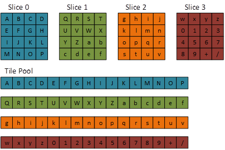
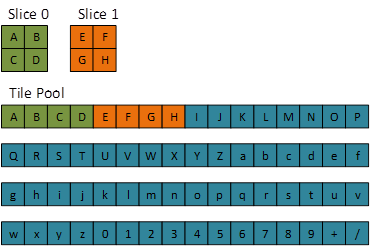
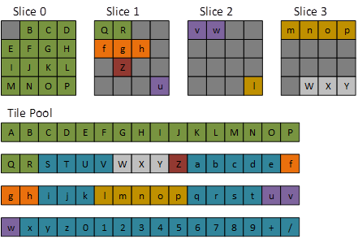
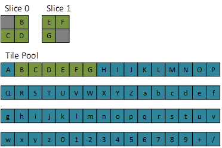
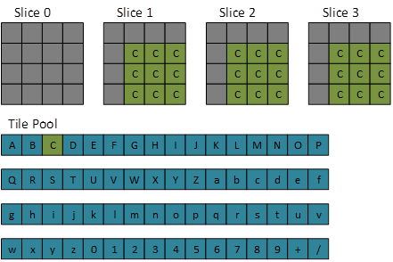
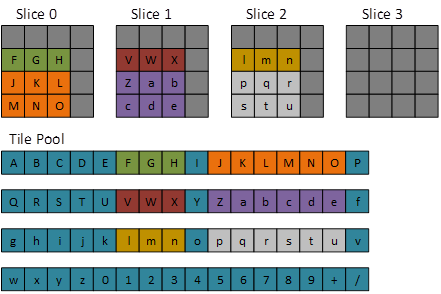

# Resources and memory

| Subject | Sections |
|---|---|
| Resource and heap model | [Identity](#resource-storage), [subresources](#subresources), [storage and ownership](#storage-models) |
| Descriptions and properties | [Resources](#resource-description), [heaps](#heap-properties), [heap flags](#heap-flags) |
| Explicit memory management | [Residency and budgets](#residency), [CPU mapping](#cpu-access) |
| Allocation and creation | [Allocation information](#allocation-info), [tight alignment](#tight-alignment), [creation methods](#creation-contracts) |
| Driver and hardware contract | [Allocation and residency](#allocation-driver), [memory access](#hardware-memory-access) |

<a id="resource-storage"></a>

## Resource identity and storage

Resources are the D3D concept which abstracts the usage of GPU physical memory. Resources require GPU virtual address (VA) space to access physical memory.

Resources are associated with virtual memory functionality, while heaps are associated with physical memory functionality. These associations are honored more at the DDI, to encourage driver simplification and ease DDI evolution. But, the associations are more loosely honored at the API, to simplify application concepts and avoid leveraging the available orthogonality implied by the DDI design.

Physical-address (PA) control does not mean that a game can reference actual physical addresses directly. For the most part, it refers to the fact that the game has control over how much physical memory is available (assuming it is under budget) and how it has the ability to explicitly map GPU VA (in the form of DX12 resources) to it.

The concept of "Heaps" in "Resource Heaps" is not to be confused with the other DX12 concepts of "Heaps" in the "Descriptor Heaps" or "Query Heaps" features.

Resources are aligned closer to the notion of a GPU virtual address range than physical video memory; but there is some flexibility for the driver. It can choose whether each resource typically reuses both virtual address range and physical memory, or if each resource has its own virtual address range mapped to the same physical memory.

<a id="resource-dimensions"></a>

## Resource dimensions

```cpp
typedef enum D3D12_RESOURCE_DIMENSION
{
    D3D12_RESOURCE_DIMENSION_UNKNOWN = 0,
    D3D12_RESOURCE_DIMENSION_BUFFER = 1,
    D3D12_RESOURCE_DIMENSION_TEXTURE1D = 2,
    D3D12_RESOURCE_DIMENSION_TEXTURE2D = 3,
    D3D12_RESOURCE_DIMENSION_TEXTURE3D = 4,
} D3D12_RESOURCE_DIMENSION;
```

### Buffers

Buffers are a contiguous memory region. Exhaustion of GPU virtual address space, memory residency budget (see [IDXGIAdapter3::QueryVideoMemoryInfo](https://learn.microsoft.com/en-us/windows/desktop/api/dxgi1_4/nf-dxgi1_4-idxgiadapter3-queryvideomemoryinfo)), and/or system memory may occur.

For buffers, `D3D12_RESOURCE_DESC::Width` is a nonzero size in bytes. For textures it is a size in texels; block-compressed texture dimensions are logical texel dimensions rather than compressed-block counts. GPU virtual-address capability fields report address-bit counts, not byte sizes or guarantees that an allocation will succeed.

### Texture1D

A Texture1D is a homogeneous array of 1D Textures. The array is homogeneous
in the sense that each Texture has the same data format and dimensions
(including miplevels). The entire array of Textures are created
atomically. The memory for the entire Resource need not be contiguous.

### Texture2D

A Texture2D is a homogeneous array of 2D Textures. The array is homogeneous
in the sense that each Texture has the same data format and dimensions
(including miplevels). The entire array of Textures are created
atomically. The memory for the entire Resource need not be contiguous.

### Texture3D

A Texture3D is a 3D grid data layout, supporting mipmaps; and is also
known as a Volume Texture. The entire Resource is created
atomically. The memory for the entire Resource need not be contiguous.

<a id="subresources"></a>

## Subresources

If a resource contains a buffer, then it simply contains one subresource with an index of 0. If the resource contains a texture (or texture array), then referencing the subresources is more complex.

A 3D texture mip level contains all depth slices of that mip; the depth slices are not array slices and do not have separate subresource indices.

Mip level 0 is the most detailed level. Each subsequent level halves each spatial dimension, rounding down, with a minimum of one texel in each dimension. Array-element counts do not shrink with mip level. The resource can contain fewer levels than the full chain.

### Mip slices

A mip slice includes one mipmap level for every texture in an array, as shown in the following image.


### Array slices

Given an array of textures, each texture with mipmaps, an array slice includes one texture and all of its mip levels, as shown in the following image.


### Plane slices

Typically planar formats are not used to store RGBA data, but in the cases where it is (perhaps 24bpp RGB data), one plane could represent the red image, one the green, and one the blue image. One plane though is not necessarily one color, two or more colors could be combined into one plane. More typically planar data is used for sub-sampled YCbCr and Depth-Stencil data. Depth-stencil formats can have separate depth and stencil planes.

### Subresource indexing

```cpp
UINT D3D12CalcSubresource(
    UINT MipSlice, UINT ArraySlice, UINT PlaneSlice, UINT MipLevels, UINT ArraySize
    )
{ return MipSlice + ArraySlice * MipLevels + PlaneSlice * MipLevels * ArraySize; }
```

`MipSlice`, `ArraySlice`, and `PlaneSlice` are zero-based indices. `MipLevels` and `ArraySize` are the resource's mip-level and array-element counts; `ArraySize` is 1 for a 3D texture. Mip indices vary fastest, followed by array indices and then plane indices. This is a logical indexing order, not a portable byte-offset formula for opaque texture storage.

<a id="storage-models"></a>

## Storage models

<a id="committed-resources"></a>

### Committed resources

Creating such a resource allocates virtual address range, an implicit heap large enough to fit the whole resource, and commits the virtual address range to the physical memory encapsulated by the heap.

<a id="placed-resources"></a>

### Placed resources

Applications may create heaps separate from resources. Afterward, the application may locate multiple resources within a single heap. This can be done without creating tiled or reserved resources, enabling the capabilities for all resource types able to be created directly by applications. Multiple resources may overlap; their reuse is subject to the applicable aliasing and initialization requirements.

Placement requirements are defined by [`CreatePlacedResource`](resources.md#create-placed-resource). Overlapping allocations do not by themselves establish synchronization or initialize texture metadata; the [legacy and enhanced metadata-initialization requirements](synchronization.md#enhanced-aliasing) apply.

<a id="reserved-resources"></a>

### Reserved resources

Shader [mapping-status feedback](common-shader-internals.md#mapping-feedback) and [sampler-feedback usage recording](common-shader-internals.md#sampler-feedback) have distinct meanings. Neither maps tiles, establishes residency nor synchronizes a mapping change.

On their creation, only a virtual address range is allocated and not mapped to any heap. The application will map such resources to heaps later. Such resources can be mapped to a heap at a 64KB tile granularity with `UpdateTileMappings`.

<a id="arrayed-packed-mips"></a>

#### Arrayed packed mips and Tier 4

Tiers 2 and 3 support arrayed, mipped tiled resources, but not resources combining more than one array slice with any mipmap having a dimension smaller than the corresponding standard tile extent for its format. Such small levels require packed mips.

Tiled resources Tier 4 includes Tier 3 behavior and permits `64KB_UNDEFINED_SWIZZLE` texture arrays with a full mip chain, including packed levels. This contribution does not apply to `64KB_STANDARD_SWIZZLE`.

Existing resource creation, `GetResourceTiling` and tile-mapping APIs operate on these resources without new method signatures. `D3D12_TILED_RESOURCES_TIER_4` reports support. Drivers report the tier through `D3D12DDI_TILED_RESOURCES_TIER_0117_4` starting at DDI version 0117; reporting the tier requires supporting and testing this resource shape.

The creation/runtime/debug-layer restrictions on arrayed packed-mip resources are relaxed only when the applicable Tier 4 support is exposed. The ordinary layout, resource description and mapping/synchronization requirements still apply.

<a id="resource-heap-allocation"></a>

### Resource and heap allocation

For resource backing in D3D12, the way to allocate physical video memory is by creating a heap. This can be done in one of two ways: implicitly by using `CreateCommittedResource`, or explicitly using `CreateHeap`.

`CreateHeap` creates backing storage without creating a valid D3D resource. In order to use that newly created heap memory, an application is then expected to create a placed resource within that heap or map a reserved resource to that heap.

For typical scenarios, in order to make a resource available to the GPU for rendering, both a resource and heap memory backing that resource need to exist; the resource for binding to the GPU and the heap to contain the actual data.

| Method | Creates resource | Creates heap |
| --- | --- | --- |
| `CreateHeap` | No | Yes |
| `CreatePlacedResource` | Yes | No |
| `CreateReservedResource`\* | Yes | No |
| `CreateCommittedResource` | Yes | Yes |

Table: Basic resource/heap creation method comparison.
\*While reserved resources are similar to placed resources, they can be created stand-alone without a pre-created heap and do not automatically get mapped to heap memory upon creation.

A heap can contain multiple placed resources. However, they do not provide the flexibility for the converse. Unlike reserved resources, placed resources cannot be used to access data in multiple heaps. Meaning, placed resources represent a one-heap-to-many-resources relationship, unlike the reserved resource's many-to-many relationship.

A reserved resource describes a region of VA — for example, a texture mip chain — while heaps describe regions of PA. Multiple heaps can back different regions of the same reserved resource, and any region of the reserved resource may be unmapped (i.e. not backed by any heap) at any given time. This many-to-many relationship between resources (VA) and heaps (PA) is the basis for fine-grained, runtime memory management.

<a id="resource-heap-ownership"></a>

### Ownership, destruction and reuse

As an example, if a game were to create a heap (PA) and then create a placed resource (VA) within that heap, simply destroying the placed resource will not lower a game's overall memory footprint; the heap itself must be destroyed to return memory back to the system.

A heap backing a resource (or sub-resource) that is no longer needed doesn't necessarily need to be destroyed; it could, for example, be reused for a higher-priority allocation instead, to remove the cost of recreating the heap later on.

Compression metadata is used by some hardware to provide performance benefits when accessing certain resources (e.g. fast clears, etc.). This typically comes at the cost of using slightly more memory. The amount of memory required is dependent on the hardware and implementation of specific optimizations.

Without going into too much detail, when using committed and placed resources, the amount of compression metadata required is known when the resource is created. A committed resource will create a heap behind the app's back with the requested size plus the amount of space required for the metadata. For placed resources, the game has the ability to determine how much space it needs including the compression metadata before the game needs to place it into an actual heap.

In the case of reserved resources however, since there is no heap space actually associated with the resource during resource creation, a driver may decide to allocate space elsewhere for the compression metadata. Although the space required for this metadata is not directly known by the game, the developer can use the budget querying APIs to check their before and after memory footprint.

It's also important to note that currently, in DX12, creating a new heap (even if it does not contain a resource) can allocate VA. For example, creating a reserved resource of 32MiB and a heap of 32MiB can consume 64MiB of virtual address space.

<a id="resource-binding-declarations"></a>

### Resource creation and pipeline bindings

`VERTEX_BUFFER`, `INDEX_BUFFER`, `STREAM_OUTPUT`, and `CONSTANT_BUFFER` bind flags are no longer declared at resource creation in D3D12. Instead, D3D12 buffers can be used by the GPU for all these purposes without declaration.

`DRAWINDIRECT_ARGS` is no longer required to be declared during resource creation in D3D12. Instead, D3D12 buffers can be used by the GPU for this purpose without declaration.

`ALLOW_RAW_VIEWS` and `BUFFER_STRUCTURED` are no longer required to be declared in D3D12. Instead, D3D12 buffers can be used as RAW Buffer SRVs without such up-front declaration. The structured buffer stride and the flags related to these features are specified by the view descriptor.

<a id="tiled-resources"></a>

## Reserved-resource tile organization

Reserved resources separate a resource's virtual address range from its physical backing. Tile mappings select 64-KB pages in heaps; they do not copy resource contents. A resource can simultaneously map tiles from multiple heaps. Changing the heap used for one mapping does not clear unrelated mappings.

[Heap creation and properties](#heap-properties), [residency](#residency), [GPU virtual address support](#tiled-virtual-address) and [resource lifetime](execution.md#lifetime) remain separate contracts. Heap memory must be resident when the GPU accesses it. Mapping a page is not a residency operation or a texture-metadata initialization.

The [layout definition](#texture-layout), [resource description](#resource-description), [format support](formats.md#support) and [resource flags](#resource-flags) constrain reserved-resource creation. Texture1D reserved resources are not supported. Textures created by `CreateReservedResource`, `CreateReservedResource1` or `CreateReservedResource2` must use `D3D12_TEXTURE_LAYOUT_64KB_UNDEFINED_SWIZZLE`. Tier 3 adds full Texture3D support; the [read-only volume capability](#tiled-tiers) is a separate contribution. Tier 4's arrayed packed-mip contribution is defined in [arrayed packed mips](#arrayed-packed-mips). Buffers use row-major layout; the tile shape is 65536 bytes.

<a id="tiled-sparse-storage"></a>

### Virtual reservation and sparse mapping storage

Whereas a committed resource's storage is allocated in the system when the resource is created, for a Tiled Resource,
the storage for the Resource contents is not allocated. Instead, when a Tiled Resource is created at the API, the system makes an address space reservation
for the tiled surface's area only, and then allows the mapping of the tiles to be controlled by the application. The "mapping" of a tile is simply
the physical location in memory that a logical tile in a resource points to (or NULL for an unmapped tile).
This is not to be confused with the notion of mapping a D3D resource for CPU access, which despite using the same name is completely independent. Reserved resources cannot be CPU-mapped with `ID3D12Resource::Map`.
The application can define and change the mapping of each tile individually as needed, knowing that all tiles for a surface don't need to be
mapped at a time, thereby making effective use of the amount of memory available.

The amount of storage associated with a Tiled Resource itself (independent of heap memory) should
be roughly proportional to the number of tiles actually mapped to the heap at any given time. In hardware this boils down to scaling the
memory footprint for page table storage roughly with the amount of tiles that are mapped (e.g. using a multilevel page table scheme as appropriate).

Let us explore what storage the page table itself could require in the worst case (though in practice implementations should only require storage roughly proportional to what is mapped).

Suppose each page table entry is 64 bits.

For the **worst-case** page table size hit for a single surface, using the dimensions in this example, suppose a Tiled Resource is created with a 128 bit-per-element format (e.g. RGBA float),
so a 64KB tile contains only 4096 pixels. A Texture2DArray of 16384\*16384\*2048 (but with only a single mipmap) would require about 1 GiB of storage in the
page table if fully populated (not including mipmaps) using 64 bit table entries. Adding mipmaps would grow the fully-mapped (worst case) page table storage by about a third, to about 1.3 GiB.

This would give access to about 10.6 TiB of addressable memory.

Another case to consider is a single Texture2D Tiled Resource of 16384\*16384 with a 32 bit-per-element format, including mipmaps.
The space needed in a fully populated page table would be roughly 171 KiB with 64 bit table entries.

Finally, consider an example using a BC format, say BC7 with 128 bits per compression block of 4x4 pixels. That is one byte per pixel. A Texture2DArray of 16384\*16384\*2048 including mipmaps
would require roughly 85.3 MiB to fully populate this memory in a page table. That is not bad considering this allows one Tiled Resource to span approximately 733 billion texels (approximately 683 GiB including mipmaps).

In practice nowhere near these full mappings would be defined given that the amount of physical memory available wouldn't allow anywhere near that much to be mapped and referenced at a time anyway. With
a heap, however, applications could choose to reuse tiles (as a simple example, reusing a "black" colored tile for large black regions in an image) - effectively using the heap
(i.e. page table mappings) as a tool for memory compression.

The initial contents of the page table are NULL for all entries. Applications also can't pass initial
data for the memory contents of the surface since it starts off with no memory backing.

The page-table examples assume 64-bit entries and a full mip chain where stated; they do not require a particular hardware page-table implementation. Resource dimensions, virtual address limits and residency budgets remain independent restrictions. Heaps are not resizable; additional heaps and mapping changes provide independently allocated backing.

<a id="standard-tile-shapes"></a>

### Standard tile shapes

When a Tiled Resource is created, the dimensions, format element size and number of mipmaps and/or array slices (if applicable) determine
the number of tiles that would be required to back the entire surface area. For `64KB_UNDEFINED_SWIZZLE`, the pixel/byte layout within tiles is implementation-chosen. The number of pixels that fit in a tile, depending on the format element size, is fixed and identical whether using standard swizzle or not.

This means that the number of tiles that will be used by a given surface size and format element width is well defined/predictable based on the following tables.
For Resources that contain mipmaps, or cases where surface dimensions don't fill a tile, however, there are some constraints, discussed in [mipmap packing](#tiled-mipmap-packing).

The complete [shared-tile data compatibility and inheritance contract](#tiled-data-compatibility) defines compatible format/dimension cases, packed/nonpacked solid-color sharing, zero-filled inheritance and mapping-local metadata requirements.

The layout of data within a tile does not depend on where the tile is mapped in a resource overall. So, for example, a tile can be reused in different locations of a surface at once with consistent behavior in all locations.

#### Texture2D and texture arrays

(not counting tail mip packing)

| **Bits/Pixel (1 sample/pixel)** | **Tile Dimensions (Pixels, WxH)** |
| --- | --- |
| 8 | 256x256 |
| 16 | 256x128 |
| 32 | 128x128 |
| 64 | 128x64 |
| 128 | 64x64 |
| BC1,4 | 512x256 |
| BC2,3,5,6,7 | 256x256 |

Other format bit counts not supported with Tiled Resources: 96bpp formats, video formats, R1_UNORM, R8G8_B8G8_UNORM, G8R8_G8B8_UNORM.

| **Multisample Count** | **Divide Tile Dimensions Above by (WxH)** |
| --- | --- |
| 1 | 1x1 |
| 2 | 2x1 |
| 4 | 2x2 |
| 8 | 4x2 |
| 16 | 4x4 |

The supported sample counts and quality levels are reported by the tiled-resource multisample query. The table specifies the shape scaling for each listed sample count; it does not assert support for that count.

Tiled Resources with sample counts larger than 1 cannot use 128bpp formats.

#### Texture3D

| **Bits/Pixel (1 sample/pixel)** | **Tile Dimensions (Pixels, WxHxD)** |
| --- | --- |
| 8 | 64x32x32 |
| 16 | 32x32x32 |
| 32 | 32x32x16 |
| 64 | 32x16x16 |
| 128 | 16x16x16 |
| BC1,4 | 128x64x16 |
| BC2,3,5,6,7 | 64x64x16 |

Other format bit counts not supported with Tiled Resources: 96bpp formats, video formats, R1_UNORM, R8G8_B8G8_UNORM, G8R8_G8B8_UNORM.

<a id="tiled-volume-examples"></a>

#### Three-dimensional traversal examples

In the diagrams below, dark gray represents NULL tiles.

- Texture 3D Tiled Resource default mapping (most detailed mip)
- Texture 3D Tiled Resource default mapping (second most detailed mip)
- Texture 3D Tiled Resource (most detailed mip)
- Texture 3D Tiled Resource (second most detailed mip)
- Texture 3D Tiled Resource (Offset Box)
- Texture 3D Tiled Resource (Uniform Box)

##### Texture 3D tiled resource default mapping (most-detailed mip)



##### Texture 3D tiled resource default mapping (second-most-detailed mip)



##### Texture 3D tiled resource (most-detailed mip)

The following code sets up a 3D tiled resource at the most-detailed mip.

```cpp
D3D12_TILED_RESOURCE_COORDINATE trCoord{};
trCoord.X = 1;
trCoord.Y = 0;
trCoord.Z = 0;
trCoord.Subresource = 0;

D3D12_TILE_REGION_SIZE trSize{};
trSize.UseBox = false;
trSize.NumTiles = 63;
```



##### Texture 3D tiled resource (second-most-detailed mip)

The following code sets up a 3D tiled resource, and the second most detailed mip.

```cpp
D3D12_TILED_RESOURCE_COORDINATE trCoord{};
trCoord.X = 1;
trCoord.Y = 0;
trCoord.Z = 0;
trCoord.Subresource = 1;

D3D12_TILE_REGION_SIZE trSize{};
trSize.UseBox = false;
trSize.NumTiles = 6;
```



##### Texture 3D tiled resource (offset box)

The following code selects a 3-by-3-by-3 box of tiles.

```cpp
D3D12_TILED_RESOURCE_COORDINATE trCoord{};
trCoord.X = 1;
trCoord.Y = 1;
trCoord.Z = 1;
trCoord.Subresource = 0;

D3D12_TILE_REGION_SIZE trSize{};
trSize.UseBox = true;
trSize.NumTiles = 27;
trSize.Width = 3;
trSize.Height = 3;
trSize.Depth = 3;
```



##### Texture 3D tiled resource (uniform box)

The following code sets up a uniform box tiled resource.

```cpp
D3D12_TILED_RESOURCE_COORDINATE trCoord{};
trCoord.X = 0;
trCoord.Y = 1;
trCoord.Z = 0;
trCoord.Subresource = 0;

D3D12_TILE_REGION_SIZE trSize{};
trSize.UseBox = true;
trSize.NumTiles = 27;
trSize.Width = 3;
trSize.Height = 3;
trSize.Depth = 3;
```



#### Buffers

A Buffer Resource is trivially divided into 64KB tiles, with some empty space in the last tile if the size is not a multiple of 64KB.

Structured Buffers must have no constraint on the Stride to be Tiled, however possible performance optimizations in hardware
for using Structured Buffers may be sacrificed by making them Tiled in the first place.

Typed buffer views on a tiled resource don't support 96bpp formats, video formats, R1_UNORM, R8G8_B8G8_UNORM, G8R8_G8B8_UNORM.

<a id="tiled-mipmap-packing"></a>

### Standard mips and packed mip tails

Depending on the [tier](#tiled-tiers) of Tiled Resources support, mipmaps with certain dimensions do not follow the standard tile shapes and
are considered to all be packed together with one another in a manner that is opaque to the application. Higher Tiers of support have broader guarantees about what
types of surface dimensions fit in the standard tile shapes (and can therefore be individually mapped by applications).

What can vary between implementations is that -
given a Tiled Resource's dimensions, format, number of mipmaps and array slices - some number M of mips (per array slice) may be packed into some number N tiles. The
[GetResourceTiling](#get-resource-tiling) API exists to allow the driver to report to the application what M and N are (among other details about the surface
that this API reports that are standard and do not vary by IHV). The set of tiles for the packed mips are still 64KB and can be individually mapped into disparate locations
in a heap, however the pixel shape of the tiles and how the mipmaps fit across the set of tiles is IHV specific and too complex to expose. So applications are required
to either map all of the tiles that are designated as packed, or none of them, at a time. Otherwise the behavior for accessing the Tiled Resource is undefined.

For arrayed surfaces, the set of packed mips and the number of packed tiles storing those mips (M and N described above) applies individually for each array slice.

Dedicated APIs for [CopyTiles](resource-operations.md#copytiles) cannot access packed mips. Applications that wish to copy data to/from packed mips can do so using all the
non-Tiled Resource specific APIs for copying and rendering to surfaces.

For the purposes of populating the contents of mipmapped Tiled Resources for mips that are non packed (use the standard tile shapes) from CPU memory
(using upload buffers), there is a well defined CPU-side layout for the tiling of all mipmaps independent of implementation (described in the [CopyTiles](resource-operations.md#copytiles) section).
Implementations can hide any differences in tile breakdown of mipmaps on the GPU side during Copy operations.

<a id="tile-types"></a>

### Tile coordinates and regions

<a id="d3d12-tiled-resource-coordinate"></a>

#### D3D12_TILED_RESOURCE_COORDINATE

##### Syntax

```cpp
typedef struct D3D12_TILED_RESOURCE_COORDINATE {
  UINT X;
  UINT Y;
  UINT Z;
  UINT Subresource;
} D3D12_TILED_RESOURCE_COORDINATE;
```

##### Members

`X`

The x-coordinate of the tiled resource.

`Y`

The y-coordinate of the tiled resource.

`Z`

The z-coordinate of the tiled resource.

`Subresource`

The index of the subresource for the tiled resource.

For mipmaps that use nonstandard tiling, or are packed, or both use nonstandard tiling and are packed, any subresource value that indicates any of the packed mipmaps all refer to the same tile. Additionally, the X coordinate is used to indicate a tile within the packed mip region, rather than a logical region of a single subresource. The Y and Z coordinates must be zero.

##### Remarks

This structure is used by the [CopyTiles](resource-operations.md#copytiles), [CopyTileMappings](resources.md#copy-tile-mappings) and [UpdateTileMappings](resources.md#update-tile-mappings) methods.

<a id="d3d12-tile-region-size"></a>

#### D3D12_TILE_REGION_SIZE

##### Syntax

```cpp
typedef struct D3D12_TILE_REGION_SIZE {
  UINT   NumTiles;
  BOOL   UseBox;
  UINT   Width;
  UINT16 Height;
  UINT16 Depth;
} D3D12_TILE_REGION_SIZE;
```

##### Members

`NumTiles`

The number of tiles in the tiled region.

`UseBox`

Specifies whether the runtime uses the **Width**, **Height**, and **Depth** members to define the region.

If **TRUE**, the runtime uses the **Width**, **Height**, and **Depth** members to define the region. In this case, **NumTiles** should be equal to **Width** \* **Height** \* **Depth**.

If **FALSE**, the runtime ignores the **Width**, **Height**, and **Depth** members and uses the **NumTiles** member to traverse tiles in the resource linearly across x, then y, then z (as applicable) and then spills over mipmaps/arrays in subresource order. For example, use this technique to map an entire resource at once.

Regardless of whether you specify **TRUE** or **FALSE** for **UseBox**, you use a [D3D12_TILED_RESOURCE_COORDINATE](#d3d12-tiled-resource-coordinate) structure to specify the starting location for the region within the resource as a separate parameter outside of this structure by using x, y, and z coordinates.

When the region includes mipmaps that are packed with nonstandard tiling, **UseBox** must be **FALSE** because tile dimensions are not standard and the app only knows a count of how many tiles are consumed by the packed area, which is per array slice. The corresponding (separate) starting location parameter uses x to offset into the flat range of tiles in this case, and y and z coordinates must each be 0.

`Width`

The width of the tiled region, in tiles. Used for buffer and 1D, 2D, and 3D textures.

`Height`

The height of the tiled region, in tiles. Used for 2D and 3D textures.

`Depth`

The depth of the tiled region, in tiles. Used for 3D textures or arrays. For arrays, used for advancing in depth jumps to next slice of same mipmap size, which isn't contiguous in the subresource counting space if there are multiple mipmaps.

##### Remarks

This structure is used by the [CopyTiles](resource-operations.md#copytiles), [CopyTileMappings](resources.md#copy-tile-mappings) and [UpdateTileMappings](resources.md#update-tile-mappings) methods.

Coordinates index tiles, not pixels or bytes. Box regions traverse X fastest, then Y, then Z; a box cannot span mip levels. For arrays, `Depth` selects consecutive array slices at the same mip level, so the subresource-index stride is the resource's mip count, not one. A linear region can spill across mips and array slices in subresource order. A region containing packed mips must use `UseBox = FALSE`; its X is a flat packed-tile offset and Y and Z must be zero.

A packed-subresource coordinate refers to the packed tail of its own array slice, not one tail shared by all array slices.

`NumTiles` must equal `Width * Height * Depth` for a box. The region must fit the selected resource, and dimension/count arithmetic must not overflow. `NumTiles = 0` does not designate the whole resource. The whole-resource default belongs only to the optional-array rules of `UpdateTileMappings`; its checked-layer zero-count diagnostics are described with that method.

<a id="tiling-metadata"></a>

### Tiling metadata

<a id="d3d12-tile-shape"></a>

#### D3D12_TILE_SHAPE

##### Declaration

```cpp
typedef struct D3D12_TILE_SHAPE {
  UINT WidthInTexels;
  UINT HeightInTexels;
  UINT DepthInTexels;
} D3D12_TILE_SHAPE;
```

##### Members

`WidthInTexels`

The width in texels of the tile.

`HeightInTexels`

The height in texels of the tile.

`DepthInTexels`

The depth in texels of the tile.

##### Remarks

This structure is used by the [GetResourceTiling](resources.md#get-resource-tiling) method.

<a id="d3d12-packed-mip-info"></a>

#### D3D12_PACKED_MIP_INFO

##### Declaration

```cpp
typedef struct D3D12_PACKED_MIP_INFO {
  UINT8 NumStandardMips;
  UINT8 NumPackedMips;
  UINT  NumTilesForPackedMips;
  UINT  StartTileIndexInOverallResource;
} D3D12_PACKED_MIP_INFO;
```

##### Members

`NumStandardMips`

The number of standard mipmaps in the tiled resource.

`NumPackedMips`

The number of packed mipmaps in the tiled resource.

This number starts from the least detailed mipmap (either sharing tiles or using non standard tile layout). This number is 0 if no such packing is in the resource. For array surfaces, this value is the number of mipmaps that are packed for a given array slice where each array slice repeats the same packing.

On Tier\_2 tiled resources hardware, mipmaps that fill at least one standard shaped tile in all dimensions are not allowed to be included in the set of packed mipmaps. On Tier\_1 hardware, mipmaps that are an integer multiple of one standard shaped tile in all dimensions are not allowed to be included in the set of packed mipmaps. Mipmaps with at least one dimension less than the standard tile shape may or may not be packed. When a given mipmap needs to be packed, all coarser mipmaps for a given array slice are considered packed as well.

`NumTilesForPackedMips`

The number of tiles for the packed mipmaps in the tiled resource.

If there is no packing, this value is meaningless and is set to 0. Otherwise, it is set to the number of tiles that are needed to represent the set of packed mipmaps. The pixel layout within the packed mipmaps is hardware specific. If apps define only partial mappings for the set of tiles in packed mipmaps, read and write behavior is vendor specific and undefined. For arrays, this value is only the count of packed mipmaps within the subresources for each array slice.

`StartTileIndexInOverallResource`

The offset of the first packed tile for the resource in the overall range of tiles. If **NumPackedMips** is 0, this value is meaningless and is 0. Otherwise, it is the offset of the first packed tile for the resource in the overall range of tiles for the resource. A value of 0 for **StartTileIndexInOverallResource** means the entire resource is packed. For array surfaces, this is the offset for the tiles that contain the packed mipmaps for the first array slice. Packed mipmaps for each array slice in arrayed surfaces are at this offset past the beginning of the tiles for each array slice.
**Note** The number of overall tiles, packed or not, for a given array slice is simply the total number of tiles for the resource divided by the resource's array size, so it is easy to locate the range of tiles for any given array slice, out of which **StartTileIndexInOverallResource** identifies which of those are packed.
##### Remarks

This structure is used by the [GetResourceTiling](resources.md#get-resource-tiling) method.

<a id="d3d12-subresource-tiling"></a>

#### D3D12_SUBRESOURCE_TILING

##### Declaration

```cpp
typedef struct D3D12_SUBRESOURCE_TILING {
  UINT   WidthInTiles;
  UINT16 HeightInTiles;
  UINT16 DepthInTiles;
  UINT   StartTileIndexInOverallResource;
} D3D12_SUBRESOURCE_TILING;
```

##### Members

`WidthInTiles`

The width in tiles of the subresource.

`HeightInTiles`

The height in tiles of the subresource.

`DepthInTiles`

The depth in tiles of the subresource.

`StartTileIndexInOverallResource`

The index of the tile in the overall tiled subresource to start with.

##### Remarks

This structure is used by the [GetResourceTiling](resources.md#get-resource-tiling) method.

<a id="d3d12-tile-range-flags"></a>

#### D3D12_TILE_RANGE_FLAGS

##### Declaration

```cpp
typedef enum D3D12_TILE_RANGE_FLAGS {
  D3D12_TILE_RANGE_FLAG_NONE = 0,
  D3D12_TILE_RANGE_FLAG_NULL = 1,
  D3D12_TILE_RANGE_FLAG_SKIP = 2,
  D3D12_TILE_RANGE_FLAG_REUSE_SINGLE_TILE = 4
} D3D12_TILE_RANGE_FLAGS;
```

##### Constants

| Constant | Value | Meaning |
| --- | --- | --- |
| `D3D12_TILE_RANGE_FLAG_NONE` | `0` | No tile-mapping flags are specified. |
| `D3D12_TILE_RANGE_FLAG_NULL` | `1` | The tile range is **NULL**. |
| `D3D12_TILE_RANGE_FLAG_SKIP` | `2` | Skip the tile range. |
| `D3D12_TILE_RANGE_FLAG_REUSE_SINGLE_TILE` | `4` | Reuse a single tile in the tile range. |

##### Remarks

Use these flags with [ID3D12CommandQueue::UpdateTileMappings](resources.md#update-tile-mappings).

<a id="d3d12-tile-mapping-flags"></a>

#### D3D12_TILE_MAPPING_FLAGS

##### Declaration

```cpp
typedef enum D3D12_TILE_MAPPING_FLAGS {
  D3D12_TILE_MAPPING_FLAG_NONE = 0,
  D3D12_TILE_MAPPING_FLAG_NO_HAZARD = 0x1
} D3D12_TILE_MAPPING_FLAGS;
```

##### Constants

| Constant | Value | Meaning |
| --- | --- | --- |
| `D3D12_TILE_MAPPING_FLAG_NONE` | `0` | No tile-mapping flags are specified. |
| `D3D12_TILE_MAPPING_FLAG_NO_HAZARD` | `0x1` | Unsupported, do not use. |

##### Remarks

This enum is used by the following methods:

- [CopyTileMappings](resources.md#copy-tile-mappings)
- [UpdateTileMappings](resources.md#update-tile-mappings)

`D3D12_TILE_MAPPING_FLAG_NONE` is the supported mapping-operation flag. `D3D12_TILE_MAPPING_FLAG_NO_HAZARD` remains declared as `0x1` but is unsupported and must not be used. It does not establish an application hazard promise or synchronization relaxation.

Each range has one interpretation: `NONE` (consecutive heap tiles), `NULL` (unmapped), `SKIP` (leave mappings unchanged), or `REUSE_SINGLE_TILE` (repeat one heap tile). These are range alternatives, not independent composable behaviors. Undeclared flag bits are not valid application flags.

<a id="tiled-tiers"></a>

### Tiers and access behavior

#### Declaration

```cpp
typedef enum D3D12_TILED_RESOURCES_TIER {
  D3D12_TILED_RESOURCES_TIER_NOT_SUPPORTED = 0,
  D3D12_TILED_RESOURCES_TIER_1 = 1,
  D3D12_TILED_RESOURCES_TIER_2 = 2,
  D3D12_TILED_RESOURCES_TIER_3 = 3,
  D3D12_TILED_RESOURCES_TIER_4 = 4
} D3D12_TILED_RESOURCES_TIER;
```

`D3D12_FEATURE_DATA_D3D12_OPTIONS::TiledResourcesTier` reports the supported cumulative tier. Tier 0 does not permit reserved resources, including buffers. Tier 1 supports reserved buffers and 2D textures but NULL-mapped GPU reads and writes are undefined, including possible device removal. Tier 2 adds defined NULL-read/write handling and shader LOD-clamp/mapping-status instructions. Feature level 12_0 requires Tier 2 or greater. Tier 3 adds volume tiled resources. Tier 4 adds the [arrayed full mip chain](#arrayed-packed-mips) for `64KB_UNDEFINED_SWIZZLE`.

On Tier 1, only mips whose dimensions are integer multiples of the standard tile shape are guaranteed nonpacked. The first mip not satisfying that condition and all coarser mips may form an opaque packed tail. Such a resource cannot have more than one array slice. Tier 1 does not expose the tiled shader status/LOD-clamp instructions. Heap buffer-versus-texture restrictions are defined by [heap flags](#heap-flags); updating mappings does not change heap flags.

On Tier 2 and higher, mips at least one standard tile in every dimension are guaranteed nonpacked. Smaller mips may be packed, and once one mip is packed all coarser mips in that array slice are packed. Tiers 2 and 3 do not permit arrayed packed tails; Tier 4 removes that restriction for the selected undefined-swizzle layout.

Format support is reported by `D3D12_FORMAT_SUPPORT2_TILED`. Tiled MSAA quality levels use `D3D12_FEATURE_MULTISAMPLE_QUALITY_LEVELS` with `D3D12_MULTISAMPLE_QUALITY_LEVELS_FLAG_TILED_RESOURCE`; support and quality levels need not equal the non-tiled case. The ordinary [format-support owner](formats.md#support) retains the whole feature-query API.

`D3D12_FEATURE_DATA_D3D12_OPTIONS5::SRVOnlyTiledResourceTier3` independently permits read-only volume tiled resources without full Tier 3 support. This does not permit render-target, depth-stencil or unordered-access flags on those volumes; those uses require full Tier 3.

<a id="tiled-virtual-address"></a>

#### GPU virtual address limits

##### Declaration

```cpp
typedef struct D3D12_FEATURE_DATA_GPU_VIRTUAL_ADDRESS_SUPPORT {
  UINT MaxGPUVirtualAddressBitsPerResource;
  UINT MaxGPUVirtualAddressBitsPerProcess;
} D3D12_FEATURE_DATA_GPU_VIRTUAL_ADDRESS_SUPPORT;
```

##### Members

`MaxGPUVirtualAddressBitsPerResource`

The maximum GPU virtual address bits per resource.

Some adapters have significantly less bits available per resource than per process, while other adapters have significantly greater bits available per resource than per process. The latter scenario tends to happen in less common scenarios, like when running a 32-bit process on certain UMA adapters. When per resource capabilities are greater than per process, the greater per resource capabilities can only be leveraged by reserved resources or NULL mapped pages.

`MaxGPUVirtualAddressBitsPerProcess`

The maximum GPU virtual address bits per process.

When this value is nearly equal to the available residency budget, [Evict](https://learn.microsoft.com/en-us/windows/desktop/api/d3d12/nf-d3d12-id3d12device-evict) will not be a feasible option to manage residency. See [MakeResident](https://learn.microsoft.com/en-us/windows/desktop/api/d3d12/nf-d3d12-id3d12device-makeresident) for more details.

##### Query

See the enumeration constant D3D12\_FEATURE\_GPU\_VIRTUAL\_ADDRESS\_SUPPORT in the [D3D12_FEATURE](https://learn.microsoft.com/en-us/windows/desktop/api/d3d12/ne-d3d12-d3d12_feature) enumeration.

#### Stencil-containing formats

Formats containing stencil are not supported with Tiled Resources.

This includes DXGI_FORMAT_D24_UNORM_S8_UINT (and related formats in the R24G8 family) and DXGI_FORMAT_D32_FLOAT_S8X24_UINT (and related formats in the R32G8X24 family).

Format availability is governed by [tiled format support](formats.md#support) and the [depth-stencil resource flags](#resource-flags).

#### Pipeline access

Tiled Resources can be used in Shader Resource Views, Render Target Views, Depth Stencil Views and Unordered Access Views, as well
as some bindpoints where Views aren't used, such as Vertex Buffer bindings. See [resource creation and pipeline bindings](#resource-binding-declarations). Copy\* operations also work on Tiled Resources.

If multiple tile coordinates in one or more views are bound to the same memory location, reads and writes from different paths to the same memory will occur in
a nondeterministic/nonrepeatable order of memory accesses.

If all tiles behind a memory access footprint from a shader are mapped to unique tiles, behavior is identical on all implementations to the surface having the same memory contents in a non-tiled fashion.

#### Shader-resource views

Behavior for SRV reads that involve non-mapped tiles depends on the level of hardware support - see read behavior in [tiled-resource tiers](#tiled-tiers)
for a breakdown of requirements. The following summarizes Tier 2 and higher read behavior.

Consider a texture filter operation that reads from a set of texels in an SRV. Texels that fall on non-mapped tiles contribute 0 in all non-missing components of the format, and the
[default for missing components](formats.md#missing-components)(19.1.3.3), into the overall filter operation
alongside contributions from mapped texels. The texels are all weighted and combined together independent of whether the data came from mapped or non-mapped tiles.

**Compatibility:** Some first generation Tier 2 level hardware does not meet this spec requirement and returns the 0 with defaults described above as the overall filter result if ANY texels (with nonzero weight) fall on non-mapped tiles.
Other hardware must include all nonzero-weight texels in the filter.

#### Unordered-access views

Behavior of UAV reads and writes depends on the level of hardware support. See overall read and write behavior for [tiled-resource tiers](#tiled-tiers)
for a breakdown of requirements.

For accesses to unmapped tiles on Tier 2 and higher (subject to the cache qualification below):

Shader operations that read from a non-mapped tile in a UAV return 0 in all non-missing components of the format, and the
[default for missing components](formats.md#missing-components)(19.1.3.3).

Shader operations that attempt to write to a non-mapped tile cause nothing to be written to the non-mapped area (while writes to mapped area
proceed). This ideal definition for write handling is not required by Tier 2 - writes to non-mapped tiles may end up in a cache that subsequent reads could pick up.

#### Depth-stencil views

Behavior of DSV reads and writes depends on the level of hardware support. See overall read and write behavior for [tiled-resource tiers](#tiled-tiers)
for a breakdown of requirements.

For accesses to unmapped tiles on Tier 2 and higher (subject to the cache qualification below):

If a tile is not mapped in the DepthStencilView, the return value from reading depth is 0, which is then fed into whatever operation(s) are configured for the depth read value. Writes to the missing depth tile are dropped.
This ideal definition for write handling is not required by Tier 2 - writes to non-mapped tiles may end up in a cache that subsequent reads could pick up.

#### Render-target views

Behavior of RTV reads and writes depends on the level of hardware support. See overall read and write behavior for [tiled-resource tiers](#tiled-tiers)
for a breakdown of requirements.

On all implementations it is valid for different RTVs (and DSV) bound simultaneously to have different areas mapped vs non-mapped and have different sized surface formats (which means different tile shapes).

For accesses to unmapped tiles on Tier 2 and higher (subject to the cache qualification below):

Reads from unmapped tiles in RenderTargetViews return 0 in all non-missing components of the format, and the [default for missing components](formats.md#missing-components)(19.1.3.3).
Writes to unmapped tiles in RenderTargetViews are dropped. This ideal definition for write handling is not required - writes to non-mapped tiles may end up in a cache that subsequent reads could pick up.

[Shader mapping-status feedback](common-shader-internals.md#mapping-feedback) defines the opaque access status, Fully Mapped Check (including zero-weight texels and missing components), and per-sample MinLOD clamp. [Min/max reduction filtering](common-shader-internals.md#minmax-filtering) owns the reduction rules. [Sampler feedback](common-shader-internals.md#sampler-feedback) records sampling usage and is not a tile-mapping operation.

<a id="tiled-data-compatibility"></a>

### Shared tiles and compatible data inheritance

Heaps can be shared with other processes just like traditional resources. Reserved resources (which reference heaps) cannot be shared across devices/processes. However separate processes
can create their own reserved resources that map to heap(s) shared between them.

Shared Heaps cannot be resized.

Different Tiled Resources can point to the same memory with different formats as long as applications don't rely on the results of writing to the memory with one format and reading with another,
unless the formats are in the same format family (have the same typeless parent format) - e.g. R8G8B8A8_UNORM and R8G8B8A8_UINT are compatible with each other but not with R16G16_UNORM. There is one exception
where bleeding data from one format aliasing to another is well defined: A tile that completely contains 0 for all its bits can be used with any format that interprets those memory contents as 0 (regardless of memory
layout). So a tile could be cleared to 0x00 with the format R8_UNORM and then used with a format like R32G32_FLOAT and it would appear the contents are still (0.0f,0.0f).

The format-family and all-zero cases above are supplemented by the specific BC/uncompressed and packed/nonpacked solid-color compatibility cases below. All data inheritance remains subject to the mapping-local metadata and aliasing requirements in this section.

Suppose multiple Tiled Resources have mappings to the same heap locations and each resource is used to access the same data. This is only valid if problems with hardware
optimization structures are avoided, the applicable D3D12 aliasing synchronization is performed and the Tiled Resources are compatible with each other. The latter is described here (in terms of what it means
for Tiled Resources sharing tiles to be incompatible). The conditions for incompatibility when accessing the same data across duplicate tile mappings are the use of different surface dimensions,
format, or differences in the presence of RenderTarget or DepthStencil resource flags on the
Resources. Writing to the memory with one type of mapping produces undefined results if subsequently reading or rendering via a mapping from an
incompatible Resource. If the other Resource sharing mappings will be first initialized with new data (recycling the memory for a different purpose), that is fine since
data is not bleeding across incompatible interpretations, however the [D3D12 aliasing synchronization](synchronization.md#enhanced-aliasing) must be performed when switching between accessing incompatible mappings like this.

If the RenderTarget or DepthStencil resource flag is not set on any of the resources sharing mappings with each other, there are far fewer restrictions:
As long as the format and surface types (e.g Texture2D) are the same, tiles can be shared. Some cases of different format are compatible such as BC\* surfaces and the equivalent sized
uncompressed 32 bit or 16 bit per component format, like BC6H and R32G32B32A32. Many 32 bit per element formats can be aliased with R32_\* as well (R10G10B10A2_\*, R8G8B8A8_\*, B8G8R8A8_\*,B8G8R8X8_\*,R16G16_\*) -
this has always been allowed for non Tiled Resources.

Sharing between packed and non-packed tiles is fine if the formats are compatible and the tiles are filled with solid color.

Finally, if nothing is common about the Resources sharing tile mappings except that none have RenderTarget/DepthStencil resource flags, then only memory filled with 0 can
be shared safely - it will appear as whatever 0 decodes to for the definition of the given Resource format (typically just 0).

Suppose an Unordered Access View on a Tiled Resource has duplicate tile mappings in its area or with other resources bound to the pipeline. Ordering of accesses to these duplicated tiles is
undefined if performed by different threads, just as any ordering of memory access to UAVs in general is unordered.

If a Tiled Resource's tile mappings have changed or content in mapped heap tiles have changed via another Tiled Resource's mappings,
and the Tiled Resource is going to be rendered via RenderTargetView or DepthStencilView, the application must initialize the affected mapping-local metadata before rendering, using the applicable [enhanced aliasing and initialization contract](synchronization.md#enhanced-aliasing) or [legacy aliasing path](synchronization.md#legacy-aliasing). The enhanced contract permits the specified full-subresource discard path, as well as the applicable clear/copy initialization paths, subject to that owner's synchronization and discard conditions. Failure to perform the required initialization results in hardware optimization structures for the given
RenderTargetView or DepthStencilView being stale and will result in garbage rendering results on some hardware and inconsistency across different hardware. These hidden optimization data structures
used by hardware may be local to individual mappings, not visible to other mappings to the same memory.

If an application chooses clear-based initialization and needs to preserve existing memory contents of areas in a Tiled Resource where mappings have changed, it has to preserve those contents across the clear. This can be accomplished by
the application by first saving the contents where Tile mappings have changed (by copying them to a temporary surface, for example using CopyTiles()), issuing the Clear and then copying the contents back.
While this would accomplish the task of preserving surface contents for incremental Rendering, the downside is that subsequent rendering performance on the surface may suffer because rendering optimizations may
be lost.

If a tile is mapped into multiple Tiled Resources at the same time and tile contents are manipulated by any means (render, copy etc.) via one of the Tiled Resources then if the same tile is to be rendered via any other
Tiled Resource, the tile's mapping-local metadata must first be initialized under the applicable D3D12 aliasing and initialization contract.

Suppose an area in a Tiled Resource is being rendered to and the heap tiles referenced by the render area are also mapped to from outside the render area (including via other Tiled Resources, at the same time or not).
Data rendered to these tiles is not
guaranteed to appear correctly when viewed through the other mappings, even though the underlying memory layout is compatible.
This is due to optimization data structures some hardware uses that can be local to individual mappings for renderable surfaces, not visible to other mappings to the same memory location.
This restriction can be worked around by copying from the rendered mapping to all the other mappings to the same memory that might be accessed
(or clearing that memory or copying other data to it if the old contents are no longer needed).
While this seems redundant, it makes all other mappings to the same memory correctly understand how to access its contents, and
at least the memory savings of having only a single physical memory backing remains intact. Also, note that when switching between using different Tiled Resources that share mappings (unless only reading),
the [D3D12 aliasing synchronization](synchronization.md#enhanced-aliasing) must be performed in between.

If an area in a Tiled Resource is being rendered to and within the render area multiple tiles are mapped to the same heap location, rendering results are undefined on those tiles.

The [enhanced aliasing and initialization contract](synchronization.md#enhanced-aliasing), together with the supported [legacy aliasing path](synchronization.md#legacy-aliasing), constrains data inheritance and metadata initialization. Updated mappings do not initialize texture metadata. Newly mapped render-target/depth-stencil tiles require the initialization specified by that owner before rendering; sharing physical pages does not make mapping-local optimization metadata visible through another resource.

For reserved textures, the legacy-state compatibility requirement for data inheritance is `COMMON`. Per-tile inheritance through either `64KB_UNDEFINED_SWIZZLE` or `64KB_STANDARD_SWIZZLE` also requires `COMMON`. The standard-swizzle inheritance case does not extend the permitted layouts of reserved-texture creation; tiled layout and reserved creation are distinct properties. Render-target/depth-stencil textures cannot use ordinary per-tile aliasing to inherit their optimization metadata. These restrictions are additional to format/dimension compatibility, not overridden by it.

[Copy overlap and duplicate-destination rules](resource-operations.md#copy-self-and-alias) apply to content copies. The temporary-source guarantee for overlapping `CopyTileMappings` copies mappings, not bytes, and grants no overlapping-content-copy permission.

<a id="reserved-resource-apis"></a>

## Reserved-resource creation and tiling APIs

<a id="create-reserved-resource"></a>

### ID3D12Device::CreateReservedResource

#### Declaration

```cpp
HRESULT CreateReservedResource(
    const D3D12_RESOURCE_DESC *pDesc,
    D3D12_RESOURCE_STATES InitialState,
    const D3D12_CLEAR_VALUE *pOptimizedClearValue,
    REFIID riid,
    void **ppvResource
    );
```

#### Behavior

Creates a resource that is reserved, and not yet mapped to any pages in a heap.

#### Parameters

`pDesc`

Type: **const [D3D12_RESOURCE_DESC](resources.md#resource-description)\***

A pointer to a **D3D12\_RESOURCE\_DESC** structure that describes the resource.

`InitialState`

Type: **[D3D12_RESOURCE_STATES](synchronization.md#legacy-states)**

The initial state of the resource, as a bitwise-OR'd combination of **D3D12\_RESOURCE\_STATES** enumeration constants.

`pOptimizedClearValue`

Type: **const [D3D12_CLEAR_VALUE](resources.md#optimized-clear-value)\***

Specifies a **D3D12\_CLEAR\_VALUE** structure that describes the default value for a clear color.

*pOptimizedClearValue* specifies a value for which clear operations are most optimal. When the created resource is a texture with either the [D3D12_RESOURCE_FLAG_ALLOW_RENDER_TARGET](resources.md#resource-flags) or **D3D12\_RESOURCE\_FLAG\_ALLOW\_DEPTH\_STENCIL** flags, you should choose the value with which the clear operation will most commonly be called. You can call the clear operation with other values, but those operations won't be as efficient as when the value matches the one passed in to resource creation.

When you use [D3D12_RESOURCE_DIMENSION_BUFFER](resources.md#resource-dimensions), you must set *pOptimizedClearValue* to `nullptr`.

`riid`

Type: **REFIID**

A reference to the globally unique identifier (**GUID**) of the resource interface to return in *ppvResource*. See the operation requirements.

While *riid* is most commonly the **GUID** of [ID3D12Resource](https://learn.microsoft.com/en-us/windows/win32/api/d3d12/nn-d3d12-id3d12resource), it may be the **GUID** of any interface. If the resource object doesn't support the interface for this **GUID**, then creation fails with **E\_NOINTERFACE**.

`ppvResource`

Type: **void\*\***

An optional pointer to a memory block that receives the requested interface pointer to the created resource object.

*ppvResource* can be `nullptr`, to enable capability testing. When *ppvResource* is `nullptr`, no object is created, and **S\_FALSE** is returned when *pDesc* is valid.

#### Return values

Type: **[HRESULT](https://learn.microsoft.com/en-us/windows/win32/com/structure-of-com-error-codes)**

If the function succeeds, it returns **S\_OK**. Otherwise, it returns an [**HRESULT**](https://learn.microsoft.com/en-us/windows/win32/com/structure-of-com-error-codes)[error code](https://learn.microsoft.com/en-us/windows/win32/com/com-error-codes-10).

| Return value | Description |
| --- | --- |
| E\_OUTOFMEMORY | There is insufficient memory to create the resource. |

See [Direct3D 12 return codes](https://learn.microsoft.com/en-us/windows/win32/direct3d12/d3d12-graphics-reference-returnvalues) for other possible return values.

#### Operation requirements

The resource is created with virtual memory only, no backing store.

You need to map the resource to physical memory (that is, to a heap) using [CopyTileMappings](resources.md#copy-tile-mappings) and [UpdateTileMappings](resources.md#update-tile-mappings).

These resource types can only be created when the adapter supports tiled resource tier 1 or greater. The tiled resource tier defines the behavior of accessing a resource that is not mapped to a heap.

The [shared creation validation](#creation-contracts), [optimized-clear-value rules](#optimized-clear-value), [initial state/layout rules](#initial-layout-and-format-lists) and [protected creation requirements](#protected-creation) also apply to the versioned reserved-resource methods. The resource must satisfy its dimension, format, layout, sample and tier restrictions. Creation does not initialize texture contents or establish physical backing.

<a id="create-reserved-resource1"></a>

### ID3D12Device4::CreateReservedResource1

#### Declaration

```cpp
HRESULT CreateReservedResource1(
    const D3D12_RESOURCE_DESC *pDesc,
    D3D12_RESOURCE_STATES InitialState,
    const D3D12_CLEAR_VALUE *pOptimizedClearValue,
    ID3D12ProtectedResourceSession *pProtectedSession,
    REFIID riid,
    void **ppvResource
    );
```

#### Behavior

Creates a resource (optionally for a protected session) that is reserved, and not yet mapped to any pages in a heap. Also see [ID3D12Device::CreateReservedResource](resources.md#create-reserved-resource).

Only tiles from heaps created with the same protected resource session can be mapped into a protected reserved resource.

#### Parameters

`pDesc`

Type: **const [D3D12_RESOURCE_DESC](resources.md#resource-description)\***

A pointer to a **D3D12\_RESOURCE\_DESC** structure that describes the resource.

`InitialState`

Type: **[D3D12_RESOURCE_STATES](synchronization.md#legacy-states)**

The initial state of the resource, as a bitwise-OR'd combination of **D3D12\_RESOURCE\_STATES** enumeration constants.

`pOptimizedClearValue`

Type: **const [D3D12_CLEAR_VALUE](resources.md#optimized-clear-value)\***

Specifies a **D3D12\_CLEAR\_VALUE** structure that describes the default value for a clear color.

*pOptimizedClearValue* specifies a value for which clear operations are most optimal. When the created resource is a texture with either the [D3D12_RESOURCE_FLAG_ALLOW_RENDER_TARGET](resources.md#resource-flags) or **D3D12\_RESOURCE\_FLAG\_ALLOW\_DEPTH\_STENCIL** flags, you should choose the value with which the clear operation will most commonly be called. You can call the clear operation with other values, but those operations won't be as efficient as when the value matches the one passed in to resource creation.

When you use [D3D12_RESOURCE_DIMENSION_BUFFER](resources.md#resource-dimensions), you must set *pOptimizedClearValue* to `nullptr`.

`pProtectedSession`

Type: **[ID3D12ProtectedResourceSession](https://learn.microsoft.com/en-us/windows/win32/api/d3d12/nn-d3d12-id3d12protectedresourcesession)\***

An optional pointer to an object that represents a session for content protection. If provided, this session indicates that the resource should be protected. You can obtain an **ID3D12ProtectedResourceSession** by calling [ID3D12Device4::CreateProtectedResourceSession](https://learn.microsoft.com/en-us/windows/win32/api/d3d12/nf-d3d12-id3d12device4-createprotectedresourcesession).

`riid`

Type: **REFIID**

A reference to the globally unique identifier (**GUID**) of the resource interface to return in *ppvResource*. See the operation requirements.

While *riid* is most commonly the **GUID** of [ID3D12Resource](https://learn.microsoft.com/en-us/windows/win32/api/d3d12/nn-d3d12-id3d12resource), it may be the **GUID** of any interface. If the resource object doesn't support the interface for this **GUID**, then creation fails with **E\_NOINTERFACE**.

`ppvResource`

Type: **void\*\***

An optional pointer to a memory block that receives the requested interface pointer to the created resource object.

*ppvResource* can be `nullptr`, to enable capability testing. When *ppvResource* is `nullptr`, no object is created, and **S\_FALSE** is returned when *pDesc* is valid.

#### Return values

Type: **[HRESULT](https://learn.microsoft.com/en-us/windows/win32/com/structure-of-com-error-codes)**

If the function succeeds, it returns **S\_OK**. Otherwise, it returns an [**HRESULT**](https://learn.microsoft.com/en-us/windows/desktop/com/structure-of-com-error-codes)[error code](https://learn.microsoft.com/en-us/windows/win32/com/com-error-codes-10).

| Return value | Description |
| --- | --- |
| E\_OUTOFMEMORY | There is insufficient memory to create the resource. |

See [Direct3D 12 return codes](https://learn.microsoft.com/en-us/windows/win32/direct3d12/d3d12-graphics-reference-returnvalues) for other possible return values.

#### Operation requirements

The resource is created with virtual memory only, no backing store.

You need to map the resource to physical memory (that is, to a heap) using [CopyTileMappings](resources.md#copy-tile-mappings) and [UpdateTileMappings](resources.md#update-tile-mappings).

These resource types can only be created when the adapter supports tiled resource tier 1 or greater. The tiled resource tier defines the behavior of accessing a resource that is not mapped to a heap.

<a id="create-reserved-resource2"></a>

### ID3D12Device10::CreateReservedResource2

#### Declaration

```cpp
HRESULT CreateReservedResource2(
    const D3D12_RESOURCE_DESC *pDesc,
    D3D12_BARRIER_LAYOUT InitialLayout,
    const D3D12_CLEAR_VALUE *pOptimizedClearValue,
    ID3D12ProtectedResourceSession *pProtectedSession,
    UINT32 NumCastableFormats,
    const DXGI_FORMAT *pCastableFormats,
    REFIID riid,
    void **ppvResource
    );
```

#### Behavior

Creates a resource that is reserved, and not yet mapped to any pages in a heap.

#### Parameters

`pDesc`

Type: **const [D3D12_RESOURCE_DESC](resources.md#resource-description)\***

A pointer to a **D3D12\_RESOURCE\_DESC** structure that describes the resource.

`InitialLayout`

The initial layout of the texture resource; **D3D12\_BARRIER\_LAYOUT::D3D12\_BARRIER\_LAYOUT\_UNDEFINED** for buffers.

`pOptimizedClearValue`

Type: **const [D3D12_CLEAR_VALUE](resources.md#optimized-clear-value)\***

Specifies a **D3D12\_CLEAR\_VALUE** structure that describes the default value for a clear color.

*pOptimizedClearValue* specifies a value for which clear operations are most optimal. When the created resource is a texture with either the [D3D12_RESOURCE_FLAG_ALLOW_RENDER_TARGET](resources.md#resource-flags) or **D3D12\_RESOURCE\_FLAG\_ALLOW\_DEPTH\_STENCIL** flags, you should choose the value with which the clear operation will most commonly be called. You can call the clear operation with other values, but those operations won't be as efficient as when the value matches the one passed in to resource creation.

When you use [D3D12_RESOURCE_DIMENSION_BUFFER](resources.md#resource-dimensions), you must set *pOptimizedClearValue* to `nullptr`.

`pProtectedSession`

Type: **[ID3D12ProtectedResourceSession](https://learn.microsoft.com/en-us/windows/win32/api/d3d12/nn-d3d12-id3d12protectedresourcesession)\***

An optional pointer to an object that represents a session for content protection. If provided, this session indicates that the resource should be protected. You can obtain an **ID3D12ProtectedResourceSession** by calling [ID3D12Device4::CreateProtectedResourceSession](https://learn.microsoft.com/en-us/windows/win32/api/d3d12/nf-d3d12-id3d12device4-createprotectedresourcesession).

`NumCastableFormats`

The number of elements in *pCastableFormats*.

`pCastableFormats`

A contiguous array of [DXGI_FORMAT](https://learn.microsoft.com/en-us/windows/win32/api/dxgiformat/ne-dxgiformat-dxgi_format) structures that this resource can be cast to.

`riid`

Type: **REFIID**

A reference to the globally unique identifier (**GUID**) of the resource interface to return in *ppvResource*. See the operation requirements.

While *riid* is most commonly the **GUID** of [ID3D12Resource](https://learn.microsoft.com/en-us/windows/win32/api/d3d12/nn-d3d12-id3d12resource), it may be the **GUID** of any interface. If the resource object doesn't support the interface for this **GUID**, then creation fails with **E\_NOINTERFACE**.

`ppvResource`

Type: **void\*\***

An optional pointer to a memory block that receives the requested interface pointer to the created resource object.

*ppvResource* can be `nullptr`, to enable capability testing. When *ppvResource* is `nullptr`, no object is created, and **S\_FALSE** is returned when *pDesc* is valid.

#### Return values

Type: **[HRESULT](https://learn.microsoft.com/en-us/windows/win32/com/structure-of-com-error-codes)**

If the function succeeds, it returns **S\_OK**. Otherwise, it returns an [**HRESULT**](https://learn.microsoft.com/en-us/windows/win32/com/structure-of-com-error-codes)[error code](https://learn.microsoft.com/en-us/windows/win32/com/com-error-codes-10).

| Return value | Description |
| --- | --- |
| E\_OUTOFMEMORY | There is insufficient memory to create the resource. |

See [Direct3D 12 return codes](https://learn.microsoft.com/en-us/windows/win32/direct3d12/d3d12-graphics-reference-returnvalues) for other possible return values.

#### Operation requirements

The [CreateReservedResource](resources.md#create-reserved-resource) backing and tier requirements also apply.

`ID3D12Device10` declares this entry. It uses the [enhanced-barrier creation layout](#initial-layout-and-format-lists); buffers use `D3D12_BARRIER_LAYOUT_UNDEFINED`. Enhanced barriers must be supported. The [castable-format creation contract](formats.md#casting) defines `NumCastableFormats`, `pCastableFormats`, relaxed casting support and validation. A protected reserved resource can map only heap tiles created with the same protected resource session, as for `CreateReservedResource1`.

<a id="get-resource-tiling"></a>

### ID3D12Device::GetResourceTiling

#### Declaration

```cpp
void GetResourceTiling(
    ID3D12Resource *pTiledResource,
    UINT *pNumTilesForEntireResource,
    D3D12_PACKED_MIP_INFO *pPackedMipDesc,
    D3D12_TILE_SHAPE *pStandardTileShapeForNonPackedMips,
    UINT *pNumSubresourceTilings,
    UINT FirstSubresourceTilingToGet,
    D3D12_SUBRESOURCE_TILING *pSubresourceTilingsForNonPackedMips
    );
```

#### Behavior

Gets info about how a tiled resource is broken into tiles.

#### Parameters

`pTiledResource`

Type: **[ID3D12Resource](https://learn.microsoft.com/en-us/windows/desktop/api/d3d12/nn-d3d12-id3d12resource)\***

Specifies a tiled [ID3D12Resource](https://learn.microsoft.com/en-us/windows/desktop/api/d3d12/nn-d3d12-id3d12resource) to get info about.

`pNumTilesForEntireResource`

Type: **UINT\***

A pointer to a variable that receives the number of tiles needed to store the entire tiled resource.

`pPackedMipDesc`

Type: **[D3D12_PACKED_MIP_INFO](resources.md#d3d12-packed-mip-info)\***

A pointer to a [D3D12_PACKED_MIP_INFO](resources.md#d3d12-packed-mip-info) structure that **GetResourceTiling** fills with info about how the tiled resource's mipmaps are packed.

`pStandardTileShapeForNonPackedMips`

Type: **[D3D12_TILE_SHAPE](resources.md#d3d12-tile-shape)\***

Specifies a [D3D12_TILE_SHAPE](resources.md#d3d12-tile-shape) structure that **GetResourceTiling** fills with info about the tile shape. This is info about how pixels fit in the tiles, independent of tiled resource's dimensions, not including packed mipmaps. If the entire tiled resource is packed, this parameter is meaningless because the tiled resource has no defined layout for packed mipmaps. In this situation, **GetResourceTiling** sets the members of D3D12\_TILE\_SHAPE to zeros.

`pNumSubresourceTilings`

Type: **UINT\***

A pointer to a subresource-count variable. On input, this is the number of subresources to query tilings for; on output, this is the number that was actually retrieved at *pSubresourceTilingsForNonPackedMips* (clamped to what's available).

`FirstSubresourceTilingToGet`

Type: **UINT**

The index of the first subresource whose tiling is requested. **GetResourceTiling** ignores this parameter if the number that *pNumSubresourceTilings* points to is 0.

`pSubresourceTilingsForNonPackedMips`

Type: **[D3D12_SUBRESOURCE_TILING](resources.md#d3d12-subresource-tiling)\***

Specifies a [D3D12_SUBRESOURCE_TILING](resources.md#d3d12-subresource-tiling) structure that **GetResourceTiling** fills with info about subresource tiles. If subresource tiles are part of packed mipmaps, **GetResourceTiling** sets the members of D3D12\_SUBRESOURCE\_TILING to zeros, except the *StartTileIndexInOverallResource* member, which **GetResourceTiling** sets to D3D12\_PACKED\_TILE (0xffffffff). The D3D12\_PACKED\_TILE constant indicates that the whole **D3D12\_SUBRESOURCE\_TILING** structure is meaningless for this situation, and the info that the *pPackedMipDesc* parameter points to applies.

#### Return values

None

#### Operation requirements

To estimate the total resource size of textures needed when calculating heap sizes and calling [CreatePlacedResource](resources.md#create-placed-resource), use [GetResourceAllocationInfo](resources.md#allocation-info) instead of **GetResourceTiling**. **GetResourceTiling** cannot be used for this.

For more information on tiled resources, refer to [Volume Tiled Resources](https://learn.microsoft.com/en-us/windows/desktop/direct3d12/volume-tiled-resources).

The independent summary outputs may be omitted. If `pNumSubresourceTilings` is null, no subresource-tiling array is requested. Otherwise the input count is the capacity of `pSubresourceTilingsForNonPackedMips`; the returned count is clamped to the subresources available starting at `FirstSubresourceTilingToGet`. With an input count of zero, the first-subresource parameter is ignored and no array entries are written. A nonzero request requires a valid first subresource and sufficient output storage.

Tile shape dimensions are independent of resource dimensions: even if a nonpacked subresource is smaller than a tile, the full tile shape is reported. For MSAA surfaces, those dimensions count pixels, not individual samples. For untyped buffers, one texel in the shape description is one byte.

The per-array-slice tile stride is the total resource tile count divided by the array size. `NumStandardMips` and `NumPackedMips` describe one slice; `NumTilesForPackedMips` is also per slice. The first slice's `StartTileIndexInOverallResource` locates the packed tail; add the slice tile stride for later slices. Packed subresource entries use zero dimensions and `D3D12_PACKED_TILE` (`0xffffffff`), not an ordinary start index.

This method reports tile organization, not the current physical page mappings. Applications track those mappings themselves; no mapping-readback operation is defined by this query.

<a id="update-tile-mappings"></a>

### ID3D12CommandQueue::UpdateTileMappings

#### Declaration

```cpp
void UpdateTileMappings(
    ID3D12Resource *pResource,
    UINT NumResourceRegions,
    const D3D12_TILED_RESOURCE_COORDINATE *pResourceRegionStartCoordinates,
    const D3D12_TILE_REGION_SIZE *pResourceRegionSizes,
    ID3D12Heap *pHeap,
    UINT NumRanges,
    const D3D12_TILE_RANGE_FLAGS *pRangeFlags,
    const UINT *pHeapRangeStartOffsets,
    const UINT *pRangeTileCounts,
    D3D12_TILE_MAPPING_FLAGS Flags
    );
```

#### Behavior

Updates mappings of tile locations in reserved resources to memory locations in a resource heap.

#### Parameters

`pResource`

A pointer to the reserved resource.

`NumResourceRegions`

The number of reserved resource regions.

`pResourceRegionStartCoordinates`

An array of [D3D12_TILED_RESOURCE_COORDINATE](resources.md#d3d12-tiled-resource-coordinate) structures that describe the starting coordinates of the reserved resource regions. The *NumResourceRegions* parameter specifies the number of **D3D12\_TILED\_RESOURCE\_COORDINATE** structures in the array.

`pResourceRegionSizes`

An array of [D3D12_TILE_REGION_SIZE](resources.md#d3d12-tile-region-size) structures that describe the sizes of the reserved resource regions. The *NumResourceRegions* parameter specifies the number of **D3D12\_TILE\_REGION\_SIZE** structures in the array.

`pHeap`

A pointer to the resource heap.

`NumRanges`

The number of tile ranges.

`pRangeFlags`

A pointer to an array of [D3D12_TILE_RANGE_FLAGS](resources.md#d3d12-tile-range-flags) values that describes each tile range. The *NumRanges* parameter specifies the number of values in the array.

`pHeapRangeStartOffsets`

An array of offsets into the resource heap. These are 0-based tile offsets, counting in tiles (not bytes).

`pRangeTileCounts`

An array of values that specify the number of tiles in each tile range. The *NumRanges* parameter specifies the number of values in the array.

`Flags`

A combination of [D3D12_TILE_MAPPING_FLAGS](resources.md#d3d12-tile-mapping-flags) values that are combined by using a bitwise OR operation.

#### Return values

None

#### Operation requirements

Use **UpdateTileMappings** to map the virtual pages of a reserved resource to the physical pages of a heap. The mapping does not have to be in order. A reserved resource can have tiles from multiple heaps.

In a single call to **UpdateTileMappings**, you can map one or more ranges of resource tiles to one or more ranges of heap tiles.

You can organize the parameters of **UpdateTileMappings** in these ways to perform an update:

- **Reserved resource whose mappings are updated.** Mappings start off all NULL when a resource is initially created.
- **Set of tile regions on the reserved resource whose mappings are updated.** You can make one **UpdateTileMappings** call to update many mappings or multiple calls with a bit more API call overhead as well if that is more convenient.
    - *NumResourceRegions* specifies how many regions there are.
    - *pResourceRegionStartCoordinates* and *pResourceRegionSizes* are each arrays that identify the start location and extent of each region. If *NumResourceRegions* is 1, for convenience either or both of the arrays that describe the regions can be NULL. NULL for *pResourceRegionStartCoordinates* means the start coordinate is all 0s, and NULL for both arrays identifies a default region that is the full set of tiles for the entire reserved resource, including all mipmaps, array slices, or both.
    - If *pResourceRegionStartCoordinates* isn't NULL and *pResourceRegionSizes* is NULL, the region size defaults to 1 tile for all regions. This makes it easy to define mappings for a set of individual tiles each at disparate locations by providing an array of locations in *pResourceRegionStartCoordinates* without having to send an array of *pResourceRegionSizes* all set to 1.

The updates are applied from first region to last; so, if regions overlap in a single call, the updates later in the list overwrite the areas that overlap with previous updates.
- **Heap that provides memory where tile mappings can go.** If **UpdateTileMappings** only defines NULL mappings, you don't need to specify a heap.
- **Set of tile ranges where mappings are going.** Each given tile range can specify one of a few types of ranges: a range of tiles in a heap (default), a count of tiles in the reserved resource to map to a single tile in a heap (sharing the tile), a count of tile mappings in the reserved resource to skip and leave as they are, or a count of tiles in the heap to map to NULL. *NumRanges* specifies the number of tile ranges, where the total tiles identified across all ranges must match the total number of tiles in the tile regions from the previously described reserved resource. Mappings are defined by iterating through the tiles in the tile regions in sequential order - x then y then z order for box regions - while walking through the set of tile ranges in sequential order. The breakdown of tile regions doesn't have to line up with the breakdown of tile ranges, but the total number of tiles on both sides must be equal so that each reserved resource tile specified has a mapping specified.
    *pRangeFlags*, *pHeapRangeStartOffsets*, and *pRangeTileCounts* are all arrays, of size *NumRanges*, that describe the tile ranges. If *pRangeFlags* is NULL, all ranges are sequential tiles in the heap; otherwise, for each range i, *pRangeFlags[i]* identifies how the mappings in that range of tiles work:

    - If *pRangeFlags[i]* is **D3D12\_TILE\_RANGE\_FLAG\_NONE**, that range defines sequential tiles in the heap, with the number of tiles being *pRangeTileCounts[i]* and the starting location *pHeapRangeStartOffsets[i]*. If *NumRanges* is 1, *pRangeTileCounts* can be NULL and defaults to the total number of tiles specified by all the tile regions.
    - If *pRangeFlags[i]* is **D3D12\_TILE\_RANGE\_FLAG\_REUSE\_SINGLE\_TILE**, *pHeapRangeStartOffsets[i]* identifies the single tile in the heap to map to, and *pRangeTileCounts[i]* specifies how many tiles from the tile regions to map to that heap location. If *NumRanges* is 1, *pRangeTileCounts* can be NULL and defaults to the total number of tiles specified by all the tile regions.
    - If *pRangeFlags[i]* is **D3D12\_TILE\_RANGE\_FLAG\_NULL**, *pRangeTileCounts[i]* specifies how many tiles from the tile regions to map to NULL. If *NumRanges* is 1, *pRangeTileCounts* can be NULL and defaults to the total number of tiles specified by all the tile regions. *pHeapRangeStartOffsets[i]* is ignored for NULL mappings.
    - If *pRangeFlags[i]* is **D3D12\_TILE\_RANGE\_FLAG\_SKIP**, *pRangeTileCounts[i]* specifies how many tiles from the tile regions to skip over and leave existing mappings unchanged for. This can be useful if a tile region conveniently bounds an area of tile mappings to update except with some exceptions that need to be left the same as whatever they were mapped to before. *pHeapRangeStartOffsets[i]* is ignored for SKIP mappings.

Reserved resources must follow the same rules for tile aliasing, initialization, and data inheritance as placed resources. See [CreatePlacedResource](resources.md#create-placed-resource) for more details.
Here are some examples of common **UpdateTileMappings** cases:

#### Examples

The examples reference the following structures and enums:

- [D3D12_TILED_RESOURCE_COORDINATE](resources.md#d3d12-tiled-resource-coordinate)
- [D3D12_TILE_REGION_SIZE](resources.md#d3d12-tile-region-size)
- [D3D12_TILE_RANGE_FLAGS](resources.md#d3d12-tile-range-flags)

 Clearing an entire surface's mappings to NULL

```cpp
// - NULL for pResourceRegionStartCoordinates and pResourceRegionSizes defaults to the entire resource
// - NULL for pHeapRangeStartOffsets since it isn't needed for mapping tiles to NULL
// - NULL for pRangeTileCounts when NumRanges is 1 defaults to the same number of tiles as the resource region (which is
//   the entire surface in this case)
//
D3D12_TILE_RANGE_FLAGS RangeFlags = D3D12_TILE_RANGE_FLAG_NULL;
pCommandQueue->UpdateTileMappings(pResource, 1, NULL, NULL, NULL, 1, &RangeFlags, NULL, NULL, D3D12_TILE_MAPPING_FLAG_NONE);

```

Mapping a region of tiles to a single tile:

```cpp
// - This maps a 2x3 tile region at tile offset (1,1) in a resource to tile [12] in a heap
//
D3D12_TILED_RESOURCE_COORDINATE TRC{};
TRC.X = 1;
TRC.Y = 1;
TRC.Z = 0;
TRC.Subresource = 0;

D3D12_TILE_REGION_SIZE TRS{};
TRS.UseBox = TRUE;
TRS.Width = 2;
TRS.Height = 3;
TRS.Depth = 1;
TRS.NumTiles = TRS.Width * TRS.Height * TRS.Depth;

D3D12_TILE_RANGE_FLAGS RangeFlags = D3D12_TILE_RANGE_FLAG_REUSE_SINGLE_TILE;
UINT StartOffset = 12;

pCommandQueue->UpdateTileMappings(pResource,1,&TRC,&TRS,pHeap,1,&RangeFlags,&StartOffset,NULL,D3D12_TILE_MAPPING_FLAG_NONE);

```

Defining mappings for a set of disjoint individual tiles:

```cpp
// - This can also be accomplished in multiple calls.
//   A single call to define multiple mapping updates can reduce CPU call overhead slightly,
//   at the cost of having to pass arrays as parameters.
// - Passing NULL for pResourceRegionSizes defaults to each region in the resource
//   being a single tile.  So all that is needed are the coordinates of each one.
// - Passing NULL for pRangeFlags defaults to no flags (since none are needed in this case)
// - Passing nullptr for pRangeTileCounts defaults each heap range to one tile.
//
D3D12_TILED_RESOURCE_COORDINATE TRC[3]{};
UINT StartOffsets[3];
UINT NumSingleTiles = 3;
TRC[0].X = 1;
TRC[0].Y = 1;
TRC[0].Subresource = 0;

StartOffsets[0] = 1;
TRC[1].X = 4;
TRC[1].Y = 7;
TRC[1].Subresource = 0;
StartOffsets[1] = 4;

TRC[2].X = 2;
TRC[2].Y = 3;
TRC[2].Subresource = 0;
StartOffsets[2] = 7;

pCommandQueue->UpdateTileMappings(pResource,NumSingleTiles,TRC,NULL,pHeap,NumSingleTiles,NULL,StartOffsets,
nullptr,D3D12_TILE_MAPPING_FLAG_NONE);

```

Complex example - defining mappings for regions with some skips, some NULL mappings.

```cpp
// - This complex example hard codes the parameter arrays, whereas in practice the
//   application would likely configure the parameters programatically or in a data driven way.
// - Suppose we have 3 regions in a resource to configure mappings for, 2x3 at coordinate (1,1),
//   3x3 at coordinate (4,7), and 7x1 at coordinate (20,30)
// - The tiles in the regions are walked from first to last, in X then Y then Z order,
//   while stepping forward through the specified Tile Ranges to determine each mapping.
//   In this example, 22 tile mappings need to be defined.
// - Suppose we want the first 3 tiles to be mapped to a contiguous range in the heap starting at
//   heap location [9], the next 8 to be skipped (left unchanged), the next 2 to map to NULL,
//   the next 5 to share a single tile (heap location [17]) and the remaining
//   4 tiles to each map to to unique heap locations, [2], [9], [4] and [17]:
//
D3D12_TILED_RESOURCE_COORDINATE TRC[3]{};
D3D12_TILE_REGION_SIZE TRS[3]{};
UINT NumRegions = 3;

TRC[0].X = 1;
TRC[0].Y = 1;
TRC[0].Subresource = 0;
TRS[0].UseBox = TRUE;
TRS[0].Depth = 1;
TRS[0].Width = 2;
TRS[0].Height = 3;
TRS[0].NumTiles = TRS[0].Width * TRS[0].Height;

TRC[1].X = 4;
TRC[1].Y = 7;
TRC[1].Subresource = 0;
TRS[1].UseBox = TRUE;
TRS[1].Depth = 1;
TRS[1].Width = 3;
TRS[1].Height = 3;
TRS[1].NumTiles = TRS[1].Width * TRS[1].Height;

TRC[2].X = 20;
TRC[2].Y = 30;
TRC[2].Subresource = 0;
TRS[2].UseBox = TRUE;
TRS[2].Depth = 1;
TRS[2].Width = 7;
TRS[2].Height = 1;
TRS[2].NumTiles = TRS[2].Width * TRS[2].Height;

UINT NumRanges = 8;
D3D12_TILE_RANGE_FLAGS RangeFlags[8];
UINT HeapRangeStartOffsets[8];
UINT RangeTileCounts[8];

RangeFlags[0] = D3D12_TILE_RANGE_FLAG_NONE;
HeapRangeStartOffsets[0] = 9;
RangeTileCounts[0] = 3;

RangeFlags[1] = D3D12_TILE_RANGE_FLAG_SKIP;
HeapRangeStartOffsets[1] = 0; // offset is ignored for skip mappings
RangeTileCounts[1] = 8;

RangeFlags[2] = D3D12_TILE_RANGE_FLAG_NULL;
HeapRangeStartOffsets[2] = 0; // offset is ignored for NULL mappings
RangeTileCounts[2] = 2;

RangeFlags[3] = D3D12_TILE_RANGE_FLAG_REUSE_SINGLE_TILE;
HeapRangeStartOffsets[3] = 17;
RangeTileCounts[3] = 5;

RangeFlags[4] = D3D12_TILE_RANGE_FLAG_NONE;
HeapRangeStartOffsets[4] = 2;
RangeTileCounts[4] = 1;

RangeFlags[5] = D3D12_TILE_RANGE_FLAG_NONE;
HeapRangeStartOffsets[5] = 9;
RangeTileCounts[5] = 1;

RangeFlags[6] = D3D12_TILE_RANGE_FLAG_NONE;
HeapRangeStartOffsets[6] = 4;
RangeTileCounts[6] = 1;

RangeFlags[7] = D3D12_TILE_RANGE_FLAG_NONE;
HeapRangeStartOffsets[7] = 17;
RangeTileCounts[7] = 1;

pCommandQueue->UpdateTileMappings(pResource,NumRegions,TRC,TRS,pHeap,NumRanges,RangeFlags,
HeapRangeStartOffsets,RangeTileCounts,D3D12_TILE_MAPPING_FLAG_NONE);

```

The coordinate/region arrays have `NumResourceRegions` entries and the range arrays have `NumRanges` entries when supplied. A null heap-offset array defaults heap offsets to zero. When `NumRanges` is one, a null `pRangeTileCounts` consumes the total selected resource-region tile count. When `NumRanges` is greater than one, a null `pRangeTileCounts` defaults each range to one tile. A null range-flag array selects `NONE`. A `NULL` or `SKIP` range ignores its heap offset; `SKIP` still consumes resource-region tiles. `REUSE_SINGLE_TILE` consumes its resource count while using only one physical heap tile. The resource and range streams must have equal total tile counts.

A sequential heap range must fit the heap; a reused tile requires one valid heap tile. Tile offsets count 65536-byte tiles, not bytes. Resource-region bounds and arithmetic must remain valid even when a range is skipped or NULL-mapped. When no heap is supplied, ranges must not request physical mappings: only NULL and SKIP ranges are applicable.

The runtime consumes the CPU coordinate, region, flag, offset and count arrays during the call; their storage need not remain valid until GPU execution. Resource and heap object lifetimes and residency extend through the GPU work that references them under the [execution lifetime contract](execution.md#lifetime).

`UpdateTileMappings` and `CopyTileMappings` are supported on `D3D12_COMMAND_LIST_TYPE_DIRECT`, `D3D12_COMMAND_LIST_TYPE_COMPUTE` and `D3D12_COMMAND_LIST_TYPE_COPY` queues. They are not supported on video queues. Mapping changes are queue operations, not command-list recordings. They are ordered with operations submitted to the same queue; other queues require the [common queue synchronization contract](synchronization.md#queue-compatibility). [CPU free-threading](execution.md#threading) and [runtime/DDI queue-lock serialization](execution.md#driver-responsibilities) do not imply GPU completion. The call returns no HRESULT.

#### Debug layer

The checked layer diagnoses zero `NumResourceRegions`, zero `NumRanges`, zero `NumTiles` in an explicitly supplied region, mismatched stream totals, invalid range flags and out-of-bounds resource/heap ranges. This is not a promise that every retail call is sanitized or returns an error result.

**Diagnostic compatibility note:** The selected checked-layer implementation rejects a null `pRangeTileCounts` when `NumRanges` is greater than one. That diagnostic is stricter than the supported one-tile-per-range default and does not make this usage invalid.

<a id="copy-tile-mappings"></a>

### ID3D12CommandQueue::CopyTileMappings

#### Declaration

```cpp
void CopyTileMappings(
    ID3D12Resource *pDstResource,
    const D3D12_TILED_RESOURCE_COORDINATE *pDstRegionStartCoordinate,
    ID3D12Resource *pSrcResource,
    const D3D12_TILED_RESOURCE_COORDINATE *pSrcRegionStartCoordinate,
    const D3D12_TILE_REGION_SIZE *pRegionSize,
    D3D12_TILE_MAPPING_FLAGS Flags
    );
```

#### Behavior

Copies mappings from a source reserved resource to a destination reserved resource.

#### Parameters

`pDstResource`

A pointer to the destination reserved resource.

`pDstRegionStartCoordinate`

A pointer to a [D3D12_TILED_RESOURCE_COORDINATE](resources.md#d3d12-tiled-resource-coordinate) structure that describes the starting coordinates of the destination reserved resource.

`pSrcResource`

A pointer to the source reserved resource.

`pSrcRegionStartCoordinate`

A pointer to a [D3D12_TILED_RESOURCE_COORDINATE](resources.md#d3d12-tiled-resource-coordinate) structure that describes the starting coordinates of the source reserved resource.

`pRegionSize`

A pointer to a [D3D12_TILE_REGION_SIZE](resources.md#d3d12-tile-region-size) structure that describes the size of the reserved region.

`Flags`

One member of [D3D12_TILE_MAPPING_FLAGS](resources.md#d3d12-tile-mapping-flags).

#### Return values

None

#### Operation requirements

Use **CopyTileMappings** to copy the tile mappings from one reserved resource to another, either to duplicate a resource mapping, or to initialize a new mapping before modifying it using [UpdateTileMappings](resources.md#update-tile-mappings).

**CopyTileMappings** helps with tasks such as shifting mappings around within and across reserved resources, for example, scrolling tiles. The source and destination regions can overlap; the result of the copy in this situation is as if the source was saved to a temporary location and from there written to the destination.

The destination and the source regions must each entirely fit in their resource or behavior is undefined and the debug layer will emit an error.

`pRegionSize` describes both regions using the [shared traversal rules](#tile-types). NULL mappings are copied as mappings; no tile contents are transferred. Existing destination mappings outside the region are unchanged, even when source mappings refer to a different heap. The supported flags and CPU/GPU lifetime/queue-order requirements are the same as for [UpdateTileMappings](#update-tile-mappings).

<a id="tiled-driver"></a>

## Tiled-resource driver contract

The published driver interface uses `PFND3D12DDI_UPDATETILEMAPPINGS` and `PFND3D12DDI_COPYTILEMAPPINGS` on a command queue. `PFND3D12DDI_GETMIPPACKING` reports the implementation-specific packed mip count and packed-tile count; it is not a one-to-one `GetResourceTiling` DDI. The runtime combines those values with the defined standard tile shapes and subresource traversal.

Reserved creation uses the common heap/resource creation DDIs without creating physical heap storage. The versioned creation arguments carry resource layout, initial barrier layout, castable formats and protected-session information as applicable. The existing [allocation driver contract](#allocation-driver) owns allocation size/alignment and resource lifetime.

For the mapping DDI, a missing API coordinate is resolved to the origin before the driver call. A null DDI region-size array represents single-tile regions; the API's both-arrays-null whole-resource default instead supplies an explicit region size. The runtime resolves a single null range count to the total selected resource tile count. For multiple ranges, a null DDI range-count array means one tile per range. These CPU defaults do not turn out-of-bounds resource regions into valid mappings.

The driver reports `TiledResourcesTier` in the versioned D3D12-options capability structure. `PFND3D12DDI_CHECKMULTISAMPLEQUALITYLEVELS` receives the tiled-resource quality-level flag and reports the number of supported quality levels for that format/sample count. These capability fields do not remove the tier-dependent standard/packed-mip restrictions.

The mapping-update and mapping-copy driver callbacks use the following error reporting:

Errors are reported via the call back `pfnSetErrorCb`.  Valid errors are out of memory and device removed.  On out of memory
(possible if memory allocation for page table storage fails), tile mappings are left in their original state before the call.


For a given tiled resource, `PFND3D12DDI_GETMIPPACKING` returns how many mips
are packed and how many tiles are needed to store all the packed mips.
Packed mips include cases where multiple small mips share tile(s) and
also mips for which a given device cannot use standard tile shapes.  It is possible
for an entire resource to be considered packed.

Applications are not told the tile shapes/layout for packed mips and must simply map
all or none of the packed tiles if any of the mipmaps are to be accessed.
Otherwise the observed mapping of individual pixels accessed will be undefined - IHV specific.

For array surfaces, the returned values are the counts for a single array slice,
given the tile breakdown is identical for the mipmaps of each array slice.

On Tier 2 and higher, mipmaps whose pixel dimensions fully fill at least one standard shaped tile in all
dimensions are not allowed to be considered part of the set of packed mips, otherwise
the runtime will remove the device on an invalid driver.
One example of dimensions that a device can validly lump into
the packed tiles (meaning the IHV can use its own custom tile breakdown) is
a mip that is at least one tile wide but less than a tile high.  Ideally though,
a device would stick with the standard tile breakdown for this case (so the application can
manage the tiles in a standard way).  If a device does need to use a custom tiling,
the application is not told what the tile breakdown is (only how many tiles are involved
in the packing overall), and thus loses some freedom.

<a id="tiled-driver-types"></a>

### Shared driver tile coordinates and regions

```cpp
typedef struct D3D12DDI_TILED_RESOURCE_COORDINATE
{
    // Coordinate values below index tiles (not pixels or bytes).
    UINT X; // Used for buffer, 1D, 2D, 3D
    UINT Y; // Used for 2D, 3D
    UINT Z; // Used for 3D
    UINT Subresource; // indexes into mips, arrays. Used for 1D, 2D, 3D
    // For mipmaps that are packed into a single tile, any subresource
    // value that indicates any of the packed mips all refer to the same tile.
} D3D12DDI_TILED_RESOURCE_COORDINATE;
```

```cpp
typedef struct D3D12DDI_TILE_REGION_SIZE
{
    UINT NumTiles;
    BOOL UseBox;  // TRUE: Uses width/height/depth parameters below to define the region.
                  //   Width*Height*Depth must match NumTiles above.  (While
                  //   this looks like redundant information, the application likely has to know
                  //   how many tiles are involved anyway.)
                  //   The downside to using the box parameters is that one update region cannot
                  //   span mipmaps (though it can span array slices via the depth parameter).
                  //
                  // FALSE: Ignores width/height/depth parameters - NumTiles just traverses tiles in
                  //   the resource linearly across x, then y, then z (as applicable) then spilling over
                  //   mips/arrays in subresource order.  Useful for just mapping an entire resource
                  //   at once.
                  //
                  // In either case, the starting location for the region within the resource
                  // is specified as a separate parameter outside this struct.

    UINT Width;   // Used for buffer, 1D, 2D, 3D
    UINT16 Height; // Used for 2D, 3D
    UINT16 Depth; // For 3D or arrays.  For arrays, advancing in depth skips to next slice of same mip size.
} D3D12DDI_TILE_REGION_SIZE;
```

<a id="tiled-driver-callbacks"></a>

### Mapping, mip-packing, creation and capability callbacks

```cpp
typedef VOID ( APIENTRY* PFND3D12DDI_UPDATETILEMAPPINGS )( D3D12DDI_HCOMMANDQUEUE, D3D12DDI_HRESOURCE,
    UINT NumTiledResourceRegions,
    _In_reads_(NumTiledResourceRegions) const D3D12DDI_TILED_RESOURCE_COORDINATE* pResourceRegionStartCoords,
    _In_reads_opt_(NumTiledResourceRegions) const D3D12DDI_TILE_REGION_SIZE* pResourceRegionSizes,
    D3D12DDI_HHEAP, UINT NumRanges,
    _In_reads_opt_(NumRanges) const D3D12DDI_TILE_RANGE_FLAGS*,
    _In_reads_opt_(NumRanges) const UINT* pHeapStartOffsets,
    _In_reads_opt_(NumRanges) const UINT* pRangeTileCounts,
    D3D12DDI_TILE_MAPPING_FLAGS );
```

```cpp
typedef VOID ( APIENTRY* PFND3D12DDI_COPYTILEMAPPINGS )( D3D12DDI_HCOMMANDQUEUE,
    D3D12DDI_HRESOURCE hDstResource, _In_ const D3D12DDI_TILED_RESOURCE_COORDINATE* pDstRegionStartCoord,
    D3D12DDI_HRESOURCE hSrcResource, _In_ const D3D12DDI_TILED_RESOURCE_COORDINATE* pSrcRegionStartCoord,
    _In_ const D3D12DDI_TILE_REGION_SIZE*, D3D12DDI_TILE_MAPPING_FLAGS );
```

```cpp
typedef VOID ( APIENTRY* PFND3D12DDI_GETMIPPACKING )(
    D3D12DDI_HDEVICE hDevice,
    D3D12DDI_HRESOURCE hTiledResource,
    _Out_ UINT* pNumPackedMips,
    _Out_ UINT* pNumTilesForPackedMips
);
```

```cpp
typedef enum D3D12DDI_TILED_RESOURCES_TIER
{
    D3D12DDI_TILED_RESOURCES_TIER_NOT_SUPPORTED  = 0,
    D3D12DDI_TILED_RESOURCES_TIER_1              = 1,
    D3D12DDI_TILED_RESOURCES_TIER_2              = 2,
    D3D12DDI_TILED_RESOURCES_TIER_3              = 3,
    D3D12DDI_TILED_RESOURCES_TIER_0117_4         = 4,
} D3D12DDI_TILED_RESOURCES_TIER;
```

```cpp
typedef enum D3D12DDI_TILE_MAPPING_FLAGS
{
    D3D12DDI_TILE_MAPPING_FLAG_NONE = 0x0, // Constant for no flags
    D3D12DDI_TILE_MAPPING_FLAG_NO_HAZARD = 0x1,
} D3D12DDI_TILE_MAPPING_FLAGS;
```

```cpp
typedef enum D3D12DDI_TILE_RANGE_FLAGS
{
    D3D12DDI_TILE_RANGE_FLAG_NONE = 0x0, // Constant for no flags
    D3D12DDI_TILE_RANGE_FLAG_NULL = 0x1,
    D3D12DDI_TILE_RANGE_FLAG_SKIP = 0x2,
    D3D12DDI_TILE_RANGE_FLAG_REUSE_SINGLE_TILE = 0x4,
} D3D12DDI_TILE_RANGE_FLAGS;
```

```cpp
typedef struct D3D12DDI_D3D12_OPTIONS_DATA_0003
{
    D3D12DDI_RESOURCE_BINDING_TIER ResourceBindingTier;
    D3D12DDI_CONSERVATIVE_RASTERIZATION_TIER ConservativeRasterizationTier;
    D3D12DDI_TILED_RESOURCES_TIER TiledResourcesTier;
    D3D12DDI_CROSS_NODE_SHARING_TIER CrossNodeSharingTier;
    BOOL VPAndRTArrayIndexFromAnyShaderFeedingRasterizerSupportedWithoutGSEmulation;
    BOOL OutputMergerLogicOp;
    D3D12DDI_RESOURCE_HEAP_TIER ResourceHeapTier;
} D3D12DDI_D3D12_OPTIONS_DATA_0003;
```

```cpp
typedef VOID ( APIENTRY* PFND3D12DDI_CHECKMULTISAMPLEQUALITYLEVELS )(
    D3D12DDI_HDEVICE hDevice,
    DXGI_FORMAT Format,
    UINT SampleCount,
    D3D12DDI_MULTISAMPLE_QUALITY_LEVEL_FLAGS Flags,
    _Out_ UINT* pNumQualityLevels
);
```

```cpp
typedef enum D3D12DDI_MULTISAMPLE_QUALITY_LEVEL_FLAGS
{
    D3D12DDI_MULTISAMPLE_QUALITY_LEVEL_FLAG_NONE            = 0,
    D3D12DDI_MULTISAMPLE_QUALITY_LEVEL_FLAG_TILED_RESOURCE  = 0x1
} D3D12DDI_MULTISAMPLE_QUALITY_LEVEL_FLAGS;
```

```cpp
typedef struct D3D12DDIARG_CREATERESOURCE_0088
{
    D3D12DDIARG_BUFFER_PLACEMENT    ReuseBufferGPUVA;
    D3D12DDI_RESOURCE_TYPE          ResourceType;
    UINT64                          Width; // Virtual coords
    UINT                            Height; // Virtual coords
    UINT16                          DepthOrArraySize;
    UINT16                          MipLevels;
    DXGI_FORMAT                     Format;
    DXGI_SAMPLE_DESC                SampleDesc;
    D3D12DDI_TEXTURE_LAYOUT         Layout; // See standard swizzle spec
    D3D12DDI_RESOURCE_FLAGS_0003    Flags;
    D3D12DDI_BARRIER_LAYOUT         InitialBarrierLayout;

    // When Layout = D3D12DDI_TL_ROW_MAJOR and pRowMajorLayout is non-null
    // then *pRowMajorLayout specifies the layout of the resource
    CONST D3D12DDIARG_ROW_MAJOR_RESOURCE_LAYOUT* pRowMajorLayout;

    D3D12DDI_MIP_REGION_0075       SamplerFeedbackMipRegion;
    UINT32                          NumCastableFormats;
    const DXGI_FORMAT *             pCastableFormats;
} D3D12DDIARG_CREATERESOURCE_0088;
```

```cpp
typedef HRESULT ( APIENTRY* PFND3D12DDI_CREATEHEAPANDRESOURCE_0088)(
    D3D12DDI_HDEVICE, _In_opt_ CONST D3D12DDIARG_CREATEHEAP_0001*, D3D12DDI_HHEAP, D3D12DDI_HRTRESOURCE,
    _In_opt_ CONST D3D12DDIARG_CREATERESOURCE_0088*, _In_opt_ CONST D3D12DDI_CLEAR_VALUES*,
    D3D12DDI_HPROTECTEDRESOURCESESSION_0030, D3D12DDI_HRESOURCE );
```

```cpp
typedef VOID ( APIENTRY* PFND3D12DDI_CHECKRESOURCEALLOCATIONINFO_0088)(
    D3D12DDI_HDEVICE, _In_ CONST D3D12DDIARG_CREATERESOURCE_0088*, D3D12DDI_RESOURCE_OPTIMIZATION_FLAGS,
    UINT32 AlignmentRestriction, UINT VisibleNodeMask, _Out_ D3D12DDI_RESOURCE_ALLOCATION_INFO_0022* );
```

<a id="resource-contracts"></a>

## Descriptions, creation and synchronization

[Resource descriptions](#resource-description), [heap properties](#heap-properties), [CPU mapping](#cpu-access), [residency](#residency), and [resource creation](#creation-contracts) are defined below.

A resource's storage layout is distinct from its current legacy state or enhanced barrier layout. [Synchronization and barriers](synchronization.md) owns promotion/decay; enhanced access/layout requirements are defined in [Enhanced Barriers](synchronization.md#layout-transitions).

<a id="resource-description"></a>

## D3D12_RESOURCE_DESC

```cpp
typedef struct D3D12_RESOURCE_DESC
{
    D3D12_RESOURCE_DIMENSION Dimension;
    UINT64 Alignment;
    UINT64 Width;
    UINT Height;
    UINT16 DepthOrArraySize;
    UINT16 MipLevels;
    DXGI_FORMAT Format;
    DXGI_SAMPLE_DESC SampleDesc;
    D3D12_TEXTURE_LAYOUT Layout;
    D3D12_RESOURCE_FLAGS Flags;
} D3D12_RESOURCE_DESC;
```

### `Dimension`

One member of [`D3D12_RESOURCE_DIMENSION`](resources.md#resource-dimensions), specifying the dimensions of the resource (for example, `D3D12_RESOURCE_DIMENSION_TEXTURE1D`), or whether it is a buffer (`D3D12_RESOURCE_DIMENSION_BUFFER`).

### `Alignment`

Specifies the alignment.

### `Width`

Specifies the buffer size in bytes or the texture width in texels. The value must be nonzero.

### `Height`

Specifies the height of the resource.

### `DepthOrArraySize`

Specifies the depth of the resource, if it is 3D, or the array size if it is an array of 1D or 2D resources.

### `MipLevels`

Specifies the number of MIP levels.

### `Format`

Specifies one member of [`DXGI_FORMAT`](https://learn.microsoft.com/en-us/windows/desktop/api/dxgiformat/ne-dxgiformat-dxgi_format).

### `SampleDesc`

Specifies a [`DXGI_SAMPLE_DESC`](https://learn.microsoft.com/en-us/windows/desktop/api/dxgicommon/ns-dxgicommon-dxgi_sample_desc) structure.

### `Layout`

Specifies one member of [`D3D12_TEXTURE_LAYOUT`](resources.md#texture-layout).

### `Flags`

Bitwise-OR'd flags, as [`D3D12_RESOURCE_FLAGS`](resources.md#resource-flags) enumeration constants.

<a id="buffer-description"></a>

### Buffer descriptions

*Height*, *DepthOrArraySize*, and *MipLevels* must be 1.

*Format* must be `DXGI_FORMAT_UNKNOWN`.

*SampleDesc.Count* must be 1 and *Quality* must be 0.

*Layout* must be `D3D12_TEXTURE_LAYOUT_ROW_MAJOR`, as buffer memory layouts are understood by applications and row-major texture data is commonly marshaled through buffers.

*Flags* must still be accurately filled out by applications for buffers, with minor exceptions. However, applications can use the most amount of capability support without concern about the efficiency impact on buffers. The flags field is meant to control properties related to textures.

Without `D3D12_RESOURCE_FLAG_USE_TIGHT_ALIGNMENT`, *Alignment* must be 64KB (`D3D12_DEFAULT_RESOURCE_PLACEMENT_ALIGNMENT`) or 0, which is effectively 64KB.

<a id="texture-description"></a>

### Texture descriptions

Textures are a multi-dimensional arrangement of texels in a contiguous region of memory, heavily optimized to maximize bandwidth for rendering and sampling. Texture sizes are hard to predict and vary from adapter to adapter. Applications must use [ID3D12Device::GetResourceAllocationInfo](resources.md#allocation-info) to accurately understand their size.
TEXTURE1D, TEXTURE2D, and TEXTURE3D are not supported orthogonally on every format. See the use of `D3D12_FORMAT_SUPPORT1_TEXTURE1D`, `D3D12_FORMAT_SUPPORT1_TEXTURE2D`, and `D3D12_FORMAT_SUPPORT1_TEXTURE3D` in [`D3D12_FORMAT_SUPPORT1`](https://learn.microsoft.com/en-us/windows/desktop/api/d3d12/ne-d3d12-d3d12_format_support1).

*Width*, *Height*, and *DepthOrArraySize* must be between 1 and the maximum dimension supported for the particular feature level and texture dimension. However, exhaustion of GPU virtual address space, memory residency budget (see [IDXGIAdapter3::QueryVideoMemoryInfo](https://learn.microsoft.com/en-us/windows/desktop/api/dxgi1_4/nf-dxgi1_4-idxgiadapter3-queryvideomemoryinfo)), and/or system memory may easily occur first. For compressed formats, these dimensions are logical. For example:

- For TEXTURE1D:
    - *Width* must be less than or equal to `D3D12_REQ_TEXTURE1D_U_DIMENSION`.
    - *Height* must be 1.
    - *DepthOrArraySize* is interpreted as array size and must be less than or equal to `D3D12_REQ_TEXTURE1D_ARRAY_AXIS_DIMENSION`.
- For TEXTURE2D:
    - *Width* and *Height* must be less than or equal to `D3D12_REQ_TEXTURE2D_U_OR_V_DIMENSION`.
    - *DepthOrArraySize* is interpreted as array size and must be less than or equal to `D3D12_REQ_TEXTURE2D_ARRAY_AXIS_DIMENSION`.
- For TEXTURE3D:
    - *Width* and *Height* and *DepthOrArraySize* must be less than or equal to `D3D12_REQ_TEXTURE3D_U_V_OR_W_DIMENSION`.
    - *DepthOrArraySize* is interpreted as depth.

### Texture dimension limits

```cpp
const UINT D3D12_REQ_TEXTURE1D_ARRAY_AXIS_DIMENSION = 2048;
const UINT D3D12_REQ_TEXTURE1D_U_DIMENSION = 16384;
const UINT D3D12_REQ_TEXTURE2D_ARRAY_AXIS_DIMENSION = 2048;
const UINT D3D12_REQ_TEXTURE2D_U_OR_V_DIMENSION = 16384;
const UINT D3D12_REQ_TEXTURE3D_U_V_OR_W_DIMENSION = 2048;
```

### Texture alignment

Without `D3D12_RESOURCE_FLAG_USE_TIGHT_ALIGNMENT`, *Alignment* may be one of 0, 4KB, 64KB or 4MB.
If *Alignment* is set to 0, the runtime will use 4MB for MSAA textures and 64KB for everything else. The application may choose smaller alignments than these defaults for a couple of texture types when the texture is small. Textures with UNKNOWN layout and MSAA may be created with 64KB alignment (if they pass the small size restriction detailed below).

Textures with UNKNOWN layout without MSAA and without render-target nor depth-stencil flags may be created with 4KB Alignment (again, passing the small size restriction).

Applications can create smaller aligned resources when the estimated size of the most-detailed mip level is a total of the larger alignment restriction or less. The runtime will use an architecture-independent mechanism of size-estimation, that mimics the way standard swizzle and D3D12 tiled resources are sized. However, the tile sizes will be of the smaller alignment restriction for such calculations. Using the non-render-target and non-depth-stencil texture as an example, the runtime will assume near-equilateral tile shapes of 4KB, and calculate the number of tiles needed for the most-detailed mip level. If the number of tiles is equal to or less than 16, then the application can create a 4KB aligned resource. So, a mipped tex2d array of any array size and any number of mip levels can be 4KB, as long as the width and height are small enough for the particular format and MSAA.

Tight-alignment allocation rules and alignment floors are defined in [Tight resource alignment](resources.md#tight-alignment).

### Mip levels

*MipLevels* may be 0, or 1 to the maximum mip levels supported by the spatial dimensions (*Width*, *Height*, and, for 3D textures, *DepthOrArraySize*). When 0 is used, the API will automatically calculate the maximum mip levels supported and use that. But, some resource and heap properties preclude mip levels, so the app must specify the value as 1.
Refer to the `D3D12_FORMAT_SUPPORT1_MIP` field of [`D3D12_FORMAT_SUPPORT1`](https://learn.microsoft.com/en-us/windows/desktop/api/d3d12/ne-d3d12-d3d12_format_support1) for per-format restrictions. MSAA resources, textures with `D3D12_RESOURCE_FLAG_ALLOW_CROSS_ADAPTER`, and heaps with `D3D12_HEAP_FLAG_ALLOW_DISPLAY` all require *MipLevels* to be 1.

### Format and multisampling

*Format* must be a valid format supported at the feature level of the device.

A *SampleDesc.Count* greater than 1 and/ or non-zero *Quality* are only supported for TEXTURE2D and when either `D3D12_RESOURCE_FLAG_ALLOW_RENDER_TARGET` or `D3D12_RESOURCE_FLAG_ALLOW_DEPTH_STENCIL` are set.
For these multisampled resources, the following are unsupported:

- `D3D12_TEXTURE_LAYOUT_64KB_STANDARD_SWIZZLE`,
- `D3D12_RESOURCE_FLAG_ALLOW_UNORDERED_ACCESS` without [writable-MSAA texture support](#writable-msaa),
- `D3D12_RESOURCE_FLAG_ALLOW_SIMULTANEOUS_ACCESS`,
- `D3D12_HEAP_FLAG_ALLOW_DISPLAY`

See [`D3D12_FEATURE_DATA_MULTISAMPLE_QUALITY_LEVELS`](https://learn.microsoft.com/en-us/windows/desktop/api/d3d12/ns-d3d12-d3d12_feature_data_multisample_quality_levels) for determining valid *Count* and *Quality* values.

<a id="extended-description"></a>

## D3D12_RESOURCE_DESC1

```cpp
typedef struct D3D12_MIP_REGION
{
    UINT Width;
    UINT Height;
    UINT Depth;
} D3D12_MIP_REGION;
```

```cpp
typedef struct D3D12_RESOURCE_DESC1
{
    D3D12_RESOURCE_DIMENSION Dimension;
    UINT64 Alignment;
    UINT64 Width;
    UINT Height;
    UINT16 DepthOrArraySize;
    UINT16 MipLevels;
    DXGI_FORMAT Format;
    DXGI_SAMPLE_DESC SampleDesc;
    D3D12_TEXTURE_LAYOUT Layout;
    D3D12_RESOURCE_FLAGS Flags;
    D3D12_MIP_REGION SamplerFeedbackMipRegion;
} D3D12_RESOURCE_DESC1;
```

`D3D12_RESOURCE_DESC1` retains the fields and constraints of [`D3D12_RESOURCE_DESC`](#resource-description) and adds `SamplerFeedbackMipRegion`. The `Width`, `Height`, and `Depth` of `D3D12_MIP_REGION` describe the sampler-feedback mip region, not the resource's dimensions.

Each of the Width and Height fields of a 2D sampler-feedback mip region is
* a power-of-two number
* greater than or equal to 4
* less than or equal to half of the dimension of the most detailed mip of the paired texture.

For 2D sampler-feedback resources, applications always set `Depth` to 0, or equivalently to 1 when sampler feedback is used.

For a non-feedback texture, `SamplerFeedbackMipRegion` is zero. Creating opaque sampler-feedback maps requires `D3D12_FEATURE_DATA_D3D12_OPTIONS7::SamplerFeedbackTier` other than `D3D12_SAMPLER_FEEDBACK_TIER_NOT_SUPPORTED`.

Feedback maps can be committed or placed resources.

Feedback maps cannot themselves be tiled (reserved) resources.

Their dimension is `D3D12_RESOURCE_DIMENSION_TEXTURE2D`.

Their width and height come from the paired resource.

They have a mip count which matches the resource with which they are paired.

They have an array size which matches the resource with which they are paired.

Their format is `DXGI_FORMAT_SAMPLER_FEEDBACK_MIN_MIP_OPAQUE` or `DXGI_FORMAT_SAMPLER_FEEDBACK_MIP_REGION_USED_OPAQUE`.

They are single-sampled; that is to say, they have sample count 1. They have sample quality 0.

Their layout is `D3D12_TEXTURE_LAYOUT_UNKNOWN`. The hardware implementation decides their layout.

They are created with the flag `D3D12_RESOURCE_FLAG_ALLOW_UNORDERED_ACCESS`.

The [mip-region constraints](../SamplerFeedback.md#mip-region-constraints) and [feedback-map creation contract](../SamplerFeedback.md#resource-properties) define the feature-specific dimensions and format restrictions. These requirements apply to opaque sampler-feedback maps, not ordinary textures.

<a id="resource-flags"></a>

## Resource usage flags

```cpp
typedef enum D3D12_RESOURCE_FLAGS
{
    D3D12_RESOURCE_FLAG_NONE = 0x0,
    D3D12_RESOURCE_FLAG_ALLOW_RENDER_TARGET = 0x1,
    D3D12_RESOURCE_FLAG_ALLOW_DEPTH_STENCIL = 0x2,
    D3D12_RESOURCE_FLAG_ALLOW_UNORDERED_ACCESS = 0x4,
    D3D12_RESOURCE_FLAG_DENY_SHADER_RESOURCE = 0x8,
    D3D12_RESOURCE_FLAG_ALLOW_CROSS_ADAPTER = 0x10,
    D3D12_RESOURCE_FLAG_ALLOW_SIMULTANEOUS_ACCESS = 0x20,
    D3D12_RESOURCE_FLAG_VIDEO_DECODE_REFERENCE_ONLY = 0x40,
    D3D12_RESOURCE_FLAG_VIDEO_ENCODE_REFERENCE_ONLY = 0x80,
    D3D12_RESOURCE_FLAG_RAYTRACING_ACCELERATION_STRUCTURE = 0x100,
    D3D12_RESOURCE_FLAG_USE_TIGHT_ALIGNMENT = 0x400,

} D3D12_RESOURCE_FLAGS;
```

### D3D12_RESOURCE_FLAG_NONE

No options are specified.

### D3D12_RESOURCE_FLAG_ALLOW_RENDER_TARGET

Allows a render target view to be created for the resource; and also enables the resource to transition into the state of [`D3D12_RESOURCE_STATE_RENDER_TARGET`](https://learn.microsoft.com/en-us/windows/win32/api/d3d12/ne-d3d12-d3d12_resource_states). Some adapter architectures allocate extra memory for textures with this flag to reduce the effective bandwidth during common rendering. This characteristic may not be beneficial for textures that are never rendered to, nor is it available for textures compressed with BC formats. Your application should avoid setting this flag when rendering will never occur.

The following restrictions and interactions apply:
- Either the texture format must support render target capabilities at the current feature level. Or, when the format is a typeless format, a format within the same typeless group must support render target capabilities at the current feature level.
- Can't be set in conjunction with textures that have [`D3D12_TEXTURE_LAYOUT_ROW_MAJOR`](resources.md#texture-layout) when [`D3D12_FEATURE_DATA_D3D12_OPTIONS::CrossAdapterRowMajorTextureSupported`](https://learn.microsoft.com/en-us/windows/win32/api/d3d12/ns-d3d12-d3d12_feature_data_d3d12_options) is `FALSE`, nor in conjunction with textures that have [`D3D12_TEXTURE_LAYOUT_64KB_STANDARD_SWIZZLE`](resources.md#texture-layout) when [`D3D12_FEATURE_DATA_D3D12_OPTIONS::StandardSwizzle64KBSupported`](https://learn.microsoft.com/en-us/windows/win32/api/d3d12/ns-d3d12-d3d12_feature_data_d3d12_options) is `FALSE`.
- Can't be used with 4KB alignment without `D3D12_RESOURCE_FLAG_USE_TIGHT_ALIGNMENT`, `D3D12_RESOURCE_FLAGS::D3D12_RESOURCE_FLAG_ALLOW_DEPTH_STENCIL`, nor usage with heaps that have [`D3D12_HEAP_FLAG_DENY_RT_DS_TEXTURES`](resources.md#heap-flags).

### D3D12_RESOURCE_FLAG_ALLOW_DEPTH_STENCIL

Allows a depth stencil view to be created for the resource, as well as enables the resource to transition into the state of [`D3D12_RESOURCE_STATE_DEPTH_WRITE`](https://learn.microsoft.com/en-us/windows/win32/api/d3d12/ne-d3d12-d3d12_resource_states) and/or `D3D12_RESOURCE_STATE_DEPTH_READ`. Most adapter architectures allocate extra memory for textures with this flag to reduce the effective bandwidth, and maximize optimizations for early depth-test. Your application should avoid setting this flag when depth operations will never occur.

The following restrictions and interactions apply:
- Either the texture format must support depth stencil capabilities at the current feature level. Or, when the format is a typeless format, a format within the same typeless group must support depth stencil capabilities at the current feature level.
- Can't be used with [`D3D12_RESOURCE_DIMENSION_BUFFER`](resources.md#resource-dimensions), 4KB alignment without `D3D12_RESOURCE_FLAG_USE_TIGHT_ALIGNMENT`, `D3D12_RESOURCE_FLAGS::D3D12_RESOURCE_FLAG_ALLOW_RENDER_TARGET`, `D3D12_RESOURCE_FLAGS::D3D12_RESOURCE_FLAG_ALLOW_UNORDERED_ACCESS`, `D3D12_RESOURCE_FLAGS::D3D12_RESOURCE_FLAG_ALLOW_SIMULTANEOUS_ACCESS`, [`D3D12_TEXTURE_LAYOUT_64KB_STANDARD_SWIZZLE`](resources.md#texture-layout), `D3D12_TEXTURE_LAYOUT_ROW_MAJOR`, nor used with heaps that have [`D3D12_HEAP_FLAG_DENY_RT_DS_TEXTURES`](resources.md#heap-flags) or `D3D12_HEAP_FLAG_ALLOW_DISPLAY`.
- Precludes usage of [WriteToSubresource](https://learn.microsoft.com/en-us/windows/win32/api/d3d12/nf-d3d12-id3d12resource-writetosubresource) and [ReadFromSubresource](https://learn.microsoft.com/en-us/windows/win32/api/d3d12/nf-d3d12-id3d12resource-readfromsubresource).
- Region copies follow the [CopyTextureRegion depth/stencil requirements](resource-operations.md#copytextureregion), including the capability-qualified exceptions to baseline whole-subresource copying. The [full/partial depth-pattern consistency rules](rasterization.md#sample-copy-depthstencil-full-subresource) also apply.

### D3D12_RESOURCE_FLAG_ALLOW_UNORDERED_ACCESS

Allows an unordered access view to be created for the resource, as well as enables the resource to transition into the state of [`D3D12_RESOURCE_STATE_UNORDERED_ACCESS`](https://learn.microsoft.com/en-us/windows/win32/api/d3d12/ne-d3d12-d3d12_resource_states). Some adapter architectures must resort to less efficient texture layouts in order to provide this functionality. If a texture is rarely used for unordered access, then it might be worth having two textures around and copying between them. One texture would have this flag, while the other wouldn't. Your application should avoid setting this flag when unordered access operations will never occur.

The following restrictions and interactions apply:
- Either the texture format must support unordered access capabilities at the current feature level. Or, when the format is a typeless format, a format within the same typeless group must support unordered access capabilities at the current feature level.
- Can't be set in conjunction with textures that have [`D3D12_TEXTURE_LAYOUT_ROW_MAJOR`](resources.md#texture-layout) when [`D3D12_FEATURE_DATA_D3D12_OPTIONS::CrossAdapterRowMajorTextureSupported`](https://learn.microsoft.com/en-us/windows/win32/api/d3d12/ns-d3d12-d3d12_feature_data_d3d12_options) is `FALSE`, nor in conjunction with textures that have [`D3D12_TEXTURE_LAYOUT_64KB_STANDARD_SWIZZLE`](resources.md#texture-layout) when [`D3D12_FEATURE_DATA_D3D12_OPTIONS::StandardSwizzle64KBSupported`](https://learn.microsoft.com/en-us/windows/win32/api/d3d12/ns-d3d12-d3d12_feature_data_d3d12_options) is `FALSE`, nor when the feature level is less than 11.0.
- Use with MSAA textures requires [writable-MSAA texture support](#writable-msaa).

### D3D12_RESOURCE_FLAG_DENY_SHADER_RESOURCE

Disallows a shader resource view from being created for the resource, as well as disables the resource from transitioning into the state of [`D3D12_RESOURCE_STATE_NON_PIXEL_SHADER_RESOURCE`](https://learn.microsoft.com/en-us/windows/win32/api/d3d12/ne-d3d12-d3d12_resource_states) or `D3D12_RESOURCE_STATE_PIXEL_SHADER_RESOURCE`. Some adapter architectures gain bandwidth capacity for depth stencil textures when shader resource views are precluded. If a texture is rarely used for shader resources, then it might be worth having two textures around and copying between them. One texture would have this flag, while the other wouldn't. Your application should set this flag when depth stencil textures will never be used from shader resource views.

The following restrictions and interactions apply:
- Must be used with `D3D12_RESOURCE_FLAGS::D3D12_RESOURCE_FLAG_ALLOW_DEPTH_STENCIL`.

### D3D12_RESOURCE_FLAG_ALLOW_CROSS_ADAPTER

Allows the resource to be used for cross-adapter data, as well as those features enabled by `D3D12_RESOURCE_FLAGS::D3D12_RESOURCE_FLAG_ALLOW_SIMULTANEOUS_ACCESS`. Cross-adapter resources commonly preclude techniques that reduce effective texture bandwidth during usage, and some adapter architectures might require different caching behavior. Your application should avoid setting this flag when the resource data will never be used with another adapter.

The following restrictions and interactions apply:
- Must be used with heaps that have [`D3D12_HEAP_FLAG_SHARED_CROSS_ADAPTER`](resources.md#heap-flags).
- Can't be used with heaps that have [`D3D12_HEAP_FLAG_ALLOW_DISPLAY`](resources.md#heap-flags).

### D3D12_RESOURCE_FLAG_ALLOW_SIMULTANEOUS_ACCESS

Allows a resource to be simultaneously accessed by multiple different queues, devices, or processes (for example, allows a resource to be used with [ResourceBarrier](https://learn.microsoft.com/en-us/windows/win32/api/d3d12/nf-d3d12-id3d12graphicscommandlist-resourcebarrier) transitions performed in more than one command list executing at the same time). Simultaneous access allows multiple readers and one writer, as long as the writer doesn't concurrently modify the texels that other readers are accessing. Some adapter architectures can't leverage techniques to reduce effective texture bandwidth during usage.

However, your application should avoid setting this flag when multiple readers are not required during frequent, non-overlapping writes to textures. Use of this flag can compromise resource fences to perform waits, and prevent any compression being used with a resource.

The following restrictions and interactions apply:
- Can't be used with [`D3D12_RESOURCE_DIMENSION_BUFFER`](resources.md#resource-dimensions); but buffers always have the properties represented by this flag.
- Can't be used with MSAA textures.
- Can't be used with `D3D12_RESOURCE_FLAGS::D3D12_RESOURCE_FLAG_ALLOW_DEPTH_STENCIL`.

### D3D12_RESOURCE_FLAG_VIDEO_DECODE_REFERENCE_ONLY

Specifies that this resource may be used only as a decode reference frame. It may be written to or read only by the video decode operation.

[`D3D12_VIDEO_DECODE_TIER_1`](https://learn.microsoft.com/en-us/windows/win32/api/d3d12video/ne-d3d12video-d3d12_video_decode_tier) and [`D3D12_VIDEO_DECODE_TIER_2`](https://learn.microsoft.com/en-us/windows/win32/api/d3d12video/ne-d3d12video-d3d12_video_decode_tier) may report [`D3D12_VIDEO_DECODE_CONFIGURATION_FLAG_REFERENCE_ONLY_ALLOCATIONS_REQUIRED`](https://learn.microsoft.com/en-us/windows/win32/api/d3d12video/ne-d3d12video-d3d12_video_decode_configuration_flags) in the [`D3D12_FEATURE_DATA_VIDEO_DECODE_SUPPORT`](https://learn.microsoft.com/en-us/windows/win32/api/d3d12video/ns-d3d12video-d3d12_feature_data_video_decode_support) structure configuration flag. If that happens, then your application must allocate reference frames with the `D3D12_RESOURCE_FLAGS::D3D12_RESOURCE_FLAG_VIDEO_DECODE_REFERENCE_ONLY` resource flag.

[`D3D12_VIDEO_DECODE_TIER_3`](https://learn.microsoft.com/en-us/windows/win32/api/d3d12video/ne-d3d12video-d3d12_video_decode_tier) must not set the [`D3D12_VIDEO_DECODE_CONFIGURATION_FLAG_REFERENCE_ONLY_ALLOCATIONS_REQUIRED`](https://learn.microsoft.com/en-us/windows/win32/api/d3d12video/ne-d3d12video-d3d12_video_decode_configuration_flags) configuration flag, and must not require the use of this resource flag.

Decode capability/tier requirements and native reference/output roles are defined in [Video decode](video-decode.md#decode-capabilities). The resource flag's access restrictions and the [ordinary-copy prohibition](resource-operations.md#copy-self-and-alias) remain operative.

### D3D12_RESOURCE_FLAG_VIDEO_ENCODE_REFERENCE_ONLY

Specifies that this resource may be used only as an encode reference frame. It may be written to or read only by the video encode operation.

### D3D12_RESOURCE_FLAG_RAYTRACING_ACCELERATION_STRUCTURE

Requires the DirectX 12 Agility SDK 1.608.0 or later. Indicates that a buffer is to be used as a raytracing acceleration structure. When using D3D12 Enhanced Barriers, this flag serves as a replacement for `D3D12_RESOURCE_STATE_RAYTRACING_ACCELERATION_STRUCTURE`, since buffers have no layout in the enhanced barrier model. Requires `D3D12_RESOURCE_FLAG_ALLOW_UNORDERED_ACCESS` to be set.

### D3D12_RESOURCE_FLAG_USE_TIGHT_ALIGNMENT

`D3D12_RESOURCE_FLAG_USE_TIGHT_ALIGNMENT` selects the [tight-alignment allocation contract](resources.md#tight-alignment); the device must report support before the flag can be used.

<a id="writable-msaa"></a>

### Writable multisampled textures

Support for writable MSAA textures is determined by
the `WritableMSAATexturesSupported` field of `D3D12_FEATURE_DATA_D3D12_OPTIONS14`.

When `WritableMSAATexturesSupported` is true, multisampled resources can be created with `D3D12_RESOURCE_FLAG_ALLOW_UNORDERED_ACCESS`. This does not permit combining unordered access with `D3D12_RESOURCE_FLAG_ALLOW_DEPTH_STENCIL`.

<a id="texture-layout"></a>

## Texture storage layouts

```cpp
typedef enum D3D12_TEXTURE_LAYOUT
{
    D3D12_TEXTURE_LAYOUT_UNKNOWN = 0,
    D3D12_TEXTURE_LAYOUT_ROW_MAJOR = 1, // Must be used with buffers.  Can be used with cross-adapter shared textures.
    D3D12_TEXTURE_LAYOUT_64KB_UNDEFINED_SWIZZLE = 2,
    D3D12_TEXTURE_LAYOUT_64KB_STANDARD_SWIZZLE = 3,
} D3D12_TEXTURE_LAYOUT;
```

### D3D12_TEXTURE_LAYOUT_UNKNOWN

Indicates that the layout is unknown, and is likely adapter-dependent.

During creation, the driver chooses the most efficient layout based on other resource properties, especially resource size and flags.

Prefer this choice unless certain functionality is required from another texture layout.

Zero-copy texture upload optimizations exist for UMA architectures; see [ID3D12Resource::WriteToSubresource](https://learn.microsoft.com/en-us/windows/win32/api/d3d12/nf-d3d12-id3d12resource-writetosubresource).

### D3D12_TEXTURE_LAYOUT_ROW_MAJOR

Indicates that data for the texture is stored in row-major order (sometimes called "pitch-linear order").

This texture layout locates consecutive texels of a row contiguously in memory, before the texels of the next row.

Similarly, consecutive texels of a particular depth or array slice are contiguous in memory before the texels of the next depth or array slice.

Padding may exist between rows and between depth or array slices to align collections of data.

A stride is the distance in memory between rows, depth, or array slices; and it includes any padding.

This texture layout enables sharing of the texture data between multiple adapters, when other layouts aren't available.

Many restrictions apply, because this layout is generally not efficient for extensive usage:
- The locality of nearby texels is not rotationally invariant.
- Only the following texture properties are supported:
    - [D3D12_RESOURCE_DIMENSION_TEXTURE2D](resources.md#resource-dimensions).
    - A single mip level.
    - A single array slice.
    - 64KB alignment.
    - Non-MSAA.
    - No [`D3D12_RESOURCE_FLAG_ALLOW_DEPTH_STENCIL`](resources.md#resource-flags).
    - The format cannot be a YUV format.
- The texture must be created on a heap with [`D3D12_HEAP_FLAG_SHARED_CROSS_ADAPTER`](resources.md#heap-flags).

Buffers are created with [`D3D12_TEXTURE_LAYOUT_ROW_MAJOR`](resources.md#texture-layout), because row-major texture data can be located in them without creating a texture object.

This is commonly used for uploading or reading back texture data, especially for discrete/NUMA adapters.

However, `D3D12_TEXTURE_LAYOUT_ROW_MAJOR` can also be used when marshaling texture data between GPUs or adapters.


### D3D12_TEXTURE_LAYOUT_64KB_UNDEFINED_SWIZZLE

Indicates that the layout within 64KB tiles and tail mip packing is up to the driver.

There is no standard swizzle pattern.

This texture layout is arranged into contiguous 64KB regions, also known as tiles, containing near equilateral amount of consecutive number of texels along each dimension.

Tiles are arranged in row-major order.

While there is no padding between tiles, there are typically unused texels within the last tile in each dimension.

The layout of texels within the tile is undefined.

Each subresource immediately follows where the previous subresource end, and the subresource order follows the same sequence as subresource ordinals.

However, tail mip packing is adapter-specific.

For more details, see tiled resource tier and [ID3D12Device::GetResourceTiling](https://learn.microsoft.com/en-us/windows/win32/api/d3d12/nf-d3d12-id3d12device-getresourcetiling).

This texture layout enables partially resident or sparse texture scenarios when used together with virtual memory page mapping functionality.

This texture layout must be used together with [ID3D12Device::CreateReservedResource](https://learn.microsoft.com/en-us/windows/win32/api/d3d12/nf-d3d12-id3d12device-createreservedresource) to enable the usage of [ID3D12CommandQueue::UpdateTileMappings](https://learn.microsoft.com/en-us/windows/win32/api/d3d12/nf-d3d12-id3d12commandqueue-updatetilemappings).

Some restrictions apply to textures with this layout:
- The adapter must support [`D3D12_TILED_RESOURCES_TIER`](https://learn.microsoft.com/en-us/windows/win32/api/d3d12/ne-d3d12-d3d12_tiled_resources_tier) 1 or greater.
- 64KB alignment must be used.
- [`D3D12_RESOURCE_DIMENSION_TEXTURE1D`](resources.md#resource-dimensions) is not supported, nor are all formats.
- The tiled resource tier indicates whether textures with [`D3D12_RESOURCE_DIMENSION_TEXTURE3D`](resources.md#resource-dimensions) is supported.

### D3D12_TEXTURE_LAYOUT_64KB_STANDARD_SWIZZLE

Indicates that a default texture uses the standardized swizzle pattern.

This texture layout is arranged the same way that `D3D12_TEXTURE_LAYOUT_64KB_UNDEFINED_SWIZZLE` is, except that the layout of texels within the tile is defined. Tail mip packing is adapter-specific.

This texture layout enables optimizations when marshaling data between multiple adapters or between the CPU and GPU.

The amount of copying can be reduced when multiple components understand the texture memory layout.

This layout is generally more efficient for extensive usage than row-major layout, due to the rotationally invariant locality of neighboring texels.

This layout can typically only be used with adapters that support standard swizzle, but exceptions exist for cross-adapter shared heaps.

The restrictions for this layout are that the following aren't supported:
- [`D3D12_RESOURCE_DIMENSION_TEXTURE1D`](resources.md#resource-dimensions)
- Multi-sample anti-aliasing (MSAA)
- [`D3D12_RESOURCE_FLAG_ALLOW_DEPTH_STENCIL`](resources.md#resource-flags)
- Formats within the [`DXGI_FORMAT_R32G32B32_TYPELESS`](https://learn.microsoft.com/en-us/windows/win32/api/dxgiformat/ne-dxgiformat-dxgi_format) group

<a id="optimized-clear-value"></a>

## Optimized clear value

```cpp
typedef struct D3D12_DEPTH_STENCIL_VALUE
{
    FLOAT Depth;
    UINT8 Stencil;
} D3D12_DEPTH_STENCIL_VALUE;
```

```cpp
typedef struct D3D12_CLEAR_VALUE
{
    DXGI_FORMAT Format;
    union
    {
        FLOAT Color[4];
        D3D12_DEPTH_STENCIL_VALUE DepthStencil;
    };
} D3D12_CLEAR_VALUE;
```

### `Format`

Specifies one member of the [`DXGI_FORMAT`](https://learn.microsoft.com/en-us/windows/desktop/api/dxgiformat/ne-dxgiformat-dxgi_format) enum.

The format of the commonly cleared color follows the same validation rules as a view/ descriptor creation. In general, the format of the clear color can be any format in the same typeless group that the resource format belongs to.

This *Format* must match the format of the view used during the clear operation. It indicates whether the *Color* or the *DepthStencil* member is valid and how to convert the values for usage with the resource.

### `Color[4]`

Specifies a 4-entry array of float values, determining the RGBA value. The order of RGBA matches the order used with [ClearRenderTargetView](resource-operations.md#clearrendertargetview).

### `DepthStencil`

Specifies one member of [`D3D12_DEPTH_STENCIL_VALUE`](https://learn.microsoft.com/en-us/windows/desktop/api/d3d12/ns-d3d12-d3d12_depth_stencil_value). These values match the semantics of *Depth* and *Stencil* in [ClearDepthStencilView](resource-operations.md#cleardepthstencilview).

`pOptimizedClearValue` must be null for buffers and for textures without either `D3D12_RESOURCE_FLAG_ALLOW_RENDER_TARGET` or `D3D12_RESOURCE_FLAG_ALLOW_DEPTH_STENCIL`. For a non-null value, `Format` must be a fully typed, compatible render-target or depth-stencil view format, as appropriate for the resource. For a depth-stencil clear value, `DepthStencil.Depth` must lie in the inclusive range [0, 1].

An optimized clear value describes an optimization for subsequent clear commands. It is not a command to clear the resource during creation, and it does not replace required initialization of aliased texture metadata.

<a id="heap-properties"></a>

## Heap properties

```cpp
typedef struct D3D12_HEAP_PROPERTIES
{
    D3D12_HEAP_TYPE Type;
    D3D12_CPU_PAGE_PROPERTY CPUPageProperty;
    D3D12_MEMORY_POOL MemoryPoolPreference;
    UINT CreationNodeMask;
    UINT VisibleNodeMask;
} D3D12_HEAP_PROPERTIES;
```

### `Type`

A [`D3D12_HEAP_TYPE`](resources.md#heap-types)-typed value that specifies the type of heap.

### `CPUPageProperty`

A [`D3D12_CPU_PAGE_PROPERTY`](resources.md#cpu-page-property)-typed value that specifies the CPU-page properties for the heap.

### `MemoryPoolPreference`

A [`D3D12_MEMORY_POOL`](resources.md#memory-pools)-typed value that specifies the memory pool for the heap.

### `CreationNodeMask`

For multi-adapter operation, this indicates the node where the resource should be created.

Exactly one bit of this UINT must be set. See [Multi-adapter systems](https://learn.microsoft.com/en-us/windows/win32/direct3d12/multi-engine).

Passing zero is equivalent to passing one, in order to simplify the usage of single-GPU adapters.

### `VisibleNodeMask`

For multi-adapter operation, this indicates the set of nodes where the resource is visible.

*VisibleNodeMask* must have the same bit set that is set in *CreationNodeMask*. *VisibleNodeMask* can *also* have additional bits set for cross-node resources, but doing so can potentially reduce performance for resource accesses, so you should do so only when needed.

Passing zero is equivalent to passing one, in order to simplify the usage of single-GPU adapters.

Valid combinations of struct member values:
- When **Type** is [`D3D12_HEAP_TYPE_CUSTOM`](resources.md#heap-types), **CPUPageProperty** and **MemoryPoolPreference** must not be `D3D12_CPU_PAGE_PROPERTY_UNKNOWN` and `D3D12_MEMORY_POOL_UNKNOWN`, respectively.
- When **Type** is not `D3D12_HEAP_TYPE_CUSTOM`, **CPUPageProperty** and **MemoryPoolPreference** must be `D3D12_CPU_PAGE_PROPERTY_UNKNOWN` and `D3D12_MEMORY_POOL_UNKNOWN`, respectively.

<a id="cpu-page-property"></a>

### CPU page properties

```cpp
typedef enum D3D12_CPU_PAGE_PROPERTY
{
    D3D12_CPU_PAGE_PROPERTY_UNKNOWN = 0,
    D3D12_CPU_PAGE_PROPERTY_NOT_AVAILABLE = 1,
    D3D12_CPU_PAGE_PROPERTY_WRITE_COMBINE = 2,
    D3D12_CPU_PAGE_PROPERTY_WRITE_BACK = 3,
} D3D12_CPU_PAGE_PROPERTY;
```

#### D3D12_CPU_PAGE_PROPERTY_UNKNOWN

The CPU-page property is unknown.

#### D3D12_CPU_PAGE_PROPERTY_NOT_AVAILABLE

The CPU cannot access the heap, therefore no page properties are available.

#### D3D12_CPU_PAGE_PROPERTY_WRITE_COMBINE

The CPU-page property is write-combined.

#### D3D12_CPU_PAGE_PROPERTY_WRITE_BACK

The CPU-page property is write-back.

<a id="memory-pools"></a>

### Memory pools

```cpp
typedef enum D3D12_MEMORY_POOL
{
    D3D12_MEMORY_POOL_UNKNOWN = 0,
    D3D12_MEMORY_POOL_L0 = 1, // Maximum bandwidth for CPU
    D3D12_MEMORY_POOL_L1 = 2, // More bandwidth for GPU, less for CPU
} D3D12_MEMORY_POOL;
```

#### D3D12_MEMORY_POOL_UNKNOWN

The memory pool is unknown.

#### D3D12_MEMORY_POOL_L0

The memory pool is L0. L0 is the physical system memory pool. When the adapter is discrete/NUMA, this pool has greater bandwidth for the CPU and less bandwidth for the GPU. When the adapter is UMA, this pool is the only one which is valid.

#### D3D12_MEMORY_POOL_L1

The memory pool is L1. L1 is typically known as the physical video memory pool. L1 is only available when the adapter is discrete/NUMA, and has greater bandwidth for the GPU. When the adapter is UMA, this pool is not available.

<a id="heap-types"></a>

## Heap types

```cpp
typedef enum D3D12_HEAP_TYPE
{
    D3D12_HEAP_TYPE_DEFAULT   = 1,
    D3D12_HEAP_TYPE_UPLOAD    = 2,
    D3D12_HEAP_TYPE_READBACK  = 3,
    D3D12_HEAP_TYPE_CUSTOM    = 4,
    D3D12_HEAP_TYPE_GPU_UPLOAD = 5,
} D3D12_HEAP_TYPE;
```

<a id="compute-only-heap-support"></a>

### Compute-only heap support

For a device whose maximum supported feature level is `D3D_FEATURE_LEVEL_1_0_CORE`, a `FALSE` value of `D3D12_FEATURE_DATA_D3D12_OPTIONS19::ComputeOnlyCustomHeapSupported` prohibits all `D3D12_HEAP_TYPE_CUSTOM` creation, including implicit heaps for committed resources. A `FALSE` value of `D3D12_FEATURE_DATA_D3D12_OPTIONS20::ComputeOnlyWriteWatchSupported` prohibits all uses of `D3D12_HEAP_FLAG_ALLOW_WRITE_WATCH` on that device class. A `TRUE` result does not waive the other heap-type, flag, resource or creation requirements.

These two options are irrelevant for devices whose maximum supported feature level is higher. Classification uses the device's maximum supported feature level, not the minimum requested when creating it: requesting `1_0_CORE` on a more capable adapter does not make these restrictions apply. [Feature discovery](devices-and-capabilities.md#feature-discovery) defines the query mechanism.

### D3D12_HEAP_TYPE_DEFAULT

Specifies the default heap. This heap type experiences the most bandwidth for the GPU, but cannot provide CPU access. The GPU can read and write to the memory from this pool, and resource transition barriers may be changed. The majority of heaps and resources are expected to be located here, and are typically populated through resources in upload heaps.

### D3D12_HEAP_TYPE_UPLOAD

Specifies a heap used for uploading. This heap type has CPU access optimized for uploading to the GPU, but does not experience the maximum amount of bandwidth for the GPU. This heap type is best for CPU-write-once, GPU-read-once data; but GPU-read-once is stricter than necessary. GPU-read-once-or-from-cache is an acceptable use-case for the data; but such usages are hard to judge due to differing GPU cache designs and sizes.

With legacy resource-state creation, resources in this heap must be created with [`D3D12_RESOURCE_STATE_GENERIC_READ`](https://learn.microsoft.com/en-us/windows/win32/api/d3d12/ne-d3d12-d3d12_resource_states) and cannot be changed away from this. The CPU address for such heaps is commonly not efficient for CPU reads.

The following are typical usages for \_UPLOAD heaps:
- Initializing resources in a \_DEFAULT heap with data from the CPU.
- Uploading dynamic data in a constant buffer that is read, repeatedly, by each vertex or pixel.

The following are likely not good usages for \_UPLOAD heaps:
- Re-initializing the contents of a resource every frame.
- Uploading constant data which is only used every other Draw call, where each Draw uses a non-trivial amount of other data.

### D3D12_HEAP_TYPE_READBACK

Specifies a heap used for reading back. This heap type has CPU access optimized for reading data back from the GPU, but does not experience the maximum amount of bandwidth for the GPU. This heap type is best for GPU-write-once, CPU-readable data. The CPU cache behavior is write-back, which is conducive for multiple sub-cache-line CPU reads.

With legacy resource-state creation, resources in this heap must be created with [`D3D12_RESOURCE_STATE_COPY_DEST`](https://learn.microsoft.com/en-us/windows/win32/api/d3d12/ne-d3d12-d3d12_resource_states), and cannot be changed away from this.

### D3D12_HEAP_TYPE_CUSTOM

Specifies a custom heap. The application may specify the memory pool and CPU cache properties directly, which can be useful for UMA optimizations, multi-engine, multi-adapter, or other special cases. To do so, the application is expected to understand the adapter architecture to make the right choice. For more details, see [`D3D12_FEATURE_ARCHITECTURE`](https://learn.microsoft.com/en-us/windows/win32/api/d3d12/ne-d3d12-d3d12_feature), [`D3D12_FEATURE_DATA_ARCHITECTURE`](https://learn.microsoft.com/en-us/windows/win32/api/d3d12/ns-d3d12-d3d12_feature_data_architecture), and [GetCustomHeapProperties](https://learn.microsoft.com/en-us/windows/win32/api/d3d12/nf-d3d12-id3d12device-getcustomheapproperties%28uint_d3d12_heap_type%29).

Note that textures (unlike buffers) can't be heap type UPLOAD or READBACK.

<a id="gpu-upload"></a>

### GPU-upload heaps

Like `D3D12_HEAP_TYPE_DEFAULT`, `D3D12_HEAP_TYPE_UPLOAD`, and `D3D12_HEAP_TYPE_READBACK`, when heap type is set to `D3D12_HEAP_TYPE_GPU_UPLOAD`, `CPUPageProperty` and `MemoryPoolPreference` must be `D3D12_CPU_PAGE_PROPERTY_UNKNOWN` and `D3D12_MEMORY_POOL_UNKNOWN`, respectively.

On discrete GPUs, Upload heaps have `D3D12_MEMORY_POOL_L0` as their memory pool while GPU upload heaps have `D3D12_MEMORY_POOL_L1` as their memory pool. And the page property for GPU upload heaps is the same as upload heaps, which is `D3D12_CPU_PAGE_PROPERTY_WRITE_COMBINE`. CPU reads of this memory are inefficient.

On integrated GPUs, the memory pool is always `D3D12_MEMORY_POOL_L0`.

On discrete GPUs, when the heap type is `D3D12_HEAP_TYPE_CUSTOM`, the application can specify the `D3D12_CPU_PAGE_PROPERTY` to be `D3D12_CPU_PAGE_PROPERTY_WRITE_COMBINE` and the MemoryPoolPreference to be `D3D12_MEMORY_POOL_L1`. Custom heaps created like this are equivalent to GPU upload heaps.

On integrated GPUs, MemoryPoolPreference needs to be `D3D12_MEMORY_POOL_L0` and `D3D12_CPU_PAGE_PROPERTY` can be `D3D12_CPU_PAGE_PROPERTY_WRITE_COMBINE`/`D3D12_CPU_PAGE_PROPERTY_WRITE_BACK` depending on the adapter architecture.

GetCustomHeapProperties supports `D3D12_HEAP_TYPE_GPU_UPLOAD` and it can always be used to get the corresponding CPUPageProperty and MemoryPoolPreference for current adapter architecture.

GPU upload heaps can be used only if `D3D12_FEATURE_DATA_D3D12_OPTIONS16::GPUUploadHeapSupported` is true. GPU upload heaps creation will fail if they are not supported.

Since GPU upload heaps are CPU-accessible heaps, they do not support shared heap flags such as:
```c++
D3D12_HEAP_FLAG_SHARED
D3D12_HEAP_FLAG_SHARED_CROSS_ADAPTER
D3D12_HEAP_FLAG_ALLOW_DISPLAY
```

<a id="heap-description"></a>

## Heap description

```cpp
typedef struct D3D12_HEAP_DESC
{
    UINT64 SizeInBytes;
    D3D12_HEAP_PROPERTIES Properties;
    UINT64 Alignment;
    D3D12_HEAP_FLAGS Flags;
} D3D12_HEAP_DESC;
```

### `SizeInBytes`

The size, in bytes, of the heap. To avoid wasting memory, applications should pass *SizeInBytes* values which are multiples of the effective *Alignment*; but non-aligned *SizeInBytes* is also supported, for convenience. To find out how large a heap must be to support textures with undefined layouts and adapter-specific sizes, call [ID3D12Device::GetResourceAllocationInfo](resources.md#allocation-info).

### `Properties`

A [`D3D12_HEAP_PROPERTIES`](resources.md#heap-properties) structure that describes the heap properties.

### `Alignment`

The alignment value for the heap. Valid values:

| Value | Description |
| --- | --- |
| 0 | An alias for 64KB. |
| `D3D12_DEFAULT_RESOURCE_PLACEMENT_ALIGNMENT` | Defined as 64KB. |
| `D3D12_DEFAULT_MSAA_RESOURCE_PLACEMENT_ALIGNMENT` | Defined as 4MB. This alignment is required when a resource's allocation alignment exceeds 64KB. Eligible small or tightly aligned MSAA resources do not by themselves require a 4MB-aligned heap. |

### `Flags`

A combination of [`D3D12_HEAP_FLAGS`](resources.md#heap-flags)-typed values that are combined by using a bitwise-OR operation. The resulting value identifies heap options. When creating heaps to support adapters with resource heap tier 1, an application must choose some flags.

<a id="heap-flags"></a>

## Heap flags and resource categories

```cpp
typedef enum D3D12_HEAP_FLAGS
{
    D3D12_HEAP_FLAG_NONE = 0x0,
    D3D12_HEAP_FLAG_SHARED = 0x1,
    D3D12_HEAP_FLAG_DENY_BUFFERS = 0x4,
    D3D12_HEAP_FLAG_ALLOW_DISPLAY = 0x8,
    D3D12_HEAP_FLAG_SHARED_CROSS_ADAPTER = 0x20,
    D3D12_HEAP_FLAG_DENY_RT_DS_TEXTURES = 0x40,
    D3D12_HEAP_FLAG_DENY_NON_RT_DS_TEXTURES = 0x80,
    D3D12_HEAP_FLAG_HARDWARE_PROTECTED = 0x100,
    D3D12_HEAP_FLAG_ALLOW_WRITE_WATCH = 0x200,
    D3D12_HEAP_FLAG_ALLOW_SHADER_ATOMICS = 0x400,
    D3D12_HEAP_FLAG_CREATE_NOT_RESIDENT = 0x800,
    D3D12_HEAP_FLAG_CREATE_NOT_ZEROED = 0x1000,
    D3D12_HEAP_FLAG_TOOLS_USE_MANUAL_WRITE_TRACKING = 0x2000,

    // These are convenience aliases to manage resource heap tier restrictions. They cannot be bitwise OR'ed together cleanly.
    D3D12_HEAP_FLAG_ALLOW_ALL_BUFFERS_AND_TEXTURES = 0x0,
    D3D12_HEAP_FLAG_ALLOW_ONLY_BUFFERS = 0xC0,
    D3D12_HEAP_FLAG_ALLOW_ONLY_NON_RT_DS_TEXTURES = 0x44,
    D3D12_HEAP_FLAG_ALLOW_ONLY_RT_DS_TEXTURES = 0x84,


} D3D12_HEAP_FLAGS;
```

### D3D12_HEAP_FLAG_NONE

No options are specified.

### D3D12_HEAP_FLAG_SHARED

The heap is shared. Refer to [Shared Heaps](sharing-and-interoperability.md#shared-heaps).

### D3D12_HEAP_FLAG_DENY_BUFFERS

The heap isn't allowed to contain buffers.

### D3D12_HEAP_FLAG_ALLOW_DISPLAY

The heap is allowed to contain swap-chain surfaces.

### D3D12_HEAP_FLAG_SHARED_CROSS_ADAPTER

The heap is allowed to share resources across adapters. Refer to [Shared Heaps](sharing-and-interoperability.md#cross-adapter-heaps). A protected session cannot be mixed with resources that are shared across adapters.

### D3D12_HEAP_FLAG_DENY_RT_DS_TEXTURES

The heap is not allowed to store Render Target (RT) and/or Depth-Stencil (DS) textures.

### D3D12_HEAP_FLAG_DENY_NON_RT_DS_TEXTURES

The heap is not allowed to contain resources with `D3D12_RESOURCE_DIMENSION_TEXTURE1D`, `D3D12_RESOURCE_DIMENSION_TEXTURE2D`, or `D3D12_RESOURCE_DIMENSION_TEXTURE3D` unless either `D3D12_RESOURCE_FLAG_ALLOW_RENDER_TARGET` or `D3D12_RESOURCE_FLAG_ALLOW_DEPTH_STENCIL` are present. Refer to [`D3D12_RESOURCE_DIMENSION`](resources.md#resource-dimensions) and [`D3D12_RESOURCE_FLAGS`](resources.md#resource-flags).

### D3D12_HEAP_FLAG_HARDWARE_PROTECTED

Unsupported.

### D3D12_HEAP_FLAG_ALLOW_WRITE_WATCH

The heap supports MEM\_WRITE\_WATCH functionality, which causes the system to track the pages that are written to in the committed memory region. This flag can't be combined with the `D3D12_HEAP_TYPE_DEFAULT` or `D3D12_CPU_PAGE_PROPERTY_UNKNOWN` flags. Applications are discouraged from using this flag themselves because it prevents tools from using this functionality.

### D3D12_HEAP_FLAG_ALLOW_SHADER_ATOMICS

Ensures that atomic operations will be atomic on this heap's memory, according to components able to see the memory.

Creating a heap with this flag will fail under either of these conditions:

- The heap type is `D3D12_HEAP_TYPE_DEFAULT`, and the heap can be visible on multiple nodes, but the device does *not* support [`D3D12_CROSS_NODE_SHARING_TIER_3`](sharing-and-interoperability.md#cross-node-sharing-tier).
- The heap is CPU-visible, but the heap type is *not* `D3D12_HEAP_TYPE_CUSTOM`.

Note that heaps with this flag might be a limited resource on some systems.

### D3D12_HEAP_FLAG_CREATE_NOT_RESIDENT

The heap is created in a non-resident state and must be made resident using [ID3D12Device::MakeResident](#make-resident) or [ID3D12Device3::EnqueueMakeResident](#enqueue-make-resident).

By default, the final step of heap creation is to make the heap resident, so this flag skips this step and allows the application to decide when to do so.

### D3D12_HEAP_FLAG_CREATE_NOT_ZEROED

Allows the OS to not zero the heap created. By default, committed resources and heaps are almost always zeroed upon creation. This flag allows this to be elided in some scenarios. However, it doesn't guarantee it. For example, memory coming from other processes still needs to be zeroed for data protection and process isolation. This can lower the overhead of creating the heap.

### D3D12_HEAP_FLAG_ALLOW_ALL_BUFFERS_AND_TEXTURES

The heap is allowed to store all types of buffers and/or textures. This is an alias; for more details, see [Aliases](#aliases).

### D3D12_HEAP_FLAG_ALLOW_ONLY_BUFFERS

The heap is only allowed to store buffers. This is an alias; for more details, see [Aliases](#aliases).

### D3D12_HEAP_FLAG_ALLOW_ONLY_NON_RT_DS_TEXTURES

The heap is only allowed to store non-RT, non-DS textures. This is an alias; for more details, see [Aliases](#aliases).

### D3D12_HEAP_FLAG_ALLOW_ONLY_RT_DS_TEXTURES

The heap is only allowed to store RT and/or DS textures. This is an alias; for more details, see [Aliases](#aliases).

### Resource heap tiers

The following heap flags must be used with [ID3D12Device::CreateHeap](resources.md#create-heap), but will be set automatically for implicit heaps created by [ID3D12Device::CreateCommittedResource](resources.md#create-committed-resource). For ordinary non-cross-adapter heaps on [heap tier 1](https://learn.microsoft.com/en-us/windows/desktop/api/d3d12/ne-d3d12-d3d12_resource_heap_tier), two out of the three following flags must be set.

| Value | Description |
| --- | --- |
| `D3D12_HEAP_FLAG_DENY_BUFFERS` | The heap isn't allowed to contain resources with `D3D12_RESOURCE_DIMENSION_BUFFER` (which is a [`D3D12_RESOURCE_DIMENSION`](resources.md#resource-dimensions) enumeration constant). |
| `D3D12_HEAP_FLAG_DENY_RT_DS_TEXTURES` | The heap isn't allowed to contain resources with `D3D12_RESOURCE_DIMENSION_TEXTURE1D`, `D3D12_RESOURCE_DIMENSION_TEXTURE2D`, or `D3D12_RESOURCE_DIMENSION_TEXTURE3D` together with either `D3D12_RESOURCE_FLAG_ALLOW_RENDER_TARGET` or `D3D12_RESOURCE_FLAG_ALLOW_DEPTH_STENCIL`. (The latter two items are [`D3D12_RESOURCE_FLAGS`](resources.md#resource-flags) enumeration constants.) |
| `D3D12_HEAP_FLAG_DENY_NON_RT_DS_TEXTURES` | The heap isn't allowed to contain resources with `D3D12_RESOURCE_DIMENSION_TEXTURE1D`, `D3D12_RESOURCE_DIMENSION_TEXTURE2D`, or `D3D12_RESOURCE_DIMENSION_TEXTURE3D` unless `D3D12_RESOURCE_FLAG_ALLOW_RENDER_TARGET` or `D3D12_RESOURCE_FLAG_ALLOW_DEPTH_STENCIL` is present. |

### Aliases
 Adapters that support [heap tier 2](https://learn.microsoft.com/en-us/windows/desktop/api/d3d12/ne-d3d12-d3d12_resource_heap_tier) or greater are additionally allowed to set none of the above flags. Aliases for these flags are available for applications that prefer thinking only of which resources are supported.
The following aliases exist, so be careful when doing bit-manipulations:

- `D3D12_HEAP_FLAG_ALLOW_ALL_BUFFERS_AND_TEXTURES` = 0 and is supported for ordinary heaps on [heap tier 2](https://learn.microsoft.com/en-us/windows/desktop/api/d3d12/ne-d3d12-d3d12_resource_heap_tier) and greater; shared-cross-adapter heaps also use this zero category mask.
- `D3D12_HEAP_FLAG_ALLOW_ONLY_BUFFERS` = `D3D12_HEAP_FLAG_DENY_RT_DS_TEXTURES` | `D3D12_HEAP_FLAG_DENY_NON_RT_DS_TEXTURES`
- `D3D12_HEAP_FLAG_ALLOW_ONLY_NON_RT_DS_TEXTURES` = `D3D12_HEAP_FLAG_DENY_BUFFERS` | `D3D12_HEAP_FLAG_DENY_RT_DS_TEXTURES`
- `D3D12_HEAP_FLAG_ALLOW_ONLY_RT_DS_TEXTURES` = `D3D12_HEAP_FLAG_DENY_BUFFERS` | `D3D12_HEAP_FLAG_DENY_NON_RT_DS_TEXTURES`

Heaps with `D3D12_HEAP_FLAG_SHARED_CROSS_ADAPTER` must leave `D3D12_HEAP_FLAG_DENY_BUFFERS`, `D3D12_HEAP_FLAG_DENY_RT_DS_TEXTURES` and `D3D12_HEAP_FLAG_DENY_NON_RT_DS_TEXTURES` clear. This category-mask exception does not remove the [cross-adapter resource restrictions](sharing-and-interoperability.md#cross-adapter-heaps).

### Displayable heaps

Displayable heaps are most commonly created by the swapchain for presentation, to enable scanning out to a monitor.
Displayable heaps are specified with the `D3D12_HEAP_FLAG_ALLOW_DISPLAY` member of the `D3D12_HEAP_FLAGS` enum.

Applications may create displayable heaps outside of a swapchain; but cannot actually present with them. This flag is not supported by [CreateHeap](resources.md#create-heap) and can only be used with [CreateCommittedResource](resources.md#create-committed-resource) with `D3D12_HEAP_TYPE_DEFAULT`.

Additional restrictions to the [`D3D12_RESOURCE_DESC`](resources.md#resource-description) apply to the resource created with displayable heaps.

- The format must not only be supported by the device, but must be supported for scan-out. Refer to the use of the `D3D12_FORMAT_SUPPORT1_DISPLAY` member of [`D3D12_FORMAT_SUPPORT1`](https://learn.microsoft.com/en-us/windows/desktop/api/d3d12/ne-d3d12-d3d12_format_support1).
- *Dimension* must be `D3D12_RESOURCE_DIMENSION_TEXTURE2D`.
- *Alignment* must be 0.
- *DepthOrArraySize* may be either 1 or 2.
- *MipLevels* must be 1.
- *SampleDesc* must have *Count* set to 1 and *Quality* set to 0.
- *Layout* must be `D3D12_TEXTURE_LAYOUT_UNKNOWN`.
- `D3D12_RESOURCE_FLAG_ALLOW_DEPTH_STENCIL` and `D3D12_RESOURCE_FLAG_ALLOW_CROSS_ADAPTER` are invalid flags.

<a id="manual-write-tracking"></a>

### D3D12_HEAP_FLAG_TOOLS_USE_MANUAL_WRITE_TRACKING

D3D12 sets ManualWriteTrackingResourceSupported to false by default, and tools like Pix will override this value. If this value is false, using `D3D12_HEAP_FLAG_TOOLS_USE_MANUAL_WRITE_TRACKING` is treated as an error by D3D12.

If an ID3D12Heap* is created with the `D3D12_HEAP_FLAG_TOOLS_USE_MANUAL_WRITE_TRACKING` flag, the application is expected to use ID3D12ManualWriteTrackingResource to notify tools about any CPU resource writes that occur on any placed or committed resources in the heap. Nothing needs to be done for reserved/tiled resources, because D3D12 does not allow Map() to be used on reserved/tiled resources.

ID3D12ManualWriteTrackingResource can be used with any type of CPU writeable resource, not just GPU upload heaps.

`ManualWriteTrackingResourceSupported` is reported by `D3D12_FEATURE_DATA_D3D12_OPTIONS17`. The [manual-write notification contract](../D3D12GPUUploadHeaps.md#detect-modifications-to-the-gpu-upload-heaps) defines the tool-provided `ID3D12ManualWriteTrackingResource` interface and `TrackWrite` ranges.

<a id="residency"></a>

## Residency and memory budgets

To prevent applications from using too much memory which can cause the system to thrash, the graphics kernel provides a per-process budget, representing what it thinks is a fair amount of video memory for that application to use. Under low memory pressure, this value is generally large for all processes. Once memory starts becoming constrained, the graphics kernel will start restricting the budget of various processes. The graphics kernel will prioritize memory to DWM (the desktop compositor that composites rendertargets from multiple apps among other things) and the foreground application above applications running in the background. This helps ensure that the application the user is currently using remains smooth and responsive.

Windows' DirectX Graphics Infrastructure (DXGI) provides two means of allowing applications to monitor their memory usage: `QueryVideoMemoryInfo` and `RegisterVideoMemoryBudgetChangeNotificationEvent`.

`QueryVideoMemoryInfo` is a way for the application to poll the graphics kernel for information about how much memory they are using, how much video memory their process is budgeted, and information about video memory reservation.

In contrast to the polling method, `RegisterVideoMemoryBudgetChangeNotificationEvent` allows the application to map an event object to budget changes, allowing the graphics kernel to inform the application when their budget changes. This notification should be combined with the use of `QueryVideoMemoryInfo` (after the event is signaled) to refresh the application's view of video memory.

```cpp
typedef enum DXGI_MEMORY_SEGMENT_GROUP
{
    // Local to the video adapter; fastest available memory to the GPU.
    // Applications should target this group as their working-set size.
    DXGI_MEMORY_SEGMENT_GROUP_LOCAL     = 0,
    // Non-local to the video adapter; may have slower performance than LOCAL.
    DXGI_MEMORY_SEGMENT_GROUP_NON_LOCAL = 1
} DXGI_MEMORY_SEGMENT_GROUP;

typedef struct DXGI_QUERY_VIDEO_MEMORY_INFO
{
    // OS-provided video-memory budget, in bytes, that the application
    // should target. Exceeding Budget may incur stuttering or performance
    // penalties as the OS gives other applications fair use of video memory.
    UINT64 Budget;
    // Application's current video-memory usage, in bytes.
    UINT64 CurrentUsage;
    // Bytes the application has available to reserve via
    // IDXGIAdapter3::SetVideoMemoryReservation.
    UINT64 AvailableForReservation;
    // Bytes reserved by the application. The OS uses this as a hint for
    // the application's minimum working set; the application should ensure
    // its usage can be trimmed to this amount.
    UINT64 CurrentReservation;
} DXGI_QUERY_VIDEO_MEMORY_INFO;
```

The residency budget is not a guarantee that an allocation will succeed, nor is it an unconditional prohibition on allocations above the budget. `D3D12_RESIDENCY_FLAG_DENY_OVERBUDGET` selects the stricter queued-residency policy.

<a id="resident-objects"></a>

### Residency ownership

The following object types support application-controlled residency:

| Object | Memory owner |
|---|---|
| `ID3D12Heap` | Explicit heap backing |
| Committed `ID3D12Resource` | Its implicit heap |
| `ID3D12DescriptorHeap` | Descriptor storage |
| `ID3D12QueryHeap` | Query storage |
| `ID3D12VideoDecoder` | Decoder backing allocations |
| `ID3D12VideoProcessor` | Processor backing allocations |
| `ID3D12VideoDecoderHeap` | Decoder-heap backing allocations |
| `ID3D12VideoMotionEstimator` | Motion-estimator backing allocations |
| `ID3D12VideoMotionVectorHeap` | Motion-vector backing allocations |
| `ID3D12VideoExtensionCommand` | Extension-command backing allocations |
| `ID3D12VideoEncoder` | Encoder backing allocations |
| `ID3D12VideoEncoderHeap` | Encoder-heap backing allocations |

A placed resource borrows its heap's memory; a reserved resource's tile mappings refer to heaps. Residency of that backing memory is managed through its owning heap rather than by treating each mapping as an independent allocation. Inheritance from `ID3D12Pageable` is not by itself permission to call application residency methods: command allocators, command queues, pipeline state objects, meta-commands and state objects are not direct application-residency targets.

Motion-estimator and opaque vector-heap [allocation and residency](video-motion-estimation.md#motion-driver-objects) distinguish driver-private CPU object bytes from [GPU memory-pool sizes](video-motion-estimation.md#d3d12-feature-data-video-motion-estimator-size). The vector heap is not an application picture texture or an ID3D12Heap allocation.

Video extension-command [object allocation and resource parameters](video-extension-commands.md#extension-objects) distinguish private driver-object storage, GPU residency allocations and resources named in packed blobs. The [creation-dependent size qualification](video-extension-commands.md#extension-qualifications) remains explicit; an apparently plausible query result is not independent proof of correct allocation accounting.

Encoding's [readable reconstructed-picture contract](video-encoding-controls.md#control-readable-reconstruction) conditionally permits ordinary reconstructed/DPB textures when the supported encoding tuple reports readable-layout support. The reference-only path remains supported; reporting readable support must not hide a driver-side layout conversion/performance hit. The ordinary input picture is not reference-only. Codec-specific formats, dimensions, reference storage and lifetime obligations remain applicable; [full/downscaled DPB allocations](video-encoding-controls.md#family-lowerresolution-2pass) retain their separate requirements.

D3D12's heap eviction interface gives applications the ability to reduce their memory footprint by evicting without actually destroying the heap. The application can then "make the heap resident" again to make it available for rendering.

`MakeResident` acquires a residency reference and `Evict` releases one; eviction becomes possible when the residency-reference count reaches zero. Objects created resident have an initial residency reference; `D3D12_HEAP_FLAG_CREATE_NOT_RESIDENT` omits that initial residency.

`EnqueueMakeResident` acquires the same residency reference as `MakeResident`. Its asynchronous completion fence does not replace the matching `Evict` operation.

Applications must use fences to ensure the GPU doesn't use non-resident objects. **MakeResident** must return before the GPU accesses the object. [Evict](#evict) must be called after the GPU finishes the accesses that require the object to remain resident.

Evicted objects still consume the same GPU virtual address and same amount of GPU virtual address space. Therefore, resource descriptors and other GPU virtual address references are not invalidated after [Evict](#evict).

In D3D12, applications must tightly understand all GPU-accessible memory lifespans, including residency. The resource binding model enables applications to build large descriptor heaps for resources. Some entries can refer to resources/ heaps that are no longer alive or resident. The application must ensure such entries are not referenced to keep the application running normally.

<a id="make-resident"></a>

### ID3D12Device::MakeResident

#### Declaration

```cpp
HRESULT MakeResident(
    UINT NumObjects,
    ID3D12Pageable* const* ppObjects);
```

#### Behavior

Makes objects resident for the device.

#### Parameters

##### `NumObjects`

The number of objects in the *ppObjects* array to make resident for the device.

##### `ppObjects`

A pointer to a memory block that contains an array of [ID3D12Pageable](https://learn.microsoft.com/en-us/windows/desktop/api/d3d12/nn-d3d12-id3d12pageable) interface pointers for the objects.

Eligible objects are defined in [Residency ownership](#resident-objects).

#### Return values

This method returns one of the [Direct3D 12 Return Codes](https://learn.microsoft.com/en-us/windows/desktop/direct3d12/d3d12-graphics-reference-returnvalues).

#### Allocation and paging

**MakeResident** and [Evict](#evict) can help applications manage the residency budget on many adapters. **MakeResident** explicitly pages-in data and, then, precludes page-out so the GPU can access the data. **Evict** enables page-out.

Applications must handle **MakeResident** failures, even if there appears to be enough residency budget available. Physical memory fragmentation and adapter architecture quirks can preclude the utilization of large contiguous ranges. Applications should free up more residency budget before trying again.

<a id="evict"></a>

### ID3D12Device::Evict

#### Declaration

```cpp
HRESULT Evict(
    UINT NumObjects,
    ID3D12Pageable* const* ppObjects);
```

#### Behavior

Enables the page-out of data, which precludes GPU access of that data.

#### Parameters

##### `NumObjects`

The number of objects in the *ppObjects* array to evict from the device.

##### `ppObjects`

A pointer to a memory block that contains an array of [ID3D12Pageable](https://learn.microsoft.com/en-us/windows/desktop/api/d3d12/nn-d3d12-id3d12pageable) interface pointers for the objects.

Eligible objects are defined in [Residency ownership](#resident-objects).

#### Return values

This method returns one of the [Direct3D 12 Return Codes](https://learn.microsoft.com/en-us/windows/desktop/direct3d12/d3d12-graphics-reference-returnvalues).

#### Backing-storage ownership

This method should be called on the object which owns the physical memory: either a committed resource (which owns both virtual and physical memory assignments) or a heap - noting that reserved resources do not have physical memory, and placed resources are borrowing memory from a heap.

<a id="enqueue-make-resident"></a>

### ID3D12Device3::EnqueueMakeResident

#### Declaration

```cpp
HRESULT EnqueueMakeResident(
    D3D12_RESIDENCY_FLAGS Flags,
    UINT NumObjects,
    ID3D12Pageable* const* ppObjects,
    ID3D12Fence* pFenceToSignal,
    UINT64 FenceValueToSignal);
```

#### Behavior

Asynchronously makes objects resident for the device.

#### Parameters

##### `Flags`

Controls whether the objects should be made resident if the application is over its memory budget.

##### `NumObjects`

The number of objects in the *ppObjects* array to make resident for the device.

##### `ppObjects`

A pointer to a memory block; contains an array of [ID3D12Pageable](https://learn.microsoft.com/en-us/windows/desktop/api/d3d12/nn-d3d12-id3d12pageable) interface pointers for the objects.

Eligible objects are defined in [Residency ownership](#resident-objects).

##### `pFenceToSignal`

A pointer to the fence used to signal when the work is done.

##### `FenceValueToSignal`

An unsigned 64-bit value signaled to the fence when the work is done.

#### Return values

This method returns one of the [Direct3D 12 Return Codes](https://learn.microsoft.com/en-us/windows/desktop/direct3d12/d3d12-graphics-reference-returnvalues).

#### Completion and ordering

**EnqueueMakeResident** performs the same actions as [MakeResident](#make-resident), but does not wait for the resources to be made resident. Instead, **EnqueueMakeResident** signals a fence when the work is done.

A successful return does not itself establish completion of residency work. The application must order GPU access after the residency-completion fence, using the [queue wait contract](execution.md#queue-waits).

Calls to this API are guaranteed to signal their corresponding fence in order, so the same fence can be used from call to call.

#### Completion fence eligibility

`pFenceToSignal` must be a writable fence that supports queue/CPU synchronization. Ordinary fences and supported [non-monitored fences](execution.md#fence-flags) are eligible. [Command-list-scoped fences](execution.md#command-list-scoped-fences) and [read-only protected-session status fences](execution.md#status-fences) are not eligible. Non-monitored fences retain their CPU-observation restrictions; the residency signal does not turn them into monitored fences.

### Residency flags

```cpp
typedef enum D3D12_RESIDENCY_FLAGS
{
    D3D12_RESIDENCY_FLAG_NONE = 0x0,
    D3D12_RESIDENCY_FLAG_DENY_OVERBUDGET = 0x1,
} D3D12_RESIDENCY_FLAGS;
```

`D3D12_RESIDENCY_FLAG_NONE` permits the normal over-budget behavior. `D3D12_RESIDENCY_FLAG_DENY_OVERBUDGET` causes an over-budget residency request to fail with `E_OUTOFMEMORY` rather than proceeding with that policy.

<a id="cpu-access"></a>

## CPU access and mapping

The runtime ref-counts the driver's `pfnMapHeap` / `pfnUnmapHeap` (DDI) calls internally and serializes them across multiple application threads. This avoids redundant calls into the driver. (No equivalent `Map` exists on `ID3D12Heap` at the API level — only on `ID3D12Resource`.)

1. `Map` has no discard mode in D3D12. Applications must implement resource renaming themselves.
2. Map calls are implicitly `NO_OVERWRITE` and multi-threaded. There is no `DO_NOT_WAIT` Map flag.
    1. The driver does not implicitly flush any command buffers when map is called. It is the application's responsibility to ensure that any relevant work contained in command lists is submitted to the appropriate command queue before relying on completion of that work.
    2. Map does not block waiting for the GPU to finish work. It is the application's responsibility to ensure that the GPU has finished any relevant work before conflicting CPU access to that data.

CPU-accessible heaps can be mapped at the DDI level, even while the GPU is busy reading or writing to the resource. The runtime will understand how to handle the lack of I/O coherence.

<a id="cpu-texture-state"></a>

### CPU texture access and state

With the legacy state model, CPU-accessible *textures* must be in the `D3D12_RESOURCE_STATE_COMMON` state in order to be accessed for read or write from the CPU.

The legacy COMMON-state restriction for CPU texture access does not impose a COMMON state on buffers. Buffer access still requires synchronization of conflicting CPU/GPU accesses. For texture access with enhanced barriers, the corresponding common-layout and CPU-visibility requirements apply.

<a id="cpu-range"></a>

### CPU read/write ranges

```cpp
typedef struct D3D12_RANGE
{
    SIZE_T Begin;
    SIZE_T End; // One past end, so (End - Begin) = Size
} D3D12_RANGE;
```

#### `Begin`

The offset, in bytes, denoting the beginning of a memory range.

#### `End`

The offset, in bytes, denoting the end of a memory range. **End** is one-past-the-end.

### Mapping, ranges and synchronization

Read/write ranges describe CPU access for cache management and tooling; they are not permissions or synchronization barriers. Mapping or unmapping does not authorize races with GPU accesses. Resource [state and barrier requirements](synchronization.md) and [completion dependencies](execution.md#completion) remain distinct.

<a id="resource-map"></a>

### ID3D12Resource::Map

#### Declaration

```cpp
HRESULT Map(
    UINT Subresource,
    const D3D12_RANGE* pReadRange,
    void** ppData);
```

#### Behavior

Gets a CPU pointer to the specified subresource in the resource, but may not disclose the pointer value to applications. **Map** also invalidates the CPU cache, when necessary, so that CPU reads to this address reflect any modifications made by the GPU.

#### Parameters

##### `Subresource`

Specifies the index number of the subresource.

##### `pReadRange`

A pointer to a [`D3D12_RANGE`](#cpu-range) structure that describes the range of memory to access.

This indicates the region the CPU might read, and the coordinates are subresource-relative. A null pointer indicates the entire subresource might be read by the CPU. It is valid to specify the CPU won't read any data by passing a range where **End** is less than or equal to **Begin**.

##### `ppData`

A pointer to a memory block that receives a pointer to the resource data.

A null pointer is valid and is useful to cache a CPU virtual address range for methods like [WriteToSubresource](https://learn.microsoft.com/en-us/windows/desktop/api/d3d12/nf-d3d12-id3d12resource-writetosubresource). When *ppData* is not NULL, the pointer returned is never offset by any values in *pReadRange*.

#### Return values

This method returns one of the [Direct3D 12 Return Codes](https://learn.microsoft.com/en-us/windows/desktop/direct3d12/d3d12-graphics-reference-returnvalues).

#### Nested mapping and address lifetime

**Map** and [Unmap](#resource-unmap) can be called by multiple threads safely. Nested **Map** calls are supported and are ref-counted. The first call to **Map** allocates a CPU virtual address range for the resource. The last call to **Unmap** deallocates the CPU virtual address range. The CPU virtual address is commonly returned to the application; but manipulating the contents of textures with unknown layouts precludes disclosing the CPU virtual address. See [WriteToSubresource](https://learn.microsoft.com/en-us/windows/desktop/api/d3d12/nf-d3d12-id3d12resource-writetosubresource) for more details. Applications cannot rely on the address being consistent, unless **Map** is persistently nested.

Pointers returned by **Map** are not guaranteed to have all the capabilities of normal pointers, but most applications won't notice a difference in normal usage. For example, pointers with WRITE\_COMBINE behavior have weaker CPU memory ordering guarantees than WRITE\_BACK behavior. Memory accessible by both CPU and GPU are not guaranteed to share the same atomic memory guarantees that the CPU has, due to PCIe limitations. Use fences for synchronization.

#### Persistent mapping

Resources on CPU-accessible heaps can be persistently mapped, meaning **Map** can be called once, immediately after resource creation. [Unmap](#resource-unmap) never needs to be called, but the address returned from **Map** must no longer be used after the last reference to the resource is released. When using persistent map, the application must ensure the CPU finishes writing data into memory before the GPU reads or writes that memory. In common scenarios, the application merely must write to memory before calling [ExecuteCommandLists](execution.md#execute-command-lists); but using a fence to delay command list execution works as well.
All CPU-accessible memory types support persistent mapping usage, where the resource is mapped but then never unmapped, provided the application does not access the pointer after the resource has been disposed.

#### Opaque texture layouts

`Map` will only succeed on opaque resource layouts, if `ppData` is NULL. This is useful to cache information for the [CPU subresource copy operations](../ResourceHeaps.md#strip-mine-cpu-copy-operations) across multiple copy operations. The following restrictions apply to CPU subresource copy operations on opaque resources:

- No MSAA resources
- No depth-stencil resources
- Formats must have a power-of-two element size
- Volume textures must have only a single mip-level

Ranges must be NULL or empty when the layout is opaque.

<a id="resource-unmap"></a>

### ID3D12Resource::Unmap

#### Declaration

```cpp
void Unmap(
    UINT Subresource,
    const D3D12_RANGE* pWrittenRange);
```

#### Behavior

Releases a mapping reference for the specified subresource. The CPU address lifetime follows the nested-mapping rules of `Map`.

#### Parameters

##### `Subresource`

Specifies the index of the subresource.

##### `pWrittenRange`

A pointer to a [`D3D12_RANGE`](#cpu-range) structure that describes the range of memory to unmap.

This indicates the region the CPU might have modified, and the coordinates are subresource-relative. A null pointer indicates the entire subresource might have been modified by the CPU. It is valid to specify the CPU didn't write any data by passing a range where **End** is less than or equal to **Begin**.

This parameter is only used by tooling, and not for correctness of the actual unmap operation.

#### Return values

None

<a id="allocation-info"></a>

## Allocation size and alignment

```cpp
typedef struct D3D12_RESOURCE_ALLOCATION_INFO
{
    UINT64 SizeInBytes;
    UINT64 Alignment;
} D3D12_RESOURCE_ALLOCATION_INFO;
```

<a id="get-resource-allocation-info"></a>

### ID3D12Device::GetResourceAllocationInfo

#### Declaration

```cpp
D3D12_RESOURCE_ALLOCATION_INFO GetResourceAllocationInfo(
    UINT visibleMask,
    UINT numResourceDescs,
    const D3D12_RESOURCE_DESC* pResourceDescs);
```

#### Behavior

Gets the size and alignment of memory required for a collection of resources on this adapter.

#### Parameters

##### `visibleMask`

For single-GPU operation, set this to zero. If there are multiple GPU nodes, then set bits to identify the nodes (the device's physical adapters). Each bit in the mask corresponds to a single node. Also see [Multi-adapter systems](https://learn.microsoft.com/en-us/windows/win32/direct3d12/multi-engine).

##### `numResourceDescs`

The number of resource descriptors in the *pResourceDescs* array.

##### `pResourceDescs`

An array of `D3D12_RESOURCE_DESC` structures that describe the resources to get info about.

#### Return value

A [`D3D12_RESOURCE_ALLOCATION_INFO`](https://learn.microsoft.com/en-us/windows/win32/api/d3d12/ns-d3d12-d3d12_resource_allocation_info) structure that provides info about video memory allocated for the specified array of resources.

If an error occurs, then **`D3D12_RESOURCE_ALLOCATION_INFO::SizeInBytes`** equals `UINT64_MAX`.

#### Allocation rules

When you're using [CreatePlacedResource](resources.md#create-placed-resource), your application must use **GetResourceAllocationInfo** in order to understand the size and alignment characteristics of texture resources. The results of this method vary depending on the particular adapter, and must be treated as unique to this adapter and driver version.

Your application can't use the output of **GetResourceAllocationInfo** to understand packed mip properties of textures. To understand packed mip properties of textures, your application must use [GetResourceTiling](https://learn.microsoft.com/en-us/windows/win32/api/d3d12/nf-d3d12-id3d12device-getresourcetiling).

Texture resource sizes significantly differ from the information returned by **GetResourceTiling**, because some adapter architectures allocate extra memory for textures to reduce the effective bandwidth during common rendering scenarios. This even includes textures that have constraints on their texture layouts, or have standardized texture layouts. That extra memory can't be sparsely mapped nor remapped by an application using [CreateReservedResource](https://learn.microsoft.com/en-us/windows/win32/api/d3d12/nf-d3d12-id3d12device-createreservedresource) and [UpdateTileMappings](https://learn.microsoft.com/en-us/windows/win32/api/d3d12/nf-d3d12-id3d12commandqueue-updatetilemappings), so it isn't reported by **GetResourceTiling**.

Your application can forgo using **GetResourceAllocationInfo** for buffer resources ([`D3D12_RESOURCE_DIMENSION_BUFFER`](resources.md#resource-dimensions)) when not using [Tight Alignment](resources.md#tight-alignment). Buffers that are not tightly aligned have the same size on all adapters, which is merely the smallest multiple of 64KB that's greater or equal to [`D3D12_RESOURCE_DESC::Width`](resources.md#resource-description).

When multiple resource descriptions are passed in, the C++ algorithm for calculating a structure size and alignment are used. For example, a three-element array with two tiny 64KB-aligned resources and a tiny 4MB-aligned resource, reports differing sizes based on the order of the array. If the 4MB aligned resource is in the middle, then the resulting **SizeInBytes** is 12MB. Otherwise, the resulting **SizeInBytes** is 8MB. The **Alignment** returned would always be 4MB, because it's the superset of all alignments in the resource array.

<a id="tight-alignment"></a>

## Tight resource alignment

For alignment selection, a "Small resource" is defined as:
1. MUST have UNKNOWN layout.
1. MUST NOT be RENDER_TARGET or DEPTH_STENCIL.
1. The estimated size of the most-detailed mip level MUST be a total of the larger alignment restriction or less.

The runtime will use an architecture-independent mechanism of size-estimation, that mimics the way standard swizzle and D3D11 tiled resources are sized.
However, the tile sizes will be of the smaller alignment restriction for such calculations. Additional data associated with resources, which is typically associated with compression, will not be added into this size.
For a non-MSAA texture, when this calculated size is <= 64 KiB, the alignment of 4 KiB is permitted.
For an MSAA texture, when this calculated size is <= 4 MiB, the alignment of 64 KiB is permitted.

`D3D12_RESOURCE_FLAG_USE_TIGHT_ALIGNMENT` is valid only when `D3D12_FEATURE_DATA_TIGHT_ALIGNMENT::SupportTier` reports `D3D12_TIGHT_ALIGNMENT_TIER_1`. The query uses `D3D12_FEATURE_D3D12_TIGHT_ALIGNMENT`.

```cpp
typedef enum D3D12_TIGHT_ALIGNMENT_TIER
{
    D3D12_TIGHT_ALIGNMENT_TIER_NOT_SUPPORTED,
    D3D12_TIGHT_ALIGNMENT_TIER_1                // Tight alignment of buffers supported
} D3D12_TIGHT_ALIGNMENT_TIER;
```

```cpp
typedef struct D3D12_FEATURE_DATA_TIGHT_ALIGNMENT
{
    D3D12_TIGHT_ALIGNMENT_TIER SupportTier;
} D3D12_FEATURE_DATA_TIGHT_ALIGNMENT;
```

The placed and committed tables below describe tight driver-selected alignment ranges without an application-requested higher floor. [Nonzero alignment floors](#tight-input-floors) have separate input validation.

### Placed resources

|       Type        | MIN | MAX                                                            |
|-------------------|-----|----------------------------------------------------------------|
|      Buffers      | 8B  | 256B                                                           |
|      Textures     | 8B  | 64KiB (4KiB when it meets the definition of a Small Resource)  |
|        MSAA       | 8B  | 4MiB (64KiB when it meets the definition of a Small Resource)  |

### Committed resources

Committed resources can also benefit from having their minimum alignment reduced, specifically committed buffers.
There is some nuance here though due to the fact that a heap is implicitly created for each committed resource, and the Windows video memory manager's (VidMM's) minimum alignment and size granularity for managing memory is 4KiB.
Each committed resource creation call results in 1 allocation.
Drivers do not need to manage suballocations; the minimum alignment for committed resources is 4KiB or larger.

**Note: For drivers that report LargePageSupport for VidMM allocations, it is acceptable and optimal for allocations that are a multiple of the LargePage size to be aligned to the large page size instead of using the 4KiB alignment.**


|      Type        | MIN  | MAX                                                            |
|------------------|------|----------------------------------------------------------------|
|     Buffers      | 4KiB | 4KiB                                                           |
|     Textures     | 4KiB | 64KiB (4KiB when it meets the definition of a Small Resource)  |
|       MSAA       | 4KiB | 4MiB (64KiB when it meets the definition of a Small Resource)  |

### Validation

* Cases where a warning will be issued via debug layer when `D3D12_RESOURCE_FLAG_USE_TIGHT_ALIGNMENT` is set:
  * Used along-side `D3D12_RESOURCE_FLAG_ALLOW_CROSS_ADAPTER`, as alignment MUST be 64 KiB, or 4MiB for MSAA
* Cases where `E_INVALIDARG` will be returned when `D3D12_RESOURCE_FLAG_USE_TIGHT_ALIGNMENT` is set:
  * Used with `D3D12_TEXTURE_LAYOUT_64KB_UNDEFINED_SWIZZLE` or `D3D12_TEXTURE_LAYOUT_64KB_STANDARD_SWIZZLE` resource formats, as alignment must be 64KiB. **Note that this means that Reserved Resources are not supported**.
  * Used when `D3D12_FEATURE_D3D12_TIGHT_ALIGNMENT` is reported as `D3D12_TIGHT_ALIGNMENT_TIER_NOT_SUPPORTED`
  * The app-supplied `Alignment` is non-zero and not a power of two
  * The app-supplied `Alignment` exceeds the [maximum input floor](#tight-input-floors) for its resource class

### Nonzero alignment floors

When `USE_TIGHT_ALIGNMENT` is set and `Alignment` in the resource desc is non-zero, the runtime treats the value as a *target floor* rather than a hard requirement.
The runtime honors the app-supplied floor when it is a valid value (i.e. a power of two and within the per-type spec maximum) and clamps up to its own required minimum when the floor is too small.

When the runtime has to clamp up, a debug-layer INFO message `D3D12_MESSAGE_ID_CREATERESOURCE_ALIGNMENT_OVERRIDDEN` is emitted so the override is discoverable without the app having to compare `Alignment` against `GetDesc()` afterwards.

Because a non-zero `Alignment` is now legal, applications can round-trip a desc through `ID3D12Resource::GetDesc` and pass it back into `CreateCommittedResource*`, `CreatePlacedResource*`, `GetResourceAllocationInfo`, or `GetCopyableFootprints` without needing to reset `Alignment` to `0` first.

<a id="tight-input-floors"></a>

#### Maximum input floors

For non-cross-adapter resources, a nonzero `Alignment` floor must be a power of two and must not exceed the following input limits:

| Resource class | Maximum input floor |
|---|---|
| Placed buffer | 256 B |
| Committed buffer | 4 KiB |
| Non-MSAA texture | 64 KiB |
| MSAA texture | 4 MiB |

These are input limits, not the driver-selected output ranges in the tables above. Small-resource qualifications do not reduce the texture input limits. A valid requested floor can raise the selected alignment above the no-floor small-resource range.

Resource allocation alignment does not relax the alignment required by a particular use of a buffer. The [published buffer-use alignment requirements](../D3D12TightPlacedResourceAlignment.md#choosing-an-alignment-floor-for-buffer-use-cases) remain applicable; explicit heap alignment is a separate requirement from a resource's placement alignment.

<a id="creation-contracts"></a>

## Creation contracts

Resource creation is free-threaded. The initial resource state must be valid for the resource type, or `E_INVALIDARG` occurs.

The legacy creation methods specify an initial state valid for the resource description. The [legacy state model](synchronization.md#legacy-resource-states) and [common-state promotion/decay](synchronization.md#legacy-promotion-and-decay) define subsequent state behavior. The [enhanced-layout creation alternatives](#versioned-creation) specify `InitialLayout` instead.

Writable multisampled UAV resources also require `D3D12_RESOURCE_FLAG_ALLOW_RENDER_TARGET`; `D3D12_RESOURCE_FLAG_ALLOW_DEPTH_STENCIL` cannot be combined with unordered access.

For these creation methods, a null output pointer selects parameter validation without object creation. `S_FALSE` does not establish successful backing allocation or support for the requested `riid`/`riidResource`. `CreatePlacedResource` has the same validation-only contract.

<a id="shared-cross-adapter-creation"></a>

### Committed cross-adapter creation

Committed-resource creation with `D3D12_HEAP_FLAG_SHARED_CROSS_ADAPTER` requires `D3D12_RESOURCE_DIMENSION_TEXTURE2D` and `D3D12_TEXTURE_LAYOUT_ROW_MAJOR`. The format must report `D3D12_FORMAT_SUPPORT1_DISPLAY` or `D3D12_FORMAT_SUPPORT2_DISPLAYABLE`, and the selected row-major layout must also support display through one of those support bits. A description that fails these conditions is invalid and returns `E_INVALIDARG`.

Use [CreatePlacedResource](#create-placed-resource) on a shared cross-adapter heap for other supported formats or layouts, subject to the [complete cross-adapter sharing restrictions](sharing-and-interoperability.md#cross-adapter-heaps), [resource flags](#resource-flags) and [texture-layout requirements](#texture-layout). The [format-support query](formats.md#d3d12-feature-data-format-support) defines the format result bits.

This committed-creation condition does not settle the separate [DISPLAYABLE query's operational domain](devices-and-capabilities.md#d3d12_feature_data_displayable). [Shared backing and handles](sharing-and-interoperability.md#shared-backing) remain separate from resource creation, synchronization and lifetime.

<a id="create-heap"></a>

## ID3D12Device::CreateHeap

### Declaration

```cpp
HRESULT CreateHeap(
    const D3D12_HEAP_DESC* pDesc,
    REFIID riid,
    void** ppvHeap);
```

### Behavior

Creates a heap that can be used with placed resources and reserved resources.

### Parameters

#### `pDesc`

A pointer to a constant `D3D12_HEAP_DESC` structure that describes the heap.

#### `riid`

A reference to the globally unique identifier (**GUID**) of the heap interface to return in *ppvHeap*.

While *riid* is most commonly the **GUID** of [ID3D12Heap](https://learn.microsoft.com/en-us/windows/win32/api/d3d12/nn-d3d12-id3d12heap), it may be the **GUID** of any interface. If the heap object doesn't support the interface for this **GUID**, then creation fails with `E_NOINTERFACE`.

#### `ppvHeap`

An optional pointer to a memory block that receives the requested interface pointer to the created heap object.

*ppvHeap* can be `nullptr`, for parameter validation. When *ppvHeap* is `nullptr`, no object is created, and `S_FALSE` is returned when the parameters are valid.

### Return values

If an object is created successfully, the method returns `S_OK`; successful validation with a null output pointer returns `S_FALSE`. Otherwise, it returns an [**HRESULT**](https://learn.microsoft.com/en-us/windows/desktop/com/structure-of-com-error-codes)[error code](https://learn.microsoft.com/en-us/windows/win32/com/com-error-codes-10).

| Return value | Description |
| --- | --- |
| `E_OUTOFMEMORY` | There is insufficient memory to create the heap. |

See [Direct3D 12 return codes](https://learn.microsoft.com/en-us/windows/win32/direct3d12/d3d12-graphics-reference-returnvalues) for other possible return values.

### Lifetime

Before releasing the final reference on the heap, your application must ensure that the GPU will no longer read or write to this heap.

A placed resource object holds a reference on the heap it is created on; but a reserved resource doesn't hold a reference for each mapping made to a heap.

<a id="create-committed-resource"></a>

## ID3D12Device::CreateCommittedResource

### Declaration

```cpp
HRESULT CreateCommittedResource(
    const D3D12_HEAP_PROPERTIES* pHeapProperties,
    D3D12_HEAP_FLAGS HeapFlags,
    const D3D12_RESOURCE_DESC* pDesc,
    D3D12_RESOURCE_STATES InitialResourceState,
    const D3D12_CLEAR_VALUE* pOptimizedClearValue,
    REFIID riidResource,
    void** ppvResource);
```

### Behavior

Creates both a resource and an implicit heap, such that the heap is big enough to contain the entire resource, and the resource is mapped to the heap.

### Parameters

#### `pHeapProperties`

A pointer to a `D3D12_HEAP_PROPERTIES` structure that provides properties for the resource's heap.

#### `HeapFlags`

Heap options, as a bitwise-OR'd combination of `D3D12_HEAP_FLAGS` enumeration constants.

#### `pDesc`

A pointer to a `D3D12_RESOURCE_DESC` structure that describes the resource.

#### `InitialResourceState`

The initial state of the resource, as a bitwise-OR'd combination of `D3D12_RESOURCE_STATES` enumeration constants.

When you create a resource together with a [`D3D12_HEAP_TYPE_UPLOAD`](resources.md#heap-types) heap, you must set *InitialResourceState* to [`D3D12_RESOURCE_STATE_GENERIC_READ`](https://learn.microsoft.com/en-us/windows/win32/api/d3d12/ne-d3d12-d3d12_resource_states).

When you create a resource together with a [`D3D12_HEAP_TYPE_READBACK`](resources.md#heap-types) heap, you must set *InitialResourceState* to [`D3D12_RESOURCE_STATE_COPY_DEST`](https://learn.microsoft.com/en-us/windows/win32/api/d3d12/ne-d3d12-d3d12_resource_states).

#### `pOptimizedClearValue`

Specifies a [`D3D12_CLEAR_VALUE`](resources.md#optimized-clear-value) structure that describes the default value for a clear color.

*pOptimizedClearValue* specifies a value for which clear operations are most optimal. When the created resource is a texture with either the [`D3D12_RESOURCE_FLAG_ALLOW_RENDER_TARGET`](resources.md#resource-flags) or `D3D12_RESOURCE_FLAG_ALLOW_DEPTH_STENCIL` flags, you should choose the value with which the clear operation will most commonly be called. You can call the clear operation with other values, but those operations won't be as efficient as when the value matches the one passed in to resource creation.

When you use [`D3D12_RESOURCE_DIMENSION_BUFFER`](resources.md#resource-dimensions), you must set *pOptimizedClearValue* to `nullptr`.

#### `riidResource`

A reference to the globally unique identifier (**GUID**) of the resource interface to return in *ppvResource*.

While *riidResource* is most commonly the **GUID** of [ID3D12Resource](https://learn.microsoft.com/en-us/windows/win32/api/d3d12/nn-d3d12-id3d12resource), it may be the **GUID** of any interface. If the resource object doesn't support the interface for this **GUID**, then creation fails with `E_NOINTERFACE`.

#### `ppvResource`

An optional pointer to a memory block that receives the requested interface pointer to the created resource object.

*ppvResource* can be `nullptr`, for parameter validation. When *ppvResource* is `nullptr`, no object is created, and `S_FALSE` is returned when the parameters are valid.

### Return values

If an object is created successfully, the method returns `S_OK`; successful validation with a null output pointer returns `S_FALSE`. Otherwise, it returns an [**HRESULT**](https://learn.microsoft.com/en-us/windows/desktop/com/structure-of-com-error-codes)[error code](https://learn.microsoft.com/en-us/windows/win32/com/com-error-codes-10).

| Return value | Description |
| --- | --- |
| `E_OUTOFMEMORY` | There is insufficient memory to create the resource. |

See [Direct3D 12 return codes](https://learn.microsoft.com/en-us/windows/win32/direct3d12/d3d12-graphics-reference-returnvalues) for other possible return values.

### Storage, residency and lifetime

This method creates both a resource and a heap, such that the heap is big enough to contain the entire resource, and the resource is mapped to the heap. The created heap is known as an implicit heap, because the heap object can't be obtained by the application. Before releasing the final reference on the resource, your application must ensure that the GPU will no longer read nor write to this resource.

Unless `D3D12_HEAP_FLAG_CREATE_NOT_RESIDENT` is specified, the implicit heap is made resident for GPU access before the method returns control to your application. Also see [Residency](https://learn.microsoft.com/en-us/windows/win32/direct3d12/residency).

The resource GPU VA mapping can't be changed. See [ID3D12CommandQueue::UpdateTileMappings](https://learn.microsoft.com/en-us/windows/win32/api/d3d12/nf-d3d12-id3d12commandqueue-updatetilemappings) and [Volume tiled resources](https://learn.microsoft.com/en-us/windows/win32/direct3d12/volume-tiled-resources).

This method may be called by multiple threads concurrently.

<a id="create-placed-resource"></a>

## ID3D12Device::CreatePlacedResource

### Declaration

```cpp
HRESULT CreatePlacedResource(
    ID3D12Heap* pHeap,
    UINT64 HeapOffset,
    const D3D12_RESOURCE_DESC* pDesc,
    D3D12_RESOURCE_STATES InitialState,
    const D3D12_CLEAR_VALUE* pOptimizedClearValue,
    REFIID riid,
    void** ppvResource);
```

### Behavior

Creates a resource that is placed in a specific heap.

### Parameters

#### `pHeap`

A pointer to the **ID3D12Heap** interface that represents the heap in which the resource is placed.

#### `HeapOffset`

The offset, in bytes, to the resource. The *HeapOffset* must be a multiple of the resource's alignment, and *HeapOffset* plus the resource size must be smaller than or equal to the heap size. [**GetResourceAllocationInfo**](resources.md#allocation-info) must be used to understand the sizes of texture resources.

#### `pDesc`

A pointer to a `D3D12_RESOURCE_DESC` structure that describes the resource.

#### `InitialState`

The initial state of the resource, as a bitwise-OR'd combination of `D3D12_RESOURCE_STATES` enumeration constants.

When a resource is created together with a `D3D12_HEAP_TYPE_UPLOAD` heap, *InitialState* must be `D3D12_RESOURCE_STATE_GENERIC_READ`. When a resource is created together with a `D3D12_HEAP_TYPE_READBACK` heap, *InitialState* must be `D3D12_RESOURCE_STATE_COPY_DEST`.

#### `pOptimizedClearValue`

Specifies a [`D3D12_CLEAR_VALUE`](resources.md#optimized-clear-value) that describes the default value for a clear color.

*pOptimizedClearValue* specifies a value for which clear operations are most optimal. When the created resource is a texture with either the `D3D12_RESOURCE_FLAG_ALLOW_RENDER_TARGET` or `D3D12_RESOURCE_FLAG_ALLOW_DEPTH_STENCIL` flags, your application should choose the value that the clear operation will most commonly be called with.

Clear operations can be called with other values, but those operations will not be as efficient as when the value matches the one passed into resource creation.

*pOptimizedClearValue* must be NULL when used with `D3D12_RESOURCE_DIMENSION_BUFFER`.

#### `riid`

The globally unique identifier (**GUID**) for the resource interface. This is an input parameter.

The **REFIID**, or **GUID**, of the interface to the resource can be obtained by using the `__uuidof` macro. For example, `__uuidof(ID3D12Resource)` gets the **GUID** of the interface to a resource. Although **riid** is, most commonly, the GUID for [**ID3D12Resource**](https://learn.microsoft.com/en-us/windows/win32/api/d3d12/nn-d3d12-id3d12resource), it may be any **GUID** for any interface. If the resource object doesn't support the interface for this **GUID**, then creation fails with `E_NOINTERFACE`.

#### `ppvResource`

A pointer to a memory block that receives a pointer to the resource. *ppvResource* can be NULL, for parameter validation. When *ppvResource* is NULL, no object will be created and `S_FALSE` will be returned when *pDesc* and other parameters are valid.

### Return values

This method returns `E_OUTOFMEMORY` if there is insufficient memory to create the resource. See [Direct3D 12 Return Codes](https://learn.microsoft.com/en-us/windows/win32/direct3d12/d3d12-graphics-reference-returnvalues) for other possible return values.

### Storage and initialization

**CreatePlacedResource** is similar to fully mapping a reserved resource to an offset within a heap; but the virtual address space associated with a heap may be reused as well.

A placed resource holds a reference to its heap. The resource's placement does not clear its contents or replace the [metadata initialization and aliasing requirements](synchronization.md#enhanced-aliasing). These obligations are distinct from the optimized clear value supplied at creation and from heap zeroing.

<a id="versioned-creation"></a>

## Versioned creation contributions

The following methods retain the committed/placed/explicit-heap storage models while adding protected sessions, extended descriptions, initial layouts or castable-format lists. Shared resource and heap properties are defined in [Resource descriptions and heap properties](resources.md#resource-description).

<a id="create-heap1"></a>

### ID3D12Device4::CreateHeap1

#### Declaration

```cpp
HRESULT CreateHeap1(
    const D3D12_HEAP_DESC* pDesc,
    ID3D12ProtectedResourceSession *pProtectedSession,
    REFIID riid,
    void** ppvHeap);
```

#### Behavior

Adds `pProtectedSession` to [`CreateHeap`](#create-heap). A null session creates an unprotected heap.

<a id="create-committed-resource1"></a>

### ID3D12Device4::CreateCommittedResource1

#### Declaration

```cpp
HRESULT CreateCommittedResource1(
    const D3D12_HEAP_PROPERTIES* pHeapProperties,
    D3D12_HEAP_FLAGS HeapFlags,
    const D3D12_RESOURCE_DESC* pDesc,
    D3D12_RESOURCE_STATES InitialResourceState,
    const D3D12_CLEAR_VALUE* pOptimizedClearValue,
    ID3D12ProtectedResourceSession *pProtectedSession,
    REFIID riidResource,
    void** ppvResource);
```

#### Behavior

Adds `pProtectedSession` to [`CreateCommittedResource`](#create-committed-resource). A null session creates an unprotected resource.

<a id="create-committed-resource2"></a>

### ID3D12Device8::CreateCommittedResource2

#### Declaration

```cpp
HRESULT CreateCommittedResource2(
    const D3D12_HEAP_PROPERTIES* pHeapProperties,
    D3D12_HEAP_FLAGS HeapFlags,
    const D3D12_RESOURCE_DESC1* pDesc,
    D3D12_RESOURCE_STATES InitialResourceState,
    const D3D12_CLEAR_VALUE* pOptimizedClearValue,
    ID3D12ProtectedResourceSession* pProtectedSession,
    REFIID riidResource,
    void** ppvResource);
```

#### Behavior

Uses [`D3D12_RESOURCE_DESC1`](resources.md#extended-description) and retains the protected-session parameter and legacy initial resource state. The heap, clear-value, interface and output-parameter contracts are those of [`CreateCommittedResource`](#create-committed-resource); protection is specified by `pProtectedSession` as in [`CreateCommittedResource1`](#create-committed-resource1).

<a id="create-placed-resource1"></a>

### ID3D12Device8::CreatePlacedResource1

#### Declaration

```cpp
HRESULT CreatePlacedResource1(
    ID3D12Heap* pHeap,
    UINT64 HeapOffset,
    const D3D12_RESOURCE_DESC1* pDesc,
    D3D12_RESOURCE_STATES InitialState,
    const D3D12_CLEAR_VALUE* pOptimizedClearValue,
    REFIID riid,
    void** ppvResource);
```

#### Behavior

Uses [`D3D12_RESOURCE_DESC1`](resources.md#extended-description) and retains `InitialState`. Placed resources inherit protection from their heap. The heap, offset, clear-value, interface and output-parameter contracts are those of [`CreatePlacedResource`](#create-placed-resource).

<a id="create-committed-resource3"></a>

### ID3D12Device10::CreateCommittedResource3

#### Declaration

```cpp
HRESULT CreateCommittedResource3(
    const D3D12_HEAP_PROPERTIES* pHeapProperties,
    D3D12_HEAP_FLAGS HeapFlags,
    const D3D12_RESOURCE_DESC1* pDesc,
    D3D12_BARRIER_LAYOUT InitialLayout,
    const D3D12_CLEAR_VALUE* pOptimizedClearValue,
    ID3D12ProtectedResourceSession* pProtectedSession,
    UINT32 NumCastableFormats,
    const DXGI_FORMAT *pCastableFormats,
    REFIID riidResource,
    void** ppvResource);
```

#### Behavior

Uses [`D3D12_RESOURCE_DESC1`](resources.md#extended-description), retains `pProtectedSession`, and replaces the legacy initial state with `InitialLayout`. Adds `NumCastableFormats` and `pCastableFormats`. The heap, clear-value, interface and output-parameter contracts are those of [`CreateCommittedResource`](#create-committed-resource); `pProtectedSession` specifies protection as in [`CreateCommittedResource1`](#create-committed-resource1). The initial-layout and format-list constraints are defined [below](#initial-layout-and-format-lists).

<a id="create-placed-resource2"></a>

### ID3D12Device10::CreatePlacedResource2

#### Declaration

```cpp
HRESULT CreatePlacedResource2(
    ID3D12Heap* pHeap,
    UINT64 HeapOffset,
    const D3D12_RESOURCE_DESC1* pDesc,
    D3D12_BARRIER_LAYOUT InitialLayout,
    const D3D12_CLEAR_VALUE* pOptimizedClearValue,
    UINT32 NumCastableFormats,
    const DXGI_FORMAT *pCastableFormats,
    REFIID riid,
    void** ppvResource);
```

#### Behavior

Uses [`D3D12_RESOURCE_DESC1`](resources.md#extended-description) and replaces the legacy initial state with `InitialLayout`. Adds `NumCastableFormats` and `pCastableFormats`. Protection is inherited from the heap. The heap, offset, clear-value, interface and output-parameter contracts are those of [`CreatePlacedResource`](#create-placed-resource). The initial-layout and format-list constraints are defined [below](#initial-layout-and-format-lists).

<a id="protected-creation"></a>

### Protected creation

Protected creation methods for heaps, committed resources, and reserved resources receive a protected session.  Placed resources infer their protection from the heap they are placed on.

<a id="initial-layout-and-format-lists"></a>

### Initial layout and format-list parameters

| Parameter            |                                                                                  |
|----------------------|----------------------------------------------------------------------------------|
| `InitialLayout`      | Initial layout of texture resource, `D3D12_BARRIER_LAYOUT_UNDEFINED` for buffers |
| `NumCastableFormats` | The number of elements in `pCastableFormats`                                     |
| `pCastableFormats`   | A contiguous array of `DXGI_FORMAT`s that this resource may be cast to           |

Creation methods that accept `InitialLayout` require `D3D12_FEATURE_DATA_D3D12_OPTIONS12::EnhancedBarriersSupported`. Buffer resources use `D3D12_BARRIER_LAYOUT_UNDEFINED`; texture resources use a layout compatible with their resource description.

`NumCastableFormats` is the element count of `pCastableFormats`. The [format-list casting contract](formats.md#cast-lists) specifies eligible formats and corresponding view restrictions; this is separate from [fully typed format-family casting](formats.md#casting).

With enhanced-layout creation, a texture with `D3D12_RESOURCE_FLAG_ALLOW_SIMULTANEOUS_ACCESS` uses `D3D12_BARRIER_LAYOUT_COMMON` as its initial layout. The absence of a buffer layout does not remove the upload/readback usage restrictions.

Zero-list interpretation and the resource-own-format exception are defined by the [format-list casting contract](formats.md#cast-lists). Format-list casting requires `D3D12_FEATURE_DATA_D3D12_OPTIONS12::RelaxedFormatCastingSupported`.

<a id="resource-queries"></a>

## Resource description and address queries

<a id="resource-get-desc"></a>

### ID3D12Resource::GetDesc

#### Declaration

```cpp
D3D12_RESOURCE_DESC GetDesc();
```

#### Behavior

Gets the resource description.

#### Return value

A Direct3D 12 resource description structure.

<a id="resource-gpu-address"></a>

### ID3D12Resource::GetGPUVirtualAddress

#### Declaration

```cpp
D3D12_GPU_VIRTUAL_ADDRESS GetGPUVirtualAddress();
```

#### Behavior

This method returns the GPU virtual address of a buffer resource.

This method is only useful for buffer resources, it will return zero for all texture resources.

#### Return value

This method returns the GPU virtual address. `D3D12_GPU_VIRTUAL_ADDRESS` is a typedef'd synonym of UINT64.

A GPU virtual address is not a CPU mapping or a completion indication. Resource and backing-storage lifetime must cover the GPU accesses that use the address; the [execution lifetime rules](execution.md#lifetime) apply.

GPU virtual addresses stored in [indirect argument records](indirect-execution.md#argument-records) retain their addressed resource's lifetime, residency, alignment and access requirements. [Argument/count-buffer extent and storage](indirect-execution.md#execute-validation) and [argument initialization](indirect-execution.md#argument-initialization) are defined by Indirect execution.

[Acceleration-structure storage and lifetime](acceleration-structures.md#storage-and-lifetime) defines opaque AS buffers, construction inputs and persistent BLAS/OMM references. [State-object lifetime](state-objects.md#object-model) uses the distinction between runtime-managed object storage and application-resident GPU resources defined here.

<a id="allocation-driver"></a>

## Runtime, driver and hardware requirements

<a id="heap-resource-driver"></a>

### Heap/resource driver creation model

The [published `PFND3D12DDI_CREATEHEAPANDRESOURCE_0088` callback](https://learn.microsoft.com/en-us/windows-hardware/drivers/ddi/d3d12umddi/nc-d3d12umddi-pfnd3d12ddi_createheapandresource_0088) accepts an optional `D3D12DDIARG_CREATEHEAP_0001` and an optional `D3D12DDIARG_CREATERESOURCE_0088`. This supports heap-only, resource-only and combined creation. Its handles distinguish the driver heap, the runtime resource used for callbacks, the protected session, and the driver resource. The combined surface does not imply that every application call maps to one identical driver-call sequence.

The resource and heap creation & destruction methods are able to be called by multiple threads concurrently.

The runtime chooses CPU access characteristics and location preference of the memory segment. The driver must honor the page & segment request exactly. The runtime understands when a UMA design is available, so will not request `_L1` on UMA designs. The runtime also understands when a cache-coherent UMA design is available, so requests for write-combine will be rare. The runtime will never request `WRITE_BACK` with `_L1`. The runtime owns any policy related to the functional disparity between integrated and discrete GPU designs.

`_L0` is required to be in system memory segments.

`_L1` is required to be in video memory segments for discrete GPUs.

Creating a heap is equivalent to creating backing store, just like a section does. The driver is required to call `AllocateCB` during heap creation, supplying `HRTRESOURCE` when associating the allocations with a runtime resource.

The driver is required to call `DeallocateCB` during heap destruction, identifying the resource or allocation handles as appropriate.

<a id="allocation-reflection-driver"></a>

### Allocation reflection and resolved layouts

Creation of a resource still goes through two steps in D3D12. These steps are most obviously needed for textures, but buffers must be supported for orthogonality.

1. First, the sizes and alignments of the resource data, additional data header, and additional data are determined along with the parameterized swizzle patterns, using [`CheckResourceAllocationInfo`](https://learn.microsoft.com/en-us/windows-hardware/drivers/ddi/d3d12umddi/nc-d3d12umddi-pfnd3d12ddi_checkresourceallocationinfo_0088). When the resource description is passed into `CheckResourceAllocationInfo`, the `Layout` of the resource description may be set to `_UNDEFINED`. When the `Layout` of the resource description is `STANDARD_SWIZZLE` or `ROW_MAJOR`, the driver must return the corresponding layout.
2. Second, the resource is created using the properties derived from this method. During resource creation, the `Layout` will never be set to `_UNDEFINED`, since the driver will have returned a resolved swizzle pattern.

This DDI is also used by applications to calculate the size of resources to create appropriately sized heaps, before actually creating any resources.

The driver's texture storage `Layout` here is distinct from the enhanced barrier `InitialLayout` parameter. In particular, the no-layout value required for buffer creation with enhanced barriers does not request an unresolved driver texture layout.

This method enables applications to calculate the size of resources and understand alignment requirements. The size of a resource needs to include any additional data necessary that the application may not expect. For example, depth stencil textures may need additional data for early depth fail optimizations.

This method can be called from multiple threads and must return the same result when the same input resource and flag parameters are passed.

Sizes must be nondecreasing with respect to dimensions. A resource descriptor with the same parameters but greater or equal dimensions must return a size that is greater or equal to the other resource descriptor.

The alignment fields must be a power of two, and the alignment requirements must not be larger than 64KiB, unless the number of MSAA samples is greater than 1.

Resource-optimization flags are intentionally separated from resource creation flags to highlight how they are intended to be used by the driver. They should only influence the driver's choice of device-dependent swizzle pattern. Resource-optimization flags cannot choose a resource layout which would preclude orthogonally supporting such other resource properties, like resource misc flags, in general.

### Tight-alignment DDI requirements

The `AlignmentRestriction` parameter of the DDI is set to the minimum acceptable alignment value based on the [tight-alignment tables](#tight-alignment) during resource creation (varies based on placed vs committed resource requirements, which can't be inferred in the `CheckResourceAllocationInfo` call the way it can in `CreateHeapAndResource`).
Drivers must return an alignment between the `AlignmentRestriction` and the max alignment value in the [tight-alignment tables](#tight-alignment), subject to a valid requested alignment floor.

IMPORTANT: Drivers should size buffers appropriately (`desc.width`) rather than assume 64KiB size when `D3D12DDI_RESOURCE_FLAG_0111_USE_TIGHT_ALIGNMENT` is set.
`CheckExistingResourceAllocationInfo_*` should also return appropriate values for resources that were created with tight alignment.

Starting in DDI 0115, the runtime sets the new `D3D12DDI_HEAP_FLAG_0115_IMPLICIT` bit to true in the `D3D12DDIARG_CREATEHEAP_0001::Flags` parameter of `CreateHeapAndResource` calls for committed resources.

```cpp
typedef enum D3D12DDI_HEAP_FLAGS
{
    // existing heap flags
    D3D12DDI_HEAP_FLAG_0115_IMPLICIT = 0x80,
} D3D12DDI_HEAP_FLAGS;
```

<a id="residency-driver"></a>

### Driver residency responsibilities

The driver `MakeResident` and `Evict` entry points support multiple threads calling into them simultaneously, so the driver must use fine-grained synchronization when appropriate. The driver must forward the flags passed in to both `MakeResident` and `Evict` to the callback routines, and copy the resulting fence value from the callback as an output to these calls.

For a driver `MakeResident` residency batch, drivers must obey the "all or nothing" policy. That is, a call to `MakeResident` must fully succeed, or fully fail, and cannot return to the caller with a partially resident state. The runtime manages return values from kernel in the callback routine, as well as cleanup involved with batching during the runtime's `MakeResident` call. When the driver translates the driver objects to the appropriate `D3DKMT_HANDLE` array for the callback routine, it may process resources that contain more than one allocation per resource. Therefore the driver is required to do one of two things:

- Ensure that the array used to hold the `D3DKMT_HANDLE`s is large enough to accommodate all allocations in one batch. All failure cases will then be handled in the callback routine in the runtime.
- The other option is to batch calls internally to the callback routine. While this is discouraged if the previous method can be done, it may be unavoidable to achieve optimal performance requirements. In this case it is absolutely critical that the driver cleanup all failure cases. This means that if the array is translated to two batches, and the callback routine returns an error on the second batch, the driver must manually call `EvictCb` on the first batch.

The driver batching rule applies to residency work and rollback of its allocation batches. It does not imply that a later failure while submitting an asynchronous completion signal rolls back all earlier successful residency operations.

<a id="resident-destruction-driver"></a>

### Resident-object destruction

The driver must set the `AssumeNotInUse` and `SynchronousDestroy` flags when calling `DeallocateCB` for any DXGK allocations associated with the DDI handles that support residency operations. Heaps and resources are the DDI handle types most commonly associated with residency operations.

The driver should be able to set these flags for all DXGK allocations; but it's possible a few internal UMD allocations may still require different flag settings.

The application is responsible to synchronize the CPU and GPU for many aspects of D3D12: cpu-manipulation of persistently mapped resources, residency management, and all residency object destruction. These flags will destroy resident objects in the most efficient way on D3D12.

The application expects the residency budget to be immediately affected by the destruction of heaps & resources, and keeps tighter control of CPU work with these flags always set. If the flags are not used, a two-second compute task can cause large heap destructions to be wastefully deferred when that compute task is known to not use those heaps. And, DXGK asynchronous processing for deallocation can cause glitches on the render thread.

<a id="hardware-memory-access"></a>

### Hardware memory-access requirements

The [ordinary resource operations](resource-operations.md#resource-operations) define their copy/clear/resolve/discard regions, [formatted transfer footprints](resource-operations.md#copy-representation), [pitch/dimension capabilities](resource-operations.md#copy-pitch) and destination selection. Those operations retain the physical write boundaries here; transfer footprints do not expose opaque texture allocation layout.

These hardware requirements describe memory access through supported resource configurations. They do not waive the resource-description, queue, synchronization or CPU-access restrictions defined above.

1. The GPU must read and write data to and from memory pages. When such pages are accessible by the CPU, they must be able to be marked as write-back or write-combine for the CPU.
    1. The GPU must be able to read and write single-dimensional buffer data & multi-dimensional texture data to and from such pages for all GPU operations, like copying, constant reads, vertex reads, index reads, indirect draw reads, buffer & texture loading and sampling, buffer & texture rendering, UAV processing, and even depth-stencil. Resource restrictions and undefined behavior still apply.

The following GPU write operations are well-defined, such that the CPU and/ or other GPU engines can guarantee writes to heaps without losing memory write operations. Bytes within row padding must not be modified.
1. Copy, resolve, stream output, decoder, encoder, and capture GPU-write operations modify only the bytes in the destination resource where each copied texel data resides, as specified by the operation.
2. UAV write operations modify only the bytes in the destination resource in which the modified UAV element resides.

GPUs capable of I/O coherence must use it when write-back is required or chosen for pages that reside in physical system memory.

D3D12 allows metadata on all textures, not just those with `RENDER_TARGET` or `DEPTH_STENCIL` flags. However, any metadata on non-RT/DS textures must not require full subresource copies for initialization. Instead, the metadata must be robust enough to honor the app initializing each texel, discretely, from all possible initial physical memory values.
