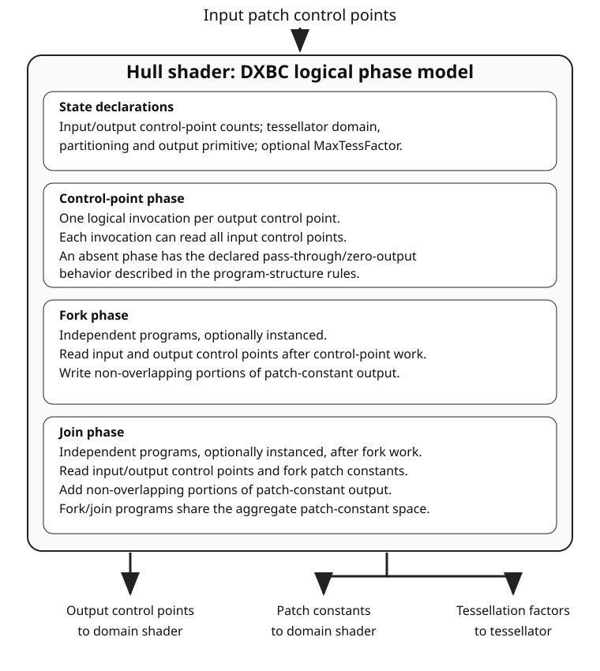

<a id="tessellation-chapter"></a>

# Tessellation: hull and domain processing

<a id="tessellation"></a>

## Tessellation pipeline

<a id="tessellation-overview"></a>

### Tessellation Introduction

The tessellation model processes a patch at a time, either a quad, tri or "isoline" domain, and does not embody any specific surface representation. It strictly generates domain locations that are fed to a programmable shader ([Domain Shader](#domain-shader)) that is responsible for generating positions and any ancillary shading information (texture coordinates, tangent frames, normals, etc.). The domain locations are water tight across a boundary if identical level of detail is used, otherwise the hardware plays no role in ensuring crack free surfaces. This specification does not cover any specific surface representation, or how to map representations to the given pipeline.

<a id="tessellation-input"></a>

### Input Assembler and Tessellation

The [Input Assembler](vertex-processing.md#input-assembly) has "patch list" primitive topologies, which are accompanied by a vertex count per patch: [1..32]. This is also described under [Patch Topologies](vertex-processing.md#patch-topologies).

Indexing and instancing work orthogonally with patches.

Incomplete patches are discarded – for example if the vertex count is 32 per patch, and a one-instance draw specifies 63 vertices, one 32 vertex patch will be produced, and the remaining 31 vertices will be discarded.

<a id="tessellation-stage-flow"></a>

### Tessellation stages

Here are pointers to the stages involved in Tessellation, in the order of data flow:

[Hull Shader](#hull-shader)

[Fixed Function Tessellator](#fixed-function-tessellator) (defined below)

[Domain Shader](#domain-shader)

Hull-shader control-point computation produces output control points, and patch-constant computation produces per-patch data including tessellation factors. The DXIL and DXBC subsections describe their respective program organization. DXBC fork/join mini-programs and register declarations are not additional API shader stages. The fixed-function tessellator consumes the final factors regardless of the shader representation that produced them.

<a id="hull-shader"></a>

## Hull shader

<a id="hull-invocation"></a>

### Hull Shader Invocation

The Hull Shader operates once per patch, transforming Control Points, computing Patch Constant data and defining Tessellation Factors.

<a id="patch-constant-overview"></a>

### Patch-constant computation

Patch-constant computation produces constant data such as [Tessellation Factors](#tessellation-factor-output) (how much the fixed function Tessellator should tessellate), as well as any other Patch Constant data, beyond the patch Control Points, that the application may need in the [Domain Shader](#domain-shader) (the shader that runs once per Tessellator output point).

Patch-constant computation occurs after the Control Point phase is complete, and has read-only access to all of the input and output Control Points. So for example, Control Points could be examined to help calculate [Tessellation Factors](#tessellation-factor-output) for each patch edge.

<a id="dxil-hull-processing"></a>

### DXIL hull-shader processing

The hull shader is represented as two functions, related via metadata: (1) control point phase function, which is the entry point of the hull shader, and (2) patch constant phase function.

The inputs to both functions are the input control points for an entire patch, and therefore each element may be indexed by row and, in addition, is indexed by vertex.

The control-point function is the hull shader's entry point, not a separately bound shader per control point. It logically processes each output control point, identified by `SV_OutputControlPointID`. Patch-constant computation can read the patch's input control points and completed output control points and produces data shared by the patch, including its tessellation factors. These are the same [control-point/patch-constant data dependencies](#patch-constant-overview) and [logical storage limits](vertex-processing.md#geometry-interface-capacities) used by the stage; the two functions are not two application API shader stages.

The patch constant function represents original HLSL computation, and is not separated into fork and join phases, as is the case in DXBC. The driver compiler may perform such separation if this is profitable for the target GPU.

<a id="dxil-hull-data-flow"></a>

#### Signatures and data flow

The input signature describes one input control point and is used across the input patch; the output signature describes one output control point. The patch-constant signature describes the per-patch data passed to the domain shader, including tessellation factors. The [HS/DS interface-matching rules](pipeline-state.md#compatibility) apply to both control-point and patch-constant interfaces.

`SV_OutputControlPointID` and `SV_PrimitiveID` input elements are system-generated values loaded through DXIL intrinsics, and are not present in the signature at all.  These have a semantic interpretation of `SemanticInterpretationKind::NotInSig`.

The following table summarizes the input/output operation roles of hull and domain shaders. CP stands for Control Point, PC - for Patch Constant.

| Operation | Control-point function | Patch-constant function | Domain shader |
| --- | --- | --- | --- |
| Store Input CP | - | - | - |
| Load Input CP | `LoadInput` | `LoadInput` | - |
| Store Output CP | `StoreOutput` | - | - |
| Load Output CP | - | `LoadOutputControlPoint` | `LoadInput` |
| Store PC | - | `StorePatchConstant` | - |
| Load PC | - | `LoadPatchConstant` ([converted DXBC](#dxil-hull-dxbc-conversion)) | `LoadPatchConstant` |
| Store Output Vertex | - | - | `StoreOutput` |

<a id="dxil-hull-counts"></a>

#### Control-point counts

For DXIL hull shaders, the output control-point count is 1 through 32. The [zero-output and absent-control-point-program cases](#hull-control-program-presence) describe the DXBC model, not an alternative DXIL program structure. DXIL validation permits zero input control-point metadata only when the input signature is empty. These metadata distinctions do not add a zero-control-point input-assembler topology; actual IA patch topologies still contain 1 through 32 control points, and the remaining shader/PSO validity conditions apply.

<a id="dxil-hull-properties"></a>

#### Hull-shader properties

The hull-shader properties associate the patch-constant function and specify the stage state:

| Property | Meaning |
| --- | --- |
| Patch-constant function | The related function's global symbol |
| Input control-point count | The shader's input control-point count |
| Output control-point count | The shader's output control-point count |
| Tessellator domain | Triangle, quad or isoline domain |
| Tessellator partitioning | The selected partitioning mode |
| Tessellator output primitive | The selected output topology |
| Maximum tessellation factor | The declared maximum tessellation factor |

The [tessellator-state and factor rules](#tessellator-state) define the common execution contract. A maximum-factor property is not a substitute for the [shader/compiler-side enforcement obligation](#maximum-tessellation-factor).

<a id="dxbc-hull-processing"></a>

### DXBC phase organization

In the DXBC model, the Hull Shader has four phases, all defined together as one program. That is, from the API/DDI point of view, the Hull Shader is a single atomic shader, and its phases are an implementation detail within the Hull Shader program. Implementations can choose to exploit independent work within a Patch by executing work within a single patch in parallel.

The phases appear in the DXBC intermediate language as standalone shaders, each with individual input and output declarations tailored to what each independent program is doing. However the inputs and outputs across all of the shaders come out of a fixed pool of Hull Shader-wide input data and output storage, described later in great detail.

The Hull Shader phase structure is depicted in the following picture:



<a id="hull-state"></a>

### DXBC state declarations

This section of the Hull Shader has no executable code. It simply declares some overall characteristics of Hull Shader operation, such as how many control points the HS inputs and outputs (an independent number). The operation of the fixed function Tessellator is also defined here – such as choosing the patch domain, partitioning etc. A tessellation pattern overview is given [here](#tessellation-pattern).

Note that declarations that are typical in shaders, such as input and output register declarations and declarations of input Resources, Constant Buffers, Samplers etc. are part of each individual shader phase below, not part of this HS State declaration section.

See [Tessellator State](#tessellator-state).

<a id="hull-control-points"></a>

### DXBC control-point phase

In the Hull Shader’s Control Point phase, a thread is invoked once per patch output control point. An input value [vOutputControlPointID](../archive/D3D11_3_FunctionalSpec.htm#generatedvalue_OUTPUT_CONTROL_POINT_ID) identifies to each thread which output control point it represents. Each of the threads sees shared input of all the input control points for the patch. The output of each thread is one of the output control points for the patch.

<a id="dxbc-patch-constant-phases"></a>

### DXBC patch-constant phases

There are two Patch Constant phases:

<a id="hull-fork"></a>

### DXBC patch-constant fork phase

The Patch Constant Fork Phase is a collection of an arbitrary number of independent programs. For the discussion in this section let us call these independent programs mini-shaders.

Each mini-shader produces independent (non-overlapping) parts of the total output Patch Constant data (such as all the different [TessFactors](#tessellation-factor-output)).

An implementation could choose to execute each mini-shader in parallel, since they are independent. Or, in the opposite extreme an implementation could choose to trivially concatenate all the mini-shaders together and run them serially. Such transformations of the mini-shaders are trivial to perform (in a driver’s compiler) given they all share the same inputs and perform non-overlapping writes to a unified output space.

An implementation could even choose to hoist any amount of the code from the Fork Phase up into the Control Point Phase if that happened to be most efficient. This is allowable because all the parts of a Hull Shader are specified together as if it is one program – how its contents are executed does not matter as long as the output is deterministic and defined observable shader effects are preserved.

The shared inputs to each mini-shader are all of the Control Point Phase’s Input and Output Control Points.

The output of each mini-shader is a non overlapping subset of the output Patch Constant Data.

There is no communication of data between mini-shaders, other than the fact that they share Control Point input.

To further enable parallelism within a single mini-shader, any mini-shader can be declared to run in an instanced fashion, given a fixed instance count per patch. During execution, each instance of an instance mini-shader is identified by a [ForkInstanceID](../archive/D3D11_3_FunctionalSpec.htm#generatedvalue_FORK_INSTANCE_ID) and is responsible for producing a unique output, typically by indexing an array of outputs. So for example, a single mini-shader instanced 4 times could output edge TessFactors for each edge of a quad patch.

<a id="hull-join"></a>

### DXBC patch-constant join phase

The final Hull Shader phase is the Patch Constant Join Phase. This phase behaves the same way as the Fork Phase, in that there can be multiple Join programs that are independent of each other. All of them execute after all the Fork Phase programs. An example use for this phase is to derive [TessFactors](#tessellation-factor-output) for the inside of a patch given the edge TessFactors computed in the previous phase.

The inputs to each Patch Constant Join Phase shader are all the Control Point Phase’s Input and Output Control Points as well as all the Patch Constant Fork Phase’s output.

The output of each Patch Constant Join Phase shader is a subset of the output Patch Constant data that does not overlap any of the outputs of the shaders from the Patch Constant Fork Phase or other Join Phase shaders.

Similar to the fork phase, to enable parallelism within a join phase mini-shader, any mini-shader can be declared to run in an instanced fashion, given a fixed instance count per patch. During execution, each instance of an instance mini-shader is identified by a [JoinInstanceID](../archive/D3D11_3_FunctionalSpec.htm#generatedvalue_JOIN_INSTANCE_ID) and is responsible for producing a unique output, typically by indexing an array of outputs. So for example, a single mini-shader instanced 2 times could output inside TessFactors for each inside direction of a quad patch.

<a id="hull-control-program-presence"></a>

### DXBC control-point program presence

0 or 1 Control Point Phase program can be present

- If there is no Control Point Phase program:

  - If the declared input control point count matches the declared output control point count, this is like passing through all of the control points

  - If the declared output control point count is 0, the HS does not output any control points, however the fork and join phases in the HS can always read the input control points

  - It is invalid for the output control point count to be more than 0 but not equal to the input control point count.

<a id="hull-control-storage"></a>

### DXBC control-point interface and storage

[hs_control_point_phase](../archive/D3D11_3_FunctionalSpec.htm#inst_HS_CONTROL_POINT_PHASE) is a shader program with the following register model. Note the footnotes which provide a detailed discussion of output storage size calculations.

| Register Type | Count | r/w | Dimension | Indexable by r# | Defaults | Requires DCL |
| --- | --- | --- | --- | --- | --- | --- |
| 32-bit Input (v[vertex][element]) | 32(element)*32(vert) | r | 4 | Y | None | Y |
| 32-bit UINT Input [vOutputControlPointID](../archive/D3D11_3_FunctionalSpec.htm#generatedvalue_OUTPUT_CONTROL_POINT_ID) | 1 | r | 1 | N | None | Y |
| 32-bit UINT Input PrimitiveID (vPrim) | 1 | r | 1 | N | n/a | Y |
| **Output Registers:** |  |  |  |  |  |  |
| 32-bit output Vertex Data Element (o#) | 32, see [output storage](#hull-cp-output-storage) | w | 4 | Y | None | Y |

<a id="hull-cp-output-storage"></a>

**Output storage.** Each Hull Shader Control Point Phase output register is up to a 4-vector, of which up to 32 registers can be declared. There are also from 1 to 32 output control points declared, which scales amount of storage required. Let us refer to the maximum allowable aggregate number of scalars across all Hull Shader Control Point Phase output as `cp_output_max`.

`cp_output_max` = 3968 scalars

This limit happens to be based on a design point for certain hardware of 4096*32-bit storage here. The amount for Control Point output is 3968=4096-128, which is 32(control points)*4(component)*32(elements) - **4(component)*32(elements)**. The subtraction reserves 128 scalars (one control point) worth of space dedicated to the HS Fork and Join phases, discussed below. The choice of reserving 128 scalars for Patch Constants (as opposed to allowing the amount to be simply whatever of the 4096 scalars of storage is unused by output Control Points) accommodates the limits of another particular hardware design. Note the Control Point Phase can declare 32 output control points, but they just can’t be fully 32 elements with 4 components each, since the total storage would be too high.

<a id="hull-control-system-values"></a>

### System Generated Values input to the HS Control Point Phase

[InstanceID](vertex-processing.md#instance-id) and [VertexID](vertex-processing.md#vertex-id) can be input as long as the previous Vertex Shader stage outputs them.

[PrimitiveID](vertex-processing.md#primitive-id) is also available as a scalar 32-bit integer input for each Control Point. PrimitiveID indicates the current patch in the Draw*() call, starting with 0. This PrimitiveID is the same value that the Geometry Shader would see for every patch if it input PrimitiveID - that is every point/line/triangle produced by the tessellator for a given patch has a single PrimitiveID for the entire Patch.

[OutputControlPointID](../archive/D3D11_3_FunctionalSpec.htm#generatedvalue_OUTPUT_CONTROL_POINT_ID) is a scalar 32-bit integer input for each Control Point identifying which one it is [0..n-1] given n declared output Control Points.

In the hull shader, the control-point invocation identifier is exposed through `SV_OutputControlPointID`.

<a id="hull-fork-programs"></a>

### DXBC fork programs

There can be 0 or more Fork Phase programs present in a Hull Shader. Each of them declares its own inputs, but they come from the same pool of input data – the Control Points. Each Fork Phase program declares its own outputs as well, but out of the same output register space as all Fork Phase and Join Phase programs, and the outputs can never overlap.

<a id="hull-fork-interfaces"></a>

### DXBC fork interface

The following registers are visible in the [hs_fork_phase](../archive/D3D11_3_FunctionalSpec.htm#inst_HS_FORK_PHASE) model.

The input resources (t#), samplers (s#), constant buffers (cb#) and immediate constant buffer (icb) are all shared state with all other HS Phases. That is, from the API/DDI point of view, the Hull Shader has a single set of input resource state for all phases. This goes with the fact that from the API/DDI point of view, the Hull Shader is a single atomic shader; the phases within it are implementation details.

Note the footnotes which provide a detailed discussion of output storage size calculations.

| Register Type | Count | r/w | Dimension | Indexable by r# | Defaults | Requires DCL |
| --- | --- | --- | --- | --- | --- | --- |
| 32-bit Input Control Points (vicp[vertex][element]) (pre-Control Point Phase) | 32, see [input declaration subsets](#hull-fork-input-subsets) | r | 4(component)*32(element)*32(vert) | Y | None | Y |
| 32-bit Output Control Points (vocp[vertex][element]) (post-Control Point Phase) | 32, see [input declaration subsets](#hull-fork-input-subsets) | r | 4(component)*32(element)*32(vert) | Y | None | Y |
| 32-bit UINT Input PrimitiveID (vPrim) | 1 | r | 1 | N | n/a | Y |
| 32-bit UINT Input [ForkInstanceID](../archive/D3D11_3_FunctionalSpec.htm#generatedvalue_FORK_INSTANCE_ID) (vForkInstanceID) | 1 | r | 1 | N | n/a | Y |
| **Output Registers:** |  |  |  |  |  |  |
| 32-bit output Patch Constant Data Element (o#) | 32, see [shared patch-constant output](#hull-fork-shared-output) | w | 4 | Y | None | Y |

<a id="hull-fork-input-subsets"></a>

**Input declaration subsets.** The HS Fork Phase’s Input Control Point register (vicp) declarations must be any subset, along the **[element]** axis, of the HS Control Point input (pre-Control Point phase). Similarly the declarations for inputting the Output Control Points (vocp) must be any subset, along the [element] axis, of the HS Output Control Points (post-Control Point Phase).

Along the **[vertex]** axis, the number of control points to be read for each of the vicp and vocp must similarly be a subset of the HS Input Control Point count and HS Output Control Point count, respectively. For example, if the vertex axis of the vocp registers are declared with n vertices, that makes the Control Point Phase’s Output Control Points [0..n-1] available as read only input to the Fork Phase.

<a id="hull-fork-shared-output"></a>

**Shared patch-constant output.** The HS Fork and Join phase outputs are a shared set of 32 4-vector registers. The outputs of each Fork/Join phase program cannot overlap with each other. System Interpreted values such as [TessFactors](#tessellation-factor-output) come out of this space.

<a id="hull-fork-declarations"></a>

### DXBC fork input declarations

The declarations for inputs, outputs, temp registers, resource etc. in an HS Fork Phase program are like any standalone shader. A given HS Fork Phase program need only declare what it needs to read and write. Further, if it does not need to see all Input or Output Control Points, it can declare a subset of the counts for each, by declaring a smaller number on the [vertex] array axis than the corresponding number of Control Points actually available.

There is not a way to declare that a sparse set of the Control Points is read. E.g. a shader that needs read Input Control Points [0],[3], [11] and [15] would just declare the Input Control Point (vicp) register’s [vertex] axis size as 16. Note that if references to the Control Points from shader code use static indexing, it will be obvious to drivers exactly what subset of Control Points is actually needed by the program anyway.

<a id="hull-fork-instances"></a>

### DXBC fork instancing

Any individual HS Fork Phase program can be declared to execute instanced, with a declaration identifying a fixed instance count from 1 to 0xffffffff. The 128-scalar shared Patch Constant output budget and output non-overlap requirements are not expanded by this instance count. The HS Fork Phase program executes the declared number of times per patch, with each instance identified by its 32-bit UINT input register [vForkInstanceID](../archive/D3D11_3_FunctionalSpec.htm#generatedvalue_FORK_INSTANCE_ID).

Note that if the role of an instanced Fork Phase program is for each instance to produce a [System Interpreted Value](../archive/D3D11_3_FunctionalSpec.htm#SystemInterpretedValues), say one of the edge [TessFactors](#tessellation-factor-output) for a quad patch per instance, the declarations for each of those outputs would identify the System Interpreted Value being produced, just like any other shader.

<a id="hull-fork-system-values"></a>

### DXBC fork system values

The HS Fork Phase can input [PrimitiveID](vertex-processing.md#primitive-id) in its own register just like the HS Control Point Phase. The value in this register is the same as what the HS Control Point Phase sees. The other special input register in the HS Fork Phase is [vForkInstanceID](../archive/D3D11_3_FunctionalSpec.htm#generatedvalue_FORK_INSTANCE_ID), described previously.

The system doesn’t go out of its way to automatically provide other [System Generated Values](../archive/D3D11_3_FunctionalSpec.htm#SystemGeneratedValues) ([VertexID](vertex-processing.md#vertex-id), [InstanceID](vertex-processing.md#instance-id)) to the HS Fork Phase. Values like these are part of the Input Control Points (if they were declared to be there) already, so the HS Fork phase can read VertexID/InstanceID by reading them out of the Input Control Points.

The treatment of [InstanceID](vertex-processing.md#instance-id) does seem strange, in that InstanceID would be the same for all Control Points in a Patch (indeed, unchanging across multiple patches), yet it shows up per-Input Control Point. However, this is consistent with the behavior elsewhere in the pipeline, where the first active stage that can input a System Generated Value (for InstanceID, that is the Vertex Shader) is responsible for passing the value down to the next stage via shader output (rather than the hardware feeding the value down to subsequent stages separately). For the Geometry Shader to see InstanceID, it also shows up in each input vertex there, just like it shows up in each Input Control Point in the Hull Shader.

<a id="hull-join-programs"></a>

### DXBC join programs

There can be 0 or more Join Phase programs present in a Hull Shader. Each of them declares its own inputs, but they come from the same pool of input data – the Control Points as well as the Patch Constant outputs of the Fork Phase programs. Each Join Phase program declares its own outputs as well, but out of the same output register space as all Fork Phase and Join Phase programs, and the outputs can never overlap.

<a id="hull-join-interfaces"></a>

### DXBC join interface

The following registers are visible in the [hs_join_phase](../archive/D3D11_3_FunctionalSpec.htm#inst_HS_JOIN_PHASE) model. Note there are three sets of input registers: v**icp** (Control Point Phase Input Control Points), v**ocp** (Control Point Phase Output Control Points), and v**pc** (Patch Constants). v**pc** are the aggregate output of all the HS Fork Phase programs. The HS Join Phase output o# registers are in the same register space as the HS Fork Phase outputs.

The input resources (t#), samplers (s#), constant buffers (cb#) and immediate constant buffer (icb) are all shared state with all other HS Phases. That is, from the API/DDI point of view, the Hull Shader has a single set of input resource state for all phases. This goes with the fact that from the API/DDI point of view, the Hull Shader is a single atomic shader; the phases within it are implementation details.

Note the footnotes which provide a detailed discussion of output storage size calculations.

| Register Type | Count | r/w | Dimension | Indexable by r# | Defaults | Requires DCL |
| --- | --- | --- | --- | --- | --- | --- |
| 32-bit Input Control Points (vicp[vertex][element]) (pre-Control Point Phase) | 32, see [input declaration subsets](#hull-join-input-subsets) | r | 4(component)*32(element)*32(vert) | Y | None | Y |
| 32-bit Output Control Points (vocp[vertex][element]) (post-Control Point Phase) | 32, see [input declaration subsets](#hull-join-input-subsets) | r | 4(component)*32(element)*32(vert) | Y | None | Y |
| 32-bit Input (vpc[element]) (Patch Constant Data) | 32, see [patch-constant input](#hull-join-patch-input) | r | 4 | Y | None | Y |
| 32-bit UINT Input PrimitiveID (vPrim) | 1 | r | 1 | N | n/a | Y |
| 32-bit UINT Input [JoinInstanceID](../archive/D3D11_3_FunctionalSpec.htm#generatedvalue_JOIN_INSTANCE_ID) (vJoinInstanceID) | 1 | r | 1 | N | n/a | Y |
| **Output Registers:** |  |  |  |  |  |  |
| 32-bit output Patch Constant Data Element (o#) | 32, see [shared patch-constant output](#hull-join-shared-output) | w | 4 | Y | None | Y |

<a id="hull-join-input-subsets"></a>

**Input declaration subsets.** The HS Join Phase’s Input Control Point register (vicp) declarations must be any subset, along the **[element]** axis, of the HS Control Point input (pre-Control Point phase). Similarly the declarations for inputting the Output Control Points (vocp) must be any subset, along the [element] axis, of the HS Output Control Points (post-Control Point Phase).

Along the **[vertex]** axis, the number of control points to be read for each of the vicp and vocp must similarly be a subset of the HS Input Control Point count and HS Output Control Point count, respectively. For example, if the vertex axis of the vocp registers are declared with n vertices, that makes the Control Point Phase’s Output Control Points [0..n-1] available as read only input to the Join Phase.

<a id="hull-join-shared-output"></a>

**Shared patch-constant output.** The HS Fork and Join phase outputs are a shared set of 32 4-vector registers. The outputs of each Fork/Join phase program cannot overlap with each other. System Interpreted values such as [TessFactors](#tessellation-factor-output) come out of this space.

<a id="hull-join-patch-input"></a>

**Patch-constant input.** In addition to Control Point input, the HS Join phase also sees as input the Patch Constant data computed by the HS Fork Phase program(s). This shows up at the HS Join phase as the vpc# registers. The HS Join Phase’s input vpc# registers share the same register space as the HS Fork Phase output o# registers. The declarations of the o# registers must not overlap with any HS Fork phase program o# output declaration; the HS Join Phase is adding to the aggregate Patch Constant data output for the Hull Shader.

<a id="hull-join-declarations"></a>

### DXBC join input declarations

The declarations for inputs, outputs, temp registers, resource etc. in an HS Join Phase program function the same way as [HS Fork Phase declarations](#hull-fork-declarations).

<a id="hull-join-instances"></a>

### DXBC join instancing

Any individual HS Join Phase program can be declared to execute instanced, with a declaration identifying a fixed instance count from 1 to 0xffffffff. The 128-scalar shared Patch Constant output budget and output non-overlap requirements are not expanded by this instance count. The HS Join Phase program executes the declared number of times per patch, with each instance identified by its 32-bit UINT input register [vJoinInstanceID](../archive/D3D11_3_FunctionalSpec.htm#generatedvalue_JOIN_INSTANCE_ID).

Note that if the role of an instanced Join Phase program is for each instance to produce a [System Interpreted Value](../archive/D3D11_3_FunctionalSpec.htm#SystemInterpretedValues), say one of the inside [TessFactors](#tessellation-factor-output) for a quad patch per instance, the declarations for each of those outputs would identify the System Interpreted Value being produced, just like any other shader.

<a id="hull-join-system-values"></a>

### DXBC join system values

System Generated Values are dealt with the [same](#hull-fork-system-values) way in the HS Join Phase as the HS Fork Phase. Instead of [vForkInstanceID](../archive/D3D11_3_FunctionalSpec.htm#generatedvalue_FORK_INSTANCE_ID), in the Join Phase the same thing is called [vJoinInstanceID](../archive/D3D11_3_FunctionalSpec.htm#generatedvalue_JOIN_INSTANCE_ID). [PrimitiveID](vertex-processing.md#primitive-id) is available as a standalone input register.

<a id="tessellation-factor-output"></a>

### Tessellation-factor output

[Hull Shader](#hull-shader) Fork and Join Phase code can declare up to 6 of their output scalars as System Interpreted Values that identify various Tessellation Factors, driving how much tessellation the fixed function Tessellator should perform. For example, on a Quad there are 4 TessFactors for the edges, as well as 2 for the inside. HLSL exposes alternative (helper) ways to generate the inside tessfactors automatically from the edge TessFactors, e.g. deriving them by min/max/avg on the edge values, and possibly scaling based on user-provided scale values. The hardware does not understand anything about this helper processing (it just appears as shader code)

The optional (from the HLSL author point of view) tessellation factor processing results in HLSL compiler autogenerated shader code in either or both of the Fork and Join Phases. This standard processing can involve cleaning up of values, handling of special low TessFactor cases to prevent popping, and rounding of the values depending on the tessellation mode.

The final Tessellation Factors after this processing go to the fixed function Tessellator hardware – TessFactors for each edge and explicit TessFactors for the patch inside (as opposed to TessFactorScale the user specifies).

Downstream, [Domain Shader](#domain-shader) code may be interested in seeing all of the intermediate values generated during any optional TessFactor processing. For example, to be able to perform blending during Pow2 Partitioning tessellation, one might want to see the ratio between unrounded and rounded TessFactor values. To enable that, the auto-generated code in the Fork and/or Join Phases will output not only final TessFactor values for the tessellator, but also the intermediate values, so the Domain Shader can access them. There are at most 12 such additional values (in the case of a Quad Patch). Again, the hardware does not understand anything about these "helper" values, and they are not discussed in detail here.

The next sections describe just the TessFactors relevant to the hardware without discussing the various optional helper routines that HLSL provides to derive them.

Further information about how Tessellation Factors are interpreted is [here](#tessellation-factor-interpretation).

<a id="tri-tessellation-factors"></a>

### Tri Patch TessFactors

**float3 [SV_TessFactor](../archive/D3D11_3_FunctionalSpec.htm#interpretedvalue_TessFactor)**

The first component provides the TessFactor for the U==0 edge of the patch.

The second component provides the TessFactor for the V==0 edge of the patch.

The third component provides the TessFactor for the W==0 edge of the patch.

In DXBC, the above hardware/system interpreted values must be declared in the same component of 3 consecutive registers (since indexing is on that axis).

**float [SV_InsideTessFactor](../archive/D3D11_3_FunctionalSpec.htm#interpretedvalue_InsideTessFactor)**

This determines how much to tessellate the inside of the tri patch.

<a id="quad-tessellation-factors"></a>

### Quad Patch TessFactors

**float4 [SV_TessFactor](../archive/D3D11_3_FunctionalSpec.htm#interpretedvalue_TessFactor)**

The first component provides the TessFactor for the U==0 edge of the patch.

The second component provides the TessFactor for the V==0 edge of the patch.

The third component provides the TessFactor for the U==1 edge of the patch.

The fourth component provides the TessFactor for the V==1 edge of the patch.

The ordering of the edges is clockwise, starting from the U==0 edge (visualized as the "left" edge of the patch).

In DXBC, the above hardware/system interpreted values must be declared in the same component of 4 consecutive registers (since indexing is on that axis).

**float2 [SV_InsideTessFactor](../archive/D3D11_3_FunctionalSpec.htm#interpretedvalue_InsideTessFactor)**

The first component determines how much to tessellate along the U direction of the inside of the patch.

The second component determines how much to tessellate along the V direction of the inside of the patch.

<a id="isoline-tessellation-factors"></a>

### Isoline TessFactors

**float2 [SV_TessFactor](../archive/D3D11_3_FunctionalSpec.htm#interpretedvalue_TessFactor)**

The first component determines the line density (how many tessellated parallel lines to generate in the V direction over the patch area).

The second component determines the line detail (how finely tessellated each of the parallel lines is, in the U direction over the patch area).

In DXBC, the above hardware/system interpreted values must be declared in the same component of 2 consecutive registers (since indexing is on that axis).

IsoLines are discussed further [here](#isolines)

<a id="patch-constant-storage"></a>

### DXBC patch-constant layout and indexing

The Hull Shader output Patch Constant data appears as 32 vec4 elements. The placement of the Final TessFactors are constrained as described in the previous sections – each grouping of TessFactors must appear in a specific order in the same component of consecutive registers/elements in the Patch Constant Data. E.g. For Quad Patches, the four Final Edge TessFactors in a fixed order make up one grouping, and the two Final Inside TessFactors in a fixed order make up another separate grouping.

Shader indexing of the Patch Constant data across the 32 vec4 elements is restricted, due to the limitations of a particular hardware implementation, as follows:

- Indexing ranges (declared via dcl_indexRange regMin, regMax) on Patch Constant registers cannot cross over the start or end of any group of hardware TessFactors.

<a id="hull-invocation-termination"></a>

### DXBC invocation termination

Since the Hull Shader has multiple phases, each of which can be instanced (e.g. multiple Control Points in the Control Point phase, or instanced Fork or Join Phases), the "ret*" ([return](../archive/D3D11_3_FunctionalSpec.htm#inst_RET) or [conditional return](../archive/D3D11_3_FunctionalSpec.htm#inst_RET_CONDITION)) shader instruction is defined to end only the current instance of the current phase. So a "ret*" in the Control Point Phase would only finish the current Control Point invocation without affecting the others or other phases. Or a "ret*" in a Fork or Join Phase program would only end that instance of that program without affecting other instances (if it is instanced) or other Fork/Join programs.

<a id="maximum-tessellation-factor"></a>

### Declared maximum tessellation factor

The HS State Declaration Phase can optionally include a fixed float32 [MaxTessFactor](../archive/D3D11_3_FunctionalSpec.htm#inst_DCL_MAX_TESSFACTOR) in the range {1.0...64.0}.

This MaxTessFactor [declaration](../archive/D3D11_3_FunctionalSpec.htm#inst_DCL_MAX_TESSFACTOR) is useful when the application knows the maximum amount of tessellation it could possibly ask for through the TessFactor values it will output from the Hull Shader. Communicating this knowledge to the device allows it to optionally take advantage and perform better scheduling of resources on the GPU.

If a MaxTessFactor is declared, it is enforced by HLSL autogenerated TessFactor clamping code as the last step in the calculation of all of the following hardware System Interpreted Values (whose meanings were described earlier):

SV_TessFactor

SV_InsideTessFactor

For simplicity only a single MaxTessFactor value can be declared, and when it is present, it is applied to all the TessFactors listed above.

The device sees the MaxTessFactor declaration as a part of the Hull Shader. The knowledge of this declaration is what hardware can optionally take advantage of to optimize Tessellation performance for content going through that Hull Shader, versus an otherwise identical Hull Shader without the declaration.

If HLSL fails to enforce the MaxTessFactor when it is declared (by clamping the HS output TessFactors), and a TessFactor larger than MaxTessFactor arrives at the Tessellator, the Tessellator’s behavior is undefined. Hitting this undefined situation is a Microsoft HLSL compiler (or driver compiler) bug, not the fault of the shader author or hardware.

Note that independent of this optional application-defined MaxTessFactor, the Tessellator always performs some additional basic clamping and rounding of Final TessFactors as appropriate for the situation, defined in the [hardware factor-clamping rules](#edge-factor-clamping). Those manipulations guarantee the hardware behavior by limiting the range of inputs possible. The only exception to that well defined hardware interface is this MaxTessFactor declaration which must rely on HLSL to generate code to enforce it. The reason it is the responsibility of HLSL to enforce consistency in this one case is it was too late in the spec process to arrive at any consistent hardware definition here, either by defining what the hardware behavior is if MaxTessFactor was not enforced but then exceeded at runtime, or getting all hardware vendors enforce the same MaxTessFactor clamping in hardware.

<a id="dxil-hull-dxbc-conversion"></a>

### DXBC-to-DXIL conversion

In DXBC to DXIL conversion, the original patch constant function cannot be recovered during DXBC-to-DXIL conversion. Instead, instructions of each fork and join phase are 'wrapped' by a loop that iterates the corresponding number of phase-instance-count iterations. Thus, fork/join instance ID becomes the loop induction variable. The `LoadPatchConstant` operation represents load from DXBC `vpc` register.

`LoadPatchConstant` in the patch-constant function is generated only by DXBC-to-DXIL converter, to access DXBC `vpc` registers. The HLSL compiler produces IR that references LLVM IR values directly.

<a id="fixed-function-tessellator"></a>

## Fixed-function tessellator

This fixed function stage takes floating point TessFactor values as input and generates a tessellation of the domain. The domain can be tri, quad or isoLine (see next section for a definition of isoLines).

The tessellator generates a couple of things:

- (1) A set of domain points - UV for isoLine or quad domains and UVW (barycentric) for a tri domain. Each of these domain points is input to its own Domain Shader invocation. Each Domain Shader invocation also sees shared input of all the [Hull Shader](#hull-shader) output data.

- (2) Topology connectivity - fed downstream past the [Domain Shader](#domain-shader). For tri and quad domains, the valid output topologies are points or triangles. For isoLines, the valid output topologies are points or lines.

Note the domains are defined such that for isoLines and quads, the V direction is clockwise from the U direction. For tri domain, UVW are clockwise, in that order.

[Adjacency](vertex-processing.md#adjacency) information is not available when using the tessellator - only independent points, lines or triangles are generated. The order that points/lines/triangles and their vertices are produced must be invariant between similar tessellator invocations on the same device, but no explicit order is prescribed.

<a id="isolines"></a>

### IsoLines

The isoLine domain is a specialized form of the quad domain. It is the only domain that can produce tessellated lines. For isoLines, the U direction over a quad domain is the direction tessellated lines are drawn (lines of constant V). There are two [TessFactor](#isoline-tessellation-factors) values:

The first is the line density, which is always rounded to integer and determines how many U-parallel tessellated line segments to generate across the V direction. The spacing of these line segments across V is uniform, starting at V=0. So if the line density is 1, a single tessellated line is generated from (U=0,V=0) to (U=1,V=0). If the line density is 2, the first tessellated line is generated from (0,0) to (1,0) and the second tessellated line is generated from (0,0.5)-(1,0.5). Notice that no line is ever generated at V=1.

The second TessFactor is the line detail, determining how much to tessellate each line of constant V.

For more concrete info on the tessellation pattern for isolines see [IsoLine Pattern Details](#isoline-pattern).

<a id="tessellation-pattern"></a>

### Tessellation pattern

<a id="tessellation-reference-code"></a>

#### Overview

Details of the point placement and connectivity are described in words in this section.

A more concrete description can be found in the reference fixed function tessellator code, entirely encapsulated in the following C++ files:

[tessellator.hpp](../archive/images/d3d11/tessellator.hpp)

[tessellator.cpp](../archive/images/d3d11/tessellator.cpp)

<a id="pattern-overview"></a>

#### Tessellation Pattern Overview

The inside of a triangle/quad patch is a tessellated triangle/square based on a specified InsideTessFactor(s). For a triangle, there is a [single TessFactor](#tri-tessellation-factors) for the inside region of the patch. For a quadrilateral, there are [2 inside TessFactors](#quad-tessellation-factors).

HLSL exposes helpers that can optionally derive inside TessFactors from the edge TessFactors (these amount to shader code, so the hardware doesn't need to know about them). For example in the case of a quad patch, the helpers have a couple of options for deriving inside TessFactors – 1-axis and 2-axis. In the 1-axis mode, the inside TessFactor reduction is applied on all 4 edges producing a single inside TessFactor. In the 2-axis mode, the reduction from 4 edge TessFactors is divided into two separate parts. The V==0 and V==1 edge TessFactors are reduced to a single TessFactor for the V direction of the interior. Similarly the U==0 and U==1 TessFactors are reduced to a single TessFactor for the U direction on the interior.

The boundaries of the patch provide transitions between the inside TessFactor(s) and each per-edge TessFactor.

There are two basic flavors of fractional tessellation: either using an even number of segments (intervals) on an edge or an odd number. When using an even number of segments the coarsest an edge can be refined is to have two segments an edge, so it is impossible to model a level of detail with a single segment.

For integer partitioning, TessFactors are rounded to integer. The parity (even/odd) of each edge and inside TessFactor after rounding determines how that area is tessellated: an odd integer TessFactor matches odd fractional tessellation at the same TessFactor. Similarly, an even integer TessFactor matches even fractional tessellation at the same TessFactor.

For pow2 partitioning, TessFactors are rounded to a power of 2, and tessellation of pow2 TessFactors matches even fractional tessellation at the same TessFactor, but in addition the power of 2 mode can go down to 1 segment on any side (1 is a power of 2). From the hardware point of view there is no distinction between pow2 and integer - the hardware doesn't do the rounding of the TessFactors to pow2. That rounding is the responsibility of the HLSL compiler, given the shader being authored using the appropriate helper intrinsics in shader code (not discussed here).

<a id="fractional-partitioning"></a>

#### Fractional Partitioning

- "Fractional" means geometry smoothly transitions as TessFactor increases.

- Since tessellation is symmetric about edges, geometry is always introduced by splitting 2 existing mirrored points across an axis into 4

- Number of segments along an axis always increments by 2 at a time, thus:

- Starting at a minimum TessFactor of either 1 or 2 produces two flavors of fractional partitioning: ODD and EVEN...

<a id="fractional-odd"></a>

#### Fractional Odd Partitioning

- Minimum TessFactor is 1; 1 for all TFs on a patch is like no tessellation (nice)

- Next TFs that have uniform segment widths are 3, 5, 7, 9...

- Between odd valued TFs, geometry is in transit.

- When TF bumps above an odd integer, the number of segments is the next odd (3.1->5)

- 1 for all TFs on a patch is like "no tessellation"

- The amount of geometry is as minimal as you could get short of culling the patch

<a id="fractional-even"></a>

#### Fractional Even Partitioning

- Minimum TessFactor is 2

- Next TFs that have uniform segment widths are 4, 6, 8...

<a id="splitting-edge-vertices"></a>

#### Splitting Vertices on an Edge

- For even or odd partitioning, vertex splits always at mirrored pair of inside vertices

  - Never split at patch corners

  - Avoids degenerate transition area between neighboring patches

- Exception: fractional odd partitioning at Tessellation Factor 1 only has 2 vertices per side – the corners

  - No choice but to split the edges

  - Not a problem

<a id="ruler-function"></a>

#### Which Vertices to Split

- Since vertices are symmetric about center of an edge, only need to consider **one half**

- Let us define an "epoch" in the TessFactor number space as: Any TessFactor with a power of 2 number of vertices on **one half** of the domain (excluding corners)

- Starting at an epoch, split each vertex at that epoch one at a time from outside to inside as the TF increases, until the next epoch arrives

- This is dubbed the "Ruler Function"

 **Why Split Like This?**

- Could have always split from the center

  - Xbox 360 tessellator does fractional even partitioning, always splitting vertices at center of an edge

- Choice of splitting algorithm affects triangulation of transition between edge TF and inside TF

- Ruler Function evenly distributes triangle edge directions connecting areas with different TessFactors

  - As opposed to having them always point towards the center of the span (yielding more extreme aspect ratios)

  - "ruler function" is a reference to the size of the tick marks on a ruler – coarser divisions have longer ticks. You enumerate the longer ticks first, then the next size smaller tick (including the larger ones) and so on indefinitely.

- Note with even partitioning, the middle point is a valid candidate in the half-TF space.

- The fact that epoch splits are from outside to inside as opposed to inside to outside is somewhat arbitrary.

- It turns out determining algorithmically where the split point needs to be at any given TF is very easy (see reference code)

<a id="triangulation"></a>

#### Triangulation

- Tri and Quad Domains are tiled with quads, each made of 2 triangles

- Which way do the quad diagonals go?

  - Quads closer to one of the patch corners than the others have diagonal pointing towards that corner

- For fractional odd:

  - If quad is between 2 corners, diagonal is the direction a counter-clockwise spiral radiating out from center of patch would cross the quad

  - Center of a quad patch is a Z: The diagonal of the Z is oriented such that the top edge of the patch is V==0 and the left edge of the patch is U==0.

  - Center of tri patch is a lone triangle

- This is as rotationally symmetric as possible

<a id="tessellation-transitions"></a>

#### Transitions

- How can each edge and the inside of a patch all have different Tessellation Factors from each other?

- For a quad, imagine a picture with a frame

  - Each side of the frame is a trapezoid

- The "picture" is tessellated regularly

  - Using two inside TessFactors, one for each of U and V axes

  - Can also just set these inside TessFactors equally to get uniform interior tessellation

- Each of the "frame" sides is a row of triangles stitching the TessFactor on the outside edge to the inside TF

- A tri patch is just a picture+frame with only 3 sides

  - single inside TessFactor

**Mapping Vertices to Texels 1:1 in an Application**

- In TF Transition areas (picture frame), one could map vertices to different densities of texture map texels (such as different mipmaps) for each side

- Over a region with a fixed TessFactor, mapping vertices to texels is easy for quad domain

- For tri domain:

  - Consider dividing the domain into 3 regions bounded by lines from the center to the corners

  - Or 6 regions, above 3 split down middle of edges

- These regions have regular tessellation so the U/V/W domain can be remapped as desired

**Tri vs Quad Density Comparison**

- Consider a square quad patch with side lengths of 1, so area is 1 unit square

- Suppose this is adjacent to an equilateral tri patch, so area is 0.433

- Given equal TF, a tri patch produces significantly higher triangle/point density than quad patch

  - Note this is true even with no tessellation, e.g. TF==1

- Scaling insideTFs by (empirically) around 0.74 vs edges on tri patches will make their triangle and point density roughly match quad patches, across the TF range (except at very low TF where nothing can be done)

- The adjustment would be different for different aspect ratios

- In applications mixing tri and quad patches, tri patches tend to be rare, so this density disparity may be a don’t care

<a id="frame-side-triangulation"></a>

#### Triangulating Picture Frame Sides

- Each trapezoid shaped picture frame side has:

  - an outside edge TessFactor

  - an inside edge TessFactor

    - where one segment on each end of the inside is not needed since the neighboring picture frame is there - thus trapezoid shape

- Each vertex on the edge with the larger TessFactor connects to its "parent" vertex on the edge with the smaller TF, given the "ruler function" split history

- This defines a row of quads

  - Plus a triangle at each end, making a trapezoid

  - The quads are triangulated using previous diagonal rules

<a id="integer-partitioning"></a>

#### Integer Partitioning

- Given floating point edge TessFactors

  - Application can, for example, determine the inside TF based on a min/max/avg reduction similar to fractional tessellation

  - HW then rounds each edge TF and inside TF up to next integer

- Rest of tessellation behavior same as fractional

  - Including picture frame, allowing transitions

- Each edge and inside TF can independently be even or odd

  - Thus smaller jumps in vert/tri count vs fractional

  - But vertex positions obviously don’t move smoothly

<a id="pow2-partitioning"></a>

#### Pow2 Partitioning

- Same as integer partitioning, except instead of rounding to integer, round to next power of 2

  - Application (or HLSL compiler) is responsible for rounding to pow2, not hardware. Hardware just treats pow2 mode exactly like integer mode.

  - Pow2 isn’t just a subset of the integer mode, when the inside TessFactor reduction is "average"

  - Handy to call this mode out on its own anyway

- As TessFactors increase, once a point shows up on the domain, it stays there permanently

**Example: Displacement Mapping**

- Can achieve displacement mapping with dynamically variable TessFactors per edge with no vertex swimming or popping

- This is enabled by using Pow2 partitioning with "max" for reduction to determine single inside TessFactor.

- Take advantage of the properties that result:

  - For quads, choosing a single inside TessFactor instead of 2 ensures that points on patch inside always show up bisecting an edge, and once they show up they don’t move. This property always holds for tri patches, which only support a single inside TessFactor.

  - Water-tight dampening of displacement can be done on edges and corners of patch by not looking anywhere else on the patch or the neighboring patches

  - Transition "picture frame" can unfortunately have triangle diagonals flipping as TessFactors change, so appropriate dampening of displacements is needed to hide diagonal flips

  - Using "max" reduction for inside TF means inside TF >= edge TFs, and there are always enough vertices on the patch inside to smoothly connect to whatever choice of displacement was made on the edges

- Not trivial shader code to be totally pop-free

  - The type of underlying surface formulation (before displacement) could make task harder/impossible

  - Could take shortcuts and live with some popping

- Could also do this smooth geomorphing with integer partitioning, using the U/V domain coordinate in the Domain Shader to identify the current point. Then completely redistribute the points ignoring where the U/V domain coordinate said each point would be on the domain, instead lumping points at pow2 divisions. With a non-pow2 TessFactor, just start filling in points using spacing for the next power of 2, filling in the gaps between the existing points that are partitioned by the previous powers of 2. This could potentially give smoother geometry increases versus complete pow2 jumps.

<a id="isoline-pattern"></a>

#### IsoLine Pattern Details

- A way to draw tessellated lines

- 2 Tessellation Factors

- Line Detail TF

  - Determines how to finely tessellate a line, with same controls (fractional, integer etc) as an edge has in tri or quad domains

- Line Density TF

  - Determines how many parallel tessellated lines to draw

  - Always rounded up to next integer

  - Tessellated lines of constant V are drawn over a UV quad domain

- Line Density TF == 1 means: Draw a single tessellated line, where V==0 across U [0..1]

- Lines density TF == 2 means: Draw 2 tessellated lines, one having V==0, and the other having V== 0.5

- Line density TF == n means: Draws n tessellated lines

- A tessellated line is never drawn at V==1

<a id="tessellation-ordering"></a>

#### Primitive Ordering

The order that geometry is generated for a patch must be repeatable on a device, however no particular ordering of the geometry within a patch is prescribed. A strict requirement is that all geometry for a given patch flows down the pipeline before any geometry for subsequent patches.

Suppose the rasterizer is the next active stage in the pipeline after tessellation, and there are vertex attributes that are declared in the Pixel Shader with constant interpolation. The leading vertex, used to provide the constant attribute for any individual line or triangle, can be any of the vertices in the line or triangle (albeit repeatable for a given patch and tessellator configuration on a device).

<a id="tessellated-primitive-id"></a>

#### Tessellator PrimitiveID

When a patch topology is used, [PrimitiveID](vertex-processing.md#primitive-id) identifies which patch in the Draw*() call is being processed, starting from the Hull Shader onward. Even though tessellation may produce multiple points/lines/triangles, for a given patch, all of the primitives generated for it have the same PrimitiveID. As such, the freedom of point/line/triangle ordering within a patch is not visible to shader code. When a patch topology is used, the true "primitive" is the patch itself.

<a id="tessellation-factor-interpretation"></a>

#### TessFactor Interpretation

The TessFactor number space roughly corresponds to how many line segments there are on the corresponding edge. This isn’t a precise definition of the number of segments because different tessellation modes snap to different numbers of segments (i.e. integer versus fractional_even versus fractional_odd).

For integer partitioning, TessFactor range is [1 ... 64] (fractions rounded up).

For pow2 partitioning, TessFactor range is [1,2,4,8,16,32,64]. Anything outside or in between values in this set is rounded to the next entry in the set by HLSL code... so from the hardware point of view, pow2 partitioning technically isn't different from integer partitioning.

For fractional odd partitioning, TessFactor range is [1 ... 63]. Odd TessFactors produce uniform partitioning of the space. Other TessFactors in the range produce a segment count that is the next odd TessFactor higher, transitioning the point locations based on the distance between the nearest lower odd TessFactor and nearest greater odd TessFactor.

For fractional even tessellation, TessFactor range is [2 ... 64]. Even TessFactors produce uniform partitioning of the space. Other TessFactors in the range produce a segment count that is the next even TessFactor higher, transitioning the point locations based on the distance between the nearest lower even TessFactor and nearest greater even TessFactor.

For the IsoLine domain, the line detail TessFactor honors all the above modes. However the line density TessFactor always behaves as integer – [1 ... 64] (fractions rounded to next).

<a id="declared-factor-clamp"></a>

#### HS MaxTessFactor Declaration

This particular clamp on TessFactors is discussed [here](#maximum-tessellation-factor), and is independent of the hardware clamps defined in the rest of this section.

<a id="edge-factor-clamping"></a>

#### Hardware Edge TessFactor Range Clamping

The following describes the float32 patch edge TessFactor range that the hardware Tessellator must accept from the Hull Shader.

First of all, if any edge TessFactor is <= 0 or NaN, the patch is culled.

Otherwise, hardware must clamp each edge input TessFactor to the range specified below.

| Partitioning | Min Edge TessFactor | Max Edge TessFactor | Comments |
| --- | --- | --- | --- |
| Even_Fractional | 2 | 64 |  |
| Odd_Fractional | 1 | 63 |  |
| Integer (Pow2 maps to integer in hardware) | 1 | 64 | After clamping, round result to next integer. |

For IsoLines, the LineDensity Tessfactor (which is how many constant V iso-lines to draw) is clamped by the hardware to [1...64] and rounded to the next integer.

<a id="inside-factor-clamping"></a>

#### Hardware Inside TessFactor Range Clamping

In addition to patch edge TessFactors, hardware will be given inside TessFactors from the Hull Shader. There are two inside TessFactors for quad patches (U and V axes), and one inside TessFactor for tri patches.

These HS outputs may have been derived (optionally) from the edge TessFactors via some operation such as max or avg in Hull Shader code autogenerated by HLSL. This derivation may involve low TessFactor fixups to prevent popping as TessFactors transition through extreme cases. Such processing is just shader code, irrelevant to the hardware.

For the final inside TessFactors coming out of the Hull Shader, the following is pseudocode for the hardware validation hardware must do, effectively creating safe bounds on the complexity of cases the hardware tessellation algorithm has to handle.

```cpp
    // Compute HWInsideTessFactorU/V for quad patch (similar tri patch case has only one axis),
    // given HSOutputInsideTessFactorU/V + 4 edge TessFactors.
    // This is just the fixed function hardware processing, independent of shader pre-conditioning
    // of the TessFactors (which the hardware does not need to know about).
    float lowerBound, upperBound;
    switch(partitioning)
    {
        case integer:
        case pow2: // don’t care about pow2 distinction for validation, just treat as integer
            lowerBound = 1;
            upperBound = 64;
            break;

        case even_fractional:
            lowerBound = 2;
            upperBound = 64;
            break;

        case odd_fractional:
    #define EPSILON 0.0000152587890625 // 2^(-16), min positive fixed point fraction
            if( any TessFactor, edge or inside is greater than (1.0 + EPSILON/2) )
            {
                // If any Tessfactor will be > 1 after rounding during
                // the float to fixed point conversion that happens later
                // then make all inside TessFactors > 1.
                lowerBound = 1.0 + EPSILON;
            }
            else // all are <= 1.0f or NaN
            {
                lowerBound = 1;
            }
            upperBound = 63;
            break;
    }

    HWInsideTessFactorU = min( upperBound, max( lowerBound, HSOutputInsideTessFactorU ) );
    HWInsideTessFactorV = min( upperBound, max( lowerBound, HSOutputInsideTessFactorV ) );
    // A tri patch only has one insideTessFactor instead of U/V
    // Note the above clamps map NaN to lowerBound based on D3D/IEEE754R min/max rules

    if( integer or pow2 partitioning )
    {
         round HWInsideTessFactorU to next integer (don’t care about pow2 distinction for validation)
         round HWInsideTessFactorV to next integer
         // tri patch only has one insideTessFactor instead of U/V
    }

    // After this, all TessFactors are converted to .16 fixed point using D3D float->fixed
    // conversion rules (incl round-to-nearest-even).  Topology and domain coordinate placement
    // is done based on the fixed point TessFactors.
```

<a id="tessellation-culling"></a>

#### Culling Patches

If any of the edge TessFactors from the HS for a patch are <= 0 or NaN, the patch is culled. No Domain Shader invocations or anything later in the pipeline are produced for that patch.

Routing of untessellated patches is defined by [tessellation stage selection](#tessellation-enablement).

<a id="tessellation-watertightness"></a>

#### Tessellation Parameterization and Watertightness

A shared edge has to generate identical domain locations for crack free tessellation to be possible. Domain Shader authors are responsible for achieving this, given some guarantees from the hardware. First, hardware tessellation on any given edge must always produce a distribution of domain points symmetric about the edge based on the TessFactor for that edge alone. Second, the parameterization of each domain point (U/V for quad or U/V/W for tri) must produce “clean” values in the space [0.0 ... 1.0]. “Clean” means that given a domain point on one side of the edge, with the parameter for that edge (say it is U) in [0 ... 0.5], the mirrored domain point produced on the other side, call it U' in [0.5 ... 1.0] will have a complement satisfying (1-U') == U exactly.

Even if a neighboring patch sharing an edge happens to produce a complementary parameterization (U moving in the other direction, and/or U/V swapped), both side’s parameterization for each shared edge domain point will be equivalent because they are clean.

Having clean parameterization means that DS authors can write domain point evaluation algorithms with a carefully constructed order of operations that is guaranteed to produce the same result even if the control points for the patch are traversed in reverse order and/or with the parameter space complemented.

<a id="tessellation-precision"></a>

#### Tessellation Precision

Tessellator input float32 TessFactor values are immediately converted to fixed point. Note this is after float processing of TessFactors, such as Inside TessFactor derivation has been done by HLSL generated shader code in HS Patch Constant Fork or Join Phases. Once the final TessFactors have been converted to fixed point, all remaining tessellator arithmetic (computing domain locations), is performed using fixed point arithmetic with 16 bits of fraction. The last step in domain point coordinate calculation is to convert the coordinates back to float32 for input to the Domain Shader.

The fact that output U/V/W [domain coordinates](../archive/D3D11_3_FunctionalSpec.htm#generatedvalue_DOMAIN) have been quantized to 16 bit fixed point means there is a uniform spacing of representable values across the [0...1] range. This uniform spacing facilitates the symmetry and watertightness issues discussed above.

Due to the fixed point arithmetic involved, it is possible for the tessellator to produce degenerate lines or triangles, where each vertex has identical domain coordinates. This will not be visible if the primitives are sent to the rasterizer, because they will be culled. However, if the Geometry Shader and/or Stream Output are enabled, the degenerate primitives will appear, and it is the application’s responsibility to be robust to this. For example, Geometry Shader code could check for and discard degenerates if that turns out to be the only way to avoid the algorithm being used from falling over on the degenerate input.

If the Tessellator’s output primitive is points (as opposed to triangles or lines), this scenario requires only unique points within a patch to be generated. The one exception is points that are on the threshold of merging, if TessFactors were to incrementally decrease, may appear in the system as duplicated points (with the same U/V coords) in an implementation dependent way.

What does 16-bit fixed point math for the domain coordinate generation mean?

Suppose a single patch is drawn 64 meters wide.

There is enough precision to place points at 2 mm resolution.

<a id="tessellator-state"></a>

#### Tessellator State Specified Via Hull Shader Declarations

- [Input Control Point Count](../archive/D3D11_3_FunctionalSpec.htm#inst_DCL_INPUT_CONTROL_POINT_COUNT) (DXBC): {1...32}

- [Output Control Point Count](../archive/D3D11_3_FunctionalSpec.htm#inst_DCL_OUTPUT_CONTROL_POINT_COUNT) (DXBC): {0...32}; DXIL output control-point counts are 1 through 32

- [Domain](../archive/D3D11_3_FunctionalSpec.htm#inst_DCL_TESSELLATOR_DOMAIN): {tri | quad | isoline}

- [Partitioning](../archive/D3D11_3_FunctionalSpec.htm#inst_DCL_TESSELLATOR_PARTITIONING): {integer | pow2 | fractional_odd | fractional_even}

- [Output Primitive (Topology)](../archive/D3D11_3_FunctionalSpec.htm#inst_DCL_TESSELLATOR_OUTPUT_PRIMITIVE): {point | line | triangle_cw | triangle_ccw}
 // Point can be used with any domain (IsoLine,Tri,Quad)
 // Line is only valid with the IsoLine domain
 // Triangle (CW or CCW) are only valid with Tri or Quad domains.

- [MaxTessFactor](../archive/D3D11_3_FunctionalSpec.htm#inst_DCL_MAX_TESSFACTOR): {1..64} // Clamp placed on all TessFactors coming out of the Hull Shader.

<a id="tessellation-enablement"></a>

## Tessellation stage selection

<a id="tessellation-stage-selection"></a>

### Stage presence and topology

The presence of both a Hull Shader and Domain Shader enables tessellation. When a Hull Shader and Domain Shader are selected, the Input Assembler topology is required to be a patch type (otherwise the draw configuration is invalid). If a Hull Shader is selected and no Domain Shader is selected, or vice versa, the pipeline configuration is invalid.

Patches can be used at the Input Assembler without tessellation (no Hull Shader or Domain Shader), as long as the Geometry Shader and/or Stream Output are being used.

<a id="untessellated-patches-gs"></a>

### Untessellated patches to the geometry shader

When tessellation is disabled (no Hull Shader and no Domain Shader bound), patches arriving at the Geometry Shader cause the GS to be invoked once per patch. Each GS invocation sees all the Control Points of the patch as an array of input vertices.

Allowing the GS to be invoked with patches allows it to effectively input non-traditional topologies (beyond points, lines, triangles). E.g. to invoke the GS with a cube as its input primitive, one could send 8 Control Point patches.

The GS does not support output of patches. The output of the GS remains one of: point list, line strips or triangle strips.

<a id="untessellated-patches-so"></a>

### Untessellated patches to stream output

Sending un-tessellated patches to NULL GS + Stream Output is valid. This enables, for example, Control Points that have gone through the Vertex Shader to be streamed out for multi-pass or reuse scenarios. Note, however, it is not possible for Hull Shader outputs to be streamed out (or go into the GS) - the presence of the Hull Shader requires a simultaneous Domain Shader and enables Tessellation – both of which consume Hull Shader output entirely.

When un-tessellated patches arrive at Stream Output, each Control Point in the patch appears as a single vertex for Stream Output. This definition is similar to the way NULL GS + Stream Output behaves with traditional primitive topologies such as triangle lists. As with other primitive types, only complete patches get written out; if there is not enough room to store a complete patch, it is discarded.

<a id="untessellated-patches-rasterizer"></a>

### Untessellated patches and rasterization

It could have been defined that Control Points arriving at the rasterizer are interpreted as points and rasterized as such, but that would have required a RenderTarget-space projected "position" to be present in the control points, and the application would have to have wanted to draw them as points. This is an extremely unlikely scenario, not worth targeting. Routing an untessellated patch directly to active rasterization is an invalid pipeline configuration. If such a patch nevertheless reaches the rasterizer, its behavior is undefined.

The [PSO compatibility rules](pipeline-state.md#compatibility) require hull/domain pairing, compatible signatures, control-point counts and tessellator domain. The command-list topology supplies the patch's actual input control-point count. Shader selection and creation validity are distinct from fixed-function factor clamping/culling during execution.

<a id="domain-shader"></a>

## Domain shader

<a id="domain-inputs"></a>

### Domain-shader inputs

Inputs for this stage are the 2D or 3D [domain location](../archive/D3D11_3_FunctionalSpec.htm#generatedvalue_DOMAIN) generated by the [tessellator](#tessellation) and all of the data generated by the [Hull Shader](#hull-shader). This latter data is visible to all domain points in a patch. In all other ways this shader is effectively analogous to a [Vertex Shader](vertex-processing.md#vertex-processing).

<a id="domain-invocation"></a>

### Domain Shader Invocation

The Domain Shader can see all the data output by the control-point and patch-constant computations of the Hull Shader, as well as the domain location of a particular point. The Domain Shader is invoked for every domain location generated by the Tessellator.

<a id="domain-logical-interfaces"></a>

### DXBC domain-stage interface

The following registers are available in the ds_5_0 model.

| Register Type | Count | r/w | Dimension | Indexable by r# | Defaults | Requires DCL |
| --- | --- | --- | --- | --- | --- | --- |
| 32-bit Input Control Points (v**cp**[vertex][element]) | 32, see [control-point and patch-constant inputs](#domain-cp-pc-inputs) | r | 4(component)*32(element)*32(vert) | Y | None | Y |
| 32-bit Input Patch Constants (v**pc**[element]) | 32, see [control-point and patch-constant inputs](#domain-cp-pc-inputs) | r | 4 | Y | None | Y |
| 32-bit input location in domain ([vDomain](../archive/D3D11_3_FunctionalSpec.htm#generatedvalue_DOMAIN).xy, [vDomain](../archive/D3D11_3_FunctionalSpec.htm#generatedvalue_DOMAIN).xyz) | 1 | r | 3 | N | n/a | Y |
| 32-bit UINT Input PrimitiveID (vPrim) | 1 | r | 1 | N | n/a | Y |
| **Output Registers:** |  |  |  |  |  |  |
| 32-bit output Vertex Data Element (o#) | 32 | w | 4 | Y | None | Y |

<a id="domain-cp-pc-inputs"></a>

**Control-point and patch-constant inputs.** The domain shader sees the Hull Shader outputs in 2 separate sets of registers. The v**cp** registers can see all of the Hull Shader’s output **C**ontrol **P**oints. The v**pc** registers can see all of the Hull Shader’s **P**atch **C**onstant output data.

Since code for Hull Shader Patch Constant Fork or Join Phases output TessFactors using names such as SV_TessFactor, the DS must match those declarations on the equivalent v**pc** input if it wishes to see those values.

<a id="domain-system-values"></a>

### System Generated Values in the Domain Shader

[InstanceID](vertex-processing.md#instance-id) and [VertexID](vertex-processing.md#vertex-id) can be input as long as the Hull Shader outputs these values (per-Control Point).

The domain location is another System Generated Value, appearing in its own input register ([vDomain](../archive/D3D11_3_FunctionalSpec.htm#generatedvalue_DOMAIN)).

The final set of System Values are the various TessFactors produced by the Hull Shader, discussed [elsewhere](#tessellation-factor-output). These can be declared as input out of part of the input Patch Constant (vpc) registers.

In the domain shader, tessellator domain coordinates are exposed through `SV_DomainLocation`, and patch identity through `SV_PrimitiveID`. The register names in the logical-interface tables are DXBC representation, not additional API bindings.

<a id="programmable-geometry-driver"></a>

## Driver responsibilities

The published [pipeline-state driver aggregate](pipeline-state.md#driver) carries vertex, hull and domain shader handles. The selected programs supply control-point interfaces, tessellator domain, partitioning and output-primitive state; these are not additional mutable command-list shader bindings. Driver compilation and execution must preserve the stage data dependencies, storage limits, final factor interpretation and tessellator precision defined above. Declared-MaxTessFactor enforcement remains distinct from the tessellator's fixed range clamping.
